<a name="top"></a>

# Calendar Card Pro for Home Assistant

[![hacs][hacs-img]][hacs-url] [![GitHub Release][github-release-img]][github-latest-url] [![Downloads][github-downloads-img]][github-release-url] [![Downloads@latest][github-latest-downloads-img]][github-latest-url]

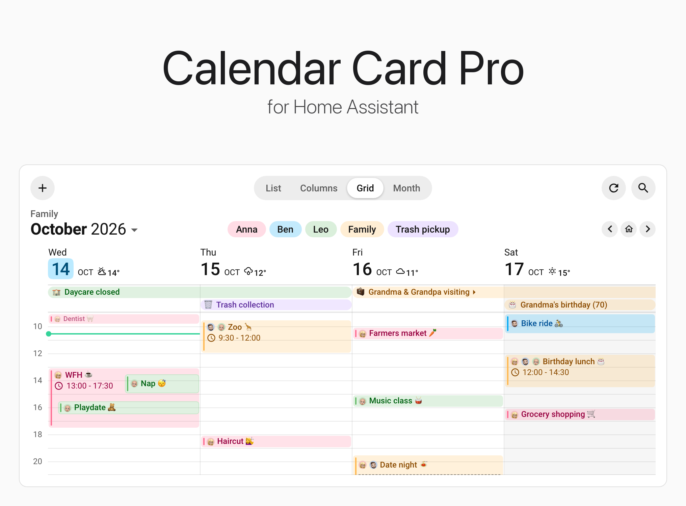

**A calendar card for Home Assistant in four layouts**, from a few lines on a phone to the whole family's week on a wall tablet, set up in the visual editor.

## ☕ Support This Project

If you find **Calendar Card Pro** useful, consider supporting its development:

[](https://www.buymeacoffee.com/alexpfau)
[](https://github.com/sponsors/alexpfau)

<p>&nbsp;</p>

## 🗓️ Every Layout, One Card

The same calendars in every layout. Pick one, or let the [toolbar](https://calendar-card-pro.alexpfau.com/features/header-toolbar) switch between them.

### 📱 On a Narrow Card

One column of a Sections dashboard, or a phone.

<table>
<tr>
<td valign="top" width="50%">
<picture><source media="(prefers-color-scheme: dark)" srcset="https://raw.githubusercontent.com/alexpfau/calendar-card-pro/main/.github/img/showcase_list_narrow_dark.png">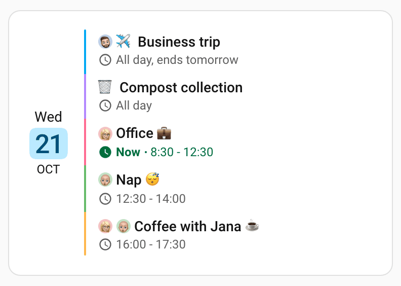</picture><br>
<a href="https://calendar-card-pro.alexpfau.com/features/list-view"><b>List</b></a> · what is next, in a few lines
</td>
<td valign="top" width="50%">
<picture><source media="(prefers-color-scheme: dark)" srcset="https://raw.githubusercontent.com/alexpfau/calendar-card-pro/main/.github/img/showcase_list_toolbar_narrow_dark.png">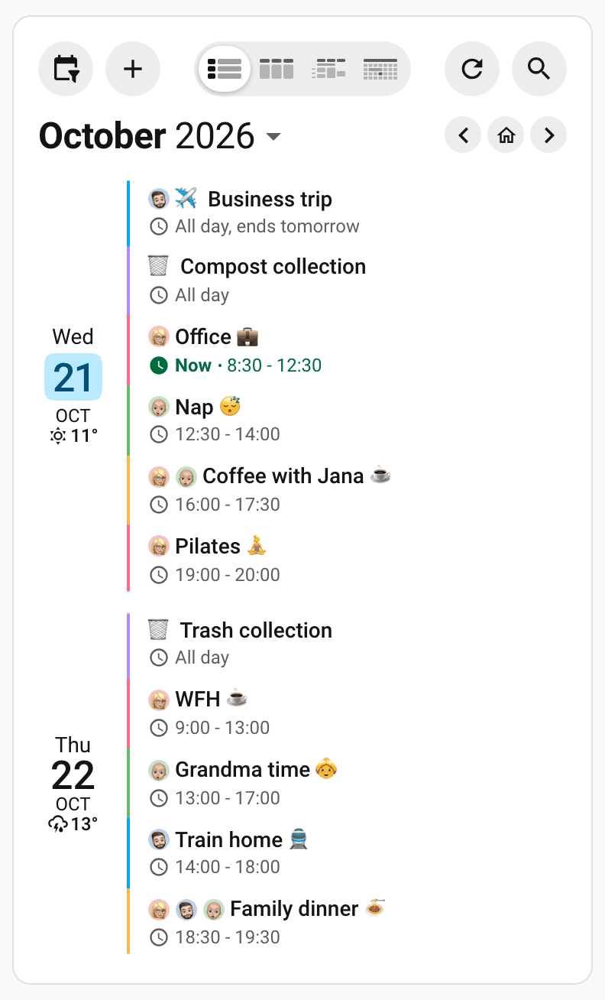</picture><br>
<a href="https://calendar-card-pro.alexpfau.com/features/header-toolbar"><b>List with the toolbar</b></a> · page through the days
</td>
</tr>
<tr>
<td valign="top" width="50%">
<picture><source media="(prefers-color-scheme: dark)" srcset="https://raw.githubusercontent.com/alexpfau/calendar-card-pro/main/.github/img/showcase_grid_narrow_dark.png">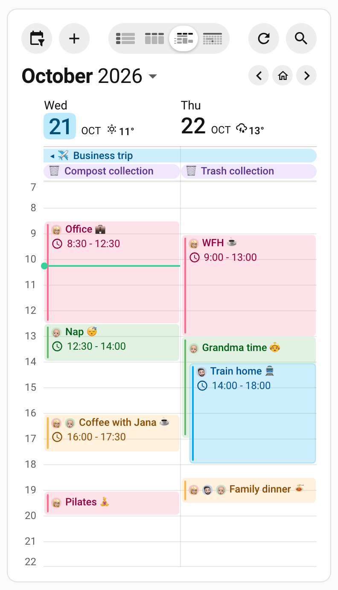</picture><br>
<a href="https://calendar-card-pro.alexpfau.com/features/grid-view"><b>Grid</b></a> · the day on an hour axis
</td>
<td valign="top" width="50%">
<picture><source media="(prefers-color-scheme: dark)" srcset="https://raw.githubusercontent.com/alexpfau/calendar-card-pro/main/.github/img/showcase_month_narrow_dark.png">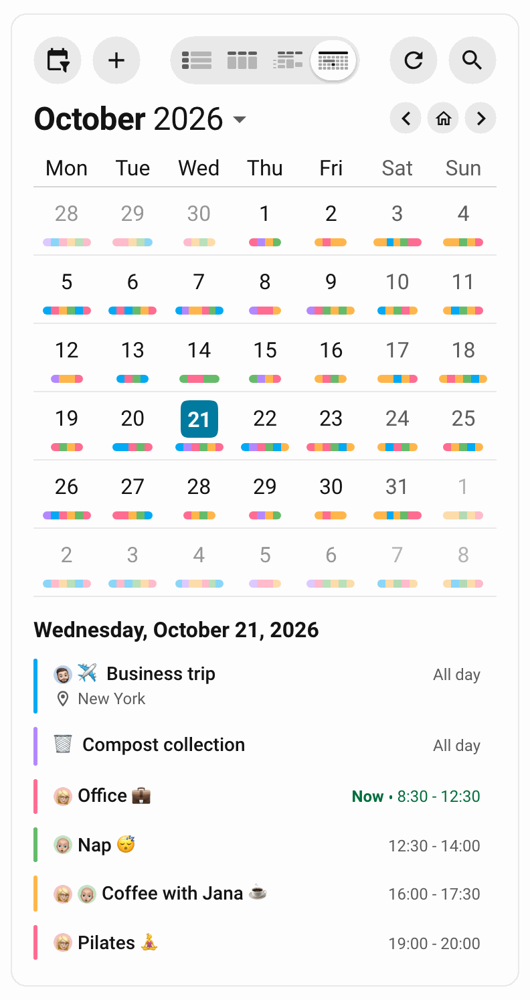</picture><br>
<a href="https://calendar-card-pro.alexpfau.com/features/month-view#the-narrow-month"><b>Month</b></a> · the month, and the day beneath
</td>
</tr>
</table>

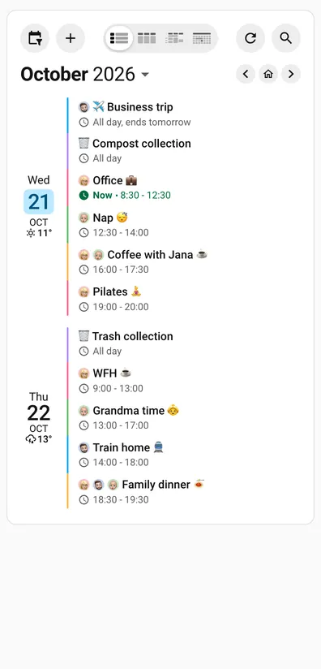

### 🖥️ On a Wide Card

Two columns, a full-width section or a wall tablet.

<p>
<picture><source media="(prefers-color-scheme: dark)" srcset="https://raw.githubusercontent.com/alexpfau/calendar-card-pro/main/.github/img/showcase_columns_medium_dark.png">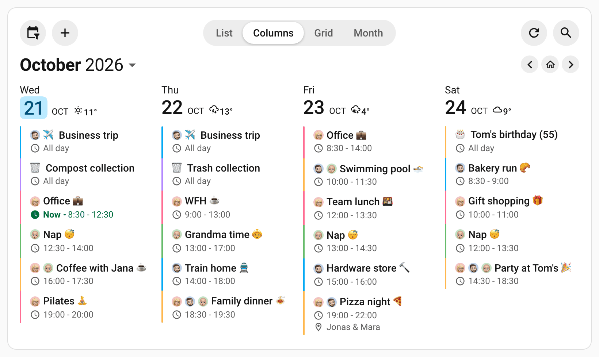</picture><br>
<a href="https://calendar-card-pro.alexpfau.com/features/column-view"><b>Columns</b></a> · the days side by side
</p>

<p>
<picture><source media="(prefers-color-scheme: dark)" srcset="https://raw.githubusercontent.com/alexpfau/calendar-card-pro/main/.github/img/showcase_grid_wide_dark.png">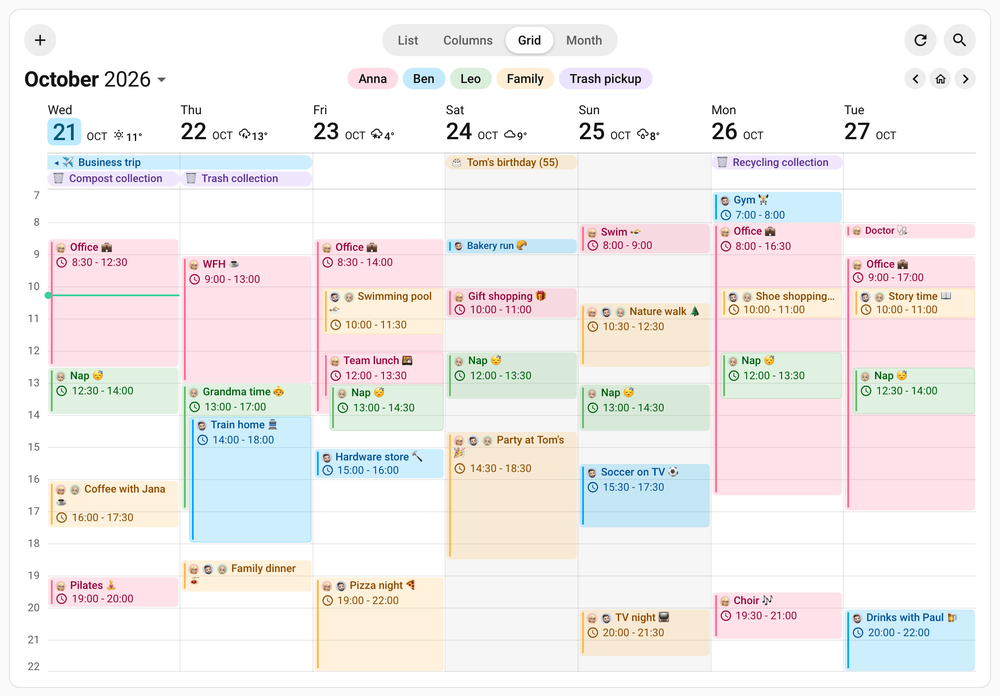</picture><br>
<a href="https://calendar-card-pro.alexpfau.com/features/grid-view"><b>Grid</b></a> · a family's week, hour by hour
</p>

<p>
<picture><source media="(prefers-color-scheme: dark)" srcset="https://raw.githubusercontent.com/alexpfau/calendar-card-pro/main/.github/img/showcase_month_wide_dark.png">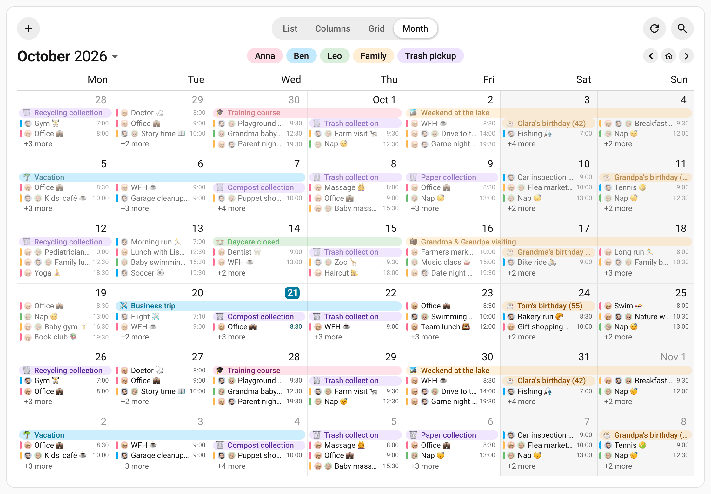</picture><br>
<a href="https://calendar-card-pro.alexpfau.com/features/month-view"><b>Month</b></a> · six weeks at a glance
</p>

<a href="https://calendar-card-pro.alexpfau.com/#see-it-move">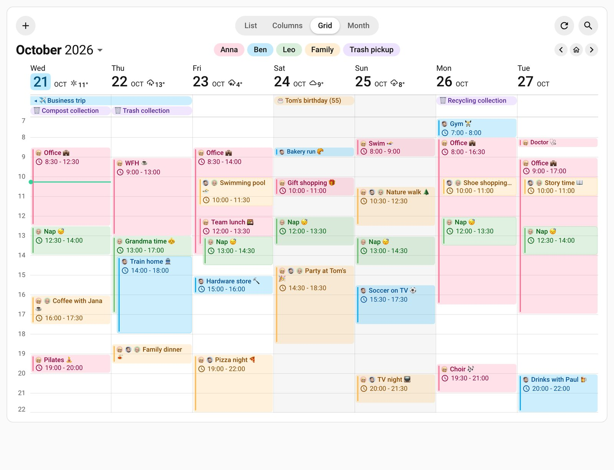</a>

**▶️ [Watch the 30-second tour](https://calendar-card-pro.alexpfau.com/#see-it-move)** on the documentation site.

<p align="right"><a href="#top">⬆️ back to top</a></p>

## 🎬 Video Review

[](https://youtu.be/ptXdis8WHXo)

Smart-Live has the exclusive first video review of v5, in German: [Calendar Card Pro 5: Endlich ZEITRASTER für deinen Familienkalender in Home Assistant](https://youtu.be/ptXdis8WHXo)

<p>&nbsp;</p>

## 📖 Documentation

[](https://calendar-card-pro.alexpfau.com)

Every option, feature and worked example lives on the searchable **[documentation site](https://calendar-card-pro.alexpfau.com)**.

- 🚀 [Installation](https://calendar-card-pro.alexpfau.com/guide/installation) — set the card up through the Marketplace, HACS or manually
- 📌 [Usage](https://calendar-card-pro.alexpfau.com/guide/usage) — add the card and configure it visually
- ✨ [Features & Configuration](https://calendar-card-pro.alexpfau.com/features/) — layouts, the toolbar, weather, actions, theming and more
- 📚 [Configuration Options](https://calendar-card-pro.alexpfau.com/reference/configuration) — complete reference for every option
- 💡 [Example Stories](https://calendar-card-pro.alexpfau.com/reference/examples) — complete cards for real setups, ready to copy
- 🆕 [Release Notes](https://calendar-card-pro.alexpfau.com/RELEASE_NOTES) — full history of every release

<p>&nbsp;</p>

## 1️⃣ Overview

### 🔍 About

**Calendar Card Pro** was inspired by a beautiful [calendar design using button-card and Hass calendar add-on](https://community.home-assistant.io/t/calendar-add-on-some-calendar-designs/385790) shared in the Home Assistant community. While the original design was visually stunning, implementing it with **button-card** and **card-mod** led to **performance issues**.

This motivated me to build a **dedicated calendar card**, fast by design. It has since grown from an event list into a calendar you can work with right on the dashboard.

### ✨ Features

- 🗓️ **[Four Layouts](https://calendar-card-pro.alexpfau.com/features/layouts)** – An agenda, the [days side by side](https://calendar-card-pro.alexpfau.com/features/column-view), [hour by hour](https://calendar-card-pro.alexpfau.com/features/grid-view), or [the whole month](https://calendar-card-pro.alexpfau.com/features/month-view).
- 🧰 **A Toolbar on the Card** – [Page through the dates, switch layouts and show or hide calendars](https://calendar-card-pro.alexpfau.com/features/header-toolbar).
- ✏️ **Add & Edit Events** – Right on the card, in [its own event popover](https://calendar-card-pro.alexpfau.com/features/actions#the-event-popover), as far as each calendar allows.
- ✅ **Many Calendars, One Card** – Each with its own color, label or [a person's photo](https://calendar-card-pro.alexpfau.com/features/core-settings#showing-a-persons-picture), and its own filters.
- ⚙️ **Visual Editor** – Set the card up in the UI, with a [search box](https://calendar-card-pro.alexpfau.com/features/editor#search) for any setting.
- 🌦️ **Weather** – [Forecasts](https://calendar-card-pro.alexpfau.com/features/weather) beside the date or each event.
- 🎨 **Fits Your Theme** – Follows your theme's colors, with [custom properties](https://calendar-card-pro.alexpfau.com/features/theming) for finer styling.
- ⚡ **Optimized Performance** – Cached events on screen the moment a dashboard opens.
- 🌍 **Multi-Language Support** – [Available in 39 languages](https://calendar-card-pro.alexpfau.com/contributing#adding-translations), with the visual editor in 13. Community contributions welcome!

### 🔗 Requirements

**Calendar Card Pro** needs at least one **calendar entity** in Home Assistant, from any integration that creates `calendar.*` entities, such as Local Calendar, Google Calendar or CalDAV. Whether you can add, edit and delete events from the card depends on the calendar's integration and on the event itself; [Editing & Deleting Events](https://calendar-card-pro.alexpfau.com/features/actions#editing-deleting-events) has the details.

<p align="right"><a href="#top">⬆️ back to top</a></p>

## 2️⃣ Installation

### 🛒 Marketplace Installation (Recommended)

From Home Assistant 2026.11, HACS ships with Home Assistant as the **Marketplace**.

1. Open **Settings → Marketplace** and search for **Calendar Card Pro**.
2. Open it and select **Install**.
3. **Reload** Home Assistant in your browser, and clear the browser cache if an older version still shows.

Coming from v5? Read [Upgrading & Going Back](https://calendar-card-pro.alexpfau.com/guide/upgrading) first.

### 📦 HACS Installation

On Home Assistant 2026.10 or earlier, install the card through **[HACS (Home Assistant Community Store)](https://hacs.xyz/)**. It is listed in the HACS default repositories, so there is no custom repository to add.

[](https://my.home-assistant.io/redirect/hacs_repository/?owner=alexpfau&repository=calendar-card-pro&category=plugin)

#### Steps:

1. Ensure **[HACS](https://hacs.xyz/docs/use/download/download/)** is installed in Home Assistant.
2. Open **HACS** and search for **Calendar Card Pro**, or use the button above.
3. Open it and select **Download**.
4. **Reload** Home Assistant in your browser, and clear the browser cache if an older version still shows.

### 📂 Manual Installation

<details>
<summary>📖 Click to expand manual installation instructions</summary>

#### Steps:

1. **Download** both files from the latest release:  
   👉 [calendar-card-pro.js](https://github.com/alexpfau/calendar-card-pro/releases/latest/download/calendar-card-pro.js)
   and [editor.js](https://github.com/alexpfau/calendar-card-pro/releases/latest/download/editor.js)

   If you use the visual editor in German, Estonian, Italian, Japanese, Korean, Latvian,
   Lithuanian, Norwegian, Polish, Slovak or Swedish, also download that language's file from the
   [latest release](https://github.com/alexpfau/calendar-card-pro/releases/latest), such as
   `editor-de.js` for German. In any other language the editor is in English.

2. **Put the files** into a folder of their own: in the folder that holds `configuration.yaml`,
   create `www/calendar-card-pro/` and copy them there. If you just created `www`, restart Home
   Assistant once; it serves that folder only if it was there at startup.

   The card is `calendar-card-pro.js`, and its visual editor is `editor.js`, plus a file per
   editor language. All of them must sit in the same folder, and `calendar-card-pro.js` is
   the only one you name as a resource — the card loads the editor itself, when you open it,
   and the editor loads its language. Without a language's file the editor opens in English.
   Use a subfolder rather than `/config/www/` directly: that folder is shared by every
   hand-installed card, and `editor.js` is a common enough name that another file can take
   it. The Marketplace and HACS do all of this for you, which is why they are the recommended route.

3. **Add the resource:** open **Settings → Dashboards**, choose **Resources** in the ⋮ menu at
   the top right, then **Add resource**. Enter the URL
   `/local/calendar-card-pro/calendar-card-pro.js` and choose **JavaScript module**.

   If your resources are in YAML (`resource_mode: yaml`), list it there instead:

   ```yaml
   url: /local/calendar-card-pro/calendar-card-pro.js
   type: module
   ```

4. **Refresh** your browser. After a later update, clear its cache as well, or the old version can stay loaded.

</details>

<p align="right"><a href="#top">⬆️ back to top</a></p>

## 3️⃣ Add the Card

Add the card from your dashboard's **➕ Add Card** picker: on the **By card** tab, search for
`"Calendar"` and pick Calendar Card Pro. Its visual editor opens with **Quick Setup**, which asks a
few questions and builds one of the [Example Stories](https://calendar-card-pro.alexpfau.com/reference/examples)
on your own calendars. To change the card later, edit the dashboard and choose the card's **Edit**.

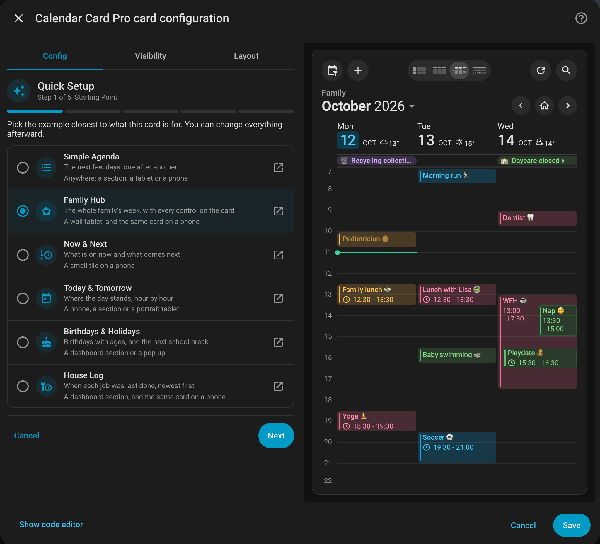

> **Shortcut (Home Assistant 2026.6+):** In the card picker, on the **By entity** tab, pick any `calendar.*` entity. Calendar Card Pro is offered under **Community**, already pointed at that calendar and previewed with its real events, and goes straight on the dashboard.

<details>
<summary>📄 Prefer YAML? A complete, working configuration</summary>

```yaml
type: custom:calendar-card-pro
entities:
  - calendar.family
days_to_show: 3
show_location: false
show_month: false
```

Swap `calendar.family` for one of your own `calendar.*` entities and you have a working card.

</details>

**➡️ Next, copy a complete card from the [Example Stories](https://calendar-card-pro.alexpfau.com/reference/examples), or look up any option in the [Configuration reference](https://calendar-card-pro.alexpfau.com/reference/configuration).**

<p align="right"><a href="#top">⬆️ back to top</a></p>

## 4️⃣ What's New

**➡️ View the [Full Release Notes](https://calendar-card-pro.alexpfau.com/RELEASE_NOTES) for a complete list of features.**

### Latest Release: v6.1

- 🖥️ **The Card, Full Size**: [`tap_action: { action: overlay }`](https://calendar-card-pro.alexpfau.com/features/actions#opening-the-card-full-size) or the toolbar's [Open Full Size button](https://calendar-card-pro.alexpfau.com/features/header-toolbar#opening-the-card-full-size) opens a small card full size over the dashboard, in Grid on a week where it fits, with every layout a press away
- ⏩ **Month Shows the Coming Weeks**: [`month: { start: week }`](https://calendar-card-pro.alexpfau.com/features/month-view#the-coming-weeks) starts Month on this week rather than the week of the 1st, for as many weeks as you choose
- 📏 **A Height for a Compact List**: [`compact_card_height`](https://calendar-card-pro.alexpfau.com/features/list-view#compact-expanded-heights) keeps a folded list card at a size of its own, and lets it fill the screen once expanded
- 🏷️ **Larger Pictures & Labels of Several Parts**: [`label_image_size`](https://calendar-card-pro.alexpfau.com/features/core-settings#sizing-a-picture-label) draws a face larger, and [`label` as a list](https://calendar-card-pro.alexpfau.com/features/core-settings#combining-a-picture-an-icon-text) puts a face and an icon before one event
- 👆 **A Tap on a Day Runs Your Own Action**: [`day_tap_action`](https://calendar-card-pro.alexpfau.com/features/actions#running-another-action-from-a-day) takes Home Assistant's own actions, with the day you tapped filled in. ⚠️ A `day_tap_action` that already held one now runs it

### v6.0

<picture><source media="(prefers-color-scheme: dark)" srcset="https://raw.githubusercontent.com/alexpfau/calendar-card-pro/main/.github/img/showcase_month_wide_dark.png"></picture>

- 📅 **Month View**: [`view: month`](https://calendar-card-pro.alexpfau.com/features/month-view) lays the card out as a wall calendar, six weeks with every event on its day, and on a phone draws [a narrow month](https://calendar-card-pro.alexpfau.com/features/month-view#the-narrow-month) with the chosen day's events underneath
- ✏️ **A Rebuilt Visual Editor**: An [overview of the card](https://calendar-card-pro.alexpfau.com/features/editor#the-overview) with pages for each layout, every setting in words, [search](https://calendar-card-pro.alexpfau.com/features/editor#search) across all of them, [Pick From Preview](https://calendar-card-pro.alexpfau.com/features/editor#pick-from-preview), and [Undo & Redo](https://calendar-card-pro.alexpfau.com/features/editor#undo-redo)
- 🔒 **Private Calendars**: [`private: true`](https://calendar-card-pro.alexpfau.com/features/core-settings#keeping-a-calendar-private) shows when a calendar's events are, and nothing they say
- 🌦️ **Weather & Height Per Layout**: One [`weather_entity`](https://calendar-card-pro.alexpfau.com/features/weather#weather-per-layout) with each layout choosing where it shows the forecast, and one [`card_height`](https://calendar-card-pro.alexpfau.com/features/layout-appearance#card-dimensions-scrolling) for the whole card in every layout
- 🕓 **Events That Start at Certain Hours**: [`starts_after` and `starts_before`](https://calendar-card-pro.alexpfau.com/features/filtering#showing-events-that-start-at-certain-hours) keep only a calendar's timed events that start within those hours
- ⚠️ **A Tap on an Event Opens It**: In every layout, and the popover shows a location or description a calendar hides; `private: true` keeps them off the card, `event_tap_action: { action: none }` keeps a card as it was, and [Upgrading & Going Back](https://calendar-card-pro.alexpfau.com/guide/upgrading) lists every change to existing cards
- 🐛 **Muted Colors Keep Their Hue in Chrome & Edge**: Text in a muted calendar color, as grid view draws its events, the all-day badge's wash and a muted today tile no longer turn pink or mauve there

### v5.3

<picture><source media="(prefers-color-scheme: dark)" srcset="https://raw.githubusercontent.com/alexpfau/calendar-card-pro/main/.github/img/example_visibility_two_people_dark.png">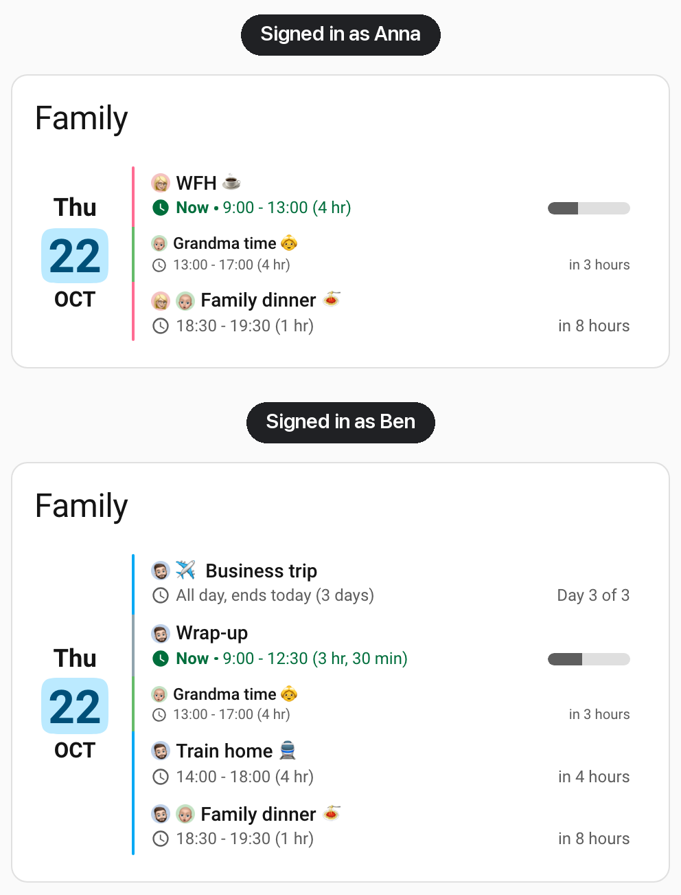</picture>

- 👥 **Each Calendar for the Right People**: [`visibility` on a calendar](https://calendar-card-pro.alexpfau.com/features/core-settings#showing-a-calendar-under-conditions) shows it only while Home Assistant's own conditions hold, so one card can show each person their own calendars
- 📜 **Calendars Kept as Logs**: With `show_countdown` on, a finished event says [how long ago it ended](https://calendar-card-pro.alexpfau.com/features/event-content#counting-up-from-past-events), [`event_order: latest_first`](https://calendar-card-pro.alexpfau.com/features/list-view#event-order) puts the newest entry on top, and the [House Log](https://calendar-card-pro.alexpfau.com/guide/house-log) story puts the two together
- ⏳ **Countdowns That Say What You Need**: Count [in days](https://calendar-card-pro.alexpfau.com/features/event-content#counting-in-days), only [as an event draws near](https://calendar-card-pro.alexpfau.com/features/event-content#countdown-range) and [once per day](https://calendar-card-pro.alexpfau.com/features/event-content#repeated-countdowns), and [`show_duration`](https://calendar-card-pro.alexpfau.com/features/event-content#event-duration) says how long each event lasts
- 🔉 **A Quieter Calendar**: [`text_scale`](https://calendar-card-pro.alexpfau.com/features/core-settings#scaling-one-calendars-text) draws one calendar's events smaller, and [`show_weather: false`](https://calendar-card-pro.alexpfau.com/features/weather#turning-weather-off-for-one-calendar) leaves the weather out beside them
- ⚠️ **Long Events Drawn for How Long They Are**: An event that runs a full day or longer into a second date [no longer shows "Now"](https://calendar-card-pro.alexpfau.com/features/multi-day-events#day-counter) and reads "Day 2 of 3" with `show_progress_bar` on, and grid view draws a long timed one as [one banner above the hours](https://calendar-card-pro.alexpfau.com/features/grid-view#long-timed-events-as-banners) by default; the [release notes](https://calendar-card-pro.alexpfau.com/RELEASE_NOTES) list every change to existing cards
- 🐛 **Event Text Is Back on Older iPhones & iPads**: Since v5.2, Safari 15.4 to 16.x drew the dates but no event text, in every view; it draws it again, on [every supported browser](https://calendar-card-pro.alexpfau.com/guide/installation#browser-support)
- 🐛 **A Restart No Longer Freezes the Dashboard**: A card taking its colors from Home Assistant could freeze the browser tab for good when it appeared while Home Assistant was restarting; it now waits and tries again

### v5.2

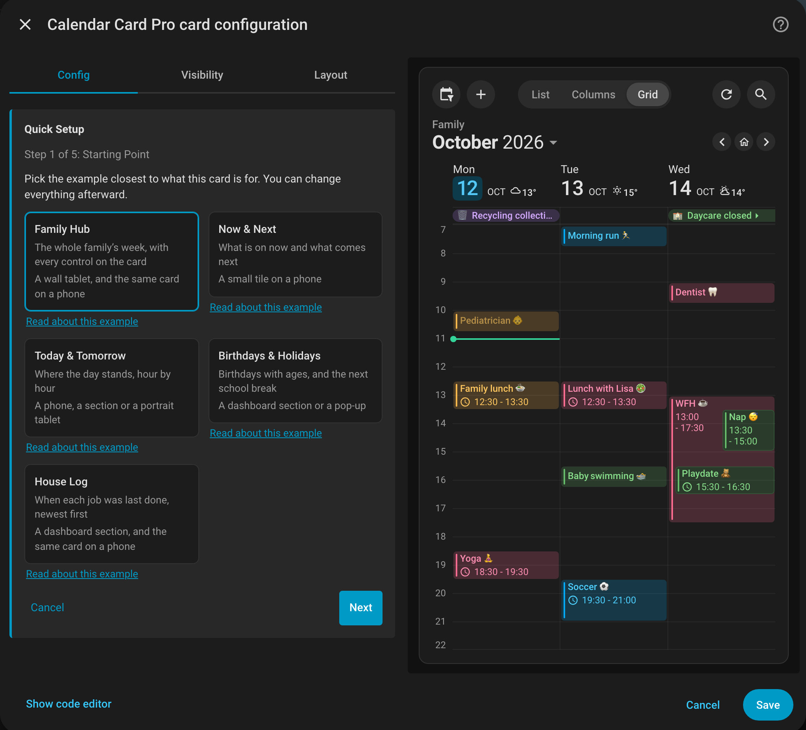

- 🪄 **Quick Setup**: [Start a card from an Example Story](https://calendar-card-pro.alexpfau.com/features/editor#quick-setup) on your own calendars by answering a few questions, and [Essentials Only](https://calendar-card-pro.alexpfau.com/features/editor#essentials-only) cuts the editor down to the settings most cards need
- 👁️ **A Calendar Filter That Does More**: [Show all and Hide all](https://calendar-card-pro.alexpfau.com/features/header-toolbar#showing-hiding-calendars) head the filter's menu, and [`show_in_legend: false`](https://calendar-card-pro.alexpfau.com/features/header-toolbar#leaving-a-calendar-out-of-the-filter) leaves a calendar out of it
- ⚠️ **Titles Beside the Time Wrap**: A long title beside the time ([`time_position: title`](https://calendar-card-pro.alexpfau.com/features/event-content#time-beside-the-title)) now wraps instead of scrolling; `title_max_lines: 1` keeps it on one line
- 🐛 **Dates & Scripts in Every Language**: The end of a multi-day event reads the way each language writes a date, which changes it in 36 of the card's 38 languages, and Thai, Vietnamese and other scripts no longer lose the marks above and below their letters in events, chips and the month
- 🐛 **Older iPhones & iPads**: Safari 16.4 and 16.5 no longer crash on a tinted event, and Safari before 16.2 draws the colors it had lost; [Browser Support](https://calendar-card-pro.alexpfau.com/guide/installation#browser-support) says which versions run the card

_Older releases are covered in the [Full Release Notes](https://calendar-card-pro.alexpfau.com/RELEASE_NOTES)._

<p align="right"><a href="#top">⬆️ back to top</a></p>

## 5️⃣ Contributing

Want to improve **Calendar Card Pro**? Contributions of all kinds are welcome, from bug fixes
and translations to new features. Pull requests go against the `dev` branch.

- 📋 [Contributing guide](https://calendar-card-pro.alexpfau.com/contributing) — setup, workflow, coding standards, and how to add a translation
- 🏗️ [Architecture documentation](https://calendar-card-pro.alexpfau.com/architecture) — module responsibilities, data flow, and performance design
- 🌍 **Adding a translation?** The card speaks [39 languages](https://calendar-card-pro.alexpfau.com/contributing#adding-translations) and the visual editor 13 — new ones are always welcome.
- 🐛 **Found a bug or have an idea?** [Open an issue](https://github.com/alexpfau/calendar-card-pro/issues/new/choose).
- 💬 **Questions?** Ask in the [community forum thread](https://community.home-assistant.io/t/calendar-card-pro-a-beautiful-high-performance-calendar-card-for-home-assistant/863711).

### 🏆 Acknowledgments

- **Original design inspiration** from [Calendar Add-on & Calendar Designs](https://community.home-assistant.io/t/calendar-add-on-some-calendar-designs/385790) by **[@kdw2060](https://github.com/kdw2060)**.

Calendar Card Pro is released under the [MIT License](./LICENSE). Full third-party attributions, including Home Assistant's Tile Card and Google's Material ripple, are listed in [NOTICE](./NOTICE).

<p align="right"><a href="#top">⬆️ back to top</a></p>

 <!--Badges-->

[hacs-img]: https://img.shields.io/badge/HACS-Default-41BDF5.svg
[hacs-url]: https://my.home-assistant.io/redirect/hacs_repository/?owner=alexpfau&repository=calendar-card-pro&category=plugin
[github-release-img]: https://img.shields.io/github/release/alexpfau/calendar-card-pro.svg
[github-downloads-img]: https://img.shields.io/github/downloads/alexpfau/calendar-card-pro/total.svg
[github-latest-downloads-img]: https://img.shields.io/github/downloads/alexpfau/calendar-card-pro/latest/total.svg
[github-release-url]: https://github.com/alexpfau/calendar-card-pro/releases
[github-latest-url]: https://github.com/alexpfau/calendar-card-pro/releases/latest
