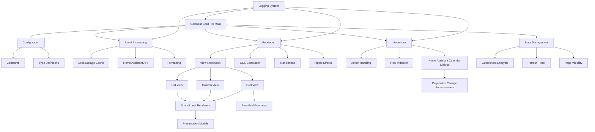

# Calendar Card Pro Architecture

This document provides a high-level overview of the Calendar Card Pro architecture, explaining how different modules work together to create a performant and maintainable calendar card for Home Assistant.

## 🗂️ Directory Structure

```text
src/
├── calendar-card-pro.ts          # Main entry point and component class
├── config/                       # Configuration-related code
│   ├── config.ts                 # DEFAULT_CONFIG and config helpers
│   ├── constants.ts              # Application constants and defaults
│   ├── types.ts                  # TypeScript interface definitions
│   └── view.ts                   # List/Column/Grid blocks, defaults, density, fallback
├── interaction/                  # User interaction handling
│   ├── actions.ts                # Runs the card's tap and hold actions
│   ├── add-event.ts              # Add button: writable calendars, label, start date
│   ├── calendar-changes.ts       # Page-wide announcement after a dialog saves
│   ├── event-details.ts          # Event dialog entry, Edit and Delete permissions
│   ├── feedback.ts               # Hold indicator (the ripple is drawn by render.ts)
│   └── ha-calendar-dialogs.ts    # Loads and opens Home Assistant's calendar dialogs
├── rendering/                    # UI rendering code
│   ├── editor/                   # Schema-driven configuration editor (its own bundle)
│   │   ├── index.ts              # Build entry and public surface of the editor
│   │   ├── element.ts            # The Lit element: lifecycle, forms, editor state
│   │   ├── panels.ts             # Panel registry and schema context
│   │   ├── schemas/              # One module per panel, plus their shared vocabulary
│   │   ├── ha-form.ts            # Our declaration of Home Assistant's schema shape
│   │   ├── value.ts              # Serialization, legacy migration, authored-value retention
│   │   ├── entities.ts           # Write path for the per-calendar list
│   │   ├── exceptions.ts         # Removes stored view overrides for Reset controls
│   │   ├── subforms.ts           # The schemas a panel renders outside its own form
│   │   ├── filter.ts             # Search and "customized only"
│   │   ├── workspace.ts          # Editor-only All Layouts/List/Columns/Grid selection
│   │   ├── routing.ts            # Workspace projections and scope-captured writes
│   │   ├── normalize.ts          # Comparable root and nested form values
│   │   ├── synthetic.ts          # UI-only fields, and values invalid while typed
│   │   ├── localize.ts           # The string hooks `ha-form` calls
│   │   ├── hass-localize.ts      # Wraps hass.localize to name `expand` in HA's action editor
│   │   ├── strings.ts            # English editor strings
│   │   ├── version.ts            # Build-stamped version the editor reports
│   │   ├── translations/         # The same keys per language, partial by design
│   │   └── styles.ts             # Editor chassis CSS
│   ├── render.ts                 # Card shell and the list view
│   ├── toolbar.ts                # Header toolbar and its controls
│   ├── view-pictograms.ts        # The picture of each view, for editor and toolbar
│   ├── activation.ts             # Marks rendered events as tap targets
│   ├── column.ts                 # The column view
│   ├── grid.ts                   # The timed grid and spanning all-day band
│   ├── grid-accessibility.ts     # Full configured names for timed Grid events
│   ├── leaves.ts                 # Leaf renderers shared across the three views
│   ├── presentation.ts           # Layout-independent per-event presentation models
│   ├── accent-text.ts            # The `accent` text sentinel's fields and properties; CSS-free
│   └── styles.ts                 # CSS styles and dynamic styling
├── translations/                 # Localization support
│   ├── dayjs.ts                  # Relative-time localization
│   ├── localize.ts               # Translation functions
│   └── languages/                # Translation files (36 supported languages)
│       ├── en.json               # English translations
│       ├── de.json               # German translations
│       └── ...                   # Other language files
└── utils/                        # Utility functions
    ├── events.ts                 # Calendar event fetching and processing
    ├── grid.ts                   # Pure time-grid geometry, overlap lanes, banner spans
    ├── grid-title-fit.ts         # Browser-measured label/title fitting, separate from geometry
    ├── grid-time-fit.ts          # Measures each grid time row and picks its degradation step
    ├── grid-cascade-threshold.ts # Measured cascade threshold, in minutes, for `utils/grid.ts`
    ├── grid-overflow-strip.ts    # Measured `+N` strip width, as a share of the day column
    ├── format.ts                 # Date and text formatting
    ├── event-age.ts              # The `YEAR=` marker: ages and anniversary counts
    ├── text-replace.ts           # Per-calendar `replace_pattern` / `replace_with`
    ├── start-date.ts             # The `start_date` relative-date grammar
    ├── paging.ts                 # Paging through dates: page length, home, the range's name
    ├── helpers.ts                # Generic utilities (color, ID generation)
    ├── entity-colors.ts          # Calendar colors from HA's entity registry, over WebSocket
    ├── entity-icons.ts           # Calendar icons from entity state, for `label: home-assistant`
    ├── person-pictures.ts        # Person pictures from entity state, for `label: person.*`
    ├── logger.ts                 # Logging system
    ├── templates.ts              # Jinja2 title templates over the HA websocket
    ├── title-motion.ts           # Pure per-title timing and cohort admission state
    ├── title-motion-controller.ts # Visible per-card membership and native clock alignment
    ├── title-words.ts            # Splits grid titles so they wrap only at spaces
    ├── view-choice.ts            # The view switcher's choice, remembered per device
    ├── editor-url.ts             # Where the editor file lives, relative to the card
    ├── weather.ts                # Weather data fetching and processing
    └── weather-i18n.ts           # Condition text in the card's language
```

## 🧭 Three Views, One Agenda

The card renders the same agenda in one of three layouts, and this is the structural fact
most worth holding on to before changing anything under `rendering/`:

- **`view: list`** stacks days vertically, each day a row. This is what the card has
  always done and remains the default.
- **`view: column`** lays days side by side, one column each.
- **`view: grid`** positions timed events against a shared hour axis, with all-day events
  in a separate band above it.

They share the card shell, event pipeline, and presentation models rather than duplicating
the card. `leaves.ts` holds reusable date, event-content, weather, and indicator renderers;
`presentation.ts` computes layout-independent event details. `render.ts`, `column.ts`, and
`grid.ts` arrange those pieces. Grid also uses the pure geometry in `utils/grid.ts` for
wall-clock placement, overlap layout — cascaded by default, side-by-side lanes as an
option — and multi-day banner spans. Two of its inputs depend on pixels, and the card
measures both after a render: how far below an event another must start before it may be
drawn on top, converted to minutes in `utils/grid-cascade-threshold.ts`, and how wide the
`+N` strip must be to hold its count, converted to a share of the day column in
`utils/grid-overflow-strip.ts`. The geometry module itself still knows no pixels.

The effective view can change with available width. A narrower Column or Grid card first
draws fewer days, down to `min_days_to_show`, in a window kept as close to today as the
configured range allows (`visibleDayWindowStart` in `config/view.ts`): it starts at today and
moves back only as far as it must to stay full, and a range wholly in the future or the past
keeps its first or its last days.
Below that floor `min_days_fallback` decides: `list` falls back to List, and `cramp` holds
the floor with days narrower than `min_day_width`. Column simply narrows its columns; Grid
keeps each day at least `2rem` wide and scrolls horizontally. Grid's width calculation also
reserves the hour gutter. `config/view.ts` owns
this resolution and its hysteresis, so resizing does not repeatedly flip layouts at a
boundary. The editor workspace is separate: choosing List exposes its controls without
changing the displayed layout.

## 🧱 Configuration Layers & Editor Adoption

The top level is the shared base. `list:`, `column:`, and `time_grid:` hold presentation
values for their own views; calendars, fetching, language, actions, and other card-wide
options stay at the top level. For a shared view option, both `resolveViewOption` and
`resolveEffectiveConfig` apply the same order: explicit view override, built-in divergent
view default, shared value. List has no divergent defaults. View-only options use their
own block defaults, with permanent root fallback for the legacy List-only options.

The editor exposes four destinations: **All Layouts** writes roots, and **List**,
**Columns**, and **Grid** write their blocks. `workspace.ts` distinguishes the destination
from the view used to build panel structure. All Layouts uses List-shaped panels, but
conditional controls resolve shared values, never `list:` overrides. `routing.ts`
captures the destination with each rendered form so a delayed event cannot write into a
different workspace.

`config_version: 5` records editor adoption; it is not a renderer precedence switch.
`configVersionState` classifies missing or older nonnegative integer markers as legacy,
accepts the current version, and blocks visual-editor writes for future or malformed
versions. It does not coerce a string such as `'5'` into a number.

For an ambiguous legacy List or Grid card, the editor waits for the user's interpretation
of authored divergent roots. **Keep my existing List appearance** moves them into
`list:`; **Use these settings for all layouts** keeps them shared. Both move List-only
roots into `list:`, preserve explicit block values, and stamp the format. Legacy Column,
unambiguous cards, and versionless configurations already carrying `list:` or `time_grid:`
adopt on the first real edit without that prompt. Opening alone emits no configuration.

Authorship is captured from raw input before defaults are merged. Migration uses those raw
values, including `false`, zero, and default-equal values; local editor state is updated
before forms reopen or Home Assistant echoes the save. Serialization retains explicit
divergent shared roots so reopening does not lose a choice that a later Grid transition
must preserve. Implicit defaults remain absent. A transition to Grid may copy those roots
into `time_grid:`; that editor reconciliation does not run when loading YAML.

See [Per-View Options](/features/core-settings#per-view-options) and the
[editor upgrade flow](/features/editor#upgrading-a-card-from-before-v5) for user-facing
examples.

## 📦 Two Files, One Card

The build emits **two** self-contained bundles into a flat `dist/`:
`calendar-card-pro.js` and `editor.js` (`-dev` suffixed in development builds). The card
fetches the editor only when someone opens it, which keeps the editor and all of its
translations off every dashboard load.

Neither file imports the other. The card names the editor through a URL it computes at
runtime (`utils/editor-url.ts`), which is invisible to both module graphs — a plain
dynamic `import()` would make Rollup emit a shared chunk that the editor imports back
from the card, and the query string HACS appends to the card's own URL would make the
browser treat that as a second copy of the card. `npm run check:bundle` asserts the
result after every build.

## 🧰 Header Toolbar

The card's own controls live in a toolbar between the title and the events: the date
navigation, the calendar legend, the view switcher, refresh and the add-event button. The
layout rule is fixed, so a control still to come slots in without moving the ones already
there. `renderHeaderToolbar`
in `rendering/toolbar.ts` draws it, and `renderMainCardStructure` places it.

- **One block configures it.** `toolbar:` holds `show`, the one switch for the bar, and a
  boolean per control. `resolveToolbar` in `config/config.ts` reads it member by member and
  is the only reader, so a malformed value reads as that member's default. `show` defaults
  off; the v5 controls default on inside a shown bar, and a control added later defaults
  off, so a release never adds a control to a toolbar someone already set up: `navigation`,
  `refresh` and `legend` are those. `labels` is not a control and defaults on, which is what the bar has
  always done. Every new control needs a `toolbar → key` row in the reference: `check:docs`
  reconciles the block's defaults against those rows in both directions.

- **It is conditional.** With no control enabled or available there is no toolbar and no
  new DOM: the header renders byte for byte as it did before the toolbar existed. That is
  why the header keeps a single child binding, since a second one, even rendering nothing,
  adds a Lit marker and a text node, and why no default snapshot moved.
- **Groups by purpose, in a fixed order.** The leading group is the dates: previous, home
  and next on one track, then the range on screen, which opens a date picker. The trailing
  group is the view switch, then the commands: refresh, then add, which is always last.
  Refresh sits with add rather than before the switch, because it is a command on the data,
  not a change of layout. The calendar legend is a filter, and gets a lane of its own below
  the bar: one row of chips, which clips rather than scrolls. Where the chips do not fit, the
  legend folds into a button that leads the trailing group, ahead of the switch, and the lane
  goes.
- **Trailing actions alone share the title's row.** With a title, a pending templated
  title included, they sit at the inline end of the title's row inside
  `.header-container`, which becomes a flex row (`.has-toolbar`) so a long title wraps
  beside them rather than pushing them below it, and the card gains no height. Without a
  title they get a slim row of 48px, the bar and a 12px gap under it.
- **The dates make the toolbar a band of its own.** With `navigation` the toolbar is
  `.card-toolbar.toolbar-band`, and `.header-container` gains `.has-band` and wraps, so the
  band takes the row under the title, or is the whole header without one. The dates lead and
  the trailing group keeps to the inline end; where both do not fit, the trailing group wraps
  onto a second row. The range button is as wide as its dates; behind it, in the same grid
  cell, an invisible copy of the widest label a page of its length can have
  (`widestRangeLabel`) keeps that much room, so the band wraps by the card's width and its
  controls, never by the dates on screen, and a press never moves a control. That holds
  because a label names its year at most once, and only where it is not the one assumed. The range can still shrink below that, so on a card too narrow for the dates it is
  cut short rather than pushed past the edge. The range focuses the hidden date input to open
  its picker, because Safari closes a picker only when its input loses focus. A press on the
  range while that picker is showing closes it by taking the focus away, and opens nothing:
  Chrome closes its picker itself and then hands the page the very press that closed it, so
  the card follows the picker from the moment it opens one, until focus leaves the input, a
  day is picked, Escape is pressed, or `:open` turns false, which it checks once a frame. The
  input is exposed to assistive technology only while it holds that focus, and focus goes
  back to the range button when the button had it. The band's 8px
  inline start is the title's margin, so column and grid, which drop that margin, drop it
  too. A view switch is drawn at once: Home Assistant's `ha-card` transitions every
  property, the padding each view sets included, so the card limits it to colors and the
  shadow. Layout is logical throughout, and the arrows are
  mirrored under `:dir(rtl)`, where previous points right.
- **card-mod selectors stay valid.** `.header-container > h1.card-header` and
  `.card-header-placeholder` keep their element, classes and CSS. The toolbar follows them
  inside `.header-container`, so the card's children and the `.header-container` +
  `.content-container` adjacency are unchanged.
- **A control never starts the card's gesture.** Each stops `pointerdown`, which arms the
  card's tap and hold and captures the pointer, and `click`. So does the `.card-toolbar` box
  itself (`renderHeaderToolbar`), because the switcher's gray track and the gaps between
  controls are part of the bar but no button: a near miss there must not run `tap_action`
  or `hold_action`. None stops `keydown`: the card already ignores keys aimed at anything
  but itself, and stopping them would hide them from Home Assistant's own shortcuts.
- **Labels follow the card's width, not the viewport's.** Above a width that depends on
  which controls are drawn (the thresholds are below), a control carries its label beside
  its icon; under it, the icon alone, named by `aria-label`. `labels: false` keeps every control an
  icon at any width. The date navigation carries no labels: its home button is always an
  icon, named by its tooltip, and the range is state rather than a control's name. The width is the card's own
  `ResizeObserver` reading, acted on inside the callback so the first painted frame is
  already right. A container query was rejected: it needs a `container-type` ancestor,
  which could capture the `cqh` units grid view sizes against, and happy-dom cannot
  evaluate one, so it could not be tested.
- **Controls are native, and share one look.** Every control is a `<button>` styled from
  theme variables rather than an `ha-*` element, so the card names no new Home Assistant
  element: a neutral pill on a gray track, the text color washed into the card, with the
  selected view raised out of it. A control under the pointer or pressed takes the card's
  hover color, its accent, laid over the gray, as an untinted event does, and the theme's
  primary color is kept for the focus ring.
  Labels are all or nothing across the bar: from `UI.TOOLBAR_LABEL_MIN_WIDTH` with the add
  button alone, from `UI.TOOLBAR_SWITCHER_LABEL_MIN_WIDTH` (640px) with the switcher, and
  never while Home Assistant offers no words for the add button. The thresholds assume a
  short title; `_syncToolbarLabelFit` reads the render, and if the labeled bar overflows the
  header it draws icons until the card is wider than that or the title, language or controls
  change. It only ever drops labels, so it cannot oscillate. With the date navigation in the
  band, labels start from `UI.TOOLBAR_BAND_LABEL_MIN_WIDTH` (600px), or
  `UI.TOOLBAR_BAND_SWITCHER_LABEL_MIN_WIDTH` (840px) with the switcher, and the same check
  drops them when the labeled trailing group wraps under the dates: a label is not worth a row.
- **The view switcher changes the requested view, never the configuration.** `requestedView`
  is the device's choice, else `view`; the width fit (`_effectiveView`, `_columnCount`)
  always follows it, so nothing about a switch is new to the fitting code. A switch draws
  without fetching, because `FETCH_TIME_KEYS` keep the window identical across views.
  `utils/view-choice.ts` keeps the choice in one `localStorage` entry keyed by a fingerprint
  of the raw configuration, so any edit resets every device. Nothing deletes the old entry:
  Home Assistant builds a fresh card for a changed configuration, in edit mode and when a
  dashboard reloads alike, so no card learns which configuration it replaced. A
  configuration changed back to exactly what it was therefore finds its old choice, which
  the docs state; the oldest entries are pruned past `MAX_VIEW_CHOICES`.
- **Which views it offers is decided at render.** A view is offered when picking it would
  draw it at the settled width: the view on screen always, every other one by
  `resolveColumnFitIfPicked`, which judges it as though it were already on screen. A pick
  gets the hysteresis margin a view on screen keeps; judged by the entry threshold instead,
  a layout the card had been drawing inside the band could not be switched back to. The
  configured view, fallen back to the list there, is judged the same way, and pressing it
  draws it. A picked or remembered view is fitted by the same rule at a card's first
  measurement, when there is no layout yet to keep, so a reload at the width a pick was
  made at draws what was picked. A view that does not fit stays in place,
  dimmed and `aria-disabled`; with fewer than two that fit there is no switcher. A settled
  width that changes the offer without changing the layout still re-renders, and so does
  one that changes only the day columns of the configured view shown while editing.
- **Paging changes the window asked for, never the configuration.** The page is a fixed first
  day (`_pageRequested`), null at home, the window the configuration opens with. It is fetched
  and drawn with the configuration's `start_date` replaced by that day, which keeps every view
  on one window, so a view switch still never fetches, and with `show_past_events` forced on,
  since a page in the past is otherwise empty. Its query identity is that of a card configured
  to open on that day, so two cards on one page share its request. The arrows step by the days
  on screen (`pageSpan`): `days_to_show`, or the columns drawn while column or grid drops some,
  in which case a page draws from its own first day rather than from today. Presses accumulate
  on the requested page; the range answers at once, while the days below stay those of the page
  whose events `events` holds (`_pageShown`), dimmed, until the new page's land, so one
  window's events are never drawn under another's dates. The request generation discards the
  responses of pages passed by.
- **Paged windows never touch `localStorage`.** They live in a bounded in-memory store in
  `utils/events.ts`, shared by every card on the page, so a tablet paging all week leaves
  nothing in a store it shares with Home Assistant. An entry fetched before a calendar write is
  dropped on read, by the write generation that already lives on `globalThis`. Home stays on
  disk, and a card that heard of a write while away fetches home on the way back
  (`_homeStale`).
- **Nothing remembers a page.** A reload, any change to the configuration and the start of
  editing all bring the card home, where `hide_when_empty` alone acts: a card that hid itself
  on an empty page would take the way back with it.
- **Editing shows `view` and touches nothing.** In preview and edit mode `effectiveView` is
  the configured view, the switcher marks it and ignores presses, and when the device's
  choice differs the shown day count is fitted for display alone, so a width measured while
  editing cannot overwrite the dashboard's fit.
- **The card stops being a button while it hosts controls, and stays focusable.**
  `_hostsControls` answers this once, for toolbar controls and tappable events alike, from
  what the render draws: a toolbar control, or at least one event that is a tap target, which
  the loading line, an error and days holding only empty-day placeholders are not
  (`drawsEvent` in `rendering/render.ts`, with `gridDrawsEvent` for grid view). `ha-card`
  then drops `role="button"`, because a button may not contain another, but keeps
  `tabindex="0"` while it has a `tap_action`: with the card itself focused, Enter and Space
  still run it, since `_handleKeyDown` leaves keys aimed at a child to the child. The
  ripple and the pointer `tap_action` stay too.
- **The legend filters what is drawn, never what is loaded.** The hidden calendars are a set
  of entity ids, replaced rather than changed in place, and `_shownEvents` is `events` without
  theirs, memoized on the events, that set and whether the card is being edited, which shows
  every calendar. `groupedEvents`, `visibleEventCount` and the now-boundary timer read it, so
  expiry, `days_of_week`, which copy of a duplicate wins, the compact limits and the empty days
  all see only the calendars shown, and a hidden calendar's merged row falls to the next one
  shown. The cache, the page store, the request identity and the failure notice stay on
  `events`, so a press fetches nothing. The set is remembered beside the switcher's view, in the
  same `utils/view-choice.ts` entry, still version 1, and read for its own control: a card with a
  legend and no switcher remembers too. `hide_when_empty` acts only while nothing is hidden,
  for the reason a page away from home never hides: the card would take the way back with it.
- **The legend folds by measurement, never inside a resize.** `_syncLegendFit` reads the chips'
  natural width against the lane's; when they overflow it the card records what they were drawn
  with and the card width from which they fit by `UI.LEGEND_UNFOLD_MARGIN`, and draws the
  button until then. After a render it only folds, at the width the legend was last judged at,
  before anything is painted. A width change is judged a frame later (`_scheduleLegendFit`),
  from a width only that pass moves (`_legendWidthPx`), so no render the resize observer causes
  folds or unfolds it: either changes the card's height, and a height changed while the browser
  delivers resize observations is logged as an error. For the same reason the header beside a
  title is a two-column grid while it carries the lane rather than a wrapping row, which would
  drop a still-labeled bar under the title for a frame. An unfold that still overflows folds
  again from a wider width, so the two cannot alternate.
- **The legend's menu is a modal `<dialog>` with one controller.** `showModal()` reaches the
  top layer, past `ha-card`'s `overflow: hidden`, in every browser Home Assistant serves; the
  popover API would need iOS 17 and Chrome 114. Because a modal makes the rest of the page
  inert, every way it ends goes through `closeMenu` in `rendering/legend.ts`, and the card
  closes it before anything takes its button away: in `willUpdate` before a render that unfolds
  the legend, drops it or starts editing, in `_applyVisibility` before the card hides, and on
  disconnect. `placeMenu` is pure: inline end on the button's by the card's direction, inside
  the viewport, below or above by room.
- **Refresh has one guarded entry point.** The button and the `refresh` card action both call
  `_requestRefresh`, which does nothing while a load is under way and otherwise calls
  `refreshEvents`. The guard is not inside `refreshEvents`, which a calendar write must still be
  able to force. The button is inert while editing like every toolbar control; the action runs
  wherever the card's tap and hold actions do.
- **Weather is deliberately not a toolbar control.** The toolbar holds things the card
  does. A current-weather readout is content, and if it is built it belongs beside today's
  own date.
- **The fetch-failure notice stays where it was**, after the content.

## 🧩 Module Responsibilities

### Main Component (`calendar-card-pro.ts`)

The main entry point serves as the orchestrator for the entire card:

- **Web Component Registration**: Defines the custom element using `@customElement` decorator
- **Lifecycle Management**: Handles component connection, disconnection, and updates
- **Property Definition**: Defines reactive properties via LitElement's `@property` decorator
- **State Management**: Manages loading state, expanded state, and events data
- **Event Handling**: Runs the one gesture recognizer for card taps, event taps, holds and
  keys (see _Interaction Flow_)
- **Write Coordination**: Opens Home Assistant's calendar dialogs, refetches after a save,
  and listens for other cards' change announcements
- **Configuration Processing**: Handles config updates from Home Assistant
- **Rendering Coordination**: Builds the component's DOM structure
- **Timers**: Arms the refresh timer for the deadline of the data on screen, and reconciles
  three display timers in `updated()` against what the render draws — the grid now line,
  local midnight, and the next event boundary (see _Refresh Mechanisms_).
  `disconnectedCallback` stops all four
  Key design patterns:

- Uses [LitElement](https://lit.dev/) for efficient DOM updates and property management
- Follows Home Assistant's component conventions for seamless integration
- Implements computed properties via getters for derived state

### Configuration (`config/`)

Manages all configuration aspects of the card:

- **config.ts**:
  - Defines default configuration (`DEFAULT_CONFIG`)
  - Classifies configuration-format markers for safe editor adoption
  - Provides helper functions for normalizing entity configurations
  - Detects configuration changes that require data refresh
  - Lists the options read at processing time (`PROCESSING_TIME_KEYS`), so a card-level
    change to one reprocesses the cached events through `hasEntityProcessingChanged`
  - Reads the `toolbar:` block member by member (`resolveToolbar`), its only reader
  - Folds an unusable icon size, font size or accent bar width to its shipped default
    (`FOLDED_OPTIONS`, judged by `toValidSize`, `toValidFontSize` and `toValidBarWidth`)
  - Reports keys removed in v3.0.0 from the raw configuration (`findDeprecatedKeys`)
  - Generates stub configurations for the card editor

- **constants.ts**:
  - Defines global constants organized by category
  - Sets default values and timing parameters
  - Centralizes cache-related settings

- **types.ts**:
  - Defines TypeScript interfaces for all component parts
  - Documents config properties and their purposes
  - Provides type safety throughout the application

- **view.ts**:
  - Resolves List, Column, and Grid values from view overrides, divergent defaults, and
    the shared base
  - Owns which options may be overridden per view, and which may not — anything deciding
    _which_ events are fetched has to hold one value across layouts, because the card
    switches between them as the dashboard resizes
  - Computes the width thresholds at which side-by-side layouts engage, and the hysteresis
    that stops it oscillating at the boundary
  - Picks which days stay when fewer fit (`visibleDayWindowStart`): from today, reaching
    back only to keep the window full, or the range's first or last days when today lies
    outside it
  - Decides whether `event_gap` draws a gap at all (`hasEventGap`)
  - Validates all three view blocks and reports unusable keys

### Interaction (`interaction/`)

Handles all user interaction with the card. The card never writes a calendar itself: adding,
viewing, editing and deleting all happen in Home Assistant's own dialogs, so the forms,
validation, recurrence and service calls stay Home Assistant's. `add-event.ts` and
`event-details.ts` decide what goes into a dialog and hold no side effects;
`ha-calendar-dialogs.ts` is the only module that opens one.

- **actions.ts**:
  - Runs `tap_action` and `hold_action`, for the card
  - Does nothing for a missing action or `none`, handles the card's own `expand`, and
    forwards everything else to Home Assistant as a `hass-action` event naming the card's
    first calendar as the entity
  - Not `event_tap_action`, which does one thing: with `details`, the card opens the tapped
    event's details itself. It reads any other value as `none`, so it forwards nothing
    for an event

- **ha-calendar-dialogs.ts**:
  - Gets Home Assistant's `dialog-calendar-event-editor` and `dialog-calendar-event-detail`
    defined and opens them. It is the one module that reaches into Home Assistant's
    frontend internals
  - The dialogs live in a lazily loaded chunk whose file name is a build hash, so the card
    borrows its import. It creates a core calendar card through
    `window.loadCardHelpers()`, which defines `ha-full-calendar`, then calls that element's
    private `_createEvent` or `_handleEventClick` on a stand-in that records the
    `show-dialog` event instead of dispatching it, awaits whatever the handler returns, so
    an asynchronous handler and its rejection are both handled, and runs the captured
    `dialogImport`. Nothing else is taken from the borrow: the card dispatches its own
    `show-dialog` with its own parameters
  - Keeps one load in flight per element for the whole page, bounded by
    `LOAD_TIMEOUT_MS`, and one waiting request for both dialogs. A press made while a dialog
    loads replaces any older waiting request, for either dialog, so one dialog opens: the
    newest, with its parameters
  - Checks every step and falls back on any mismatch or timeout: details to
    `hass-more-info` for the event's calendar, which keeps the user on the dashboard, and
    add to the `/calendar` panel. The card asks Home Assistant to navigate there with a
    `hass-action` carrying a `navigate` action, as `actions.ts` does for a configured one,
    so Home Assistant's own navigation runs: it closes open dialogs and lets a page with
    unsaved changes refuse. The card never pushes history itself
  - Reads the calendar feature bits from `supported_features`: 1 create, 2 delete,
    4 update

- **event-details.ts**:
  - Builds the detail dialog's entry from the event's `_source`, never from the rendered
    row, whose text is display text and whose interval may be one day of a split event
  - Decides Edit and Delete: the calendar's feature bit, a `uid`, `allow_event_edit` or
    `allow_event_delete`, a row that is not a `filter_duplicates` merge, and a calendar that
    is not failing to load. Edit also needs an end the calendar stores

- **add-event.ts**:
  - Lists the writable calendars, in `entities` order and without failing ones; none means
    no button, and the first is preselected
  - Takes the button's label from `hass.localize`, and never draws an English word in its
    place
  - Picks the dialog's `selectedDate`: now when today is in the card's window, otherwise
    the window's first day

- **calendar-changes.ts**:
  - Announces a saved change on `window`. An edit or a delete names the event's calendar. A
    create names the create feature bit instead, because Home Assistant's create dialog can
    write to any calendar that accepts new events: a receiving card refreshes only if it
    shows such a calendar, read from its own `hass.states`
  - Carries the write's generation, which the announcing card advanced once. Every
    connected card listens, from `connectedCallback` to `disconnectedCallback`, and calls
    `refreshEvents()` with that generation when it shows an affected calendar, skipping the
    card that announced it
  - The event name is the same in development and production builds, and must never
    contain `calendar-card-pro-dev`, which the production build rewrites

- **feedback.ts**:
  - Creates the hold indicator at the pointer, and fades it out and removes it
  - Draws no ripple: that is an `<ha-ripple>` which `renderMainCardStructure` in
    `rendering/render.ts` puts in the card while it has a `tap_action` or `hold_action`

### Rendering (`rendering/`)

Generates the HTML and CSS for the card. Three view containers share `leaves.ts` and
`presentation.ts`, with time-grid geometry kept separate from DOM construction:

- **render.ts**:
  - Renders the card shell — title, header toolbar, states, error and empty output
  - Renders the **list** view: days stacked vertically, each event a table row. While
    `event_gap` is set (`hasEventGap`), an `aria-hidden` `tr.event-gap-row` sits between two
    events, the date cell's `rowspan` covers those rows too, and `.day-table` gets
    `with-event-gap`; grid view ignores the option
  - Exposes Column and Grid renderers for the main component's view dispatch

- **column.ts**:
  - Renders the **column** view: each day a vertical track, laid out side by side
  - Arranges the same leaves as the list view along the other axis, and adds the
    column-only furniture — per-column headers, vertical separators in the gutter
  - Spaces a day's events by `event_gap` with `row-gap`, marking `.column-events` with
    `with-event-gap`

- **grid.ts**:
  - Renders the hour gutter, timed-event columns, spanning all-day band, and now line
  - Receives daily Grid occurrences from grouping and joins each all-day event's
    admitted columns into spanning banners
  - Applies percentage-based positions and overlap lanes from `utils/grid.ts`
  - Places the named group's language on an empty, pointer-transparent sibling of the
    visual disclosure, so it cannot change inherited hyphenation or normal label wrapping

- **grid-accessibility.ts**:
  - Names timed event groups independently of visual clipping, using configured labels,
    original source times, and the shared presentation/weather helpers
  - Leaves intentionally disabled details out; the visual subtree is hidden from the
    accessibility tree to avoid duplicate announcements

- **toolbar.ts**:
  - Renders the header toolbar and its controls — the view switcher and the add button —
    following the rule in _Header Toolbar_

- **view-pictograms.ts**:
  - Draws the picture of each view once, for the editor's view picker and the toolbar's
    switcher, so both bundles show the same picture

- **activation.ts**:
  - Marks a rendered event as a tap target with a Lit property, `calendarCardEventTap`,
    which leaves no trace in the markup; the gesture recognizer reads it from the
    pointer-down's composed path
  - List view puts `role="button"` on a `div.event-button` inside the cell, never on the
    `<td>`, which would stop being the row's cell; column and grid event roots carry it
    themselves
  - Empty-day rows and the grid `+N` block are never targets, and nothing is drawn while
    `event_tap_action` is anything but `details`, so the default markup is unchanged
  - Each event button is described by its day's header through `aria-describedby`, so two
    events with the same title and time on different days are announced apart. The
    headers (list view's date cell, the shared day header in column and grid) get an id
    from `dayLabelId` only while events are tap targets, unique within the shadow root
    because every view draws one header per day; a grid banner names the first day it
    covers on screen

- **leaves.ts**:
  - The axis-agnostic pieces: the date block, the event body, the weather badges, the
    today indicator, and the accent bar (`renderAccentBar`) — an `.event-accent-bar` element
    of its own, the first child of every list, column and grid timed event, painted from
    `--calendar-card-event-accent-bar-color`
  - Receives resolved values and presentation hints from the containers, keeping shared
    content consistent across views

- **presentation.ts**:
  - Computes everything about an event that does not depend on layout: whether it has
    already ended, whether it is running (`isEventCurrentlyRunning`) and, with
    `show_now_indicator`, its localized "Now" label (`getNowString`), its accent colors, and
    the pre-computed parts its body renders

- **accent-text.ts**:
  - Pairs each text color the `accent` sentinel governs with the custom property it renders
    through, read by both `styles.ts` and `presentation.ts`
  - Imports no stylesheet, renderer or Lit, so the editor can read the table without
    pulling the card's CSS into its bundle

- **styles.ts**:
  - Defines CSS styles as LitElement templates
  - Generates dynamic style properties based on configuration
  - Manages theme variable integration

- **editor/**:
  - Implements the card configuration editor as a set of `ha-form` schemas
  - Names selectors rather than Home Assistant input elements, so a component rename
    cannot break it
  - Everything except `element.ts` and `styles.ts` is free of Lit and of the DOM, which
    is what lets both the test suite and `check:i18n` import a schema and read it
  - Built as a separate bundle and fetched on demand (see _Two Files, One Card_)
  - Keeps the displayed `view` separate from the editor-local workspace. Workspace
    changes select schemas without writing configuration; edits use the workspace captured
    by the emitting form and compare normalized values before choosing a storage scope
  - Captures authored root keys before merging defaults and persists choices whose presence
    matters after reopening. A transition to Grid copies only authored choices, never
    implicit view defaults; Reset removes selected view values without an exception picker
  - Gates legacy adoption through `config_version` and a one-time choice where necessary
  - Hands `ha-form` a `hass` whose `localize` is wrapped (`hass-localize.ts`), so Home
    Assistant's action editor names the card's own `expand` action instead of printing its
    raw key

### Translations (`translations/`)

Provides internationalization support:

- **dayjs.ts**:
  - Shares locale mapping between Day.js's natural relative-time wording and native relative-unit formatting
  - Formats later-date countdowns through Day.js with both reference and target anchored to their local calendar dates, retaining its natural day/month/year selection
  - Uses cached `Intl.RelativeTimeFormat` instances for "tomorrow" and explicit same-day hour counts, while Day.js retains its short clock phrases
  - Words the running event's "Now" label (`getNowString`): `Intl.RelativeTimeFormat` for
    zero seconds, capitalized and cached per locale

- **localize.ts**:
  - Manages language detection and selection
  - Handles translation lookups with fallbacks
  - Formats dates according to locale-specific patterns

- **languages/\*.json**:
  - Contains translation strings for each supported language
  - Defines month names, day names, and UI strings

### Utilities (`utils/`)

Provides core functionality across the card:

- **title-motion.ts / title-motion-controller.ts**:
  - Keep each title's readable forward leg, 600ms start/end pauses, and individual
    200-600ms return; the longest visible trip sets the common period and shorter titles
    spend the surplus at their beginnings
  - Observe stable title viewports, including ancestor scrolling clips, in one per-card
    cohort. Full scene reconciliation and partial Grid recovery measurements are distinct
    operations; ordinary observer rebinding preserves membership and clocks
  - Withdraw changed trajectories immediately, admit replacements at a surviving reader's
    native iteration boundary, and start fresh when no reader survives
  - Check that boundary using the engine's progress and used duration; rounded native
    clocks and requested JavaScript seconds can otherwise disagree at every exact rollover
  - Publish a whole-timeline CSS `linear()` curve on each moving span, not the viewport
    whose inline color Lit replaces. Two fixed keyframe names produce fresh effects for a
    commit, with one explicit shared `CSSAnimation.startTime` assignment per member
  - Leave movement and offscreen pausing to native CSS, with no per-frame JavaScript loop.
    Reduced motion, disabled scrolling, static Grid rescue, and disconnect retire effects;
    whole-card offscreen state freezes the cohort instead of treating all-false
    intersection entries as removed members
  - Measure pending text in its eventual inline-block box, with batched temporary display
    changes restored before paint. WebKit rounds inline fragment widths differently, which
    must not turn an unchanged update into a new trajectory. Legacy fallback measurements
    and original independent animation timing stay unchanged on unsupported engines

- **grid-title-fit.ts**:
  - Reserves a scrolling label run's natural width only when the existing title-prefix
    and ellipsis criterion still fits; otherwise keeps the labels' normal wrapping.
    The same batched measurement runs before Grid disclosure and List/Column title scrolling
  - Measures complete timed label/title groups after the normal Grid disclosure transaction
  - Lets a labeled title's first word start on the labels' line, narrowing it to the room
    they leave (`leadGridTitles`), and stops a title running past its block at the last
    whole line it shows, ending that line in an ellipsis (`cutGridTitleLines`)
  - Compares text by its line boxes, not its font's content area, which overhangs a line
    whose line-height is below ascent plus descent (12px Roboto in Firefox, Noto Sans anywhere)
  - Tries symmetric compact insets before scaling, protecting every text part's font floor
  - Uses bounded, batched layout reads and writes; the host owns dirty-block tracking,
    resize/font/image/content invalidation, and disconnect cleanup
  - Reuses one parked measurement range per document, returning rectangle snapshots instead
    of leaving per-event live ranges to burden later DOM mutations
  - Leaves time geometry, all-day banners, and ordinary List/Column rendering unchanged

- **grid-time-fit.ts**:
  - Measures each grid block's time row and picks its step on a fixed ladder: clock icon
    with start and end, start and end, the same across two lines, start, nothing. It never
    truncates a clock reading

- **grid-cascade-threshold.ts / grid-overflow-strip.ts**:
  - Turn what the card measures after a render into the two inputs `utils/grid.ts` takes
    without knowing pixels: the cascade threshold in minutes, and the `+N` strip's width as
    a share of the day column

- **title-words.ts**:
  - Splits a grid title into words, so it wraps only at spaces and a word too wide for its
    lane ends in "…". Runs in scripts written without spaces are left to the browser, and a
    right-to-left title is not split

- **events.ts**:
  - Fetches calendar events from Home Assistant API
  - Implements caching system for calendar data
  - Processes and filters events based on configuration
  - Groups events by day for display
  - Rejects malformed endpoint or text payloads before processing, without discarding
    valid neighboring events; a timed event with a missing or backwards end is kept as an
    instant at its start, so every view draws it the same way
  - Stamps `_source`, the fields Home Assistant's event dialogs read, as Home Assistant
    returned them, `status` included. It is taken before `keepWellFormedEvents` repairs an
    end and carried through splitting and the `groupEventsByDay` projection, so the detail
    dialog shows the event as stored and Edit never writes a repaired end or display text
    back
  - Retains the original start of split List/Column events for anniversary counts,
    without changing their per-day countdown or expiry behavior
  - Derives Grid's daily coverage before per-day filters and empty-day omission, without
    using the List/Column splitter; timed occurrences stay timed and all-day occurrences
    retain their source interval for banner identity and final-day expiry
  - Selects duplicate winners after calendar-specific date and expiry filters, retaining
    original source signatures so identical daily slices of distinct events never merge

- **grid.ts**:
  - Resolves visible time bands and local wall-clock positions
  - Splits timed events by day, lays overlapping events out (cascaded, or in side-by-side
    lanes), and places all-day banners
  - Takes the current instant as input where needed, so geometry tests do not depend on
    DOM measurements or the running clock

- **format.ts**:
  - Formats dates and times for display
  - Handles all-day and multi-day events
  - Processes location strings
  - Manages time formatting (12/24 hour)

- **start-date.ts**:
  - Parses the relative-date grammar accepted by `start_date`, such as `today+7`
    and `start_of_week`

- **event-age.ts**:
  - Reads the `YEAR=` marker from a description and turns it into the bracketed age or
    anniversary count appended to the title

- **text-replace.ts**:
  - Applies a calendar's `replace_pattern` and `replace_with` to one field of an event, for
    display only

- **entity-colors.ts / entity-icons.ts / person-pictures.ts**:
  - Inherit a calendar's look from Home Assistant. `entity-colors.ts` defines the two color
    sentinels, `home-assistant` and `accent`, and fetches the colors the first one names
    from the entity registry: once per page over the WebSocket, refreshed when the registry
    changes, and only for a card that uses it. Icons, for `label: home-assistant`, and
    person pictures, for `label: person.*`, are read from entity state attributes on
    `hass`, with no fetch

- **paging.ts**:
  - The date navigation's rules, pure and over local calendar days: how many days a page
    covers, where home is, where the arrows and the date picker lead
  - Names a page and its home button through `Intl`, so the toolbar needs no card string

- **helpers.ts**:
  - Provides color manipulation utilities
  - Generates deterministic IDs for caching
  - Implements hash functions for cache keys

- **logger.ts**:
  - Provides tiered logging system
  - Handles error, warning, info, and debug messages
  - Includes version information in logs
  - Lets a released build be raised above errors at runtime, so a bug report can carry
    the output that explains it

- **templates.ts**:
  - Resolves Jinja2 card titles through Home Assistant's `render_template` websocket
    subscription, which pushes a new value when a referenced entity changes

- **editor-url.ts**:
  - Computes where `editor.js` sits relative to the card, and carries the card's own
    cache-busting query onto it (see _Two Files, One Card_)

- **view-choice.ts**:
  - Remembers the view switcher's choice per device, in one `localStorage` entry keyed by a
    fingerprint of the raw configuration (see _Header Toolbar_)

- **weather.ts**:
  - Fetches and processes forecast data, and matches forecasts to events

- **weather-i18n.ts**:
  - Renders condition text in the **card's** configured language rather than the
    signed-in user's profile language

## 🔄 Module Interaction Flow



## 🔀 Data Flow

### Event Data Flow

1. **Initial Load**:
   - Attaching the card runs `updateEvents('navigate')`; the `updated()` arm for the first
     `hass` runs it instead only when the card was attached before `hass` existed
   - `events.ts` generates a cache key based on configured entities and settings
   - `readEventSnapshot()` reads and processes the cached payload synchronously, so cached
     events up to 24 hours old are on the first frame
   - The API is asked when nothing is cached, the cache is due, or `refresh_on_navigate`
     asks for a background refetch; every calendar is requested in parallel
   - Requests for the same query and window share one round-trip
2. **Data Processing**:
   - Raw calendar events are filtered for relevant dates
   - Events are grouped by day using `groupEventsByDay()` with the effective view's options
   - `processEvents` stamps each event with `_source`, `_matchedConfig` and `_entityLabel`;
     `groupEventsByDay` formats the location on the display copy it projects, and
     `buildEventPresentation` builds the time text at render
   - Entity-specific styling is applied to each event
   - Grid keeps source event types intact for its separate timed-segment and all-day-band
     placement, rather than using the List/Column multi-day splitter

3. **Rendering Flow**:
   - Main component calls `render()` which uses the `Render` module
   - Dynamic styles are generated based on configuration
   - Days and events are rendered with proper CSS classes
   - Loading, error, and empty states are handled appropriately

4. **Refresh Mechanisms**:
   - The refresh timer is armed for the deadline of the data on screen: one
     `refresh_interval` after it was fetched, or the retry deadline while a calendar fails
   - A tab returning more than five minutes after the card last loaded every calendar
     (`_lastUpdateTime`, set in `_commitEvents`) runs a `cache` load, which refetches only
     if the cache is due
   - A configuration change refetches; a per-calendar edit only reprocesses the cached payload
   - While grid view draws its now line, a timer repaints it once a minute
     (`_syncNowLineTimer`, `_tickNowLine`) and refetches when the local day rolls over,
     including a rollover that passed while the timer was stopped
   - While column or grid view draws fewer day columns than `days_to_show`, a timer fires
     just after local midnight (`_syncMidnightTimer`). It re-renders, so the visible window
     moves to the new today, and runs a `cache` load, which fetches only if the window it
     asks for moved, as a relative `start_date` can at midnight, or the cache is due
   - List, column, and grid without its now line repaint at the next start or end of a
     timed event (`_syncNowBoundaryTimer`, `nextEventBoundary`), so an event turns "now" and
     then past on time. That timer only repaints; it never fetches
   - The now-line and event-boundary timers stop while the tab is hidden, and a returning
     tab repaints at once
   - `refreshEvents()` refetches without joining a request that may have started before a
     calendar changed. Given a write's generation, it joins a request started since that
     write; given none, it joins nothing

Every load above names one of the five modes `updateEvents` takes (`LoadMode`); its
docblock holds the last two columns of this table. Every mode but `reload` joins a matching
request already in flight rather than stopping at the cache.

| Mode        | Used by                                                  | Draws the cache                | Asks Home Assistant when                                                                  |
| ----------- | -------------------------------------------------------- | ------------------------------ | ----------------------------------------------------------------------------------------- |
| `navigate`  | the card appearing, or configured before it first loaded | anything up to 24 h old, first | nothing cached, the cache due, or `refresh_on_navigate` (see _Intelligent Cache Refresh_) |
| `cache`     | the refresh timer, a returning tab, the midnight timer   | only if not due                | nothing fresh is cached                                                                   |
| `reprocess` | a per-calendar edit                                      | anything up to 24 h old        | nothing is cached at all                                                                  |
| `network`   | a later configuration change, the grid day rollover      | no                             | always, joining a matching request under way                                              |
| `reload`    | `refreshEvents()`, after a write                         | no                             | always, never joining a request from before the write                                     |

### Interaction Flow

1. **User Input**: one gesture recognizer on `ha-card` decides every press, on the card or
   on an event:
   - Pointer-down reads the tappable event, if any, from its `composedPath()`. The card
     captures the pointer there, which retargets every later event of the gesture, the
     derived `click` included, to `ha-card`, so this is the one moment the event is known
   - The recognizer arms when the card has an action of its own or the press landed on an
     event, so turning event taps on changes nothing about a press anywhere else
   - Pointer-up: a hold runs `hold_action` wherever it landed, events included; a tap that
     began on an event opens its details; any other tap runs `tap_action`; a moved pointer
     runs nothing
   - A `click` naming an event is assistive technology activating it, and opens its
     details, unless it is the click a browser derives from the gesture that just ended.
     That click names no event when the capture retargeted it, or the event
     the pointer went down on when a browser did not, so the guard (`_derivedClick`)
     remembers that event's element and, for `TIMING.DERIVED_CLICK_WINDOW`, swallows the
     first click naming it or naming none. A click on any other event acts. A tap on the
     card arms the guard for no event, a hold or a drag that began on an event arms it for
     that event, and a gesture that ran nothing off the events arms nothing
   - On a focused event, Enter acts on keydown and Space on keyup, without repeats; the
     card's own Enter and Space handling is unchanged
   - Events stop no pointer event, so a hold, and Home Assistant's edit-mode drag, work on
     them as on the rest of the card
   - While Home Assistant draws the card for editing (`preview` in the card editor,
     `editMode` on a dashboard) events are not tap targets, and the functions that open
     the create and detail dialogs refuse, so nothing in a preview can write to a calendar.
     The add button is still drawn there, to show the layout
2. **Action Execution**:
   - `actions.ts` runs `tap_action` and `hold_action`: `handleAction` does nothing for a missing
     action or `none`, handles the card's own `expand`, and forwards everything else to Home
     Assistant through `fireHassAction`, so
     navigation, service calls and the rest run as they do for Home Assistant's own cards
   - An event tap never reaches `actions.ts`: `_runEventTapAction` in `calendar-card-pro.ts`
     opens the event's details through `openEventDetailDialog` in `ha-calendar-dialogs.ts`
3. **After a Write**:
   - A dialog's `updated` callback advances the page's write generation once
     (`advanceWriteGeneration` in `events.ts`), calls `refreshEvents()` with it, and
     announces the change with it through `calendar-changes.ts`, so other cards showing the
     calendar refetch too
   - Every card refreshing for one write shares one request per calendar set and window: the
     first to ask starts it and the others join it. Each in-flight request records the
     generation it started at, and a refresh for a write joins only a request started since
     that write, so a request already under way at the save, which may carry the old answer,
     is never joined, and a later write supersedes an earlier one. Only the newest request
     for a cache key writes the cache, and each card still discards a response its own
     newer request superseded
   - The generation lives on `globalThis` under a registered symbol rather than in the
     module, because a development build and a release on one dashboard hear each other's
     announcements but each has its own copy of `events.ts`
   - The callback returns nothing. Home Assistant awaits it before closing the dialog and
     re-enables Save meanwhile, so returning the refetch would invite a duplicate event
   - `updateEvents('network')` is not used: it joins a matching request already under way,
     which may have started before Home Assistant committed the save

## ⚡ Optimizations

### Performance Optimizations

1. **Smart Caching**:
   - Cached event data with configurable lifetime, drawn on the first frame
   - Deterministic cache keys based on configuration
   - Calendars requested in parallel, each bounded by a timeout

2. **Efficient Rendering**:
   - Pure rendering functions to improve performance
   - Stable DOM structure for card-mod compatibility
   - Efficient updates with lit-html

3. **Resource Management**:
   - Proper cleanup on disconnection
   - Event listener management
   - Timer cleanup

### UX Optimizations

1. **Progressive Loading**:
   - Clean loading states during data fetching
   - Optimized transitions between states
2. **Adaptive Display**:
   - Compact/expanded modes
   - Empty state handling
   - Responsive sizing

3. **Visual Feedback**:
   - Material ripple effects
   - Hold indicators
   - Focus states for keyboard navigation

## 🛠️ Advanced Features

### Start Date Configuration

The card supports a `start_date` configuration option that allows viewing calendar data from any specified date rather than just today:

1. **Relative Grammar**: `src/utils/start-date.ts` parses relative expressions — an anchor
   (`today`, `start_of_week`, or a weekday name) followed by day, week and weekday operators
   (`today+7`, `start_of_week+mon`, `monday+1w`). The module is intentionally dependency-free
   and takes `now` as a parameter, so it is pure and testable in isolation. It returns a
   three-way result (`ok` / `error` / `nomatch`) so `getTimeWindow` can distinguish
   "malformed relative expression" from "not a relative expression, try the date parsers next".
2. **Date Parsing**: Falls back to ISO format and YYYY-MM-DD when the input is not a relative
   expression
3. **Week Awareness**: `start_of_week` and weekday operators receive the resolved
   `first_day_of_week`, resolved once per request in `resolveRequest`, which both
   `fetchEventData` and `readEventSnapshot` call, and passed to `getTimeWindow` as a required
   parameter, so no call site can leave it out
4. **API Integration**: Uses the start date to fetch the appropriate time window from the API
5. **Cache Integration**: Includes the raw start date string in cache keys to ensure proper data refresh when changed

### Multi-Calendar Styling

Each calendar entity can have custom styling:

1. **Per-Entity Colors**: Customize text color by calendar source
2. **Accent Colors**: An `.event-accent-bar` element beside each event, painted from
   `--calendar-card-event-accent-bar-color`, for visual separation
3. **Background Colors**: Optional semi-transparent backgrounds
4. **Labels**: Entity-specific labels or emoji for visual differentiation

### Smart Event Formatting

Event display adapts based on event type:

1. **All-Day Events**: Special handling for single and multi-day all-day events
2. **Ongoing Events**: Shows "Ends today/tomorrow" for multi-day events
3. **Past Event Styling**: Visual distinction for events that have ended
4. **Location Processing**: Smart location string formatting with country removal

### Progressive Rendering

The calendar card implements efficient rendering to maintain responsiveness even with many events:

1. **Pure Function Pattern**: Render functions are implemented as pure functions that generate TemplateResults
2. **Stable DOM Structure**: The card maintains a consistent DOM structure for compatibility
   with card-mod. The accent stripe is the exception v5 made: it is an `.event-accent-bar`
   child of the event rather than a border on `.event`, so a rule styling that border no
   longer reaches it (see [Card & event classes](/features/theming#card-event-classes))
3. **Efficient Updates**: Uses lit-html's efficient diffing algorithm to minimize DOM operations

```typescript
// Simplified sketch of the pure-function approach. The real `renderEvent` in
// `rendering/render.ts` is module-private, takes more parameters (today, forecasts, hass,
// tap state), and gets its classes and colors from `buildEventPresentation`.
function renderEvent(
  event: Types.CalendarEventData,
  day: Types.EventsByDay,
  index: number,
  config: Types.Config,
  language: string,
): TemplateResult {
  const presentation = buildEventPresentation(event, config, language);

  // Determine classes based on event properties
  const eventClasses = {
    event: true,
    'event-first': index === 0,
    'event-last': index === day.events.length - 1,
    'past-event': presentation.isPastEvent,
  };

  // Return immutable template
  return html`
    <tr>
      ${index === 0 ? html`<td class="date-column" rowspan="${day.events.length}">...</td>` : ''}
      <td
        class=${classMap(eventClasses)}
        style="--calendar-card-event-accent-bar-color: ${presentation.entityAccentColor}"
      >
        ${renderAccentBar()}
        <!-- Event content -->
      </td>
    </tr>
  `;
}
```

### Smart Caching

The card implements a multi-level caching strategy:

1. **Event Data Caching**:
   - Calendar events are cached in localStorage
   - Cache key includes entities, days to show, start date and — for a week-relative
     start date — the resolved first day of the week
   - The key covers only what shapes the Home Assistant request. Render-side options
     such as `show_past_events` and `filter_duplicates` are reapplied on every read,
     so toggling one re-renders from cache instead of refetching
   - Cache duration is configurable through refresh_interval setting
   - A response that loaded every calendar and returned no events is due again after
     15 seconds (`EMPTY_RESULTS_CACHE_DURATION_SECONDS`) rather than a full interval
   - An entry past its lifetime is kept for drawing until it is 24 hours old
   - Each entry records which calendars failed, when each last loaded, and when to
     retry, so every card sharing the key follows one backoff. A failed calendar keeps
     its last loaded events for up to 24 hours

2. **Deterministic IDs**:
   - Each card instance generates a deterministic ID based on configuration
   - The ID remains stable across page loads but changes when configuration changes
   - This ensures proper cache handling when multiple calendar cards exist

3. **Intelligent Cache Refresh**:
   - Cache is refreshed automatically based on configured interval
   - A card that appears refetches in the background only with `refresh_on_navigate` on,
     no calendar failing — a failing one waits for its retry deadline — and its data at
     least 5 seconds old, so a reload right after a fetch does not repeat it
   - A failing calendar is retried after 1 minute, doubling up to the refresh interval
   - Reactive to page visibility changes

## 🎯 Design Principles

The code follows these core principles:

1. **Separation of Concerns**:
   - Each module has a clear, focused responsibility
   - Pure functions where possible for easier testing
   - Clear interfaces between subsystems

2. **Progressive Enhancement**:
   - Works with minimal configuration
   - Gracefully handles missing data or API errors
   - Degrades elegantly in constrained environments

3. **Type Safety**:
   - Comprehensive TypeScript interfaces
   - Minimal use of `any` type
   - Runtime type guards where needed

4. **Maintainability**:
   - Consistent code style and patterns
   - Detailed comments and documentation
   - Clear function signatures and module organization

## 🧹 Maintenance Guidelines

When modifying code:

1. **Module Boundaries**:
   - Keep changes within appropriate module boundaries
   - Update related modules when necessary
   - Follow existing patterns for consistency

2. **Type Safety**:
   - Update types in types.ts when changing data structures
   - Use type annotations for clarity
   - Avoid using `any` type when possible

3. **Testing Considerations**:
   - Test with various calendar types (Google Calendar, CalDAV, etc.)
   - Test with different screen sizes and device types
   - Test with large calendar datasets for performance

4. **Performance**:
   - Consider performance implications of new features
   - Use pure functions for rendering components
   - Implement appropriate caching for expensive operations

5. **Cleanup**:
   - Always clean up event listeners and timers
   - Manage memory carefully, especially for long-lived components
   - Implement proper disconnectedCallback handling

6. **Configuration**:
   - Make new features configurable when appropriate
   - Provide sensible defaults in constants.ts
   - Document new configuration options in `docs/reference/configuration.md` and on the
     relevant `docs/features/*.md` page; update `README.md` only when installation or the
     quick-start example changes

By following these architectural principles, Calendar Card Pro maintains a clean, maintainable codebase that delivers excellent performance and user experience.
