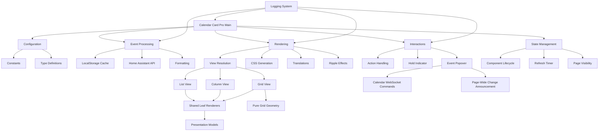

# Calendar Card Pro Architecture

This document provides a high-level overview of the Calendar Card Pro architecture, explaining how different modules work together to create a performant and maintainable calendar card for Home Assistant.

## 🗂️ Directory Structure

```text
src/
├── calendar-card-pro.ts          # Main entry point and component class
├── config/                       # Configuration-related code
│   ├── config.ts                 # DEFAULT_CONFIG and config helpers
│   ├── constants.ts              # Application constants and defaults
│   ├── types.ts                  # TypeScript interface definitions
│   └── view.ts                   # List/Column/Grid blocks, defaults, density, fallback
├── interaction/                  # User interaction handling
│   ├── actions.ts                # Runs the card's tap and hold actions
│   ├── add-event.ts              # Add button: writable calendars, label, new-event times
│   ├── back.ts                   # Where `back` goes: the page before, or a page of this dashboard
│   ├── calendar-changes.ts       # Page-wide announcement after the popover saves
│   ├── calendar-writes.ts        # Feature bits; the create, update and delete commands
│   ├── event-action-kind.ts      # What an event tap or hold amounts to, for card and editor
│   ├── event-actions.ts          # Event actions: the event's fields, filling them in
│   ├── event-details.ts          # An event's popover entry, display text and permissions
│   ├── event-map.ts              # Zone and place lookup, map tiles under a location
│   ├── event-times.ts            # An event's span, as the popover edits it and as stored
│   ├── feedback.ts               # Hold indicator (the ripple is drawn by render.ts)
│   ├── popover-model.ts          # The popover's draft: built, compared, checked, written
│   ├── rrule.ts                  # Home Assistant's repeat rules: read, written, worded
│   └── search-session.ts         # A search's year-wide load and the rows it finds among
├── rendering/                    # UI rendering code
│   ├── editor/                   # Schema-driven configuration editor (its own bundle)
│   │   ├── index.ts              # Build entry and public surface of the editor
│   │   ├── element.ts            # The Lit element: lifecycle, forms, editor state
│   │   ├── panels.ts             # Panel registry and schema context
│   │   ├── schemas/              # One module per panel, plus their shared vocabulary
│   │   ├── ha-form.ts            # Our declaration of Home Assistant's schema shape
│   │   ├── value.ts              # Serialization, legacy migration, authored-value retention
│   │   ├── entities.ts           # Write path for the per-calendar list
│   │   ├── buttons.ts            # Write path for the toolbar's own buttons
│   │   ├── exceptions.ts         # Removes stored view overrides for Reset controls
│   │   ├── subforms.ts           # The schemas a panel renders outside its own form
│   │   ├── filter.ts             # Search and "customized only"
│   │   ├── workspace.ts          # Editor-only All Layouts/List/Columns/Grid selection
│   │   ├── routing.ts            # Workspace projections and scope-captured writes
│   │   ├── normalize.ts          # Comparable root and nested form values
│   │   ├── synthetic.ts          # UI-only fields, and values invalid while typed
│   │   ├── localize.ts           # The string hooks `ha-form` calls
│   │   ├── hass-localize.ts      # Wraps hass.localize to name `expand` in HA's action editor
│   │   ├── strings.ts            # English editor strings
│   │   ├── version.ts            # Build-stamped version the editor reports
│   │   ├── translations/         # The same keys per language, partial by design
│   │   └── styles.ts             # Editor chassis CSS
│   ├── render.ts                 # Card shell and the list view
│   ├── toolbar.ts                # Header toolbar and its controls
│   ├── legend.ts                 # The calendar filter: its chips, its button and menu
│   ├── menu.ts                   # The toolbar's menus: placed, painted, opened and closed
│   ├── view-pictograms.ts        # The picture of each view, for editor and toolbar
│   ├── activation.ts             # Marks rendered events as tap targets
│   ├── event-popover.ts          # The event popover: details, editing in place, new events
│   ├── popover-shell.ts          # The popover's shell: opening, placing, its look, closing
│   ├── search-panel.ts           # The search panel: its field, its results, the keyboard
│   ├── column.ts                 # The column view
│   ├── grid.ts                   # The timed grid and spanning all-day band
│   ├── grid-accessibility.ts     # Full configured names for timed Grid events
│   ├── leaves.ts                 # Leaf renderers shared across the three views
│   ├── presentation.ts           # Layout-independent per-event presentation models
│   ├── accent-text.ts            # The `accent` text sentinel's fields and properties; CSS-free
│   └── styles.ts                 # CSS styles and dynamic styling
├── translations/                 # Localization support
│   ├── dayjs.ts                  # Relative-time localization
│   ├── language-codes.ts         # Card-language codes and language selection, table-free
│   ├── localize.ts               # Translation functions
│   └── languages/                # Translation files (36 supported languages)
│       ├── en.json               # English translations
│       ├── de.json               # German translations
│       └── ...                   # Other language files
└── utils/                        # Utility functions
    ├── events.ts                 # Calendar event fetching and processing
    ├── live-calendars.ts         # Live calendar changes over `calendar/event/subscribe`
    ├── grid.ts                   # Pure time-grid geometry, overlap lanes, banner spans
    ├── grid-title-fit.ts         # Browser-measured label/title fitting, separate from geometry
    ├── grid-time-fit.ts          # Measures each grid time row and picks its degradation step
    ├── grid-cascade-threshold.ts # Measured cascade threshold, in minutes, for `utils/grid.ts`
    ├── grid-overflow-strip.ts    # Measured `+N` strip width, as a share of the day column
    ├── format.ts                 # Date and text formatting
    ├── event-age.ts              # The `YEAR=` marker: ages and anniversary counts
    ├── text-replace.ts           # Per-calendar `replace_pattern` / `replace_with`
    ├── start-date.ts             # The `start_date` relative-date grammar
    ├── paging.ts                 # Paging through dates: page length, home, the range's name
    ├── helpers.ts                # Generic utilities (color, ID generation)
    ├── entity-colors.ts          # Calendar colors from HA's entity registry, over WebSocket
    ├── entity-icons.ts           # Calendar icons from entity state, for `label: home-assistant`
    ├── person-pictures.ts        # Person pictures from entity state, for `label: person.*`
    ├── calendar-names.ts         # A calendar's name on the card: `name`, HA's, or its id
    ├── logger.ts                 # Logging system
    ├── templates.ts              # Jinja2 title templates over the HA websocket
    ├── title-motion.ts           # Pure per-title timing and cohort admission state
    ├── title-motion-controller.ts # Visible per-card membership and native clock alignment
    ├── title-words.ts            # Splits grid titles so they wrap only at spaces
    ├── view-choice.ts            # The switcher's view and the legend's hidden calendars, per device
    ├── toolbar-fold.ts           # Which of the action row's start controls fold into its menu
    ├── search.ts                 # Searching events: the window, folding, matching, order
    ├── editor-url.ts             # Where the editor file lives, relative to the card
    ├── links.ts                  # Web addresses in an event's text, as link pieces
    ├── weather.ts                # Weather data fetching and processing
    └── weather-i18n.ts           # Condition text in the card's language
```

## 🧭 Three Views, One Agenda

The card renders the same agenda in one of three layouts, and this is the structural fact
most worth holding on to before changing anything under `rendering/`:

- **`view: list`** stacks days vertically, each day a row. This is what the card has
  always done and remains the default.
- **`view: column`** lays days side by side, one column each.
- **`view: grid`** positions timed events against a shared hour axis, with all-day events
  in a separate band above it.

They share the card shell, event pipeline, and presentation models rather than duplicating
the card. `leaves.ts` holds reusable date, event-content, weather, and indicator renderers;
`presentation.ts` computes layout-independent event details. `render.ts`, `column.ts`, and
`grid.ts` arrange those pieces. Grid also uses the pure geometry in `utils/grid.ts` for
wall-clock placement, overlap layout — cascaded by default, side-by-side lanes as an
option — and multi-day banner spans. Two of its inputs depend on pixels, and the card
measures both after a render: how far below an event another must start before it may be
drawn on top, converted to minutes in `utils/grid-cascade-threshold.ts`, and how wide the
`+N` strip must be to hold its count, converted to a share of the day column in
`utils/grid-overflow-strip.ts`. The geometry module itself still knows no pixels.

The effective view can change with available width. A narrower Column or Grid card first
draws fewer days, down to `min_days_to_show`, in a window kept as close to today as the
configured range allows (`visibleDayWindowStart` in `config/view.ts`): it starts at today and
moves back only as far as it must to stay full, and a range wholly in the future or the past
keeps its first or its last days.
Below that floor `min_days_fallback` decides: `list` falls back to List, and `cramp` holds
the floor with days narrower than `min_day_width`. Column simply narrows its columns; Grid
keeps each day at least `2rem` wide and scrolls horizontally. Grid's width calculation also
reserves the hour gutter. `config/view.ts` owns
this resolution and its hysteresis, so resizing does not repeatedly flip layouts at a
boundary. The editor workspace is separate: choosing List exposes its controls without
changing the displayed layout.

## 🧱 Configuration Layers & Editor Adoption

The top level is the shared base. `list:`, `column:`, and `time_grid:` hold presentation
values for their own views; calendars, fetching, language, actions, and other card-wide
options stay at the top level. For a shared view option, both `resolveViewOption` and
`resolveEffectiveConfig` apply the same order: explicit view override, built-in divergent
view default, shared value. List has no divergent defaults. View-only options use their
own block defaults, with permanent root fallback for the legacy List-only options.

The editor exposes four destinations: **All Layouts** writes roots, and **List**,
**Columns**, and **Grid** write their blocks. `workspace.ts` distinguishes the destination
from the view used to build panel structure. All Layouts uses List-shaped panels, but
conditional controls resolve shared values, never `list:` overrides. `routing.ts`
captures the destination with each rendered form so a delayed event cannot write into a
different workspace.

`config_version: 5` records editor adoption; it is not a renderer precedence switch.
`configVersionState` classifies missing or older nonnegative integer markers as legacy,
accepts the current version, and blocks visual-editor writes for future or malformed
versions. It does not coerce a string such as `'5'` into a number.

For an ambiguous legacy List or Grid card, the editor waits for the user's interpretation
of authored divergent roots. **Keep my existing List appearance** moves them into
`list:`; **Use these settings for all layouts** keeps them shared. Both move List-only
roots into `list:`, preserve explicit block values, and stamp the format. Legacy Column,
unambiguous cards, and versionless configurations already carrying `list:` or `time_grid:`
adopt on the first real edit without that prompt. Opening alone emits no configuration.

Authorship is captured from raw input before defaults are merged. Migration uses those raw
values, including `false`, zero, and default-equal values; local editor state is updated
before forms reopen or Home Assistant echoes the save. Serialization retains explicit
divergent shared roots so reopening does not lose a choice that a later Grid transition
must preserve. Implicit defaults remain absent. A value the YAML already holds is kept,
even at its default, unless the write changed it: `toStoredConfig` takes the stored YAML
as its authored baseline, which moves with every write, so an option edited back to its
default is still minimized. The editor's per-view labels, Reset controls and Customized
Only read the view blocks through the same rule (`storedViewBlocks`), so a kept line is
never labeled as inherited. A transition to Grid may copy those roots
into `time_grid:`; that editor reconciliation does not run when loading YAML.

See [Per-View Options](/features/core-settings#per-view-options) and the
[editor upgrade flow](/features/editor#upgrading-a-card-from-before-v5) for user-facing
examples.

## 📦 Two Files, One Card

The build emits **two** self-contained bundles into a flat `dist/`:
`calendar-card-pro.js` and `editor.js` (`-dev` suffixed in development builds). The card
fetches the editor only when someone opens it, which keeps the editor and all of its
translations off every dashboard load.

Neither file imports the other. The card names the editor through a URL it computes at
runtime (`utils/editor-url.ts`), which is invisible to both module graphs — a plain
dynamic `import()` would make Rollup emit a shared chunk that the editor imports back
from the card, and the query string HACS appends to the card's own URL would make the
browser treat that as a second copy of the card. `npm run check:bundle` asserts the
result after every build.

The event popover (`rendering/event-popover.ts`) is the opposite case: it ships inside the
card's file rather than as a third file fetched when first opened. Every asset attached to a
release is downloaded by every HACS user, so a third file would spare no installation its
bytes, and with the popover already in the card's file nothing has to load when one opens. The
search panel (`rendering/search-panel.ts`) ships there for the same reason, on the shell it
shares with the popover.

### Compact Payloads, Readable Sources

`scripts/compact-payloads.mjs` compacts data before JSON and TypeScript compilation in both
build variants. It does not change the authored translations, template whitespace, browser
requirements, or the two-file layout.

Day.js locale objects retain their names and complete relative-time definitions, including
grammar functions and the helpers those functions reference. The English locale stays
intact. The card uses Day.js for relative time only; a build-time source guard rejects other
Day.js APIs or plugins rather than letting a new formatter silently read discarded month,
weekday, or meridiem data. Expanding that API surface requires revisiting the subset.

The editor stores its sorted English string keys once, with one aligned value array per
language, including English. A small shared decoder restores ordinary string maps.
Missing translations occupy `null` slots and are omitted from the restored map; empty
strings stay empty. Partial translations, the generated British English delta, and the
existing per-key and per-view fallback order therefore use the same lookup code as before.

The transforms reject duplicate or unknown string keys, non-string values, unsupported
source shapes, and unsafe locale initializers. English-key changes invalidate the decoder
and every translation vector during incremental builds. Tests compare unoptimized and
compacted emitted modules across languages, lookup paths, relative-time thresholds,
calendar-month intervals, and the suite's UTC and DST timezones; source-only translation
checks remain independent of compaction.

## 🧰 Header Toolbar

The card's own controls live in a header of one or two rows above the events. The first row,
drawn only while it holds a control, carries the calendar filter's button, the add-event button,
the configuration's own buttons, the view switcher, reset, refresh and search; the month's row under it carries the title as a small label
over the month, the filter's chips in its middle where they all fit, and the date navigation at
its end. The layout rule is fixed, so a control still to come slots in without moving the ones
already there. `renderHeaderToolbar` in `rendering/toolbar.ts` draws it, and
`renderMainCardStructure` places it.

- **One block configures it.** `toolbar:` holds `show`, the one switch for the bar, a boolean per
  control, `legend`, which is `false`, `menu` or `chips`, and `buttons`, a list of the
  configuration's own. `resolveToolbar` in
  `config/config.ts` reads it member by member and is the only reader, so a malformed value reads
  as that member's default; `legend: true` names no form and reads as `menu`. `show` defaults off;
  inside a shown bar every control defaults on except `reset`, because v5 is the first release
  with a toolbar and these are its first defaults. Reset is for a shared screen: elsewhere a
  layout picked on the switcher is a preference, remembered until the card is edited, and a lit
  reset button kept presenting it as something to undo. A control added in a later release defaults
  off, so a release never adds a control to a toolbar someone already set up; `search` is the
  first. Every control
  needs a `toolbar → key` row in the reference:
  `check:docs` reconciles the block's defaults against those rows in both directions.
- **It is conditional.** With no control enabled or available there is no toolbar and no new DOM:
  the header renders byte for byte as it did before the toolbar existed. That is why the header
  keeps a single child binding, since a second one, even rendering nothing, adds a Lit marker and
  a text node, and why no default snapshot moved.
- **Two rows, the title in the second.** With a control, `.header-container.has-toolbar` holds
  the action row (`.card-toolbar.toolbar-actions`), then the heading row
  (`.card-toolbar.toolbar-heading`), right above the days. The title moves into the heading row:
  `h1.card-header`, or `.card-header-placeholder` without a title, is the first child of
  `.toolbar-identity`, a block it shares with the month, so the title is a small label directly
  over it. It keeps its element and classes, and the `.header-container` + `.content-container`
  adjacency is unchanged, but while the toolbar is drawn the child selector
  `.header-container > h1.card-header` no longer reaches it; the descendant
  `.header-container h1.card-header` does, with the toolbar on or off. One block is what lets the
  arrows and the chips sit centered on the month's capitals (below) whatever the title's height, and
  what keeps the month's hover off the title. The title is in the secondary text color, and the
  month, the card's headline then, reads `title_font_size` and `title_color`. A long title wraps
  within the block and adds nothing to its width (`contain: inline-size`), so it never takes room
  from the chips. A templated title still pending keeps the `h1`, held one line tall, so the
  month does not move when its value arrives.
- **The action row groups by purpose.** A start group (`.toolbar-start`: the folded filter, add,
  then the configuration's own buttons, and the menu button where some fold), the view switcher,
  and an end group (`.toolbar-end`: reset, then refresh). Both groups are always drawn and share
  the room beside the switcher equally (`flex: 1 1 0` with a `max-content` minimum), so the
  switcher sits in the middle of the card while both fit in half of it, and between them when one
  does not; only a card too narrow for the narrowest row wraps the end group onto a line of its
  own. Both groups space their icons alike, 8px apart. The row
  is drawn only while it holds a control.
- **The heading row names the month the page starts in.** `monthHeading` in `utils/paging.ts`
  writes the month and year of the page's first day through `Intl` in the card's language,
  capitalized where the month leads: one month, never two, so a week across a turn of the month is
  named by its first. The exact dates, `rangeLabel`, are the heading's tooltip and a visually
  hidden polite live region that describes the button and names the arrows' track, a group of its
  own; the row is none, since it holds the card's heading. With navigation the
  month is a button over a hidden native date input, which opens the browser's picker, and
  previous, home (a house, because home is not always today, filled on the success wash for
  `HOME_CONFIRMATION` after a press that brought the card back, `_pressHome`) and next stand
  beside it, three
  small round buttons in one group;
  without navigation the month is plain text. The arrows keep to the row's end in every layout
  (`.toolbar-heading-end`), so a press on next lands on the same spot page after page. While the
  chips show they sit between, by the action row's rule: the title's block and the arrows' group
  share the room beside them equally, so the chips are centered under the switcher while there is
  room, and the block keeps the room of the month's widest name. Behind the month, in the same grid cell, every
  month in the form drawn keeps the room of the widest, with tabular figures, so paging never
  moves a control. The month button
  focuses the hidden date input to open its picker, because Safari closes a picker only when its
  input loses focus. A press on the month while that picker is showing closes it by taking the
  focus away, and opens nothing: Chrome closes its picker itself and then hands the page the very
  press that closed it, so the card follows the picker from the moment it opens one, until focus
  leaves the input, a day is picked, Escape is pressed, or `:open` turns false, which it checks
  once a frame. The input is exposed to assistive technology only while it holds that focus, and
  focus goes back to the month button when the button had it. Layout is logical throughout, and
  the arrows are mirrored under `:dir(rtl)`, where previous points right.
- **The arrows and the chips are small, and centered on the month's capitals.** They are 24px
  tall against the action row's 36px, with the chevrons filling 44% of their button and the chips
  keeping Home Assistant's control text size, so beside a 24px month they are about as tall as
  its capitals plus a little. A 36px pill with its bottom edge on the month's baseline rose about
  19px above the letters, and its icons sat higher than their middle, which read as misaligned
  however exactly it was aligned. The row aligns its items' feet, and `_syncHeadingMiddle` reads,
  after every render, an empty box at the start of the month's words that is one capital tall
  (`1cap`) and stands on their baseline (`.toolbar-month-cap`). It writes how far that box's
  middle stands above the row's content foot as `--calendar-card-heading-middle`, straight onto
  the row, which no render binds a style to, and the stylesheet raises the arrows' group and the
  chips' box so their middles sit there. The height depends on the month's font and line alone,
  never on where the controls sit, so writing it cannot move what it was measured from; 15px
  stands in until the first measurement, and `0.7em` for a browser without the `cap` unit.
- **The month shortens by measurement, never by the month on screen.** `_syncMonthFit` reads,
  after every render, a hidden copy of every month in full laid over one another in the heading's
  own font, and the room from the month's start to the row's end less the arrows. It turns that
  into the card width from which the full form fits (`_monthFit`); below it every month takes the
  language's short form, and the month is cut short where even that does not fit. The inputs never
  depend on the form drawn, so it cannot oscillate, and the form never changes the card's height,
  so it may act inside a resize. While the chips show the month is always in full: they are drawn
  only where the full month leaves them room.
- **The rows insets follow the title's.** In list each row is 8px in, the title's margin; column
  and grid drop the title's margin, and the rows' 8px with it. A view switch is drawn at once:
  Home Assistant's `ha-card` transitions every property, the padding each view sets included, so
  the card limits it to colors and the shadow.
- **A control never starts the card's gesture; the rows around them are the card.** Each control
  stops `pointerdown`, which arms the card's tap and hold and captures the pointer, and `click`
  (`stopCardGesture`). So do the two groups drawn as one, the switcher's gray track and the date
  arrows, which stand 4px apart, and the chips' padded box, so a near miss there does nothing.
  The rows themselves stop nothing: the title, the plain month and the space between controls run
  `tap_action` and `hold_action`, ripple and swipe as the rest of the card does, the way the space
  around an event is the card's. The rows used to keep all of it, so the card's hover flickered in
  stripes as a pointer crossed them, between the rows and over the title. None stops `keydown`:
  the card already ignores keys aimed at anything but itself, and stopping them would hide them
  from Home Assistant's own shortcuts.
- **Every control has a 44px touch target.** Each answers a press 44px tall through an invisible
  `::before` box that never overlaps a neighbor's: a 36px button in the action row grows 4px each
  way; a 24px chip or arrow 10px up and down and 2px across, for their 5px and 4px gaps, the
  first and last arrows 6px outward, with the chips' box padded as far so it does not clip them;
  and a segment on the switcher's track 7px up and down, across only at the track's two ends, so
  the segments inside stay 34px wide. The arrows answer 28px to 32px across, above the 24px that
  accessibility guidelines set as the least. The month is the exception: its button is a pill exactly its
  line tall, so its hover sits close around the words and never reaches the title above it. Its
  target reaches 10px down, into the gap above the days, and only 2px up, so the title keeps its
  line for the card's own tap action: about 41px tall at the default title size, and as wide as
  the month and its caret.
- **Each control is an icon or words, never both, and which is fixed.** The commands, the
  folded filter, add, reset and refresh, are icons at every width, named by Home Assistant's own
  words as their tooltips and `aria-label`, or in English for assistive technology alone where it
  has none. The view switcher shows the words List, Columns and Grid where they fit beside the
  commands and its pictograms where they do not, each then named by its word. The month and the
  chips are words, the arrows and home icons. There is no option for it: a `labels` switch
  existed during v5's development and was removed before release, because it added an editor
  field, its strings in eleven languages, a reference row and tests for a preference that changed
  only wide cards, while labeled commands hid the views' words whenever Home Assistant lacked a
  word for a single command. The width is the card's own `ResizeObserver` reading, acted on
  inside the callback so the first painted frame is already right. A container query was rejected: it needs a
  `container-type` ancestor, which could capture the `cqh` units grid view sizes against, and
  happy-dom cannot evaluate one, so it could not be tested.
- **Controls are native, and share one look.** Every control is a `<button>` styled from theme
  variables rather than an `ha-*` element, so the card names no new Home Assistant element: a
  neutral pill on a gray track, the text color washed into the card, with the selected view raised
  out of it. A control under the pointer or pressed takes the card's hover color, its accent, laid
  over the gray, as an untinted event does, and the theme's primary color is kept for the focus
  ring. The four `--calendar-card-toolbar-*` properties are declared on `.card-toolbar`, which
  both rows are, so the chips and the filter's menu inside them take them too. The switcher's
  words show from `UI.TOOLBAR_SWITCHER_LABEL_MIN_WIDTH` (248px) for the switcher alone, plus
  exactly the commands beside it: `UI.TOOLBAR_COMMAND_WIDTH` for each icon, `UI.TOOLBAR_COMMAND_GAP`
  between two in a group, which `stylesheet.test.ts`
  reconciles against the stylesheet. The base is measured in English, where the words need 242px;
  German needs 274px and Lithuanian 330px. `_syncToolbarLabelFit` reads the render, and if the row
  wrapped or overflows with the words it draws the pictograms until the card is wider than that
  or the language or the controls change. It only ever drops the words, so it cannot oscillate,
  and its signature is the row's own controls, so neither a templated title nor a page turn
  retries words that did not fit.
- **The view switcher changes the requested view, never the configuration.** `requestedView`
  is the device's choice, else `view`; the width fit (`_effectiveView`, `_columnCount`)
  always follows it, so nothing about a switch is new to the fitting code. A switch draws
  without fetching, because `FETCH_TIME_KEYS` keep the window's start identical across views
  and the load spans the longest `days_to_show` among the views the card can show
  (`loadedDaysToShow` and `loadConfig` in `config/view.ts`): every view with the switcher,
  else `view` plus list when it falls back to list. Each view draws a prefix of that load, and
  `groupEventsByDay` bounds every occurrence by the view's own window end so a shorter view
  never fills from days past it.
  `utils/view-choice.ts` keeps the choice in one `localStorage` entry keyed by a fingerprint
  of the raw configuration, so any edit resets every device. Nothing deletes the old entry:
  Home Assistant builds a fresh card for a changed configuration, in edit mode and when a
  dashboard reloads alike, so no card learns which configuration it replaced. A
  configuration changed back to exactly what it was therefore finds its old choice, which
  the docs state; the oldest entries are pruned past `MAX_VIEW_CHOICES`.
- **Which views it offers is decided at render.** A view is offered when picking it would
  draw it at the settled width: the view on screen always, every other one by
  `resolveColumnFitIfPicked`, which judges it as though it were already on screen. A pick
  gets the hysteresis margin a view on screen keeps; judged by the entry threshold instead,
  a layout the card had been drawing inside the band could not be switched back to. The
  configured view, fallen back to the list there, is judged the same way, and pressing it
  draws it. A picked or remembered view is fitted by the same rule at a card's first
  measurement, when there is no layout yet to keep, so a reload at the width a pick was
  made at draws what was picked. A view that does not fit stays in place,
  dimmed and `aria-disabled`; with fewer than two that fit there is no switcher. A settled
  width that changes the offer without changing the layout still re-renders, and so does
  one that changes only the day columns of the configured view shown while editing.
- **Paging changes the window asked for, never the configuration.** The page is a fixed first
  day (`_pageRequested`), null at home, the window the configuration opens with. It is fetched
  and drawn with the configuration's `start_date` replaced by that day, and loaded as far as the
  longest view the card can show, which keeps every view on one load, so a view switch still
  never fetches, and with `show_past_events` forced on,
  since a page in the past is otherwise empty. Its query identity is that of a card configured
  to open on that day, so two cards on one page share its request. The arrows step by the days
  on screen (`pageSpan`): the view on screen's own `days_to_show`, or the columns drawn while
  column or grid drops some,
  in which case a page draws from its own first day rather than from today. Presses accumulate
  on the requested page; the month heading and its dates answer at once, while the days below stay those of the page
  whose events `events` holds (`_pageShown`), dimmed, until the new page's land, so one
  window's events are never drawn under another's dates. The request generation discards the
  responses of pages passed by.
- **Paged windows never touch `localStorage`.** They live in a bounded in-memory store in
  `utils/events.ts`, shared by every card on the page, so a tablet paging all week leaves
  nothing in a store it shares with Home Assistant. An entry fetched before a calendar write is
  dropped on read, by the write generation that already lives on `globalThis`. Home stays on
  disk, and a card that heard of a write while away fetches home on the way back
  (`_homeStale`). The write also marks home's stored entry due (see _After a Write_), so a
  reload before the way back fetches it too, even with `refresh_on_navigate` off.
- **Nothing remembers a page.** A reload, any change to the configuration and the start of
  editing all bring the card home, where `hide_when_empty` alone acts: a card that hid itself
  on an empty page would take the way back with it.
- **Editing shows `view` and touches nothing.** In preview and edit mode `effectiveView` is
  the configured view, the switcher marks it and ignores presses, and when the device's
  choice differs the shown day count is fitted for display alone, so a width measured while
  editing cannot overwrite the dashboard's fit.
- **The card stops being a button while it hosts controls, and stays focusable.**
  `_hostsControls` answers this once, for toolbar controls and tappable events alike, from
  what the render draws: a toolbar control, or at least one event that is a tap target, which
  the loading line, an error and days holding only empty-day placeholders are not
  (`drawsEvent` in `rendering/render.ts`, with `gridDrawsEvent` for grid view). `ha-card`
  then drops `role="button"`, because a button may not contain another, but keeps
  `tabindex="0"` while it has a `tap_action`: with the card itself focused, Enter and Space
  still run it, since `_handleKeyDown` leaves keys aimed at a child to the child. The
  ripple and the pointer `tap_action` stay too.
- **The calendar filter (`legend`) filters what is drawn, never what is loaded.** The hidden calendars are a set
  of entity ids, replaced rather than changed in place, and `_shownEvents` is `events` without
  theirs, memoized on the events, that set and whether the card is being edited, which shows
  every calendar. `groupedEvents`, `visibleEventCount` and the now-boundary timer read it, so
  expiry, `days_of_week`, which copy of a duplicate wins, the compact limits and the empty days
  all see only the calendars shown, and a hidden calendar's merged row falls to the next one
  shown. The cache, the page store, the request identity and the failure notice stay on
  `events`, so a press fetches nothing. The set is remembered beside the switcher's view, in the
  same `utils/view-choice.ts` entry, still version 1, and read for its own control: a card with a
  legend and no switcher remembers too. A press is announced on `window`
  (`LEGEND_CHANGED_EVENT`), so another card with the same configuration, which shares the
  entry, takes it up at once rather than writing its own stale set over it on its next press.
  Another tab hears the write as a `storage` event and takes up the set when this
  configuration's changed (`hiddenCalendarsChange`, which compares the event's old and new
  entry). A card that may have missed one reads the entry again when it is attached and when
  its tab comes back (`readStoredHiddenCalendars`), unless its last write was refused, when
  the set lives in that page only. A same-page announcement carries whether the write was
  stored, so a card taking up the set takes that up too. The switcher's view is not synced: it is written as a patch
  of its own half, so a stale tab cannot write an old one back.
  `hide_when_empty` acts only while nothing is hidden, for the reason a page away from home
  never hides: the card would take the way back with it.
- **`menu` is always the button; `chips` fold by measurement, never inside a resize.** Under
  `legend: chips`, `_syncLegendFit` reads the chips' natural width against the room the heading
  row leaves them (`_legendChipsRoom`): the row's content width less the widest month in full, the
  arrows' track and the two gaps either side of the chips. It is worked out from those widths
  rather than read from the chips' box, which never shrinks below nothing, so a month and arrows
  that already overflow give a negative room and a true width to unfold from. When the chips do not fit the card records what they were drawn with
  and the card width from which they fit by `UI.LEGEND_UNFOLD_MARGIN`, and draws exactly the `menu`
  layout until then: the filter button back at the start of the action row, never part of the
  chips. After a render it only folds, at the width the legend was last judged at, before anything
  is painted. A width change is judged a frame later (`_scheduleLegendFit`), from a width only that
  pass moves (`_legendWidthPx`), so no render the resize observer causes folds or unfolds it:
  either can change the card's height, since the folded button may need an action row the card did
  not draw, and a height changed while the browser delivers resize observations is logged as an
  error. An unfold that still overflows folds again from a wider width, so the two cannot
  alternate. That includes an unfold the chips themselves undo: drawing them can make the page tall
  enough for a scrollbar, which narrows the card under the chips, so a fold that follows an
  unconfirmed unfold folds from wider than the width that unfold was tried at
  (`_legendUnfoldedAtPx`). A chip whose name was cut short gets the name as its tooltip, measured
  after each render (`markShortenedChips`).
- **The legend's menu is a modal `<dialog>` with one controller.** `showModal()` reaches the
  top layer, past `ha-card`'s `overflow: hidden`, in every browser Home Assistant serves; the
  popover API would need iOS 17 and Chrome 114. Because a modal makes the rest of the page
  inert, every way it ends goes through `closeMenu` in `rendering/menu.ts`, and the card
  closes it before anything takes its button away: in `willUpdate` before a render that unfolds
  the legend, drops it or starts editing, in `_applyVisibility` before the card hides, and on
  disconnect; the resize observer closes it too when the card changes width under it. Each
  update places it again, keeping how far its list was scrolled. `placeMenu` is pure: inline
  start on the button's by the card's direction, since the button leads the action row, inside
  the viewport, below or above by room. It floats over the events, so it has to be opaque, and
  a theme made for a wallpaper makes the card background it is painted in see-through. So each
  time it is placed, `paintMenu` reads that background and, only where it is see-through, hands
  the stylesheet that background laid over the theme's page color, and that over black or white
  by the text color (`opaqueSurface`, pure), in a custom property,
  `--calendar-card-legend-menu-surface`, that only the menu's background color takes. Both
  colors are read off hidden stand-ins drawn inside the menu (`surfaceColor` in
  `rendering/surface.ts`), not off the menu, whose color the property changes, nor off a probe
  added for the read: the card's mutation observers take any element added or removed in the
  card for a change of the grid's structure, and refit every block, and the menu is painted
  again after every update while it is open. The menu's own background is never written, so a
  card-mod rule on it wins as it would against the stylesheet, a see-through one included, and a
  transition on it cannot be read halfway. An opaque theme's menu is handed its own color back,
  not nothing, since a theme may write its card background as a shorthand that is no background
  color, so it renders exactly as the stylesheet paints it, which is what keeps the default theme
  pixel-identical: a second background layer under an opaque one would not. Measured, it changes
  the rendered pixels by up to 31 levels in WebKit. A gradient whose every stop is opaque counts as opaque, and is left
  alone for the same reason. The view switcher's selected segment is raised out of its track in
  the card's own background, and gets the same color the same way after every update
  (`paintSelectedView` in `rendering/toolbar.ts`), in `--calendar-card-toolbar-selected-surface`,
  read off its own two stand-ins inside the selected segment. Under an opaque theme it is handed
  nothing, so a card-mod rule changing its color under the pointer still reaches it, except where
  its value is no background color, an image or a shorthand such as `#1c1c1c no-repeat`: the
  shared reader (`surfaceColor` in `rendering/surface.ts`) asks `CSS.supports` about the value as
  written, which each stand-in keeps beside its background in `--calendar-card-surface-value`,
  and hands the color back, since the stylesheet's background color cannot fall back to such a
  value. The segments are reused across
  renders, so the one the selection leaves loses the property.
  Focus follows how the menu was opened. From the keyboard, the first calendar takes it, as the
  dialog chooses. Opened by a press, the menu itself takes it, which draws no ring: WebKit counts
  the dialog's own choice of first control as keyboard focus, and rang the first calendar after a
  click. Tab then reaches the first calendar. Closing a modal returns focus to where it was before
  it opened, without scrolling, and after a close someone asked for the card focuses the button
  as well, which covers a browser that does not. The one exception is a menu a press opened and a
  press closed: WebKit carries the menu's own focus over to the button as the keyboard's and
  would ring it, so there focus is left to the browser, which in WebKit, where a press does not
  focus a button, returns it to where it was. Escape still focuses the button.
- **The configuration's own buttons are commands like the rest.** `toolbar → buttons` is a list of
  `{ icon, name, entity, tap_action }`, drawn in the start group after add, in the order written,
  each a `.toolbar-button.custom-button` holding an `ha-icon` the size of the other commands'
  icons. `resolveToolbar` keeps an entry only where `isToolbarButton` accepts it, an object with
  an icon whose other fields are each of their own kind or absent, and the card warns once per
  configuration about each entry it leaves out (`undrawableToolbarButtons`). The editor reads the
  list as written instead, so an entry somebody is still filling in survives the next edit. A
  press runs `handleButtonAction` in `interaction/actions.ts`: the card's own actions through the
  callbacks its `tap_action` uses, Home Assistant's through `hass-action` with the button's
  `entity`, else the card's first calendar. Like every control, a button starts no card gesture
  and is inert while the card is being edited. A button is named by its `name`; without one, a
  `back`, `refresh`, `add-event` or `reset` button by Home Assistant's own word for it, and any
  other by its icon's words (`iconWords`), for assistive technology alone. The buttons read no
  `hass` state of their own, and an `entity` is already watched through `configEntityIds`. They
  count toward the width the switcher's words need (`_toolbarLabelMinWidth`) and in its signature,
  one icon each, folded or not, since the words give way before any control folds.
- **What gives way, in order, as the card narrows.** The switcher's words become pictograms first:
  they are drawn only where every control fits beside them (`_toolbarLabelMinWidth`), and a
  measured check catches a language whose words are longer (`_syncToolbarLabelFit`). Then the
  start group's controls move into one menu button, three dots, from its end: the last of the
  configuration's buttons first, then the earlier ones, then add. The group's first control never
  folds, the filter's button wherever it is drawn, so the narrowest start group is that control
  and the menu button. A menu never holds one control, since the menu button takes the room it
  did: two fold when the menu first appears, and the last two come back together. The start group
  may take all the room the switcher and the end group leave, not half of it, so the switcher
  moves off center first, as the row's flex layout already let it. The end group never folds: a
  card too narrow for the narrowest row wraps it, as it always has, which in every view is below
  274px beside refresh, below 318px beside refresh and reset or search, and below 362px beside
  all three.
  `planStartGroup` in `utils/toolbar-fold.ts` decides it, pure, from the card's width alone.
  Each command is `UI.TOOLBAR_COMMAND_WIDTH` wide and stands `UI.TOOLBAR_COMMAND_GAP` from the
  next, the switcher's pictograms are `UI.TOOLBAR_SWITCHER_SEGMENT_WIDTH` each on a track padded
  `UI.TOOLBAR_SWITCHER_TRACK_PADDING`, and the row stands `UI.TOOLBAR_ROW_INSET` in from the
  card's edges in each view; the stylesheet tests reconcile all of them. Every plan is one line
  tall, so no plan changes the card's height, and the card plans at render, from the width its
  resize observer reported in its own callback, with no frame's delay and no hysteresis
  (`_startFold`, `_syncToolbarLabels`). A card not measured yet draws the narrowest start group,
  so its first report only gives controls back. A card that narrows across a threshold is laid
  out once more with the row it had, which wraps at the new width, and the render its callback
  requests takes that line back before the frame is painted. Browsers report a height change
  inside that delivery as a resize-observer loop error, as they already did when the switcher's
  words gave way. Home Assistant's frontend discards that error, so only a page outside Home
  Assistant, a test harness for one, ever shows it. The end group's input counts reset, refresh
  and search wherever the card draws them. One guard covers what
  arithmetic cannot see, a theme's border, a card-mod rule or a zoom's rounding: where the row it
  drew still wraps or overflows, `_syncStartFoldFit` folds one control more at that width for
  that row, never fewer, and a new width clears it, so only the arithmetic brings controls back
  and the two cannot alternate. It waits while the switcher draws its words, which give way
  first. A control that held focus as it folded hands focus to the menu button
  (`_handFocusToMenu`).
- **One menu controller serves both menus.** The start group's menu runs on the legend's
  machinery: `rendering/menu.ts` places, paints, opens and closes either `<dialog>`, told apart
  by its `MenuKind`, `legend` or `overflow`, and handed its `MenuParts`, the dialog's class
  and the stand-ins its surface is read from. The legend's tests passed over it unchanged. Each
  menu closes on its own conditions: `willUpdate` closes the legend's menu where the coming render
  takes the filter button away, and the start group's where every control comes back into the row
  (`_startMenuMayStayOpen`), and neither closes the other. A row is a native button holding the
  control's icon and its name in words, in the order the row would draw the controls; add's row
  draws the add button's plus. A press closes the menu with the reason `picked`, which asks
  nothing of focus beyond what the browser does, since the action may move focus itself, as the
  dialog it opens does; then it runs the control's action with the menu button as its anchor, so
  add, and a button running `add-event`, open the popover under the menu button.
- **Refresh has one guarded entry point.** The button and the `refresh` card action both call
  `_requestRefresh`, which does nothing while a load is under way or before the first has
  finished, and otherwise calls `refreshEvents`. The guard is not inside `refreshEvents`, which a calendar write must still be
  able to force. The button is inert while editing like every toolbar control; the action runs
  wherever the card's tap and hold actions do.
- **Reset undoes this device's choices, and shows only while there is one.** `_differsFromConfiguration`
  is the page asked for (`_pageRequested`), the switcher's choice (`_viewChoice`), the hidden
  calendars, and `isExpanded` only where `hasCompactModeLimits` makes the expansion show; a
  leftover flag in a layout without compact limits would show a button with nothing visible to
  undo. Never while editing, when every control is inert and the page, the view and the
  calendars already show the configuration; an expansion is left as it is. A press
  (`_resetToConfiguration`) forgets the configuration's entry in one write (`forgetChoice`),
  refits `view` the way a pick of it is fitted, announces the shown calendars on `window` as a
  legend press does, collapses the card, then goes home through `_goToPage`. The view goes first,
  because home's days follow the view on screen. Whether the button is drawn depends on the
  configuration alone: `reset` with navigation, the switcher, the filter or an `expand` action.
  With nothing to undo it is `.unavailable`, which the stylesheet hides with `visibility`, so it
  keeps its room and never moves the controls beside it when it appears. A press that did its work
  first shows a check on the success wash, as refresh does (`.reset-done`, `_confirmReset`), for
  `RESET_CONFIRMATION`; then it fades out over `RESET_FADE` still showing the check, and takes
  its U-turn back only once hidden. Swapping the icon first made the button flash back as itself
  on the way out. A change made meanwhile shows it as itself again at once, and disconnecting
  ends the check (`_settleResetConfirmation`), so a card put back is never stuck on it. Only a
  keyboard's focus (`:focus-visible`) keeps a button with nothing to undo drawn, dimmed, so a
  keyboard is never left on nothing; a pointer press focuses a button in some browsers, and kept
  it showing until the next press elsewhere. A reset that is the only control in its row
  (`.alone`) is always drawn, dimmed when there is nothing to undo, since hiding it would leave the
  row an empty strip over the month, and in the editor's preview always. Its name is
  `ui.common.reset`, which Home Assistant has carried only since 2026.2; older, the button has no
  tooltip and is named "Reset" in English for assistive technology alone
  (`UNLOCALIZED_RESET_NAME`), and nothing else in the bar changes, which the docs state.
  Beyond that one check and its fade it keeps no clock; there is no idle timer.
- **A refresh someone asked for is shown even when it is instant.** `_requestRefresh` steps
  `_refreshPhase` through `turning`, for at least `REFRESH_MIN_TURN` and as long as the load,
  then `done` or `failed` (read from `_hasFetchError`) for `REFRESH_CONFIRMATION`, then `idle`,
  and ignores every request until then. Where another load replaced the requested one before
  it answered, the outcome waits for `isLoading` to drop and reads that load's, since the
  requested one committed nothing. The button draws the phase, or the corner indicator
  where there is no button. A load the card starts itself never enters it: the button follows
  `isLoading` alone and shows nothing after, and it is `.unasked`, so its icon starts turning only
  after the 150ms the dimmed days wait (`.page-pending`). A page not loaded yet usually arrives
  well inside that, and turned the icon for a few milliseconds, which read as a reload nobody
  asked for. A ticket bumped on disconnect retires a sequence in
  flight, so a card put back is never stuck on a check.
- **Search is a panel of the popover's kind over a load of its own.** The magnifier
  (`renderSearchButton`) ends the end group, after refresh, named by Home Assistant's
  `ui.common.search`, and is drawn only with the date navigation, since a pick pages the card. A
  press (`_openSearch`) focuses it first, so Home Assistant's dialog manager and the modal both
  give focus back to it, then fires `show-dialog` with `SEARCH_PANEL_TAG`, which the production
  build renames as it does the popover's. The panel (`rendering/search-panel.ts`) extends the
  popover's shell (`rendering/popover-shell.ts`), so it opens, places itself, looks and closes as
  the popover does: below the magnifier, hanging back across the card, its beak pointing up, or
  above it where there is no room below, and a sheet below `SHEET_BELOW_PX`. What it finds comes
  from the card's `SearchSession` (`interaction/search-session.ts`), handed over as its
  `SearchSource`. Opening readies a load of a year back and a year ahead (`searchWindow` in
  `utils/search.ts`, local midnights from the card's date helpers): `fetchEvents` without `live`,
  plain REST and one request per calendar, each heard as it answers, so no live subscription is
  leased or disturbed. It is kept in memory on the session, never in `localStorage` or the page
  store, and later openings reuse it while the window's first day, the calendars asked, the write
  generation (`currentWriteGeneration`), the real changes to those calendars
  (`LiveCalendars.eventChanges`) and the card's refresh interval all still hold; a calendar that
  failed is asked again alone at the next opening. `eventChanges` counts a subscription that was
  live pushing different events, or failing, and never a subscription's first push, which
  `changeCount()` numbers for the views and which every page turn and every newly shown card
  makes. A write or a live change while the panel is open (`calendarsChanged`, from
  `_refreshAfterWrite`, `_handleCalendarsChanged` and `_onLiveChange`) supersedes the load once
  and tells the panel (`changed()`), which keeps the term and the active result where it still
  exists. Typing asks nothing. The rows are built from the card's own pipeline, the held events
  for a calendar still to answer and `processEvents` over the loaded ones, the hidden calendars
  left out, then `groupEventsByDay` for the view on screen (`SearchHost.view`) with its
  configuration spread over the whole window (`searchGroupingConfig`, which writes the window
  into that view's block as well, since a block outranks the top level), so filters, duplicates,
  replacements and what a row shows are the card's. `drawnIn` then keeps only what that view
  draws, a grid's timed events inside its hours by the band test `renderDayBody` applies
  (`Grid.intersectsBand`), and each event of the grouping is found once (`occurrencesIn`, by its
  `_source` and calendar block, so two events alike in title and times stay two). Matching is pure
  (`findRows`): text folded case- and accent-insensitively in the card's language, upcoming then
  past, grouped by month, at most `SEARCH_RESULT_LIMIT` drawn and the true total announced. A
  pick (`_pickSearchResult`) pages through the date picker's path (`_pickDate`), then rings the
  event while that page shows it: render stamps the display copies that are the pick
  (`ringIn`, by start and then uid and recurrence id, else title) with `_searchRing`, which each view's
  template binds as a class, so nothing is added to the card from `updated()`, where the grid's
  mutation observers would take it for a change of structure. `_syncSearchRing` starts the ring's
  `SEARCH_RING` once it is drawn, and moves focus to the ringed event where it is a target only
  once the panel has gone and Home Assistant has given focus back, two frames after the panel
  detaches (`_searchGone`). A page request for another page (`_requestPage`) drops a ring still
  waiting for its page, so a pick abandoned before its page loaded never rings later. The panel
  closes before anything takes its magnifier or its anchor
  away: in `willUpdate` while editing, hiding or without the magnifier, in `_applyVisibility`, on
  a change of width and on disconnect.
- **Weather is deliberately not a toolbar control.** The toolbar holds things the card
  does. A current-weather readout is content, and if it is built it belongs beside today's
  own date.
- **The fetch-failure notice stays where it was**, after the content.

## 🧩 Module Responsibilities

### Main Component (`calendar-card-pro.ts`)

The main entry point serves as the orchestrator for the entire card:

- **Web Component Registration**: Defines the custom element using `@customElement` decorator
- **Lifecycle Management**: Handles component connection, disconnection, and updates
- **Property Definition**: Defines reactive properties via LitElement's `@property` decorator
- **State Management**: Manages loading state, expanded state, and events data
- **Event Handling**: Runs the one gesture recognizer for card taps, event taps, holds,
  swipes and keys (see _Interaction Flow_)
- **Write Coordination**: Opens the event popover through Home Assistant's dialog manager
  (`_openPopover`), refetches after a save, and listens for other cards' change
  announcements
- **Configuration Processing**: Handles config updates from Home Assistant
- **Rendering Coordination**: Builds the component's DOM structure
- **Render Skipping**: `shouldUpdate` skips an update whose only change is a `hass` that
  changed nothing the card draws: another entity's state, which on a busy dashboard is
  nearly every update. Any other key of `hass` counts, and so does the state of any entity
  the configuration names anywhere (`src/utils/hass-relevance.ts`). A bare `requestUpdate()`
  in the same batch always renders. `tests/hass-relevance.test.ts` reconciles the rule with
  every `hass` read the card makes, so a new reader the rule misses fails there
- **Live updates**: Holds the live subscriptions of the window on screen (`_syncLive`, after
  every load and on each change a subscription reports). A subscription holding other events
  than the card drew (`EventFetchResult.raw`, so not the cache entry, which another card may
  have written) starts a `live` load, which takes them from it and never joins a request
  started before the change; every change reaches the screen through `updateEvents`
- **Timers**: Arms the refresh timer for the deadline of the data on screen, unless every
  calendar on screen is live, and reconciles
  four display timers in `updated()` against what the render draws — the grid now line,
  the midnight load, the next event boundary, and the clock repaint (see _Refresh
  Mechanisms_). `disconnectedCallback` stops all five
  Key design patterns:

- Uses [LitElement](https://lit.dev/) for efficient DOM updates and property management
- Follows Home Assistant's component conventions for seamless integration
- Implements computed properties via getters for derived state

### Configuration (`config/`)

Manages all configuration aspects of the card:

- **config.ts**:
  - Defines default configuration (`DEFAULT_CONFIG`)
  - Classifies configuration-format markers for safe editor adoption
  - Provides helper functions for normalizing entity configurations
  - Detects configuration changes that require data refresh
  - Lists the options read at processing time (`PROCESSING_TIME_KEYS`), so a card-level
    change to one reprocesses the cached events through `hasEntityProcessingChanged`
  - Reads the `toolbar:` block member by member (`resolveToolbar`), its only reader
  - Folds an unusable icon size, font size or accent bar width to its shipped default
    (`FOLDED_OPTIONS`, judged by `toValidSize`, `toValidFontSize` and `toValidBarWidth`)
  - Reports keys removed in v3.0.0 from the raw configuration (`findDeprecatedKeys`)
  - Generates stub configurations for the card editor

- **constants.ts**:
  - Defines global constants organized by category
  - Sets default values and timing parameters
  - Centralizes cache-related settings

- **types.ts**:
  - Defines TypeScript interfaces for all component parts
  - Documents config properties and their purposes
  - Provides type safety throughout the application

- **view.ts**:
  - Resolves List, Column, and Grid values from view overrides, divergent defaults, and
    the shared base
  - Owns which options may be overridden per view, and which may not — anything deciding
    _which_ events are fetched has to hold one value across layouts, because the card
    switches between them as the dashboard resizes
  - Computes the width thresholds at which side-by-side layouts engage, and the hysteresis
    that stops it oscillating at the boundary
  - Picks which days stay when fewer fit (`visibleDayWindowStart`): from today, reaching
    back only to keep the window full, or the range's first or last days when today lies
    outside it
  - Decides whether `event_gap` draws a gap at all (`hasEventGap`)
  - Validates all three view blocks and reports unusable keys

### Interaction (`interaction/`)

Handles all user interaction with the card. Viewing, adding, editing and deleting events all
happen in the card's own event popover (`rendering/event-popover.ts`), which writes through
Home Assistant's calendar WebSocket commands, the ones its Calendar panel sends. The modules
here decide what the popover is handed and what it writes: `event-details.ts` and
`add-event.ts` build its parameters, `popover-model.ts` its draft, `event-times.ts` and
`rrule.ts` the times and the repeat rule, and `event-map.ts` the map. None of them touches the
DOM. `calendar-writes.ts` is the only module that writes a calendar, and the popover its only
caller.

- **actions.ts**:
  - Runs `tap_action` and `hold_action`, for the card
  - Does nothing for a missing action or `none`, handles the card's own `expand`, `refresh`,
    `add-event` and `reset` through callbacks the card hands it per press, and forwards everything
    else to Home Assistant as a `hass-action` event naming the card's first calendar as the
    entity
  - Not `event_tap_action` or `event_hold_action`, which the card runs itself (see
    `event-actions.ts`), though it forwards their Home Assistant actions through the same
    `fireHassAction`

- **event-actions.ts**:
  - Reads an event action as one of three kinds (`eventActionKind`): `details`, which opens the
    event's popover; one of Home Assistant's actions, which is forwarded; or nothing, which is
    `none`, a bare key, and the card's own actions, since those act on the whole card
  - Builds the tapped event's fields (`eventFields`) from `_source` rather than the row, which
    carries only what the card shows: a location the grid hides, or a description while
    `show_description` is off, would otherwise be empty. The calendar's text replacement is
    applied from `_matchedConfig`, as the row applies it, so a masked calendar stays masked
  - Fills `{title}`, `{start}` and the other fields into every string of the action, at any
    depth, except its name (`fillEventAction`). The title, location and description are
    written by whoever wrote the event, so they fill only the payload: under `data` or
    `service_data`, a confirmation's `text`, and a URL's or path's query or fragment
    (`FREE_TEXT_FIELDS`). An action that puts one anywhere else is refused, since there it
    could choose the service, the target, the host or, as `..`, climb out of a path;
    percent-encoding guards none of those. In `url_path` and `navigation_path` each field is
    percent-encoded, so it stays one query value, and a `url` action whose filled URL would
    open anything but http or https is refused. The card forwards the result under the event's
    own calendar as `entity`, so
    `more-info` opens the pressed event's calendar unless the action names another

- **event-details.ts**:
  - Builds the popover's entry from the event's `_source`, never from the rendered row, whose
    text is display text and whose interval may be one day of a split event
  - Builds the title, location and description as the card shows them (`displayText`), with
    the calendar's text replacement applied, for the popover to show until a field is edited.
    Read from `_source` too, so a location the grid hides, or a description while
    `show_description` is off, is still there, and the title carries no appended age
  - Decides editing and Delete: the calendar's feature bit, a `uid`, `allow_event_edit` or
    `allow_event_delete`, a row that is not a `filter_duplicates` merge, and a calendar that
    is not failing to load. Editing also needs an end the calendar stores

- **add-event.ts**:
  - Lists the writable calendars, in `entities` order and without failing ones; none means
    no button. They are every calendar the popover's picker offers a new event
  - Takes the button's label from `hass.localize`, and never draws an English word in its
    place
  - Picks the date a new event starts on: for the add button and presses with no day under
    them, now when today is in the card's window, otherwise the window's first day; for a day,
    the hour it is now on that day, or in a grid's time area the hour pressed
    (`newEventDateOn`). `newEventTimes` rounds it down to the hour and makes it an hour long
  - Preselects the first writable calendar the legend shows, or the first writable one when it
    hides them all (`preselectedCalendarId`)

- **calendar-writes.ts**:
  - Reads the calendar feature bits from `supported_features`, as Home Assistant's calendar
    panel does (`calendarSupports`): 1 create, 2 delete, 4 update
  - Sends `calendar/event/create`, `calendar/event/update` and `calendar/event/delete`, Home
    Assistant's public calendar commands, the ones its own calendar panel sends; an update or
    a delete of one occurrence of a repeating event carries its `recurrence_id` and the range
  - Writes a timed event's start and end as UTC instants (`…Z`). Home Assistant requires the
    two to carry the same time zone, which two offsets either side of a clock change would
    not, and converts an aware time to its own zone itself. An all-day event is written as
    dates, its end the day after its last
  - Reads the message off a refused write (`writeErrorMessage`), for the popover to show as
    Home Assistant wrote it

- **popover-model.ts**:
  - The popover's draft, kept apart from how it is drawn: built from what the card hands over
    (`draftFromParams`), compared with the draft it opened with (`isDirty`), checked as Home
    Assistant would check it (`draftProblem`: no title, or times that make no valid event),
    and turned into the write command's event (`eventWrite`)
  - A repeat rule left alone is written back exactly as it was stored, so a rule the popover
    could not have written itself survives an edit of the title. A change to one occurrence
    leaves the rule out, as Home Assistant's own editor does
  - Words the time cell's date and times (`spanText`) in Home Assistant's language

- **event-times.ts**:
  - An event's span as the popover edits it, in the browser's own zone as the card's rows show
    it: an all-day event as its first and last dates, though Home Assistant stores the day
    after the last; a timed one as two instants
  - Moving the start keeps the length (`moveStart`); switching to all day covers the days the
    times touched (`setAllDay`); `validTimes` accepts what Home Assistant accepts, an end after
    the start, or for all day not before it

- **rrule.ts**:
  - The part of RFC 5545 Home Assistant's own event editor offers, read, written and worded as
    it does: daily, weekly on chosen weekdays, monthly on a day of the month or on an nth or
    last weekday, and yearly, each ending never, after a count or on a date
  - Any other rule is custom: kept verbatim, never rewritten and never worded, because reading
    it into the supported part would silently change the days it repeats on
  - Words a rule from Home Assistant's own `ui.components.calendar.event.rrule.*` strings, so
    the card adds no text of its own. Home Assistant does all three jobs with the `rrule`
    package; the card does them by hand, for bundle size

- **event-map.ts**:
  - Turns a location into a point through one seam, `resolveLocation`. A Home Assistant zone
    comes first (`zoneCoordinates`, its name or its entity ID's object ID, case and spacing
    ignored), and sends nothing; its map zooms out until the zone's radius spans the map's
    width (`zoneZoom`), no closer than `MAP_ZOOM`. Otherwise a short place name with no digit, `@`, `/` or `:`
    (`placeQuery`) is looked up in Open-Meteo's geocoding service (`placeCoordinates`), which
    allows personal home automation without a key, in Home Assistant's language, the home
    country's and English in turn (`lookupLanguages`). `pickPlace` is strict, because ordinary
    words name hamlets somewhere: an exact name, a town or city feature code, and 5,000 people
    near home (the home's country, within 100 km, or the region named after a comma) or a
    million elsewhere (100,000 for a capital); a place within 100 km wins a tie, and its
    population sets how close the map starts. Each name is kept in `localStorage` for 30
    days, a miss for 7 and a failed request for an hour, at most 300 names, and two popovers
    asking at once share one request. The popover asks only when an event with a location
    opens
  - Draws the map from Home Assistant's own tile proxy: a token from `map_tiles/access_token`,
    reused for 20 minutes, and tiles from `/api/map_tiles/raster/{z}/{x}/{y}.png`. A Home
    Assistant without the command, before 2026.10, gets no map
  - Builds the Google Maps search a press on the map, or on the pin beside any other location,
    opens (`mapsSearchUrl`)

- **calendar-changes.ts**:
  - Announces a saved change on `window`, naming the calendar written to: the event's own for
    an edit or a delete, the one picked for a new event. A receiving card refreshes only if it
    shows that calendar. A change can also be announced by feature bit, for a new event whose
    calendar is not known, read against the receiving card's own `hass.states`; the popover
    always names its calendar
  - Carries the write's generation, which the announcing card advanced once. Every
    connected card listens, from `connectedCallback` to `disconnectedCallback`, and calls
    `refreshEvents()` with that generation when it shows an affected calendar, skipping the
    card that announced it
  - The event name is the same in development and production builds, and must never
    contain `calendar-card-pro-dev`, which the production build rewrites

- **feedback.ts**:
  - Creates the hold indicator at the pointer, and fades it out and removes it
  - Describes where a press was (`PressOrigin`): a pointer's point, or for a press without
    one the element's box (`eventBox`), for the popover to open at or beside
  - Draws no ripple: that is an `<ha-ripple>` which `renderMainCardStructure` in
    `rendering/render.ts` puts in the card while it has a `tap_action` or `hold_action`. A
    press on an event or a day is theirs, and `:hover` and `:active` alone could not keep the
    ripple still through it: the ripple finishes a press after it is let go, and the popover
    opens over the event at that moment, so both leave it and the ripple flashed across the
    card. `_handlePointerDown` therefore marks such a press on `ha-card` (`data-own-press`),
    which mutes the ripple's press until the next press begins elsewhere

- **search-session.ts**:
  - One card's search (`SearchSession`): the year-wide load behind the panel, when it is kept
    and when it is asked again, and the rows the panel finds among, built by the card's own
    `processEvents` and `groupEventsByDay` and kept until what they are built from changes
  - Is the panel's `SearchSource`, and tells the card about a pick and the panel going
    (`SearchEvents`); reads the card afresh each time through `SearchHost` (see
    _Header Toolbar_)
  - Asks again while the panel is open when the card reports a write or a live change
    (`calendarsChanged`), and only then; typing never fetches

### Rendering (`rendering/`)

Generates the HTML and CSS for the card. Three view containers share `leaves.ts` and
`presentation.ts`, with time-grid geometry kept separate from DOM construction:

- **render.ts**:
  - Renders the card shell — title, header toolbar, states, error and empty output
  - Renders the **list** view: days stacked vertically, each event a table row. While
    `event_gap` is set (`hasEventGap`), an `aria-hidden` `tr.event-gap-row` sits between two
    events, the date cell's `rowspan` covers those rows too, and `.day-table` gets
    `with-event-gap`; grid view ignores the option
  - Exposes Column and Grid renderers for the main component's view dispatch

- **column.ts**:
  - Renders the **column** view: each day a vertical track, laid out side by side
  - Arranges the same leaves as the list view along the other axis, and adds the
    column-only furniture — per-column headers, vertical separators in the gutter
  - Spaces a day's events by `event_gap` with `row-gap`, marking `.column-events` with
    `with-event-gap`

- **grid.ts**:
  - Renders the hour gutter, timed-event columns, spanning all-day band, and now line
  - Receives daily Grid occurrences from grouping and joins each all-day event's
    admitted columns into spanning banners
  - Applies percentage-based positions and overlap lanes from `utils/grid.ts`
  - Places the named group's language on an empty, pointer-transparent sibling of the
    visual disclosure, so it cannot change inherited hyphenation or normal label wrapping

- **grid-accessibility.ts**:
  - Names timed event groups independently of visual clipping, using configured labels,
    original source times, and the shared presentation/weather helpers
  - Leaves intentionally disabled details out; the visual subtree is hidden from the
    accessibility tree to avoid duplicate announcements

- **toolbar.ts**:
  - Renders the header toolbar's two rows and their controls — the add button, the view
    switcher, reset and refresh, then the month heading and the date navigation — following the
    rule in _Header Toolbar_

- **legend.ts**:
  - Renders the calendar filter's chips, and the button and menu they fold into, and runs
    that menu: opening, placing and every way of closing it (see _Header Toolbar_)

- **view-pictograms.ts**:
  - Draws the picture of each view once, for the editor's view picker and the toolbar's
    switcher, so both bundles show the same picture

- **activation.ts**:
  - Marks a rendered event as a tap target with a Lit property, `calendarCardEventTap`,
    which leaves no trace in the markup; the gesture recognizer reads it from the
    pointer-down's composed path
  - List view puts `role="button"` on a `div.event-button` inside the cell, never on the
    `<td>`, which would stop being the row's cell; column and grid event roots carry it
    themselves
  - Empty-day rows and the grid `+N` block are never targets, and nothing is drawn while
    neither event action runs anything, so the default markup is unchanged
  - Each event button is described by its day's header through `aria-describedby`, so two
    events with the same title and time on different days are announced apart. The
    headers (list view's date cell, the shared day header in column and grid) get an id
    from `dayLabelId` only while events are tap targets, unique within the shadow root
    because every view draws one header per day; a grid banner names the first day it
    covers on screen

- **popover-shell.ts**:
  - The shell the card's panels share (`PopoverShell`), so the event popover's opening, placing,
    look and closing are written once: Home Assistant's dialog contract (`showDialog` before
    the element is attached, `showModal()` in `updated()`, `closeDialog()` for Back,
    `dialog-closed` once gone), placing beside a press or below a toolbar button (`placeAt`,
    `placeBeside`, `placeBelow`, `hangBelow`), a sheet from the bottom below
    `SHEET_BELOW_PX`, the beak, and the way out (`_leave`); and the stylesheets, the system
    font, the glass, the light and dark palettes and the opening animation (`shellStyles`) and
    the popover's cells (`cellStyles`). A panel extending it supplies its width, its anchor,
    its name in the log and what it drops once closed (`_clear`)
  - Moved out of `event-popover.ts` without changing it: the popover's tests and snapshots
    passed over the move unchanged
  - Holds the page still while a panel is open (`_guardScroll`), as Home Assistant's own dialogs
    do: wheel and touch moves are stopped at the window, in the capture phase, unless something
    inside the dialog can still scroll that way (`scrollsInside`, `canScroll`), so the results, a
    description and a sheet scroll and the dashboard does not. The listeners sit on the window
    because Chromium scrolls the page under a modal's backdrop without consulting a listener on
    the dialog. A pinch, a wheel with Control held, is let through for the browser's zoom
  - Places a dialog by its inline position alone (`inset: auto`): a modal dialog's own insets
    pin it to the viewport's edges, and in a right-to-left page the one at the start outranks
    an inline `left`, which opened both panels against the right edge, away from their button

- **event-popover.ts**:
  - The event popover: an event's details, editable in place, and a new event. The card never
    renders it: the card dispatches Home Assistant's `show-dialog` with the popover's own tag,
    `calendar-card-pro-event-popover` (`calendar-card-pro-dev-event-popover` in the dev build),
    and a `dialogImport` that only waits for that tag to be defined, since the element is
    defined when the card's module loads. Home Assistant's dialog manager then creates it,
    hands it `hass`, closes it on Back and gives focus back afterwards. Nothing of Home
    Assistant's frontend is borrowed beyond that public contract
  - The manager calls `showDialog` before attaching the element, so the popover keeps the
    request and opens its native `<dialog>` with `showModal()` in `updated()`, once it is
    connected; that puts it in the top layer, above the whole page. Its own `showModal()`
    focusing finds nothing, because the dialog is hidden until it is placed, so it focuses its
    start once placed. For Back the manager calls `closeDialog()` and compares the answer with
    `false` without awaiting it, so the answer is a plain boolean: `true` once the popover is
    gone, `false` to keep it open, to ask which occurrences a change covers, to show why a save
    was refused, or while a save is under way. A save closes the popover when it is done, by
    firing `dialog-closed`, which is also how every other close tells the manager it is gone
  - A save or a delete under way makes the panel `inert` and refuses every close, so nothing
    typed meanwhile is lost and an Escape cannot hide a delete that still goes ahead. Each
    `showDialog` starts a new generation, and a write that finishes after the element was
    reused for another event refreshes the calendar it wrote to but leaves the new event open
  - Keeps every change as a draft (`popover-model.ts`) and writes once, on close: a press that
    starts and ends on the backdrop saves, as Back does, and Escape, the dialog's `cancel`,
    discards. A field that is focused but not changed writes nothing. Once the draft differs,
    Cancel and Save (Add for a new event) appear in the bottom row, both in Home Assistant's
    words: closing alone was a way to save that nobody looked for. Save, and Return in the
    title, take the same path as a close, so a refusal or the which-occurrences question
    behave the same whichever way the change is confirmed
  - Shows the title, location and description as the card does until a field is edited, then
    as stored (`displayText` in `event-details.ts`), since the stored text is what a save writes
  - Places itself from the `PressOrigin`. A press on an event carries what can be seen of it
    (`eventBox`), and the popover opens beside that, to the right where it fits, else to the
    left, its arrow at the middle, as macOS opens one beside an event: an event drawn as a
    tinted box, a grid block or any event under `event_background_opacity`, ends where its box
    does, and one drawn without (its computed background paints nothing, `paints`) ends where
    its text does, leaving out a part pinned to the far edge past a wide gap, such as a weather
    badge; a right-to-left row keeps its box. The tint, not the view, decides, because an
    untinted list row's box is the card's width and says nothing about where its words are. A
    press on a day or an empty slot carries only its point, and the popover opens right there.
    The add button asks for the popover below it (`below`), the arrow on its top edge under the
    button, as macOS places its toolbar's; above it where there is no room below. Below 600
    pixels of viewport width it is a sheet from the bottom instead. It is drawn dark while Home
    Assistant's `themes.darkMode` is on
  - Moves an event to another calendar by adding it there and then deleting it from its own,
    since Home Assistant has no move command; adding first means a failure between the two
    leaves it in both calendars, never in neither. The card offers the move only where it may
    both edit and delete, to its own calendars that accept new events. A series moves from an
    occurrence on only where it can move whole (`seriesMovable`): the occurrence must carry its
    series' rule, because one changed on its own does not and would arrive as a single event
    while the series' future left, and the rule must not end by `COUNT`, which would start
    again from the occurrence moved; the card cannot tell how many are left without the
    series' start. Reading the rest from the calendar's REST API was tried and misjudged rules
    that skip months, moved exceptions and DST changes. Elsewhere only the occurrence moves. Deleted
    or individually changed occurrences of a moved series cannot be carried over by the
    write commands and come back as plain occurrences, which the docs say
  - Takes every word from `hass.localize`, Home Assistant's own strings, almost all of them
    under `ui.components.calendar.*`, each with an English fallback for a key Home Assistant lacks, so the card carries
    no translations for it; dates through `Intl` in Home Assistant's language. Ships in the
    card's own file (see _Two Files, One Card_)
  - Draws links through `utils/links.ts` and the map through `interaction/event-map.ts`

- **search-panel.ts**:
  - The search panel, on the popover's shell: the field as its first cell, a combobox, and the
    results as a listbox under it, grouped by month, upcoming then the past after a rule, each
    a cell with its calendar's color bar and the term marked
  - Down and Up move through the results while focus stays in the field, Enter picks, Escape
    closes; a pick closes the panel, then asks the card to page and ring. The count is
    announced in a status region once typing pauses, as Home Assistant's own search does
  - Takes every word from `hass.localize`, with English for assistive technology alone where
    Home Assistant has none, so it needs no card string

- **leaves.ts**:
  - The axis-agnostic pieces: the date block, the event body, the weather badges, the
    today indicator, and the accent bar (`renderAccentBar`) — an `.event-accent-bar` element
    of its own, the first child of every list, column and grid timed event, painted from
    `--calendar-card-event-accent-bar-color`
  - Receives resolved values and presentation hints from the containers, keeping shared
    content consistent across views

- **presentation.ts**:
  - Computes everything about an event that does not depend on layout: whether it has
    already ended, whether it is running (`isEventCurrentlyRunning`) and, with
    `show_now_indicator`, its localized "Now" label (`getNowString`), its accent colors, and
    the pre-computed parts its body renders

- **accent-text.ts**:
  - Pairs each text color the `accent` sentinel governs with the custom property it renders
    through, read by both `styles.ts` and `presentation.ts`
  - Imports no stylesheet, renderer or Lit, so the editor can read the table without
    pulling the card's CSS into its bundle

- **styles.ts**:
  - Defines CSS styles as LitElement templates
  - Generates dynamic style properties based on configuration
  - Manages theme variable integration

- **editor/**:
  - Implements the card configuration editor as a set of `ha-form` schemas
  - Names selectors rather than Home Assistant input elements, so a component rename
    cannot break it
  - Everything except `element.ts` and `styles.ts` is free of Lit and of the DOM, which
    is what lets both the test suite and `check:i18n` import a schema and read it
  - Built as a separate bundle and fetched on demand (see _Two Files, One Card_)
  - Keeps the displayed `view` separate from the editor-local workspace. Workspace
    changes select schemas without writing configuration; edits use the workspace captured
    by the emitting form and compare normalized values before choosing a storage scope
  - Captures authored root keys before merging defaults and persists choices whose presence
    matters after reopening. A transition to Grid copies only authored choices, never
    implicit view defaults; Reset removes selected view values without an exception picker
  - Gates legacy adoption through `config_version` and a one-time choice where necessary
  - Hands `ha-form` a `hass` whose `localize` is wrapped (`hass-localize.ts`), so Home
    Assistant's action editor names the card's own `expand` action instead of printing its
    raw key

### Translations (`translations/`)

Provides internationalization support:

- **dayjs.ts**:
  - Shares locale mapping between Day.js's natural relative-time wording and native relative-unit formatting
  - Formats later-date countdowns through Day.js with both reference and target anchored to their local calendar dates, retaining its natural day/month/year selection
  - Uses cached `Intl.RelativeTimeFormat` instances for "tomorrow" and explicit same-day hour counts, while Day.js retains its short clock phrases
  - Words the running event's "Now" label (`getNowString`): `Intl.RelativeTimeFormat` for
    zero seconds, capitalized and cached per locale

- **language-codes.ts**:
  - Lists the card languages and picks the one to use (`getEffectiveLanguage`)
  - Imports nothing, so the editor can resolve a language without the translation tables

- **localize.ts**:
  - Re-exports language selection and holds the translation tables, keyed by those codes
  - Handles translation lookups with fallbacks
  - Formats dates according to locale-specific patterns

- **languages/\*.json**:
  - Contains translation strings for each supported language
  - Defines month names, day names, and UI strings

### Utilities (`utils/`)

Provides core functionality across the card:

- **title-motion.ts / title-motion-controller.ts**:
  - Keep each title's readable forward leg, 600ms start/end pauses, and individual
    200-600ms return; the longest visible trip sets the common period and shorter titles
    spend the surplus at their beginnings
  - Observe stable title viewports, including ancestor scrolling clips, in one per-card
    cohort. Full scene reconciliation and partial Grid recovery measurements are distinct
    operations; ordinary observer rebinding preserves membership and clocks
  - Withdraw changed trajectories immediately, admit replacements at a surviving reader's
    native iteration boundary, and start fresh when no reader survives
  - Check that boundary using the engine's progress and used duration; rounded native
    clocks and requested JavaScript seconds can otherwise disagree at every exact rollover
  - Publish a whole-timeline CSS `linear()` curve on each moving span, not the viewport
    whose inline color Lit replaces. Two fixed keyframe names produce fresh effects for a
    commit, with one explicit shared `CSSAnimation.startTime` assignment per member
  - Leave movement and offscreen pausing to native CSS, with no per-frame JavaScript loop.
    Reduced motion, disabled scrolling, static Grid rescue, and disconnect retire effects;
    whole-card offscreen state freezes the cohort instead of treating all-false
    intersection entries as removed members
  - Measure pending text in its eventual inline-block box, with batched temporary display
    changes restored before paint. WebKit rounds inline fragment widths differently, which
    must not turn an unchanged update into a new trajectory. Legacy fallback measurements
    and original independent animation timing stay unchanged on unsupported engines

- **grid-title-fit.ts**:
  - Reserves a scrolling label run's natural width only when the existing title-prefix
    and ellipsis criterion still fits; otherwise keeps the labels' normal wrapping.
    The same batched measurement runs before Grid disclosure and List/Column title scrolling
  - Measures complete timed label/title groups after the normal Grid disclosure transaction
  - Lets a labeled title's first word start on the labels' line, narrowing it to the room
    they leave (`leadGridTitles`), and stops a title running past its block at the last
    whole line it shows, ending that line in an ellipsis (`cutGridTitleLines`)
  - Compares text by its line boxes, not its font's content area, which overhangs a line
    whose line-height is below ascent plus descent (12px Roboto in Firefox, Noto Sans anywhere)
  - Tries symmetric compact insets before scaling, protecting every text part's font floor
  - Uses bounded, batched layout reads and writes; the host owns dirty-block tracking,
    resize/font/image/content invalidation, and disconnect cleanup
  - Reuses one parked measurement range per document, returning rectangle snapshots instead
    of leaving per-event live ranges to burden later DOM mutations
  - Leaves time geometry, all-day banners, and ordinary List/Column rendering unchanged

- **grid-time-fit.ts**:
  - Measures each grid block's time row and picks its step on a fixed ladder: clock icon
    with start and end, start and end, the same across two lines, start, nothing. It never
    truncates a clock reading

- **grid-cascade-threshold.ts / grid-overflow-strip.ts**:
  - Turn what the card measures after a render into the two inputs `utils/grid.ts` takes
    without knowing pixels: the cascade threshold in minutes, and the `+N` strip's width as
    a share of the day column

- **title-words.ts**:
  - Splits a grid title into words, so it wraps only at spaces and a word too wide for its
    lane ends in "…". Runs in scripts written without spaces are left to the browser, and a
    right-to-left title is not split

- **live-calendars.ts**:
  - One `calendar/event/subscribe` subscription per calendar and window per connection,
    reference counted, shared by every card and request on the page; Home Assistant 2026.5
    and later push a calendar's events on subscribing and at every state write. One no card
    holds closes after `DISCONNECT_LINGER` (5 s, enough for the editor's next card): no card
    watches its calendar's state then, so none could tell its integration was reloaded
  - Never writes the cache or draws: a load asks `load` before REST, and a card it tells of a
    change runs an ordinary load (`_syncLive`)
  - Probes support with the first subscription; `unknown_command` means polling for the
    connection until it comes back or 30 minutes pass, because Home Assistant also answers it
    while the calendar integration is still loading; any other error refuses only that
    calendar. A subscription is never opened while the connection is down, and one unanswered
    for `ANSWER_TIMEOUT` counts as refused: the websocket library Home Assistant shipped up to
    2026.10 never sends, nor settles, a command made then
  - Drops a push identical to the last, and one saying the same as it (`fingerprintEvents`:
    times as instants, absent and null alike, in any order) notifies no card
  - Numbers every change for the views (`changeCount`), a subscription's first push included,
    and counts real changes per calendar apart from that (`eventChanges`): a subscription that
    was live pushing different events, or failing. A search's year-wide load reads the second,
    so another card subscribing, or this one turning a page, does not drop it
  - Writes pushed times the way the REST API does, in Home Assistant's zone (`inZone`), so
    `{start}` and the popover see the same strings from either source
  - A push proves a subscription alive before anything is compared. After a reconnect, a
    subscription silent for `RECONNECT_TIMEOUT` is closed, because the websocket library
    drops a failed resubscription without a word
  - A subscription silent for `STATE_PUSH_TIMEOUT` after its calendar's state changed in `hass`
    (`observeStates`, from the card's `shouldUpdate`) is closed and made again: Home Assistant
    pushes after every state write, and a subscription stays bound to an entity its integration
    replaced on a reload. Unloading the integration marks the entity unavailable and
    `restored`, or removes its state, which counts at once; any other change counts unless a
    push came since the card last saw the state
  - Unsubscribing waits for a push while the connection is down or the subscription has not
    pushed since a reconnect, and any push of a closed subscription unsubscribes it again, from
    a task of its own: the library Home Assistant shipped up to 2026.10 subscribes such a command
    again on reconnecting, keeps one the connection dropped before it was answered, and sends an
    old id, which by then names another subscription, until it has handled the new answer
- **events.ts**:
  - Fetches calendar events from Home Assistant API
  - Implements caching system for calendar data
  - Processes and filters events based on configuration
  - Groups events by day for display
  - Rejects malformed endpoint or text payloads before processing, without discarding
    valid neighboring events; a timed event with a missing or backwards end is kept as an
    instant at its start, so every view draws it the same way
  - Stamps `_source`, the fields the event popover reads, as Home Assistant returned them,
    `status` included. It is taken before `keepWellFormedEvents` repairs an end and carried
    through splitting and the `groupEventsByDay` projection, so the popover opens on the event
    as stored and a save never writes a repaired end or display text back
  - Retains the original start of split List/Column events for anniversary counts,
    without changing their per-day countdown or expiry behavior
  - Derives Grid's daily coverage before per-day filters and empty-day omission, without
    using the List/Column splitter; timed occurrences stay timed and all-day occurrences
    retain their source interval for banner identity and final-day expiry
  - Selects duplicate winners after calendar-specific date and expiry filters, retaining
    original source signatures so identical daily slices of distinct events never merge

- **grid.ts**:
  - Resolves visible time bands and local wall-clock positions
  - Splits timed events by day, lays overlapping events out (cascaded, or in side-by-side
    lanes), and places all-day banners
  - Takes the current instant as input where needed, so geometry tests do not depend on
    DOM measurements or the running clock

- **format.ts**:
  - Formats dates and times for display
  - Handles all-day and multi-day events
  - Processes location strings
  - Manages time formatting (12/24 hour)

- **start-date.ts**:
  - Parses the relative-date grammar accepted by `start_date`, such as `today+7`
    and `start_of_week`

- **event-age.ts**:
  - Reads the `YEAR=` marker from a description and turns it into the bracketed age or
    anniversary count appended to the title

- **text-replace.ts**:
  - Applies a calendar's `replace_pattern` and `replace_with` to one field of an event, for
    display only

- **entity-colors.ts / entity-icons.ts / person-pictures.ts**:
  - Inherit a calendar's look from Home Assistant. `entity-colors.ts` defines the two color
    sentinels, `home-assistant` and `accent`, and fetches the colors the first one names
    from the entity registry: once per page over the WebSocket, refreshed when the registry
    changes, and only for a card that uses it. Icons, for `label: home-assistant`, and
    person pictures, for `label: person.*`, are read from entity state attributes on
    `hass`, with no fetch

- **calendar-names.ts**:
  - The one resolver for a calendar's name wherever the card itself names one: the legend,
    the "Couldn't load" notice, the event popover and the grid's screen-reader names. The
    first non-blank `name` across every entry for the calendar, else Home Assistant's
    `friendly_name`, else the entity id. The editor's panel heading reads Home Assistant's
    name instead, to match the picker above it

- **paging.ts**:
  - The date navigation's rules, pure and over local calendar days: how many days a page
    covers, where home is, where the arrows and the date picker lead
  - Names a page's month, its dates and its home button through `Intl`, so the toolbar needs
    no card string

- **search.ts**:
  - Searching the card's events, pure: the window a search covers (`searchWindow`), the
    configuration its rows are grouped with, each event of a grouping once, folding and
    matching text, the order and month groups of what a term finds and the row cap, and how a
    picked event is found again on the card (`ringTargetOf`, `isRingTarget`, `ringIn`)
  - Keeps only what the view on screen draws (`drawnIn`): in the grid, a timed event inside the
    hours by the same `Grid.intersectsBand` test the grid's own day body applies

- **helpers.ts**:
  - Provides color manipulation utilities
  - Generates deterministic IDs for caching
  - Implements hash functions for cache keys

- **logger.ts**:
  - Provides tiered logging system
  - Handles error, warning, info, and debug messages
  - Includes version information in logs
  - Lets a released build be raised above errors at runtime, so a bug report can carry
    the output that explains it

- **templates.ts**:
  - Resolves Jinja2 card titles through Home Assistant's `render_template` websocket
    subscription, which pushes a new value when a referenced entity changes

- **editor-url.ts**:
  - Computes where `editor.js` sits relative to the card, and carries the card's own
    cache-busting query onto it (see _Two Files, One Card_)

- **links.ts**:
  - Finds the links in an event's description or location: bare web addresses, and the
    `<a href>` links calendars write into descriptions, which keep their words
  - Returns plain text and link pieces for a Lit template to draw, never markup, so nothing in
    an event can become an element. Only `http` and `https` addresses become links; any other
    scheme, `javascript:` included, is drawn as its words

- **view-choice.ts**:
  - Remembers the view switcher's choice and the calendars the legend hides per device, in
    one `localStorage` entry keyed by a fingerprint of the raw configuration (see _Header
    Toolbar_)

- **weather.ts**:
  - Fetches and processes forecast data, and matches forecasts to events

- **weather-i18n.ts**:
  - Renders condition text in the **card's** configured language rather than the
    signed-in user's profile language

## 🔄 Module Interaction Flow



## 🔀 Data Flow

### Event Data Flow

1. **Initial Load**:
   - Attaching the card runs `updateEvents('navigate')`; the `updated()` arm for the first
     `hass` runs it instead only when the card was attached before `hass` existed
   - `events.ts` generates a cache key based on configured entities and settings
   - `readEventSnapshot()` reads and processes the cached payload synchronously, so cached
     events up to 24 hours old are on the first frame
   - The API is asked when nothing is cached, the cache is due, or `refresh_on_navigate`
     asks for a background refetch; every calendar is requested in parallel
   - The window asked for is half-open, from local midnight on the first day to local
     midnight after the last (`getTimeWindow`), the same bound the processing keeps
   - Requests for the same query and window share one round-trip
2. **Data Processing**:
   - Raw calendar events are filtered for relevant dates
   - Events are grouped by day using `groupEventsByDay()` with the effective view's options
   - `processEvents` stamps each event with `_source`, `_matchedConfig` and `_entityLabel`;
     `groupEventsByDay` formats the location on the display copy it projects, and
     `buildEventPresentation` builds the time text at render
   - Entity-specific styling is applied to each event
   - Grid keeps source event types intact for its separate timed-segment and all-day-band
     placement, rather than using the List/Column multi-day splitter

3. **Rendering Flow**:
   - Main component calls `render()` which uses the `Render` module
   - Dynamic styles are generated based on configuration
   - Days and events are rendered with proper CSS classes
   - Loading, error, and empty states are handled appropriately

4. **Refresh Mechanisms**:
   - On Home Assistant 2026.5 and later every calendar shown is subscribed to
     (`live-calendars.ts`), and a load takes a calendar from its subscription in place of a
     REST request; `reload` alone asks REST, after closing the calendars' subscriptions, so
     nothing from before a write is drawn. A push that changes what the card drew runs a `live`
     load, which asks REST for a calendar without a working subscription only once it is due
     by its own last answer and backoff. While every calendar shown is live, the refresh timer
     is not armed
   - The refresh timer is armed for the deadline of the data on screen: one
     `refresh_interval` after it was fetched, or the retry deadline while a calendar fails
   - A tab returning more than five minutes after the card last loaded every calendar
     (`_lastUpdateTime`, set in `_commitEvents`) runs a `cache` load, which refetches only
     if the cache is due
   - A configuration change refetches; a per-calendar edit only reprocesses the cached payload
   - While grid view draws its now line, a timer repaints it once a minute
     (`_syncNowLineTimer`, `_tickNowLine`) and runs a `cache` load when the local day rolls
     over, including a rollover that passed while the timer was stopped. A grid whose window
     moves at midnight, by shedding day columns or by following today, hears about midnight
     from the timer below as well; both record the day they
     loaded for (`_nowLineDayKey`, `_claimRollover`), so only the first loads. Through the
     cache, the load asks nothing of a window another card on the same calendars fetched a
     moment before, unless nothing fresh is stored: a window with no events is kept for 15
     seconds, and a browser may store nothing
   - A timer fires just after local midnight (`_syncMidnightTimer`) while column or grid view
     draws fewer day columns than its own `days_to_show`, and while the window follows today:
     no `start_date`, or a relative one (`startDateFollowsToday`), in any view. It re-renders,
     so the visible window moves to the new today, and runs a `cache` load, which fetches only
     if the window it asks for moved or the cache is due; on a grid drawing its now line, only
     if the line has not loaded the new day first. Without it a list card drew the new last day
     empty until its next refresh, and a grid drawing its now line kept the old day until the
     line's next tick, up to a minute later
   - List, column, and grid without its now line repaint at the next start or end of a
     timed event, or the moment `allday_expires_at` retires an all-day one
     (`_syncNowBoundaryTimer`, `nextEventBoundary`), so an event turns "now" and then past on
     time. That timer only repaints; it never fetches
   - Every card without a now line repaints once more on its own (`_syncClockTimer`,
     `_nextClockRepaint`): a minute after its last render while a countdown to a start later
     today or a running progress bar is on screen, and otherwise just after local midnight,
     which moves the mark of today, "Today" and "Tomorrow", countdowns in days and the dimming
     of past days on fixed dates too. Unrelated `hass` updates used to do this incidentally;
     the card no longer renders for them. Like the now-line tick, it refits no grid block
   - The now-line, event-boundary and clock timers stop while the tab is hidden, and a
     returning tab repaints at once
   - The midnight, event-boundary and clock timers are set again on every render with the
     delay measured then, because a timer the browser held back while the machine slept keeps
     the delay it had left. A midnight passed during the sleep loads the new day on the first
     render after it (`_midnightArmedDay`)
   - `refreshEvents()` refetches without joining a request that may have started before a
     calendar changed. Given a write's generation, it joins a request started since that
     write; given none, it joins nothing

Every load above names one of the seven modes `updateEvents` takes (`LoadMode`); its
docblock holds the last two columns of this table. Every mode but `reload` joins a matching
request already in flight rather than stopping at the cache.

| Mode        | Used by                                                                       | Draws the cache                | Asks Home Assistant when                                                                  |
| ----------- | ----------------------------------------------------------------------------- | ------------------------------ | ----------------------------------------------------------------------------------------- |
| `navigate`  | the card appearing, or configured before it first loaded                      | anything up to 24 h old, first | nothing cached, the cache due, or `refresh_on_navigate` (see _Intelligent Cache Refresh_) |
| `page`      | turning to another page with the date navigation, or back home (`_loadPage`)  | anything up to 24 h old, first | nothing cached, or the cache due                                                          |
| `cache`     | the refresh timer, a returning tab, the midnight timer, the grid day rollover | only if not due                | nothing fresh is cached                                                                   |
| `reprocess` | a per-calendar edit                                                           | anything up to 24 h old        | nothing is cached at all                                                                  |
| `network`   | a later configuration change, going home after a calendar changed while away  | no                             | always, joining a matching request under way                                              |
| `reload`    | `refreshEvents()`: after a write, the refresh button and the `refresh` action | no                             | always, never joining a request from before the write                                     |
| `live`      | a live subscription holding other events than those drawn (`_syncLive`)       | no                             | as `network`; a calendar without a live subscription only once it is due                  |

### Gesture Model

One recognizer on `ha-card` decides every press, so a tap, a hold and a swipe can never both
happen. Three targets answer a press, each with a tap and a hold of its own where one is
configured, and the rules below decide which one does.

**Targets.** A press lands on a target, innermost first:

| Target                                               | Tap                | Hold                |
| ---------------------------------------------------- | ------------------ | ------------------- |
| An event                                             | `event_tap_action` | `event_hold_action` |
| An empty slot: a day's empty space, a grid time slot | `day_tap_action`   | draws, in a grid    |
| The card: everything else, title and toolbar rows    | `tap_action`       | `hold_action`       |

The toolbar's controls and the filter menu are none of these: they keep their presses
(`stopCardGesture`). Nor is a link drawn in an event's row, which only an event with no tap or
hold of its own carries (`open_links`, `rowLinksOn`): a press that begins on one arms and
captures nothing (`startsOnRowLink`), so the click the browser derives reaches the link, and
neither the card's tap nor its hold runs. Unlike the toolbar's controls a link stops nothing, so
Home Assistant's edit-mode drag still starts on it. Targets are read at pointer-down, from its composed path and, for a time
slot, its coordinates, because the pointer capture taken there retargets everything after.
Every view marks its days for this through a property no markup shows (`DaySlot` in
`rendering/activation.ts`): a day's own element names its day, a grid's time area its hours,
and every event and `+N` block says it covers the day beneath it. Space that is no day's element,
under a short column-view column or in a grid's all-day band, takes the day whose column holds
the pointer, read from the columns' drawn rects, so right to left needs nothing of its own
(`findDayHit`). A time slot is the quarter hour under the pointer, rounded down on the clock
(`minuteAt`), which is where a new event added there starts; a press in a grid's all-day band
adds an all-day event.

**Precedence.** A tap or a hold runs the innermost target's action for it, else the next
target out's. An event covers its slot: a press on an event falls through to the card, never to
the slot beneath it. So a hold on an event runs the card's `hold_action` unless
`event_hold_action` gives it one of its own, and a tap on an event with only a hold runs the
card's `tap_action`. Which target runs is one question and where the press landed another: the
card's own `add-event` action, in `tap_action` or `hold_action`, starts the new event on the day
under the press, events walked past (`_addContextAt`), so a hold on an event adds on its day.
A grid's empty slot, its time area or its all-day band, has a hold of its own while a tap on a
day adds there: it draws a new event (below), so a hold there never reaches `hold_action`.

**Arming.** A press with the primary button or the primary contact arms only when it could end
in something: a tap or a hold that resolves to an action, or a touch or pen press on a card that
swipes (`_swipeAvailable`), away from the screen's edges. Any other press is left wholly to the
browser. One gesture runs at a time; a second contact is ignored, except that it throws away a
new event being drawn. Adding an event resolves to an
action only where the card can add one: a calendar that accepts new events, and not while the
card is edited (`_canAddEvents`). Anywhere else `add-event` is no action at all, with no tab
stop, ripple or hold indicator promising one.

**Ending.** Every armed press ends in exactly one of four ways, decided at pointer-up
(`_handlePointerUp`):

1. **Held.** The pointer stayed within `UI.POINTER_MOVE_TOLERANCE` for `TIMING.HOLD_THRESHOLD`,
   and a hold resolves to an action; the timer runs only then. Movement after that belongs to
   the hold, and is ignored, except on a grid's empty slot, where the hold draws a new event and
   the movement draws its span (`_startDraft`, `_moveDraft`); pointer-up then opens the popover
   on it. Never a swipe.
2. **Stayed.** Within the tolerance and no hold: a tap, by precedence.
3. **Moved.** Past the tolerance before any hold: never a tap or a hold on any target. A touch
   or pen swipe pages; a mouse on a grid's empty slot starts drawing a new event at once, as
   though it had held; anything else does nothing.
4. **Canceled.** The browser took the gesture for a scroll or a pinch (`pointercancel`), or the
   capture was lost: nothing. While a new event is drawn, Escape and a second contact anywhere,
   both heard on the window, cancel the press the same way, the second before a toolbar control
   can keep it from the card, and so does a render showing other days than the draft was
   drawn on (`_draftStillShown`), which would otherwise add it on dates nobody can see.

Enter and Space activate the focused card, event or day. There is no key hold: an event with a
hold and no tap of its own is still a button, and the keys run its hold. While a tap on a day
adds, each day's date (list) or header (column, grid) is a button for the keyboard and
assistive technology, named by Home Assistant's own "Add event" and described by the date. The
day's id moves onto the date inside it then, so the day's events stay described by the date and
not by the button's name. While the card is being edited, nothing that writes to a calendar
runs, and neither does a swipe.

**Who owns movement.** Vertical pans are always the browser's. Sideways pans are the card's
while it swipes, which its `touch-action: pan-y pinch-zoom` declares, on the card itself and
again on its body and everything in it, and the browser's on a crammed grid, which scrolls sideways. A finger drawing a new event owns
all of its movement once the hold has fired: a grid card that adds binds a non-passive
`touchmove` on `ha-card` (`_draftTouchMove`) that refuses the scroll while it draws, and only
then, and binds none otherwise, so no other card makes a touch wait on it. The trade is that
every touch on such a card, scrolling included, waits on that listener, which returns at once.
A pen holds first, like a finger; where a browser delivers a pen as pointer events only and lets
it pan, a vertical pen drag may scroll and cancel the drawing (unverified on such hardware).
Mouse drags are the card's only on a grid's empty slot, where they draw a new event; a mouse
never swipes.

**What adding where a press lands takes on.** A slot tap beats the card's `tap_action` on empty
areas, so it is opted into (`day_tap_action`). The day it would add on is washed while the press
lasts, through an attribute and two custom properties on the day's element (`data-add-pressed`),
since most of a day's empty space is no element of its own and an element added for the wash would
set off the grid's structure observers. A new event being drawn is the exception, because it has to
look exactly like an event of its calendar: the grid's own `renderTimedEvent`, or `renderBanner` for
an all-day one, draws it from the event it will be. The card runs that event through its own
pipeline (`processEvents`, then `groupEventsByDay`, in `_newEventByDay`), so it is matched to the
calendar entry the saved event will match, its text replaced and split into days as the card's
events are; where the card would not show it at all, it is split as it stands with its calendar's
first entry, so a press still sees where it goes. The card renders that with Lit into an element of
its own (`NEW_EVENT_HOST_CLASS`, laid out as `display: contents`) in each day's plane or in the
all-day band, where a banner with no row of its own takes the first row free across its days. Days
holding no all-day event have no band, so while the card draws a banner on them it opens one, one
row, and closes it once the banner goes (`_openBandForNew`, read by `renderGridGroupedEvents`). The
render that opens it paints the banner into it in the same update, and the row is sized by that
banner as every row of the band is by its banners, so it costs exactly the height one all-day event
does and restates none of a banner's metrics. The
structure observer skips the element the event is drawn into and what happens inside it, so its coming and going refits
nothing else, and its block is observed and fitted on its own (`_fitNewBlocks`). Where it lies over
an event the day draws, it is drawn raised, as a block over another is, and a pointer moving within
one quarter hour draws nothing again. The block outlives the press while the popover adds the event
(`_newShown`): the popover reports each change to its draft (`changed`) and its closing (`closed`),
and the block follows the times, title and calendar, goes on a close that saved nothing, and after a
save stays until the refresh that save started has put the card's events on it (`_newArrived`), or
`TIMING.NEW_EVENT_HOLD` passes. Events arriving any other way do not count, since another refresh
may have started before the save. Every render paints it again (`_syncNewShown`): the grid keeps its
day elements across renders, but a render can change what the block reads, such as its language or
time format, and a render that shows other days throws the block away.

A tap's own trailing mouse events and click land where the finger lifted, on the popover once it
has opened there, and would start editing a field. The card refuses the `touchend` of a finger
whose pointer-up opened the popover (`_swallowTouchEnd`), which keeps a browser from deriving
them, but not after a click opened it, whose touch has ended already, nor after a pen. And the
popover itself swallows mouse events and clicks that arrive before any pointer-down of its own,
for a moment after a touch or pen opened it (`_ghostGuard`). On a card with any hold action,
a swipe has to start moving before the hold threshold. The hold timer and its indicator arm for
an event's own hold as for the card's. The derived-click guard covers the event or day button
the gesture began on.

### Interaction Flow

1. **User Input**: one gesture recognizer on `ha-card` decides every press, on the card or
   on an event, by the rules of the _Gesture Model_ above:
   - Pointer-down reads the event with an action of its own, if any, from its
     `composedPath()`, and otherwise, while a tap on a day adds, the day and in a grid the
     hour (`_dayHitAt`). The card captures the pointer there, which retargets every later
     event of the gesture, the derived `click` included, to `ha-card`, so this is the one
     moment either is known
   - The recognizer arms when the card has an action of its own, or the press landed on an
     event or a day that has one, so turning any of them on changes nothing about a press
     anywhere else. It also arms for a touch or pen press on a card that swipes
     (`_swipeAvailable`: the date navigation on, not being edited, not a crammed grid), away
     from the screen's edges
   - Pointer-up: a hold runs the event's `event_hold_action` where it has one, else
     `hold_action` wherever it landed; a tap that began on an event with a tap of its own
     runs it; one that began on a day adds an event there; any other tap runs
     `tap_action`; a moved pointer
     runs nothing, unless it could swipe and went `UI.SWIPE_MIN_DISTANCE` sideways, mostly
     sideways: that pages through `_stepPage`, the arrows' own path, mirrored reading right to
     left. A card that swipes declares `touch-action: pan-y pinch-zoom` on itself, which the
     title and the toolbar's rows take, and again on its body and everything in it, since a
     scroll container hands its own axis back over a restriction it only inherits, so the
     browser leaves sideways movement to the card and sends `pointercancel` for a vertical scroll
     or a pinch as before. The toolbar's controls keep their presses, and lose only a sideways
     pan nothing in the toolbar has
   - While a swipe moves sideways the content container follows the finger with resistance,
     written straight onto its style and sprung back when the gesture ends; the page the swipe
     asked for slides in once it is drawn (`_syncSwipeArrival`). Both run through the Web
     Animations API, so no element or attribute changes and the grid's structure observers
     see nothing, and neither runs under `prefers-reduced-motion`
   - A `click` naming an event is assistive technology activating it, and opens its
     details, unless it is the click a browser derives from the gesture that just ended.
     That click names no event when the capture retargeted it, or the event
     the pointer went down on when a browser did not, so the guard (`_derivedClick`)
     remembers that event's element and, for `TIMING.DERIVED_CLICK_WINDOW`, swallows the
     first click naming it or naming none. A click on any other event acts. A tap on the
     card arms the guard for no event, a hold or a drag that began on an event arms it for
     that event, and a gesture that ran nothing off the events arms nothing
   - On a focused event, Enter acts on keydown and Space on keyup, without repeats; the
     card's own Enter and Space handling is unchanged
   - A press by pointer that runs something leaves no focus in the card
     (`_releasePressFocus`), the add button included. Home Assistant gives focus back, by
     script, to whatever held it when the popover opened, and a browser rings that focus, so the
     event or day pressed stayed ringed after the popover closed. The keyboard and assistive
     technology keep their focus, and have it back with its ring
   - Events stop no pointer event, so a hold, and Home Assistant's edit-mode drag, work on
     them as on the rest of the card
   - While Home Assistant draws the card for editing (`preview` in the card editor,
     `editMode` on a dashboard) events are not tap targets, and the functions that open
     the event popover refuse, so nothing in a preview can write to a calendar.
     The add button is still drawn there, to show the layout
2. **Action Execution**:
   - `actions.ts` runs `tap_action` and `hold_action`: `handleAction` does nothing for a missing
     action or `none`, handles the card's own `expand`, `refresh`, `add-event`, `reset` and `back`, and forwards
     everything else to Home Assistant through `fireHassAction`, so
     navigation, service calls and the rest run as they do for Home Assistant's own cards
   - An event's own tap or hold never reaches `handleAction`: `_runEventAction` in
     `calendar-card-pro.ts` opens the event's popover through `_openEventDetails`, or hands
     one of Home Assistant's actions, with the event's fields filled in, straight to
     `fireHassAction`. Nor does a tap on a day: `_addEventAt` opens the popover on a new event
     through `_openCreateEventDialog`, as the add button and `add-event` do
3. **After a Write**:
   - The popover's `updated` callback, called once Home Assistant has saved or deleted,
     advances the page's write generation once
     (`advanceWriteGeneration` in `events.ts`), calls `refreshEvents()` with it, and
     announces the change with it through `calendar-changes.ts`, so other cards showing the
     calendar refetch too
   - Every card refreshing for one write shares one request per calendar set and window: the
     first to ask starts it and the others join it. Each in-flight request records the
     generation it started at, and a refresh for a write joins only a request started since
     that write, so a request already under way at the save, which may carry the old answer,
     is never joined, and a later write supersedes an earlier one. Only the newest request
     for a cache key writes the cache, and each card still discards a response its own
     newer request superseded
   - The generation lives on `globalThis` under a registered symbol rather than in the
     module, because a development build and a release on one dashboard hear each other's
     announcements but each has its own copy of `events.ts`
   - Before any refresh starts, `expireStoredCalendars` marks every stored window in
     `localStorage` holding a calendar the change may have touched as due (`expired` on the
     entry), and every request for one still in flight, which then stores its answer that
     way and is never joined (`isJoinable`, which also refuses a paged request started before
     the latest write). No card refreshes a window it is not drawing, so home while the card
     is paged away, or the window of a card on another view, would otherwise look fresh until
     `refresh_interval` passed, which `refresh_on_navigate: false` trusts. An expired entry is
     still drawn first, like any stored entry. A window `localStorage` refused is held in
     memory instead (`heldEntries`), stamped with the generation its request started at, and
     reads as expired once any write is made since, whatever calendar it touched. The
     requests, the page store and the held entries are this tab's and this copy's: another
     tab, or a development build beside a release, is reached only through the entries in
     `localStorage`
   - The callback returns nothing: the card refetches without the popover waiting on it, and
     the popover closes as soon as Home Assistant has saved
   - `updateEvents('network')` is not used: it joins a matching request already under way,
     which may have started before Home Assistant committed the save

## ⚡ Optimizations

### Performance Optimizations

1. **Smart Caching**:
   - Cached event data with configurable lifetime, drawn on the first frame
   - Where the browser refuses to store (full, blocked, or a private window), the entry is
     held in memory instead, the 16 used last, and read by the same rules, so cards on one
     window still share one request rather than each refetching at their own times
   - Deterministic cache keys based on configuration
   - Calendars requested in parallel, each bounded by a timeout
   - On a cold load, with no event drawn yet on any of its days, each calendar is drawn as it
     answers: `fetchEvents` reports each one as it settles, the shared in-flight request keeps
     those answers for any caller that joins it late, and the card commits them in the next
     task (`_schedulePartialCommit`), once the render's own test (`Render.drawsEvent`) finds an
     event among the days it draws. Cold is judged by the same test over what the card draws now
     on the load's days (`_drawsEventOn`), not by the dates the events were loaded for, since an
     all-day trip or a timed event running past midnight is drawn beyond them. A load with an
     event drawn on one of its days, the next day at midnight or a configuration changed in place
     on the same dates, keeps the events drawn until every calendar has answered.
     Failures, the cache and the deadlines move only with the full result

2. **Efficient Rendering**:
   - Pure rendering functions to improve performance
   - Stable DOM structure for card-mod compatibility
   - Efficient updates with lit-html

3. **Resource Management**:
   - Proper cleanup on disconnection
   - Event listener management
   - Timer cleanup

### UX Optimizations

1. **Progressive Loading**:
   - Clean loading states during data fetching
   - Optimized transitions between states
2. **Adaptive Display**:
   - Compact/expanded modes
   - Empty state handling
   - Responsive sizing

3. **Visual Feedback**:
   - Material ripple effects
   - Hold indicators
   - Focus states for keyboard navigation

## 🛠️ Advanced Features

### Start Date Configuration

The card supports a `start_date` configuration option that allows viewing calendar data from any specified date rather than just today:

1. **Relative Grammar**: `src/utils/start-date.ts` parses relative expressions — an anchor
   (`today`, `start_of_week`, or a weekday name) followed by day, week and weekday operators
   (`today+7`, `start_of_week+mon`, `monday+1w`). The module is intentionally dependency-free
   and takes `now` as a parameter, so it is pure and testable in isolation. It returns a
   three-way result (`ok` / `error` / `nomatch`) so `getTimeWindow` can distinguish
   "malformed relative expression" from "not a relative expression, try the date parsers next".
2. **Date Parsing**: Falls back to ISO format and YYYY-MM-DD when the input is not a relative
   expression
3. **Week Awareness**: `start_of_week` and weekday operators receive the resolved
   `first_day_of_week`, resolved once per request in `resolveRequest`, which both
   `fetchEventData` and `readEventSnapshot` call, and passed to `getTimeWindow` as a required
   parameter, so no call site can leave it out
4. **API Integration**: Uses the start date to fetch the appropriate time window from the API
5. **Cache Integration**: Includes the raw start date string in cache keys to ensure proper data refresh when changed

### Multi-Calendar Styling

Each calendar entity can have custom styling:

1. **Per-Entity Colors**: Customize text color by calendar source
2. **Accent Colors**: An `.event-accent-bar` element beside each event, painted from
   `--calendar-card-event-accent-bar-color`, for visual separation
3. **Background Colors**: Optional semi-transparent backgrounds
4. **Labels**: Entity-specific labels or emoji for visual differentiation

### Smart Event Formatting

Event display adapts based on event type:

1. **All-Day Events**: Special handling for single and multi-day all-day events
2. **Ongoing Events**: Shows "Ends today/tomorrow" for multi-day events
3. **Past Event Styling**: Visual distinction for events that have ended
4. **Location Processing**: Smart location string formatting with country removal

### Progressive Rendering

The calendar card implements efficient rendering to maintain responsiveness even with many events:

1. **Pure Function Pattern**: Render functions are implemented as pure functions that generate TemplateResults
2. **Stable DOM Structure**: The card maintains a consistent DOM structure for compatibility
   with card-mod. The accent stripe is the exception v5 made: it is an `.event-accent-bar`
   child of the event rather than a border on `.event`, so a rule styling that border no
   longer reaches it (see [Card & event classes](/features/theming#card-event-classes))
3. **Efficient Updates**: Uses lit-html's efficient diffing algorithm to minimize DOM operations

```typescript
// Simplified sketch of the pure-function approach. The real `renderEvent` in
// `rendering/render.ts` is module-private, takes more parameters (today, forecasts, hass,
// tap state), and gets its classes and colors from `buildEventPresentation`.
function renderEvent(
  event: Types.CalendarEventData,
  day: Types.EventsByDay,
  index: number,
  config: Types.Config,
  language: string,
): TemplateResult {
  const presentation = buildEventPresentation(event, config, language);

  // Determine classes based on event properties
  const eventClasses = {
    event: true,
    'event-first': index === 0,
    'event-last': index === day.events.length - 1,
    'past-event': presentation.isPastEvent,
  };

  // Return immutable template
  return html`
    <tr>
      ${index === 0 ? html`<td class="date-column" rowspan="${day.events.length}">...</td>` : ''}
      <td
        class=${classMap(eventClasses)}
        style="--calendar-card-event-accent-bar-color: ${presentation.entityAccentColor}"
      >
        ${renderAccentBar()}
        <!-- Event content -->
      </td>
    </tr>
  `;
}
```

### Smart Caching

The card implements a multi-level caching strategy:

1. **Event Data Caching**:
   - Calendar events are cached in localStorage
   - Cache key includes entities, the loaded span (the longest `days_to_show` among the views
     the card can show, `loadedDaysToShow`), start date, the card version and — for a
     week-relative start date — the resolved first day of the week
   - The key covers only what shapes the Home Assistant request. Render-side options
     such as `show_past_events` and `filter_duplicates` are reapplied on every read,
     so toggling one re-renders from cache instead of refetching
   - Cache duration is configurable through refresh_interval setting
   - A response that loaded every calendar and returned no events is due again after
     15 seconds (`EMPTY_RESULTS_CACHE_DURATION_SECONDS`) rather than a full interval
   - An entry past its lifetime is kept for drawing until it is 24 hours old
   - Each entry records which calendars failed, when each last loaded, and when to
     retry, so every card sharing the key follows one backoff. A failed calendar keeps
     its last loaded events for up to 24 hours

2. **Deterministic IDs**:
   - Each card instance generates a deterministic ID based on configuration
   - The ID remains stable across page loads but changes when configuration changes
   - This ensures proper cache handling when multiple calendar cards exist

3. **Intelligent Cache Refresh**:
   - Cache is refreshed automatically based on configured interval
   - A card that appears refetches in the background only with `refresh_on_navigate` on,
     no calendar failing — a failing one waits for its retry deadline — and its data at
     least 5 seconds old, so a reload right after a fetch does not repeat it
   - A failing calendar is retried after 1 minute, doubling up to the refresh interval
   - Reactive to page visibility changes

## 🎯 Design Principles

The code follows these core principles:

1. **Separation of Concerns**:
   - Each module has a clear, focused responsibility
   - Pure functions where possible for easier testing
   - Clear interfaces between subsystems

2. **Progressive Enhancement**:
   - Works with minimal configuration
   - Gracefully handles missing data or API errors
   - Degrades elegantly in constrained environments

3. **Type Safety**:
   - Comprehensive TypeScript interfaces
   - Minimal use of `any` type
   - Runtime type guards where needed

4. **Maintainability**:
   - Consistent code style and patterns
   - Detailed comments and documentation
   - Clear function signatures and module organization

## 🧹 Maintenance Guidelines

When modifying code:

1. **Module Boundaries**:
   - Keep changes within appropriate module boundaries
   - Update related modules when necessary
   - Follow existing patterns for consistency

2. **Type Safety**:
   - Update types in types.ts when changing data structures
   - Use type annotations for clarity
   - Avoid using `any` type when possible

3. **Testing Considerations**:
   - Test with various calendar types (Google Calendar, CalDAV, etc.)
   - Test with different screen sizes and device types
   - Test with large calendar datasets for performance

4. **Performance**:
   - Consider performance implications of new features
   - Use pure functions for rendering components
   - Implement appropriate caching for expensive operations

5. **Cleanup**:
   - Always clean up event listeners and timers
   - Manage memory carefully, especially for long-lived components
   - Implement proper disconnectedCallback handling

6. **Configuration**:
   - Make new features configurable when appropriate
   - Provide sensible defaults in constants.ts
   - Document new configuration options in `docs/reference/configuration.md` and on the
     relevant `docs/features/*.md` page; update `README.md` only when installation or the
     quick-start example changes

By following these architectural principles, Calendar Card Pro maintains a clean, maintainable codebase that delivers excellent performance and user experience.
