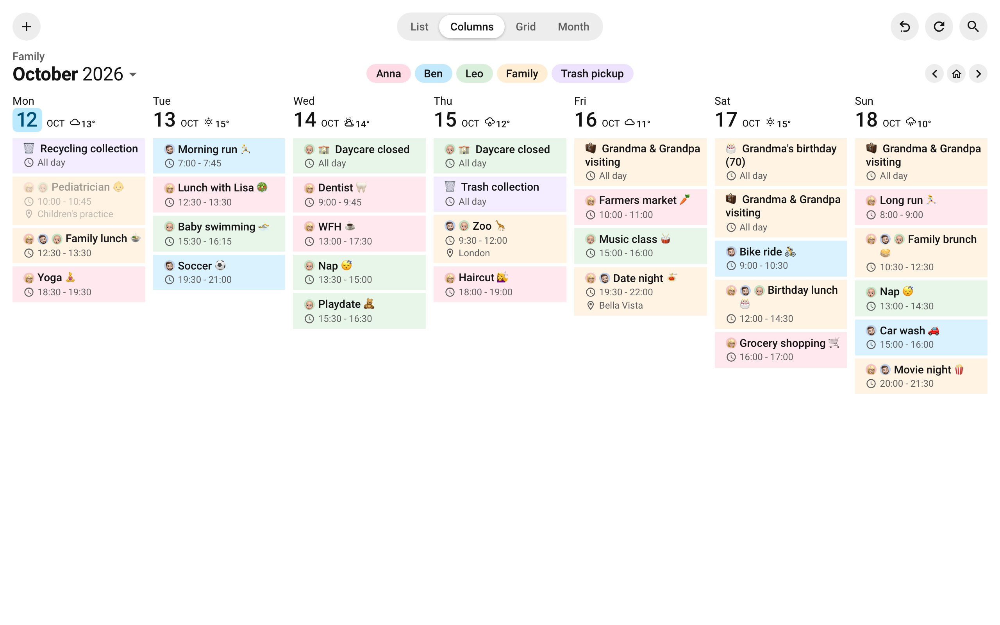
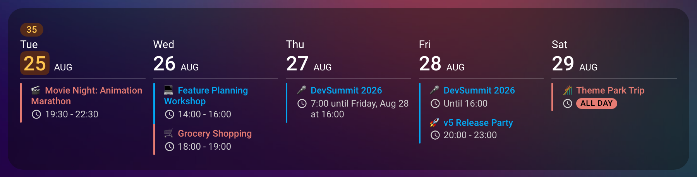
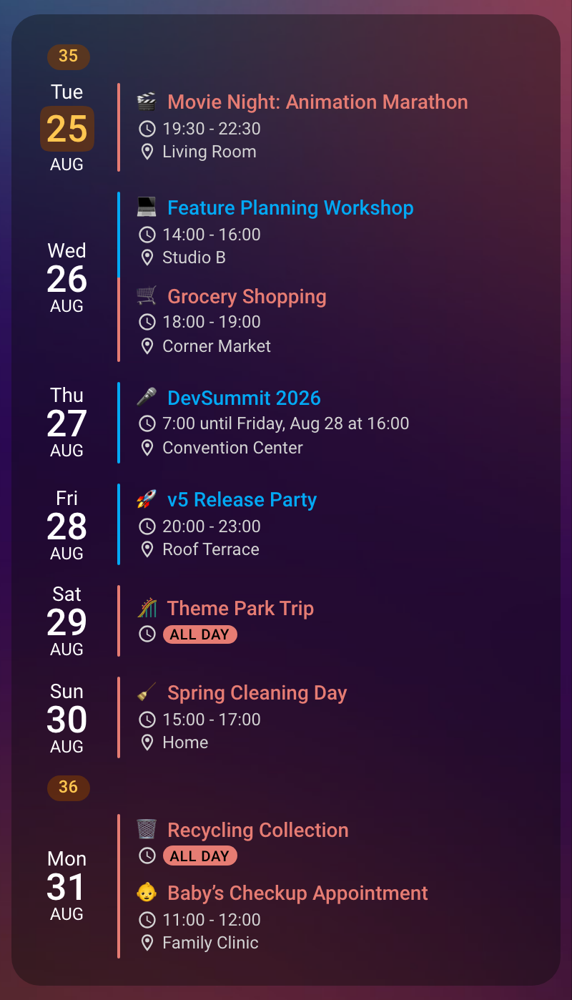
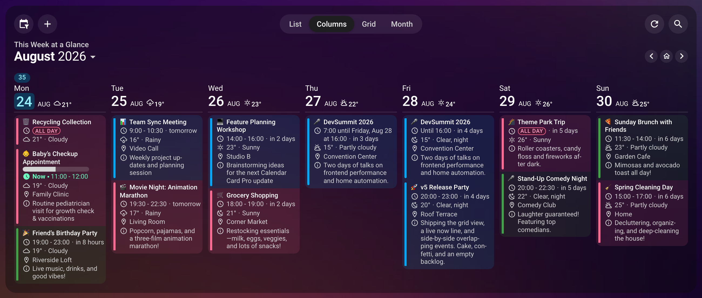
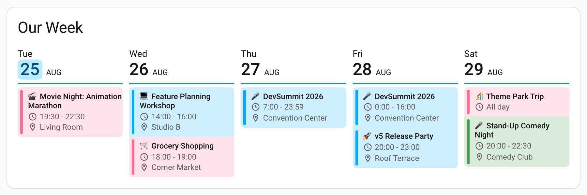

# Column View

Column view places the days side by side, one column each, so a week reads across the card
rather than down it. It is the same agenda the list layout shows, rotated — your events,
labels and colors carry over as they are, apart from
[two options that start from a different default](#options-that-start-from-a-different-default).

<br>

The [Family Hub](/guide/family-calendar) story on its wall tablet, switched to Columns. The YAML below is all it takes to switch a card to columns.

Set it with `view`. The default, `list`, stacks each day above the next.

```yaml
view: column
days_to_show: 5
```

In the [visual editor](/features/editor#options-for-the-selected-view), the circle on a layout's
row under **Layouts** chooses the layout the card opens with. Select the **Columns** row itself to
edit column view's own values, including its column-only options, without changing the card.

Column view is responsive by design. On a card too narrow for every configured day, one with the
toolbar's date navigation draws fewer columns, down to two, keeping today, and pages to the rest;
a card without it keeps every day as columns or falls back to the list layout. See
[Showing Fewer Columns on Narrow Cards](#showing-fewer-columns-on-narrow-cards).

## 📱 Showing Fewer Columns on Narrow Cards

A card too narrow for all its days drops columns one at a time, down to `min_days_to_show`, so a
week stays side by side on a tablet and still reads as columns on a phone. Unset, that is two on a
card with the toolbar's [date navigation](/features/header-toolbar#paging-through-dates), whose
arrows and swipe page to the days dropped, and every day on a card without it, which therefore
keeps its days or turns into a list.

<br>

The same seven-day card, wide enough for five of its days. Nothing marks the two that were
dropped, which is the point of the warning below.

```yaml
type: custom:calendar-card-pro
entities:
  - calendar.family
view: column
days_to_show: 7
column:
  min_days_to_show: 3
```

That card shows seven columns when there is room, then six, five, four and three as it
narrows, and only falls back to the list layout once even three columns will not fit. A
`min_days_to_show` you write applies with or without date navigation. Set it to the number of
days shown to keep every day: the card then draws all of them as columns, or as a list where they
do not fit.

::: warning Changed in v6
Before v6, a card without `min_days_to_show` kept every day as columns, or turned into a list.
Now a card with the toolbar's date navigation drops columns down to two first; a card without it
behaves as before. To keep the old behavior with date navigation, set `column.min_days_to_show`
to your `days_to_show`. See
[What Else Changes on an Existing Card](/guide/upgrading#what-else-changes-on-an-existing-card).
:::

The columns that stay always include today. They start at today and run forward, reaching
back to earlier days only when the range ends before the columns are full. So a week that
starts on Monday, three columns wide on a Wednesday, shows Wednesday to Friday; on a Sunday
it shows Friday to Sunday. A range that lies entirely ahead keeps its first days, and one
that lies entirely behind keeps its last. The columns move on at midnight.

::: warning Dropped Days Are Not Marked
A card showing two of seven days looks exactly like a card configured for two days: nothing
says days were dropped. With the toolbar's [date navigation](/features/header-toolbar#paging-through-dates),
the arrows and a swipe page through them by the days drawn. Without it, the card drops days only
where you set `min_days_to_show` below the number of days shown, and those days cannot be reached
in Columns. To see every day, set `min_days_to_show` to the number of days shown.
:::

## 📋 Falling Back to the List Layout

Below `min_days_to_show` columns the card renders as a list instead. `min_day_width` sets how
narrow a column may get, in pixels, `140` by default.

<br>

That is a seven-day column card that keeps every day (`min_days_to_show: 7`), on a phone too narrow for seven columns, so it renders as a list. Its `column:` block hides locations and tightens the type for narrow columns. Three things change with the layout, all of them defaults rather than anything the card was told to do: the locations reappear, because a `column:` override only applies while the card renders as columns; the empty day disappears, because `show_empty_days` is `false` outside column view; and the multi-day trip is no longer split across days.

```yaml
type: custom:calendar-card-pro
entities:
  - calendar.family
view: column
days_to_show: 5
column:
  min_day_width: 170
```

Raising `min_day_width` makes the card drop columns, and give up the column layout, sooner,
which is what you want when your events have long titles. Lowering it keeps more columns on
narrower cards, at the cost of more wrapping.

The list shows List's own `days_to_show`, not the column layout's; see
[Showing a Different Number of Days in Each Layout](/features/layouts#showing-a-different-number-of-days-in-each-layout).

## ⚠️ When Even the Fewest Columns Will Not Fit

`min_days_fallback` decides what happens at the very bottom. The default, `list`, gives up
the column layout — the behavior described above. Set it to `cramp` and the card holds at
`min_days_to_show` columns instead, letting them narrow past `min_day_width`:

```yaml
column:
  min_days_to_show: 2
  min_days_fallback: cramp
```

Use `cramp` when the column layout matters more to you than legibility at extreme widths —
on a phone-width card, for example, where two cramped columns still beat a long list. It can
produce a card too cramped to read; that is the trade. With `cramp` and no `min_days_to_show`,
the card keeps every day and narrows them all.

### Setting It in the Visual Editor

On Columns' Size & Spacing, under **Narrow Cards**, **When Too Narrow** sets both options as one
choice:

- **Show fewer days, then a list**, the default, writes nothing, or a `min_days_to_show` below the
  number of days shown, which **Down To** sets.
- **Show a list** writes `min_days_to_show` at the number of days shown, so the card keeps every
  day as columns or turns into a list.
- **Keep the days, narrower** writes `min_days_fallback: cramp`.
- **Custom** writes `min_days_fallback: cramp` with a `min_days_to_show` below the number of days
  shown, which **Below That** and **Down To** set: the card drops columns down to that number,
  then keeps those narrower.

**Minimum Day Width**, beside it, is `min_day_width`. Opening the editor rewrites nothing: any
combination of the two options reads as one of the four choices. Under the headings,
**At Common Card Widths** shows what each layout the card can show draws on a phone, in a
Sections column and on wider cards, and **This card renders** gives the width each number of
columns needs; see [Narrow Cards](/features/editor#narrow-cards).

**→ [Column-Only Options in the configuration reference](/reference/configuration#column-only-options)** — full option table.

## 🎛️ Overriding Options in Column View

A column is far narrower than a full-width row, so a value tuned for the list layout is often wrong in a column. The `column:` block holds the values that apply only when the card renders as columns. Anything the block does not mention keeps its top-level value, with two exceptions covered in [Options That Start From a Different Default](#options-that-start-from-a-different-default).

```yaml
show_location: true
event_font_size: 14px
column:
  show_location: false
  event_font_size: 11px
```

That card shows the location in list view and hides it in column view. The block works in both directions, so an option switched off at the top level can be switched back on for columns:

```yaml
show_description: false
column:
  show_description: true
```

What decides the outcome is whether the block mentions an option at all, not what value it holds. `show_location: false` inside the block is a real instruction to hide the location, not an empty value that falls back to the top level. Hiding a field keeps it out of the rows only: the [event details](/features/actions#event-details) still show it, and [`private: true`](/features/core-settings#keeping-a-calendar-private) is what keeps a calendar's text off the card.

The block covers the card's dimensions too: the same events laid out side by side are far shorter than they are stacked, so a `card_height` or `card_max_height` tuned for one layout is usually wrong for the other. See [A Height Per Layout](/features/layout-appearance#a-height-per-layout).

[`time_position: title`](/features/event-content#time-beside-the-title) is another option worth setting per view. In the default column width of about 140px, a time with a countdown rarely fits at the end of a title and takes a line of its own, which saves little; with `title_max_lines: 1` the title beside a time keeps room for a word or so, and the warning in [Time Beside the Title](/features/event-content#time-beside-the-title) gives the widths it needs. To leave the columns exactly as they are, set it in `list:` alone.

## 🔀 Options That Start From a Different Default

Two options mean something different once days sit side by side, so column view starts them from its own default rather than from yours.

| Option                  | Type    | Default | Column Default |
| ----------------------- | ------- | ------- | -------------- |
| `show_empty_days`       | boolean | `false` | `true`         |
| `split_multiday_events` | boolean | `false` | `true`         |

With both on, the columns are consecutive days, empty or not, and an event spanning three days appears in all three.

These two do **not** inherit the top-level value at all. Setting `show_empty_days: false` at the top level changes the list layout only; column view keeps showing empty days. The way to change it for columns is the block:

```yaml
show_empty_days: false # list view hides them
column:
  show_empty_days: false # columns hide them too
```

Showing empty days also leaves [`show_empty_today`](/features/event-content#showing-today-when-it-is-empty)
with nothing to do in column view, since today is already on the card. It takes effect there
once `show_empty_days: false` is set in `column:` as well.

`show_past_events` is different: Column inherits its top-level value unless `column:`
overrides it. Grid substitutes `true` for both `show_empty_days` and `show_past_events`. The
editor guide includes the [comparison across the layouts](/features/editor#yaml-view-defaults).

## 🚫 Options That Cannot Be Overridden

Some options act on the card as a whole, so they hold one value in every layout and are
ignored inside `list:`, `column:`, `time_grid:` or `month:`. Set them at the top level.

Which events and forecasts the card loads:

`entities` · `start_date` · `first_day_of_week` · `weather_entity` · `refresh_interval` · `refresh_on_navigate`

Its actions, its toolbar and how it opens full size:

`tap_action` · `hold_action` · `day_tap_action` · `event_tap_action` · `event_hold_action` · `open_links` · `allow_event_edit` · `allow_event_delete` · `toolbar` · `overlay`

Its title, its colors and how it writes dates and times:

`title` · `title_font_size` · `title_color` · `background_color` · `accent_color` · `weekday_color` · `day_color` · `month_color` · `weekend_weekday_color` · `weekend_day_color` · `weekend_month_color` · `today_weekday_color` · `today_day_color` · `today_month_color` · `time_24h` · `language`

Which class of event it keeps, and whether it hides when there is nothing to show:

`event_type` · `hide_when_empty`

An entry the card does not recognize is ignored rather than treated as an error, so one stray line cannot break the rest of the card. If an override seems to do nothing, check it is not one of the options above. The visual editor names every such option under **Options the Card Ignores** at the top of its overview and offers to move it; see [Options the Card Ignores](/features/editor#options-the-card-ignores).

`weather_entity` needs a word. It is the one entity every layout draws its forecast from; how a
layout draws it is that layout's own `weather:`, which belongs in its block. A top-level
`weather:` that names an entity is weather as written before v6, and overrides the layout
blocks: List, Columns and Grid draw it, Month draws none, and every block's `weather:` and
`weather_entity` are ignored. See [Weather Per Layout](/features/weather#weather-per-layout).

Three options sound as though they belong in the first list, and do not:

- **`days_to_show`** also decides what is loaded, yet each layout but Month, which counts in
  weeks, may set its own: the card loads the longest count among the layouts it can show,
  with Month's weeks where it can show Month, and each draws its own days out of that load. See
  [Showing a Different Number of Days in Each Layout](/features/layouts#showing-a-different-number-of-days-in-each-layout).
- **`show_past_events`** and **`filter_duplicates`** filter events the card has already loaded,
  so they can differ per view — and often want to, because a column is a narrow space where a
  finished event or a second copy of the same meeting costs more than it does in a full-width
  row:

```yaml
view: column
show_past_events: true
filter_duplicates: false
column:
  show_past_events: false # a column is too narrow to spend on what is over
  filter_duplicates: true # and too narrow to show the same meeting twice
```

## 💤 Options That Do Nothing in Column View

A few options describe something the column layout does not have, so they are read in list
view and ignored in column view. They are not errors and they are not removed — the same
card renders as a list whenever it is too narrow for columns, and every one of these
applies again the moment it does.

**`date_vertical_alignment`** positions the date inside a tall date cell. A column header
sits above its events rather than beside them, so there is no cell to move it in.

**`today_indicator_position`** places the marker within that same date cell, as a
percentage of it. In column view the indicator is a leading item on the weekday row
instead — so `today_indicator`, `today_indicator_size` and `today_indicator_color` all
still apply, and only the position does not. The default [date tile](/features/layout-appearance#the-date-tile)
uses neither the position nor the size: it sits on the day number itself, and every
column's date keeps the tile's height so the headers stay level.

**`compact_events_to_show`, `compact_days_to_show` and `compact_events_complete_days`**
belong to compact mode, which caps the whole card rather than each column, and so do
**`compact_card_height` and `compact_card_max_height`**, the compact card's own height. Column
density is controlled by [`min_days_to_show` and `min_days_fallback`](#showing-fewer-columns-on-narrow-cards)
instead.

**`event_order`** turns a list upside down for a calendar used as a log. Columns keep time
running forward, left to right and down each day.

**`skip_first_events`** lets a second list card continue where a first one stops. Every
column is drawn whatever its events, so leaving events out would leave gaps rather than
continue anything.

**`month_separator_label`** writes the month's name at the start of the list's month rule, and
**`month_separator_label_color` and `month_separator_label_font_size`** style it. A column's month
rule is a vertical line in the gap between two days, with no room for words.

**`multiday_banners`** draws a long timed event as a banner in grid view's all-day band, and as a
bar in month view. A column has no such band: each day of the event is a row in its column, as
`split_multiday_events` decides. It does nothing in list view either.

**`lanes` and `min_lane_width`**, and a calendar's **`lane`**, give each calendar a fixed slice of
a grid's days; see [Calendar Lanes](/features/lanes). A column already lists every calendar's
events of its day, one under another.

::: tip Hidden When Editing Column View
Columns' pages leave these controls out. Stored values are preserved and still apply where they
are read: in List, which the card falls back to, the banner option in Grid and Month, and the
lane options in Grid. To
change them, open that layout under **Layouts**; the card keeps opening in its own layout.
A calendar's own compact limit and banner option are on its page under **Calendars**, which
holds the options of every layout the card can show and says which layouts each applies to.
See [Options for the Selected View](/features/editor#options-for-the-selected-view).
:::

**→ [Options With No Effect in Column View](/reference/configuration#options-with-no-effect-in-column-view)** — the same options in the configuration reference.

## 📊 Progress Bar & Countdown

A [countdown](/features/event-content#countdown-display) and a [progress bar](/features/event-content#progress-bar-display) never appear on the same event — a countdown means the event has not started or, [counting up](/features/event-content#counting-up-from-past-events), has ended, a bar means it is running now — so column view places each one differently.

<br>

The running event on the left carries the bar on its own row, and every later event carries a
countdown after its time.

**The countdown stays on the time row**, following the time and separated from it by a middot:

```
🕐 09:30 – 11:00 · in 2 days
```

**The progress bar takes a row of its own**, directly under the event title and above the time, spanning 80% of the column. Give it a different width with `progress_bar_width`, for both layouts at once or for columns only:

```yaml
show_progress_bar: true
progress_bar_width: '80px' # the bar on the list view's time row
column:
  progress_bar_width: '100%' # the bar on its own row in column view
```

Left unset entirely, each layout keeps the width that suits it — which is usually the right answer, since a width tuned for the column's own row is often too wide for the list view's time row.

With [`time_position: title`](/features/event-content#time-beside-the-title) the time sits on the title's line, so the bar's row comes directly under both.

::: details When the Countdown Wraps

- In a column too narrow to hold it, the whole phrase wraps as ordinary running text and
  continues under the time. The middot stays at the end of a line and never starts one.
- The countdown's words are not hyphenated: a word that does not fit at the end of a line moves
  whole to the next one, and only a word wider than the column itself is split.
- Beside an [all-day pill](/features/event-content#where-the-pill-goes) on the time row, a
  countdown that cannot share the pill's line moves under the pill, and the middot stays after
  it.
- With the time on two lines, `event_icon_vertical_alignment` decides where the clock sits
  against it. The default `top` lines the icon up with the first line; `middle` centers it
  against the whole wrapped block. See
  [Spacing & Alignment](/features/layout-appearance#spacing-alignment).

:::

## ↔️ Spacing Between Days

`day_spacing` is the space between one day and the next, and it applies in both layouts —
vertically between stacked days in a list, horizontally between columns.

```yaml
view: column
days_to_show: 5
day_spacing: 16px
```

It takes a per-view value like any other option, which is worth reaching for here. The gap
between two columns is the only thing separating one day's events from the next, so widen it
first if two columns read as one block. It is also the option that costs the most, because
every gap comes out of the width the columns themselves have to share.

```yaml
day_spacing: 10px
column:
  day_spacing: 16px
```

Within a column, a day's events touch and read as one block. Where several in a row share a
calendar color, they run together into one block of that color, and
[`event_gap`](/features/layout-appearance#gaps-between-events) holds each event apart
instead. Set inside `column:`, it separates the events within each column and leaves the list
layout joined:

```yaml
column:
  event_gap: 4px
```

## 📐 Spacing Options That Only Exist in Column View

A column layout can set the gap under each day header and draw a rule under that header,
neither of which a list has. Those options live inside `column:` and have no top-level
counterpart.

<br>

A 2px header rule in the primary color and a wider `day_header_gap`, with per-calendar
`accent_color` and `event_background_opacity`, which are ordinary options that apply in both
layouts.

| Option                       | Type   | Default                                                          | Description                                                                      |
| ---------------------------- | ------ | ---------------------------------------------------------------- | -------------------------------------------------------------------------------- |
| `day_header_gap`             | string | `8px`                                                            | Vertical space between a day header and its first event                          |
| `day_header_separator_width` | string | `0px`                                                            | Thickness of the rule under each day header; `0px`, the default, renders no rule |
| `day_header_separator_color` | string | `color-mix(in srgb, var(--primary-text-color) 18%, transparent)` | Color of that rule                                                               |

```yaml
view: column
days_to_show: 5
column:
  day_header_gap: 12px
  day_header_separator_width: 2px
  day_header_separator_color: var(--primary-color)
```

Each day draws its own rule inside its own header, so the gaps between columns break it into
one short line per day. In `time_grid:` the same two options draw one line under grid view's
whole date row instead, and only while there is an all-day band under it; see
[Grid Lines](/features/grid-view#grid-lines).

The header rule starts switched **off**. Switching it on centers it inside the space
`day_header_gap` already supplies rather than adding to it, so the events stay where they are
at any rule width.

::: tip Turning the Rule Off
Set `day_header_separator_width: 0px` rather than reaching for a transparent color: at `0px`
the card omits the element entirely.
:::

The `column:` block and every option inside it are listed under [Column-Only Options in the
configuration reference](/reference/configuration#column-only-options).

For card-mod styling, note that the day container is `.day-column` here rather than list
view's `.day-table`; both carry the same `today` / `tomorrow` / `past-day` / `future-day` /
`weekend` state classes. See [Day Container Classes](/features/theming#day-container-classes).
