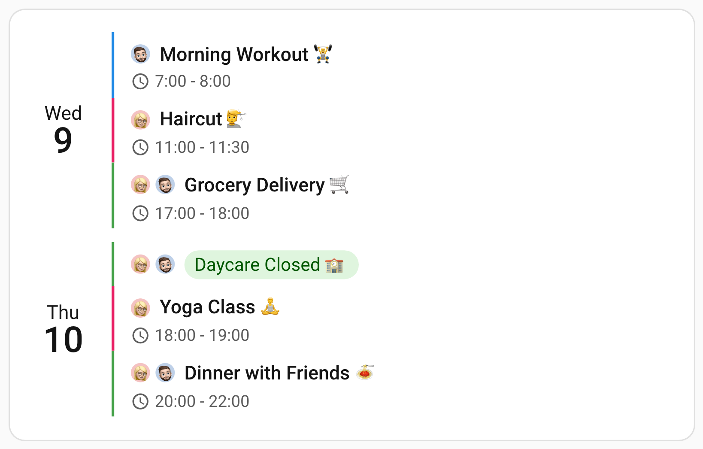

# Core Settings

Core settings control which calendars the card reads, which of their events it keeps, and how many of them it shows at once. Everything else in this documentation builds on the entity configuration described here.

## 🗂️ Entity Configuration

Calendar Card Pro can display events from multiple calendar entities in Home Assistant. The `entities` array accepts either:

1. **A simple entity ID** (default styling applies)
2. **An advanced object configuration** (custom styling per entity)

```yaml
entities:
  - calendar.family # Simple entity ID (default styling)
  - entity: calendar.work
    # Advanced object with custom styling (see options below)
    color: '#1e90ff'
    accent_color: '#ff6347'
```

### Available Options for Entity Configuration Objects

| Option                   | Type    | Default                  | Description                                                                                                                                                                                                                                                                                                                                                              |
| ------------------------ | ------- | ------------------------ | ------------------------------------------------------------------------------------------------------------------------------------------------------------------------------------------------------------------------------------------------------------------------------------------------------------------------------------------------------------------------ |
| `entity`                 | string  | —                        | **Required.** The calendar entity ID                                                                                                                                                                                                                                                                                                                                     |
| `name`                   | string  | Home Assistant's name    | The calendar's name on this card: in the calendar filter, the event popover, the "Couldn't load" line and the names grid view gives labels for screen readers. Never drawn on event rows. One per calendar, shared by every entry for it; see [Naming a Calendar in the Card](#naming-a-calendar-in-the-card)                                                            |
| `show_in_legend`         | boolean | `true`                   | Whether the [calendar filter](/features/layout-appearance#leaving-a-calendar-out-of-the-filter) lists this calendar. `false` leaves it out, as a chip and in the menu, and its events always show. One per calendar, shared by every entry for it                                                                                                                        |
| `label`                  | string  | `-`                      | Calendar label displayed before event titles. Supports text/emoji, MDI icons (`mdi:icon-name`), or images — any address, whether a file you saved (`/local/image.jpg`) or one Home Assistant serves (`/api/image/serve/…`). Accepts a person entity ID (`person.anna`) to show that person's picture, and `home-assistant` to follow this calendar's Home Assistant icon |
| `label_type`             | string  | derived from `label`     | Forces how `label` is read: `none`, `text`, `icon` or `image`. Only needed when the value alone would be read as the wrong kind                                                                                                                                                                                                                                          |
| `color`                  | string  | `event_color`            | Custom color for event titles from this calendar                                                                                                                                                                                                                                                                                                                         |
| `accent_color`           | string  | `accent_color`           | Custom color for the accent bar and event background (when `event_background_opacity` is >0). Accepts `home-assistant` to follow this calendar's Home Assistant color                                                                                                                                                                                                    |
| `label_icon_color`       | string  | `-`                      | Custom color for label icons (only applies to `mdi:` and other icon labels)                                                                                                                                                                                                                                                                                              |
| `text_scale`             | number  | `1`                      | Draws this calendar's event text, and the icons beside it, at this multiple of the card's sizes: `0.75` at three quarters; see [Scaling One Calendar's Text](#scaling-one-calendars-text)                                                                                                                                                                                |
| `show_time`              | boolean | `show_time`              | Whether to show event times for this calendar (overrides global `show_time` option)                                                                                                                                                                                                                                                                                      |
| `show_location`          | boolean | `show_location`          | Whether to show event locations for this calendar (overrides global `show_location` option). `false` also keeps them out of the [event popover](/features/actions#narrowing-what-the-popover-offers)                                                                                                                                                                     |
| `location_icon`          | string  | `mdi:map-marker-outline` | Icon shown beside this calendar's locations, e.g. `mdi:office-building`. Unset, Microsoft Teams meetings get `mdi:microsoft-teams` and every other location the map marker                                                                                                                                                                                               |
| `show_description`       | boolean | `show_description`       | Whether to show event descriptions for this calendar (overrides global `show_description` option). `false` also keeps them out of the [event popover](/features/actions#narrowing-what-the-popover-offers)                                                                                                                                                               |
| `compact_events_to_show` | number  | `-`                      | Most events this calendar shows while the card is compact. Its events still count toward the card-wide `compact_events_to_show`; see [Entity-Level vs. Global Event Limits](#entity-level-vs-global-event-limits)                                                                                                                                                        |
| `blocklist`              | string  | `-`                      | RegExp pattern to specify events to exclude (e.g., "Private\|Conference")                                                                                                                                                                                                                                                                                                |
| `allowlist`              | string  | `-`                      | RegExp pattern to specify events to include (e.g., "Birthday\|Anniversary")                                                                                                                                                                                                                                                                                              |
| `filter_field`           | string  | `title`                  | Which field `blocklist` and `allowlist` read: `title`, `location` or `description`. One at a time — list the calendar twice to filter on a second                                                                                                                                                                                                                        |
| `replace_field`          | string  | `title`                  | Which field `replace_pattern` and `replace_with` rewrite: `title`, `location` or `description`. One at a time, and listing the calendar twice does **not** add a second                                                                                                                                                                                                  |
| `replace_pattern`        | string  | `-`                      | RegExp pattern to find in that field. Every match is replaced, whatever its case. Unset, the whole field is replaced instead                                                                                                                                                                                                                                             |
| `replace_with`           | string  | `-`                      | Text to put in place of each match, or of the whole field when `replace_pattern` is unset. Unset, the match is removed                                                                                                                                                                                                                                                   |
| `split_multiday_events`  | boolean | `split_multiday_events`  | Whether multi-day events from this calendar span each day they cover (overrides global `split_multiday_events`)                                                                                                                                                                                                                                                          |
| `event_type`             | string  | `event_type`             | Which class of this calendar's events to keep — `all`, `timed` for events with a clock time, or `all_day` for all-day ones (overrides global `event_type`)                                                                                                                                                                                                               |
| `allday_expires_at`      | string  | midnight                 | Time of day, as `HH:MM`, at which this calendar's all-day events start counting as past, read against the last day each one covers. Unset, they last until midnight. Only applies while `show_past_events` is `false`                                                                                                                                                    |
| `days_of_week`           | string  | `-`                      | Restricts this calendar to `weekdays` (every day except the weekend) or `weekends` (the weekend days alone), judged on the day each row lands on. Which days are the weekend follows the country set in Home Assistant, or its language when no country is set. Unset, every day qualifies                                                                               |
| `visibility`             | list    | `-`                      | Home Assistant visibility conditions, as a card's own Visibility tab takes them. This entry's events show only while all of them hold; unset, they always show. See [Showing a Calendar Under Conditions](#showing-a-calendar-under-conditions)                                                                                                                          |

These options are per calendar. For the card-wide options they override, see [Core Settings in the configuration reference](/reference/configuration#core-settings).

### Naming a Calendar in the Card

The card names each calendar as Home Assistant does, which is often a name its integration
chose rather than one you would. `name` gives a calendar a name of its own on this card, and
leaves it as it is everywhere else:

```yaml
type: custom:calendar-card-pro
entities:
  - entity: calendar.anna_personal
    name: Anna
  - entity: calendar.family_shared
    name: Family
toolbar:
  show: true
  legend: chips
```

The name is used wherever the card itself names a calendar:

- the chips and the menu of the [calendar filter](/features/layout-appearance#showing-hiding-calendars);
- the [event popover](/features/actions#the-event-popover), for the event's own calendar and
  for the calendars it can move to or a new event can be added to;
- the "Couldn't load: …" line at the foot of the card when a calendar
  [fails to load](/features/performance#when-a-calendar-fails-to-load);
- the names [grid view](/features/grid-view) gives icon and picture labels for screen readers.

Left unset, each of these keeps Home Assistant's name for the calendar, or its entity ID where
Home Assistant has none. Home Assistant's own controls keep Home Assistant's name either way:
the calendar picker in the visual editor, the heading of each calendar's panel beneath it, and
Home Assistant's more-info dialog.

A name never draws on an event row. That is what [`label`](#choosing-how-a-label-is-read) is
for, and a calendar can have either, both or neither.

::: details Calendars Listed Twice, Typos & Hidden Calendars

- The name belongs to the calendar, not to one entry in `entities`. A calendar listed twice, as
  [splitting it by event type](#separating-all-day-from-timed-events) does, has one name: the
  [visual editor](/features/editor#per-calendar-panels-actions) writes it to every entry for
  that calendar, and in YAML the first entry that sets one wins.
- A calendar whose entity ID Home Assistant does not know, usually because of a typo, keeps its
  ID beside its name in the "Couldn't load" line, as in "Couldn't load: Anna
  (calendar.ana_personal)", so the entry to fix is easy to find.
- Like any change to the configuration, renaming a calendar shows every hidden calendar again on
  every device; see [Showing & Hiding Calendars](/features/layout-appearance#showing-hiding-calendars).

:::

### Showing a Calendar Under Conditions

`visibility` shows a calendar only while Home Assistant conditions hold, so one card can show
each person their own calendars, drop a work calendar during a holiday, or keep the birthdays
off the kitchen tablet. It takes the conditions a card's own **Visibility** tab in Home
Assistant takes, for one calendar at a time:

```yaml
type: custom:calendar-card-pro
entities:
  - calendar.family
  - entity: calendar.anna_work
    visibility:
      - condition: user
        users:
          - 8a1c3f2e9b0d4c6a
      - condition: state
        entity: input_boolean.vacation
        state: 'off'
  - entity: calendar.birthdays
    visibility:
      - condition: screen
        media_query: '(min-width: 1024px)'
```

A calendar's events show while every condition in its list holds, and a calendar with no list
always shows. In the [visual editor](/features/editor#per-calendar-panels-actions), each
calendar's panel has a **Visibility** section holding Home Assistant's own Visibility editor, the
one under a card's **Visibility** tab, which picks people by name rather than by ID.

Every condition that editor offers works here:

- `user`, `state`, `numeric_state`, `screen`, `time` and `location` (where the person linked to
  your Home Assistant user is), and `and`, `or` and `not` over any of them;
- `template`, `sun`, `zone`, `device`, and a `state` that must have held `for` a while, which
  Home Assistant judges itself. These need Home Assistant 2026.10 or later, and a calendar that
  depends on one stays hidden until Home Assistant has answered.

A calendar hidden this way is not on the card for that person at that moment. Its events are
gone from every view and from [search](/features/layout-appearance#searching-the-card), it has
no chip or row in the [calendar filter](/features/layout-appearance#showing-hiding-calendars),
new events cannot be added or moved to it, and the event limits fill from the calendars shown.
The card still loads it, so it reappears the moment a condition changes.

::: warning Not a Privacy Control
Conditions tidy a shared card; they do not keep a calendar private. Everyone with a Home
Assistant login can read every calendar through Home Assistant itself, and anyone who can open
the dashboard can read its configuration, conditions included.
:::

::: details Older Home Assistant, Calendars Listed Twice & Editing

- Before Home Assistant 2026.10, a calendar whose conditions depend on `template`, `sun`, `zone`,
  `device` or a `state` held `for` a while stays hidden, and the browser console says why once.
  2026.6 to 2026.9 judge them for administrators only. A template binary sensor does the same job
  on any version: put the test in the sensor, and use `condition: state` on it.
- Before Home Assistant 2023.11, which has no Visibility editor to lend, the panel takes the
  conditions as YAML instead.
- Written by hand, a `state` or `numeric_state` condition naming its entity with `entity` rather
  than `entity_id` cannot wait (`for`) or use a `value_template`. Its calendar stays hidden, and
  the browser console says why. Home Assistant's editor writes `entity_id`.
- Conditions belong to one entry in `entities`. A calendar listed twice, as
  [splitting it by event type](#separating-all-day-from-timed-events) does, needs them on each
  entry, and one entry can show while the other does not. The calendar leaves the filter, adding
  events and the "Couldn't load" line only while all its entries are hidden.
- A `state` or `numeric_state` condition with no `entity` reads the calendar itself, which is
  `on` while one of its events is under way.
- `time` reads the time zone your Home Assistant profile sets: the server's or this device's.
- While the card is being edited every calendar shows, so you can still style one hidden from
  you.
- A calendar the filter hid stays hidden there while its conditions hide it, and when it comes
  back.
- An event's popover or a new event's form that is already open when a condition changes keeps
  the calendars it opened with until it closes.

:::

### Using the Colors From Home Assistant

Home Assistant holds a color for each calendar entity, which the built-in calendar card and
calendar panel already use. Setting `accent_color` to `home-assistant` makes Calendar Card Pro
follow it, so a calendar keeps the same color everywhere.

Set it card-wide and every calendar follows its own color:

```yaml
type: custom:calendar-card-pro
accent_color: home-assistant
entities:
  - calendar.work
  - calendar.family
  - calendar.trash
```

Or per calendar, mixing it freely with your own colors:

```yaml
type: custom:calendar-card-pro
entities:
  - entity: calendar.work
    accent_color: home-assistant # follows Home Assistant
  - entity: calendar.family
    accent_color: '#43a047' # your own color wins
  - calendar.trash # follows the card
```

::: warning Requires Home Assistant 2026.2
Calendar colors were added in Home Assistant 2026.2. On an older version there is nothing to
read, and every calendar falls back exactly as described below.
:::

**Calendars Home Assistant has no color for fall back rather than losing their color.** A
per-calendar `home-assistant` falls back to the card's `accent_color`; a card-wide
`home-assistant` falls back to the card's default accent, which is your theme's primary color
(`#03a9f4` where the theme defines none).

**Google Calendar is currently the only integration that fills the color in for you**, and
only when a calendar is **first added** to Home Assistant. Local Calendar, CalDAV and ICS
feeds start with no color, so beside Google they stay on the fallback until you give them a
color by hand. That is the fallback working, not a bug.

::: tip Setting a Color By Hand
Any calendar can be given a color, whichever integration it came from. Open **Settings →
Devices & Services → Entities**, pick the calendar, and use the color field in its settings.
:::

::: warning A Google Integration Older Than 2026.2 Has No Colors, and Nothing Back-Fills Them
Google's colors are copied only when a calendar is first added, so a Google integration set
up before Home Assistant 2026.2 has none, and every calendar shows the fallback. It looks
exactly like the feature not working.

**Removing and re-adding the integration does not fix this.** Home Assistant restores a
removed calendar's old settings when it comes back, color included, and skips the import.
Set the colors by hand instead. A color you set yourself is restored the same way, so it
survives removing and re-adding the integration later.
:::

### Choosing How a Label Is Read

`label` holds one of four things — nothing, text or an emoji, an icon, or the address of an
image — and the card works out which by looking at the value. A value starting `mdi:` is an
icon. An address is an image: anything beginning with `/` or `https://`, plus a relative
filename ending in a picture extension. Anything else is text. That is right almost always,
so most configurations never need to say more:

```yaml
entities:
  - entity: calendar.family
    label: '📅' # text
  - entity: calendar.work
    label: mdi:briefcase # icon
  - entity: calendar.school
    label: /local/school.png # image
```

In grid view, all-day banners show the title alone, without the label.

`label_type` is for the cases where reading the value gets it wrong. Set it to `none`,
`text`, `icon` or `image` and it wins over the value:

```yaml
entities:
  # Shows the text "mdi:calendar" rather than the icon of that name
  - entity: calendar.notes
    label: 'mdi:calendar'
    label_type: text
```

Existing configurations need no change: leave `label_type` out and the card reads the value
as described above.

::: tip Visual Editor
The **Label Type** dropdown under each calendar writes this for you, and only when it has
to. Pick a type and the right control appears below it — a text box, Home Assistant's icon
browser, or a path field — along with **Label Icon Color** where the label is an icon.
:::

### Using a Picture Home Assistant Already Serves

An image label does not have to be a file you saved in `www/`. Home Assistant serves the
pictures it holds over addresses beginning `/api/`, and some of them work as a label, a
person's photo among them:

```yaml
entities:
  - entity: calendar.anna
    label: /api/image/serve/5f2b9c0e7d14a6b38e90c1d2f4a7b6e3/512x512 # a picture, by address
```

Find the address in **Settings → Tools → States** (**Developer Tools** before Home Assistant
2026.8, in the sidebar before 2026.2): pick the entity and read its `entity_picture` attribute. A
person's picture (`/api/image/serve/…`) loads with no further setup.

An address that carries a `token=` does not keep working as a label. A camera's frame is
one: Home Assistant refuses the address without its token and replaces the token regularly.
A media player's artwork and an image entity's picture carry a token too, and current Home
Assistant also refuses an integration's brand icon (`/api/brands/…`) to a card.

::: tip For a Person, Name the Person Instead
The example above works, but there is a shorter way that does not go stale — see
[Showing a Person's Picture](#showing-a-persons-picture) below.
:::

::: warning A Text Label Beginning With a Slash
Because the card reads a leading `/` as the start of an address, a label you mean as words
needs `label_type: text` to stay words:

```yaml
entities:
  - entity: calendar.notes
    label: /dev
    label_type: text
```

:::

### Showing a Person's Picture

Set `label` to a **person entity ID** and the card shows that person's picture. You do not
have to find the address, and a new photo in Home Assistant appears on the card without
touching your configuration:

```yaml
type: custom:calendar-card-pro
entities:
  - entity: calendar.anna
    label: person.anna # Anna's photo
  - entity: calendar.ben
    label: person.ben
  - calendar.family # no label
```

The picture carries the person's name from Home Assistant as its text alternative, so a
screen reader says whose event it is. A picture given by its address is treated as
decoration and skipped, the way icon and emoji labels are.

**Only `person.` entity IDs are read this way.** Another entity's picture has to be given by
its address, and not every address keeps working; see
[above](#using-a-picture-home-assistant-already-serves).

**A person Home Assistant has no picture for shows no label**, rather than an empty space
where one would go, and so does a `person.` ID naming somebody who no longer exists.

::: tip Setting a Person's Picture
Open **Settings → People**, pick the person, and use the picture field. A person does not
need a Home Assistant login to have one.
:::

::: tip Visual Editor
Choose **An Image** as the label type and an **Image Source** dropdown appears above the
field. Set it to **A person's picture** and the field becomes a person picker; leave it on
**Custom image** for a path you type yourself.
:::

::: warning A Text Label Shaped Like a Person
The card reads `person.anna` as "show that person's picture" rather than as literal text. On
the rare occasion you want the characters themselves, say so with `label_type`:

```yaml
entities:
  - entity: calendar.notes
    label: person.anna
    label_type: text
```

:::

### Following the Icon From Home Assistant

Home Assistant holds an icon for each calendar entity as well as a color, and `label` takes
the same `home-assistant` value the [accent color](#using-the-colors-from-home-assistant)
does. The card then shows whatever icon that calendar has in Home Assistant, so changing it
there changes it on the card too:

```yaml
type: custom:calendar-card-pro
entities:
  - entity: calendar.work
    label: home-assistant # follows Home Assistant's icon
  - entity: calendar.family
    label: mdi:home # your own icon wins
  - calendar.trash # no label
```

It is per calendar only, with no card-wide counterpart.

**A calendar Home Assistant has no icon for shows no label**, rather than an empty space
where one would go. Most integrations supply no icon, so this usually means setting one
yourself, in the same place as a color:

::: tip Setting an Icon By Hand
Open **Settings → Devices & Services → Entities**, pick the calendar, and use the icon field
in its settings. Any calendar can be given one, whichever integration it came from.
:::

::: tip Visual Editor
Choose **An Icon** as the label type and an **Icon Source** dropdown appears above the
picker. Set it to **Follow Home Assistant** and the picker goes away. **Label Icon Color**
stays either way, so an inherited icon can still be tinted to match the rest of your card.
:::

An icon changed in Home Assistant appears without reloading the dashboard or waiting for the
next calendar refresh.

::: warning `home-assistant` as a Literal Label
The card reads `home-assistant` as "follow Home Assistant" rather than as literal text. On
the rare occasion you want the words themselves, say so with `label_type`:

```yaml
entities:
  - entity: calendar.notes
    label: home-assistant
    label_type: text
```

:::

### Scaling One Calendar's Text

`text_scale` draws one calendar's events with smaller or larger text, so a calendar that only
needs to be there, such as a school's, takes less room and less attention than the rest. It
multiplies the card's own sizes: `0.75` draws them at three quarters, `1.25` at a quarter more.

```yaml
type: custom:calendar-card-pro
entities:
  - calendar.family
  - entity: calendar.school
    text_scale: 0.75
```

It scales the text in each of the calendar's events and the icons beside it: the title with its
label, the time with its countdown, the location, the description and the event's weather. The
spacing around them stays as it is, so a scaled-down row is shorter and a scaled-up one taller.
In grid view a block keeps the height its times give it, and its title and time fit into it as
they would at any other size.

It applies in list, column and grid view, all-day banners included. The event popover, search
results and calendar filter keep the card's sizes. Left unset, or set to anything but a number
above 0, the calendar's events draw as the card's do.

::: tip Visual Editor
**Text Scale** is the last field under **Name & Appearance** in each calendar's panel.
:::

::: details Calendars Listed Twice, Merged Rows, Grid Overlaps & Theming

- The scale belongs to the entry, not the calendar. A calendar listed twice, as
  [splitting it by event type](#separating-all-day-from-timed-events) does, can draw its all-day
  and its timed events at two scales.
- A row [merged from several calendars](#filtering-duplicate-events) takes the scale of the
  calendar listed first among them.
- In grid view, an event that starts shortly after a scaled-up one is drawn beside it rather
  than over it until it starts far enough in to leave room for that event's larger title.
- A font size written as a keyword, such as `large`, is scaled from the size browsers draw it at
  by default. One that names a variable, as in `var(--my-size)`, is scaled whole; a variable
  holding a keyword cannot be multiplied, and the text then takes the size of the text around it.
- An icon size in `em` is scaled once, with the text it sits beside. One that names a variable
  is scaled whole, which suits a variable holding a length such as `14px`; one holding an `em`
  length comes out smaller than the text beside it.
- A scaled calendar writes the card's size properties on its own events, so a card-mod rule
  setting one of them on `.event` needs `!important` to reach that calendar's events; see
  [Weather Custom Properties](/features/theming#weather-custom-properties). Its events carry
  the class `event-text-scaled`.

:::

## 🔍 Event Filtering

Calendar Card Pro provides powerful filtering capabilities to control exactly which events appear on your dashboard:

::: tip Visual Editor
Each calendar's own filters are under **Calendars**, in that calendar's panel, under **Event Filtering** — **Blocklist** and **Allowlist** among them, with **Match Against** choosing the field they read. **Filter Duplicates** works across calendars, so it is card-wide: find it under **Time Range & Content** → **Event Filtering**.
:::

### Filtering by Event Name

`blocklist` hides a calendar's events whose title matches a pattern, and `allowlist` keeps
only the ones that match. Both are regular expressions, so `|` separates alternatives:

```yaml
entities:
  - entity: calendar.work
    blocklist: 'Private|Conference' # Hide events with these words
  - entity: calendar.personal
    allowlist: 'Birthday|Anniversary' # Only show events with these words
```

Set both and both apply: an event has to match the allowlist _and_ escape the blocklist to be
shown. That is how you say "these, except those":

```yaml
entities:
  - entity: calendar.energy
    allowlist: 'Cheap' # only the cheap-rate events
    blocklist: 'quarter' # but not the quarter-hourly ones
```

### Matching the Location or Description Instead

By default both lists read the event **title**. `filter_field` points them somewhere else:
it takes `title`, `location` or `description`, and applies to that calendar's `blocklist`
and `allowlist` alike.

```yaml
entities:
  - entity: calendar.work
    filter_field: location
    blocklist: 'zoom\.us' # hide the events whose location is a Zoom link
```

It selects a field rather than adding one, so a calendar filtering on `location` has
stopped filtering on the title. To filter on two fields, list the calendar twice — each
block filters independently.

An event that has no location at all, or no description, counts as not matching: an
allowlist drops it and a blocklist keeps it, just as for an event with no title.

::: details Plain Patterns & HTML in Descriptions

- A pattern has no prefix syntax: `allowlist: 'location:'` matches the literal text
  `location:` in a title.
- The card strips HTML out of descriptions for display, but the filter reads the description
  as your calendar delivered it. With Google Calendar that usually means HTML, so a pattern
  matching a link may need to allow for the anchor markup wrapped around it.
- `show_description: false` hides descriptions without stopping them being filtered on.

:::

### Hiding Google Tasks Blended Into a Calendar

With **Show tasks in Calendar** enabled, Google surfaces scheduled Google Tasks through the
Calendar API as synthetic events **inside the same feed** as real ones. There is no separate
calendar entity for them, so they cannot be filtered out by leaving an entity off the card,
and their titles are whatever the task happened to be called — `contact admissions` — so no
title pattern can catch them reliably.

They all carry the same tell in their description, and `filter_field` reaches it:

```yaml
entities:
  - entity: calendar.work
    filter_field: description
    blocklist: 'tasks\.google\.com/task/'
```

Google's boilerplate reads:

```
Changes made to the title, description or attachments will not be saved.
To make edits, please go to: https://tasks.google.com/task/<id>
```

**Match the URL, not the sentence above it.** Google translates that sentence for every
account language; it does not translate the URL. The URL also matches whether the
description arrives as HTML or as plain text, where a pattern spanning translated words
might not.

The same approach works for any source that injects boilerplate-bearing events into a feed:
find a phrase every one of them carries and no real event does, and block on it.

### Giving Teams Meetings Their Own Icon

Pairing `filter_field: location` with [`location_icon`](/features/event-content#the-location-icon)
splits one calendar into online and in-person halves, each with its own icon and color:

```yaml
entities:
  - entity: calendar.work
    allowlist: 'Microsoft Teams'
    filter_field: location
    accent_color: '#6264a7'
  - entity: calendar.work
    blocklist: 'Microsoft Teams'
    filter_field: location
    location_icon: mdi:office-building
```

Because the same pattern is allowed in one block and blocked in the other, every event
lands in exactly one of them — nothing is lost and nothing appears twice. The visual
editor's **Duplicate** action on a calendar's panel builds the second block for you.

Teams meetings need no allowlist to get their icon; that happens on its own. This pattern
is for when you want the two halves styled differently, or want a specific icon on the
half that is _not_ a Teams call.

### Hiding a Location That Is Really a Meeting URL

Online meetings tend to put a long join URL where a room name should be, and one of those
across a card is enough to unbalance every row around it. You usually still want the
event — just not that line of text under it.

`show_location` is a per-calendar option, so the partition above solves this too. Split
the calendar on the pattern and turn the location off on the half that carries the URL:

```yaml
entities:
  - entity: calendar.work
    filter_field: location
    allowlist: 'zoom\.us|teams\.microsoft\.com|meet\.google\.com'
    show_location: false
  - entity: calendar.work
    filter_field: location
    blocklist: 'zoom\.us|teams\.microsoft\.com|meet\.google\.com'
```

The online meetings keep their title, their time and their icon and lose only the URL.
Every other event on the same calendar still shows its room, because the second block
never had the option set.

Swap `show_location` for `show_description` to do the same to a description, or set both
if the URL appears twice. And if you would rather those events were gone altogether,
delete the first block — a lone `blocklist` filters them out instead of quieting them.

### Separating All-Day From Timed Events

The `event_type` option decides which class of event a calendar contributes. It takes three
values: `all` shows everything and is the default, `timed` keeps just the events that have
a clock time, and `all_day` keeps just the all-day ones.

```yaml
type: custom:calendar-card-pro
event_type: timed # Card-wide: no all-day events anywhere
entities:
  - calendar.work
  - entity: calendar.birthdays
    event_type: all # This one calendar departs from the card
```

Its more interesting use is as a way of splitting a single calendar in two. Because `timed`
and `all_day` are exact opposites, listing the same calendar twice — once each way — divides
its events between the two blocks without losing or repeating any, and each block can then
carry its own label and colors:

```yaml
type: custom:calendar-card-pro
entities:
  - entity: calendar.family
    event_type: all_day # Birthdays, holidays, trips
    accent_color: '#9e9e9e'
  - entity: calendar.family
    event_type: timed # Appointments, meetings
    accent_color: '#1e88e5'
```

This is the same technique as [Advanced Filtering Techniques](#advanced-filtering-techniques)
below, and it composes with the name filters: a block may set `event_type` and an
`allowlist` together, and an event has to satisfy both to appear.

::: tip Listing a Calendar Twice in the Visual Editor
Home Assistant's calendar picker hides a calendar you have already chosen, so the second
listing cannot be added there. Use **Duplicate** above the calendar's own settings
instead: it lists the calendar again with the same settings, ready for you to change the
one option that differs. The two panels are numbered so you can tell them apart, and
**Remove** on the panel drops one block without taking the other — see
[Per-Calendar Panels & Actions](/features/editor#per-calendar-panels-actions).
:::

::: tip It Describes the Kind of Event, Not Its Length
`event_type` says nothing about how long an event lasts. A dinner from 23:30 to 00:30 is
`timed` even though it touches two dates, and a one-day holiday is `all_day` just as a
two-week one is. For how the card handles events spanning several days, see
[Multi-Day Events](/features/multi-day-events).
:::

### Retiring All-Day Events During the Day

An all-day event normally counts as past at **midnight after the last day it covers**.
`allday_expires_at` retires a calendar's all-day events earlier, at a time of day you name,
for feeds that describe something happening at a particular hour. A waste-collection
calendar is the common case: the truck comes in the morning, and otherwise the collection's
entry sits on the card until midnight.

```yaml
entities:
  - entity: calendar.waste_collection
    allday_expires_at: '10:00' # gone from mid-morning, once the truck has been
  - calendar.family # unaffected — birthdays stay up all day
```

- It is per calendar and has no card-wide counterpart.
- Write the time as `HH:MM` on a 24-hour clock. From that time onward the event is past, and
  the row goes at that time without waiting for a refresh, within a minute in a grid showing
  its [now line](/features/grid-view#the-now-line).
- The time is read against the **last** day the event covers, so a holiday running Monday to
  Wednesday retires on Wednesday morning rather than Monday's. Split the calendar with
  `split_multiday_events: true` and each day retires on its own morning instead.
- Leaving the option out keeps the default, midnight. The option changes _when_ within the
  final day, never _whether_.

::: warning It Only Applies While Past Events Are Hidden
`allday_expires_at` decides _when_ an all-day event becomes past. Whether past events are
drawn at all is [`show_past_events`](/reference/configuration#event-column), which
defaults to `false`. With `show_past_events: true` the card is being asked to show what is
over, so this option has nothing left to do and the event stays.
:::

::: details Accepted Time Formats
A single-digit hour works, and so do seconds if you want them, so `9:30` and `10:00:30` are
both read. A value the card cannot read as a time falls back to midnight, which looks
exactly like leaving the option out, so check the value first if a calendar is not retiring
when you expect it to.
:::

### Showing a Calendar on Weekdays Only

`days_of_week` restricts one calendar to weekdays or to weekends. It takes `weekdays` for
every day except the weekend and `weekends` for the weekend days alone; leave it out and
every day qualifies, which is the default.

```yaml
entities:
  - entity: calendar.school_holidays
    days_of_week: weekdays # term dates matter on school days
    split_multiday_events: true # judge each day of the holiday on its own
  - calendar.family # keeps its weekend events
```

Like `event_type`, the two values are exact opposites, so listing one calendar twice — once
each way — divides it between two blocks that can carry their own labels and colors,
without losing an event or showing one twice.

Which days are the weekend comes from the country set in Home Assistant, under **Settings →
System → Home information** (**General** before Home Assistant 2026.3), not from the card's
own `language` option. Set the country if your weekend comes out wrong. They are the same
days the [weekend colors](/features/layout-appearance#date-column-customization) and the
weekend shading mark.

::: warning Pair This With `split_multiday_events` on a Calendar of Long Events
`days_of_week` judges the day a row **lands on**, and in list view an event spanning several
days is a single row on the first of them unless you split it. So a two-week vacation
beginning on a Saturday is one Saturday row, and `weekdays` hides the whole vacation rather
than showing you its weekdays. With `split_multiday_events: true` it becomes a row per day,
each judged separately. Column view already defaults the option to `true`.
:::

::: details Grid, Running Events, Empty Days & Weekends by Country

- Grid always judges each day on its own, whatever `split_multiday_events` says. It filters
  each timed segment and each all-day banner date, including continuations of events whose
  first day was excluded. Other calendars can still show events on the excluded days.
- An event already running when the card's window opens is drawn on the window's **first
  day**, whichever weekday that is, so that is the day the filter judges, not the date the
  event began. A calendar of single-day entries never notices the difference.
- A day the filter empties is an empty day like any other. With
  [`show_empty_days`](/reference/configuration#core-settings) off, the default in list view,
  it is left out and a later one takes its place. With it on, as column view defaults to, the
  day still appears with the usual _No events_ notice.
- By country, the weekend is Saturday and Sunday in most countries, Friday and Saturday in
  Israel and much of the Arab world, Thursday and Friday in Afghanistan, Friday alone in Iran,
  and Sunday alone in India and Uganda.
- With no country set, Home Assistant's language decides: Friday and Saturday in Arabic and
  Hebrew, Friday alone in Persian, Sunday alone in Hindi, Malayalam, Tamil and Telugu, and
  Saturday and Sunday in every other language. A language speaks for only one of the
  countries that use it, so English gives an Israeli home Saturday and Sunday, and Arabic
  gives a Moroccan one Friday and Saturday.

:::

### Filtering Duplicate Events

When several calendars carry the same events — shared family or team calendars, most often —
`filter_duplicates` collapses each repeated event to a single row:

```yaml
entities:
  - calendar.personal # Listed first, so its copy of a shared event is the one kept
  - calendar.family # Its duplicate copy is hidden
filter_duplicates: true
```

An event counts as a duplicate of another when its original **title**, **start**, **end** and
**location** all match. Among copies that pass their calendar's filters, the surviving copy
is the one from the eligible entry listed **first** in `entities`, carrying that entry's own
`color` and `accent_color`, so reordering `entities` changes which calendar's styling a shared
event shows.

`filter_duplicates: ignore_location` leaves the location out, matching on title, start and end
alone. It suits holiday calendars, where one holiday in two regional calendars often differs
only in location: Home Assistant's Holiday integration gives each holiday its calendar's name
as the location, so `true` keeps both copies and `ignore_location` shows the holiday once:

```yaml
entities:
  - calendar.holidays_bavaria # Listed first, so its copy, location included, is the one kept
  - calendar.holidays_ticino
filter_duplicates: ignore_location
```

Keep `true` where the location tells events apart, such as one title booked in two rooms at
once. In the visual editor, **Filter Duplicates** offers the three values as **Off**, **Same
title, start, end and location** and **Same title, start and end**.

Weekday restrictions and all-day expiry are applied before choosing that winner. A calendar
that excludes a date cannot remove another calendar's eligible copy:

```yaml
filter_duplicates: true
entities:
  - entity: calendar.anna
    days_of_week: weekdays
  - calendar.ben
```

On a weekend, a shared event still appears from Ben's calendar.

When the merge spans two or more **distinct** calendars, the surviving row can also name every
calendar the event belongs to and take a color that marks it as shared; see
[Labeling & Coloring Shared Events](#labeling-coloring-shared-events).

::: warning Matching Ignores Which Calendar an Event Came From
Any two events that share a title, start, end and location are treated as duplicates, even if
they are genuinely separate events and even if both live in the **same** calendar. Nothing is
hidden merely for starting at the same time — all four fields must match, or the first three
under `ignore_location`.

If events start disappearing unexpectedly, set `filter_duplicates: false` to confirm whether
this option is the cause.
:::

::: details Multi-Day Events
Daily occurrences are compared on their displayed dates, so a split multi-day event can have
different contributing calendars on different days. In List and Column, a first-listed copy
that is not split keeps its single row; lower-priority copies do not force it to split.
:::

### Labeling & Coloring Shared Events

When filtering collapses an event that two or more **distinct** calendars hold, the surviving
row can show **who** it belongs to, with every calendar's label, and **that** it is shared,
with `duplicate_accent_color`:

<br>

Anna's own events stay pink and Ben's stay blue. Anything they both hold shows **both** faces
in front of the title and turns gold. This is Friday and Saturday of the
[Family Hub](/guide/family-calendar) story's week, with only Anna's and Ben's calendars on the
card:

```yaml
filter_duplicates: true
duplicate_accent_color: '#ffb74d'
entities:
  - entity: calendar.anna
    label: person.anna
    accent_color: '#ff6c92'
  - entity: calendar.ben
    label: person.ben
    accent_color: '#03a9f4'
```

**The labels need nothing switched on.** A merged row draws the label of every calendar it
came from, in the order the calendars are listed. Labels that resolve to the same value, such
as the same emoji or `mdi:` icon, are drawn **once**.

**The color is the one line you switch on.** `duplicate_accent_color` replaces the accent of a
merged row — the accent bar, the row's background tint when
[`event_background_opacity`](/features/layout-appearance) is on, and the
[all-day badge](/features/event-content#the-all-day-badge). Any CSS color works, including a
theme variable such as `var(--success-color)`. Leave it unset and a shared row keeps the
first-listed calendar's color. The
[Family Hub](/guide/family-calendar#gold-means-the-whole-family) story sets it to the Family
calendar's own color, so an event on more than one person's calendar reads as a family event.

Both need two or more **distinct** calendars. A calendar listed twice to
[map icons by keyword](#mapping-icons-onto-events-by-keyword) keeps the first block's single
icon and its own calendar's color.

::: tip Pick a Label That Reads Well Beside Another One
A person's picture, an image, an emoji or an `mdi:` icon is drawn at a fixed size, so several
in a row read as a row of faces or badges. Plain text is not combined into a phrase: two
calendars labeled `Anna:` and `Ben:` render as `Anna: Ben:`, not `Anna & Ben:`. If you label
calendars with names and share events between them, prefer
[a person's picture](#showing-a-persons-picture).
:::

### Advanced Filtering Techniques

Listing one calendar once per category, each block with its own filter, label and accent
color, styles different kinds of event from the same calendar differently. A last block
blocks every pattern above it and catches the rest:

```yaml
entities:
  - entity: calendar.family
    allowlist: 'shopping|grocery' # Only show shopping-related events
    label: '🛒' # Add shopping cart label to these events
    accent_color: '#1e88e5' # Blue accent for shopping events
  - entity: calendar.family
    allowlist: 'birthday|anniversary' # Only show celebration events
    label: '🎉' # Add celebration label to these events
    accent_color: '#e91e63' # Pink accent for celebration events
  - entity: calendar.family
    blocklist: 'shopping|grocery|birthday|anniversary' # Show all other events
    accent_color: '#607d8b' # Neutral accent for all other events
    # No label for remaining events
```

In the visual editor, build this with **Duplicate** above the calendar's settings —
once for each extra block — and then give each copy its own filter, label and color. See
[Per-Calendar Panels & Actions](/features/editor#per-calendar-panels-actions).

Any event whose title matches two of these blocks is drawn once per block. If your patterns
can overlap, add `filter_duplicates: true` — see
[Mapping Icons Onto Events by Keyword](#mapping-icons-onto-events-by-keyword) below for what
it does and which copy survives.

### Mapping Icons Onto Events by Keyword

The same shape gives every event an icon chosen by what its title says, without adding
emoji to the events themselves. A `label` holding an `mdi:` value renders as an icon, with
no `label_type` to set:

```yaml
filter_duplicates: true
entities:
  - entity: calendar.family
    allowlist: swim
    label: mdi:swim
  - entity: calendar.family
    allowlist: meeting
    label: mdi:briefcase
  - entity: calendar.family
    allowlist: birthday
    label: mdi:cake
  - entity: calendar.family
    blocklist: 'swim|meeting|birthday'
```

The last block is the catch-all: it blocks every keyword the blocks above it match, so
anything unmapped still appears, with no icon. Give it a `label` of its own —
`mdi:calendar-blank`, say — if you would rather unmapped events carried a fallback icon
than none.

::: warning `filter_duplicates: true` Is Doing Real Work Here
**A title can match more than
one block** — "Swim meeting" matches both `swim` and `meeting` — and each matching block
contributes its own copy, so that event is drawn **twice**, once per icon. Turning
`filter_duplicates` on collapses the copies and keeps the one from the block listed
**first**, which turns the block order into the priority order of a mapping table. With the
blocks above, "Swim meeting" takes `mdi:swim`; list `meeting` before `swim` and the same
event takes `mdi:briefcase`.

The option is card-level, not per calendar, so switching it on for this also deduplicates
across your other calendars — see [Filtering Duplicate Events](#filtering-duplicate-events)
for what that means, and reorder `entities` if a shared event starts appearing under
styling you did not expect.
:::

Put the most specific keywords first, since the first match wins. Each rule can also carry
a `color` and an `accent_color`, so a mapping can be more than an icon.

## ✏️ Text Replacement

Filtering decides which events appear. Text replacement decides what they **say** once they
are there — rewriting an event's title, location or description on the card without touching
the calendar it came from.

Three per-calendar options do it. `replace_field` names which field to rewrite and defaults
to the title; `replace_pattern` is what to find, as a regular expression; `replace_with` is
what to put there.

The [Family Agenda](/guide/one-calendar-many-purposes) story puts `replace_pattern` and
`replace_with` to work in a single card, alongside the filters above, and
[Bin Day](/guide/bin-day) uses `replace_pattern` to strip the prefix a waste feed puts on every title.

### What Each Combination Does

`replace_pattern` and `replace_with` are independently optional, and which of them you set
is the instruction:

| `replace_pattern` | `replace_with` | Result                          |
| ----------------- | -------------- | ------------------------------- |
| set               | unset          | the match is **removed**        |
| set               | set            | the match is **replaced**       |
| unset             | set            | the **whole field** is replaced |
| unset             | unset          | nothing happens                 |

In the visual editor, removing text means leaving the replacement field blank, since the
editor cannot store an empty value.

### Dropping a Prefix From Every Title

Birthday calendars in particular tend to prefix every entry, which costs the same width on
every row and tells you nothing:

```yaml
entities:
  - entity: calendar.birthdays
    replace_pattern: 'Birthday of '
```

`Birthday of Ben` becomes `Ben`. With no `replace_with`, whatever matched
is removed.

The pattern is a regular expression, matched **case-insensitively** and applied to **every**
occurrence — so a fragment repeated inside one generated title is removed from all of it, not
just the first:

```yaml
entities:
  - entity: calendar.work
    replace_pattern: '\[AUTO\] '
```

Capture groups work too, which is often tidier than deleting:

```yaml
entities:
  - entity: calendar.birthdays
    replace_pattern: 'Birthday of (.+)'
    replace_with: '$1 🎂'
```

### Hiding What an Event Is About

Leave `replace_pattern` out and the whole field is replaced, whatever it said. This is the
shared-calendar case: the family card shows that something is on, without showing what.

```yaml
entities:
  - entity: calendar.personal
    replace_with: 'Busy'
```

Every event from that calendar now reads `Busy`, keeping its time, its color and its place in
the day. The calendar itself is untouched — this is a display setting, so the same calendar on
your own card still shows real titles.

::: tip Ages Are Suppressed Automatically
If those events carry a [`YEAR=` marker](/features/event-content#birthday-ages-anniversary-counts),
the count is **not** appended to a replaced title. `Busy (40)` would announce that the hidden
event is a birthday, which is the opposite of what you asked for. A title your pattern merely
_edited_ keeps its count.
:::

### Replacing a Location That Is a Meeting URL

Set `replace_field` to point the pattern somewhere other than the title:

```yaml
entities:
  - entity: calendar.work
    replace_field: location
    replace_pattern: 'https://\S*zoom\.us/\S+'
    replace_with: 'Zoom call'
```

The row keeps a location — it just reads `Zoom call` instead of a sixty-character join link.
If you would rather the line vanished entirely, [hiding it](#hiding-a-location-that-is-really-a-meeting-url)
is the other way round.

An empty field is never filled in. A `replace_with` on the location rewrites the events that
have one and leaves the rest alone, rather than giving every event a location it never had.

::: warning Rewriting a Location Also Decides Its Icon
The [Teams icon](/features/event-content#the-location-icon) is chosen from the location the
card is about to draw, so a rewrite that removes the words `Microsoft Teams` — or the join
link — takes the Teams icon with it and leaves the map marker. Set `location_icon` on the
same block to name the icon you want and the detection stops mattering either way.
:::

### One Field Per Block

::: warning A Calendar Cannot Be Listed Twice to Rewrite Two Fields
This is the one place the "list the calendar twice" pattern used throughout this page does
**not** transfer.

It works for filters because `blocklist` and `allowlist` are complementary: each block takes a
different share of the events, and every event lands in exactly one of them. Two replacement
blocks are not complementary — both match the **same** events, and each contributes its own
copy, so every event on that calendar is drawn **twice**.

Turning on [`filter_duplicates`](#filtering-duplicate-events) does not rescue it. The copies
are identical as far as deduplication is concerned, because it compares events as the calendar
delivered them and a replacement only changes what is drawn. The first block's copy is the one
kept, so the second block's replacement is silently discarded along with the duplicate row.

Rewrite the field that matters most on the card. The rest of a calendar's settings — colors,
icons, filters — are unaffected either way.
:::

Rewriting also runs **after** the card's own formatting, so patterns are written against what
you actually see: a country name removed by
[`remove_location_country`](/features/event-content#time-location-information) is already gone,
HTML in a description is already flattened, and a `YEAR=` marker is already stripped.

**→ [Per-entity options in the configuration reference](/reference/configuration#per-entity-options)** — the full per-calendar list.

## 📊 Compact Mode & Event Limits

Compact mode keeps a list card short: it shows only the first few events or days until someone
expands it to everything in `days_to_show`. Set an event or day limit and the card starts
compact; an [`expand` tap or hold action](/features/actions#expandable-calendar-card) lets
people switch between the two.

```yaml
# Total days to fetch from API and display when expanded
days_to_show: 7

list:
  # Event limit for compact mode
  compact_events_to_show: 5

  # Day limit in compact mode
  compact_days_to_show: 2 # Fewer days to display in compact mode

  # Ensure complete days are shown
  compact_events_complete_days: true # Never cut off a day's events mid-day
```

::: warning Compact Mode Applies to List View Only
`compact_events_to_show`, its per-calendar form, `compact_days_to_show` and
`compact_events_complete_days` are read in list view and ignored in column and grid view.

They need not be removed: a card set to `view: column` or `view: grid` renders as a list
whenever it is too narrow for even `min_days_to_show` under the default
`min_days_fallback: list`, and they all apply again the moment it does. To control how much
a side-by-side view shows while it stays side-by-side, use
[`min_days_to_show` and `min_days_fallback`](/features/column-view#showing-fewer-columns-instead)
for column view, or the matching
[`time_grid` day-width options](/features/grid-view#fitting-narrow-cards) for grid.
:::

::: details Accepted Limit Values

- Numeric limits follow the same rules inside `list:` as at the top level.
- Quoted values such as `compact_events_to_show: '5'` still limit the card and can be
  expanded.
- Blank, negative or nonnumeric limits mean no limit.
- `compact_events_to_show: 0` is valid and holds every event back until the card is
  expanded. A day limit below `1` means no day limit.

:::

### Entity-Level vs. Global Event Limits

`compact_events_to_show` caps the whole card, and each calendar can carry its own as well.
Neither has a default: unset, there is no cap.

```yaml
entities:
  - entity: calendar.family # No cap of its own
  - entity: calendar.work
    compact_events_to_show: 2 # At most 2 work events, the earliest
```

- **Each calendar's cap comes first.** A calendar keeps its earliest events, up to its own
  limit. The cap belongs to the entry in `entities`, so a calendar listed twice has one per
  block. A calendar with no cap of its own keeps all of its events at this step.
- **The card's cap comes second.** It counts the events left from every calendar together, in
  date and time order with each day's all-day events first, so a calendar without a cap of
  its own still counts toward it.
- **Expanded,** every cap is lifted, each calendar's own included, and the card shows
  everything in `days_to_show`.

### Controlling Days in Compact Mode

`compact_days_to_show` limits the compact card to its first few days. It has no default:
unset, the compact card covers all of `days_to_show`, and a value larger than `days_to_show`
changes nothing.

```yaml
days_to_show: 7 # Show 7 days when expanded
list:
  compact_days_to_show: 2 # Show only the next 2 days with events in compact mode
```

Which days count depends on [`show_empty_days`](/reference/configuration#core-settings):

- **Off, the list default,** it counts days that have events, so `2` shows the next two days
  with something on, however far apart they are.
- **On,** it counts dates from the first day of the card, empty ones included.

The day limit applies first, and the event limits then count only within those days.

::: details A Day a Calendar's Cap Empties
With `show_empty_days` off, a day whose only events a calendar's own cap held back drops out,
and no later day takes its place, so the compact card can show fewer days than
`compact_days_to_show` names.
:::

### Preserving Complete Days

`compact_events_complete_days`, `false` by default, stops the card's event limit from cutting
a day off part-way: once the limit reaches a day, every event of that day is shown, even past
the limit. It does nothing without `compact_events_to_show`.

```yaml
list:
  compact_events_to_show: 5
  compact_events_complete_days: true
```

With a limit of 5, a first day of four events and a second day of six:

- off, the card shows the four and the first event of the second day: five in all;
- on, it shows both days in full: ten.

A day the limit never reaches stays hidden, so if the first day alone held five events, the
second would not appear at all. Complete days stretch only the card's own limit: the card
still shows no more days than `compact_days_to_show`, and events a calendar's own cap held
back stay hidden.

### Continuing a List on a Second Card

`skip_first_events` leaves the first events off a list, so a second card can carry on where a
first one stops: a small card showing what is on now, and a card under it with what comes
later.

```yaml
type: vertical-stack
cards:
  - type: custom:calendar-card-pro
    title: Now
    entities:
      - calendar.anna
    list:
      compact_events_to_show: 1
  - type: custom:calendar-card-pro
    title: Later
    entities:
      - calendar.anna
    list:
      skip_first_events: 1
```

| Option                     | Type   | Default | Description                                                |
| -------------------------- | ------ | ------- | ---------------------------------------------------------- |
| `list → skip_first_events` | number | -       | Events left off the top of the list; unset leaves none off |

- **Same calendars, same count.** The second card continues exactly when it shows the same
  calendars, dates and filters as the first, including `filter_duplicates` and each
  calendar's own cap, and skips as many events as the first card's `compact_events_to_show`.
- **It counts what the card would show,** in the list's order, after every filter. A
  multi-day event split over several days counts once for each day, as the event limit counts
  it. In [latest-first order](#event-order) it leaves off the most recent events.
- **It holds when the card is expanded,** so expanding the second card never brings the first
  card's events back. The card's own day and event limits count from the first event left.
- **A day it empties leaves the card.** With `show_empty_days` or `show_empty_today` the days
  start where the list goes on, so the second card never repeats a day the first one covered.

::: details When the Second Card Does Not Continue Exactly

- `compact_events_complete_days` can make the first card show more events than its limit, and
  a `compact_days_to_show` it reaches first can make it show fewer. Set `skip_first_events` to
  the number the first card actually shows.
- Expanding the second card lifts its calendars' own caps, so with a cap set it can show
  events the first card already shows.
- A second card with nothing left shows its notice on the day the list would go on from, held
  within the card's dates. [`hide_when_empty`](/reference/configuration#core-settings) hides
  it instead.

:::

### Benefits of These Controls

Together, these keep a dashboard card short: a few days, a cap on any calendar that would
crowd out the rest, a card-wide limit that never cuts its last day off part-way, and the full
range one expand away.

## 🔃 Event Order

`event_order: latest_first` turns a list card upside down, with the most recent day and event
at the top. It is for a calendar used as a log, such as visitors arriving or a camera's
detections, where the newest entry is the one that matters.

```yaml
type: custom:calendar-card-pro
entities:
  - calendar.visitors
start_date: today-29
days_to_show: 30
show_past_events: true
list:
  event_order: latest_first
  compact_events_to_show: 5
```

| Option               | Type   | Default          | Description                                                                 |
| -------------------- | ------ | ---------------- | --------------------------------------------------------------------------- |
| `list → event_order` | string | `earliest_first` | `earliest_first`, or `latest_first` for the most recent day and event first |

- **It changes the order, not the dates.** The card covers the days `start_date` and
  `days_to_show` name, so a log's window starts in the past: `today-29` with 30 days is the
  last 30 days up to today. [`show_past_events`](/reference/configuration#event-column) keeps
  the entries that have ended, and `past_event_opacity: 100` stops dimming them.
- **Every limit keeps from the top.** `compact_events_to_show` keeps the most recent events,
  `compact_days_to_show` the most recent days with events, and a calendar's own cap its most
  recent events. Expanded, the card shows every entry, still latest first.
- **Within a day,** the latest event comes first and all-day events come last, so a limit of
  one keeps today's latest entry rather than an all-day event.
- **List view only.** Column and grid view keep time running forward, and the option applies
  again whenever they fall back to a list on a narrow card. The visual editor offers it under
  Time Range when List is the layout being edited.
- **Today and paging stay as they are.** The today indicator still marks today, and the
  [date navigation](/features/layout-appearance#paging-through-dates) still moves back and
  forward in time.

::: details Empty Days in a Latest-First List
With `show_empty_days` the days run from the window's last day back. A card with nothing to
show puts its notice on the window's last day, at the top, and `show_empty_today` keeps today
wherever it falls.
:::

**→ [List-Only Options in the configuration reference](/reference/configuration#list-only-options)** — `event_order` beside the compact limits.

## 🧱 Per-View Options

Calendar Card Pro renders in three layouts, and each has a block of its own: `list:`,
`column:` and `time_grid:`. Top-level presentation options form the **shared base**.
For an option that a view can override, the card uses the view's explicit value first,
then any built-in default specific to that view, then the shared value. List has no
different built-in defaults; Column and Grid do.

```yaml
# Shared starting values
event_font_size: 14px
show_location: true

column:
  event_font_size: 11px # Column view only — narrower columns, smaller type
```

A block names what you want that layout to use explicitly. The example above shows
locations in all three layouts, but the event font sizes are **14px in List, 11px in
Column, and 12px in Grid**: Grid's own typography default takes precedence over the shared
font size. Set `time_grid.event_font_size` as well if you want to change it there.
See the [Column defaults](/features/column-view#options-that-start-from-a-different-default)
and [Grid defaults](/features/grid-view#options-that-start-from-a-different-default) for
the complete exception lists.

Each block also holds the options only that layout has — the compact caps and date-cell
settings in `list:`, the column widths in `column:`, the time axis in `time_grid:`. Those have
no shared meaning, so the visual editor does not offer them under All Layouts.

Options that act on the card as a whole stay at the top level, and a view block ignores
them: the ones that decide which events are loaded, such as `entities` and `start_date`, and
others such as the actions, the `toolbar`, the `title` and the date colors. See
[Options That Cannot Be Overridden](/features/column-view#options-that-cannot-be-overridden)
for the full list.
`days_to_show` is the exception: it decides what is loaded, and each layout can still have
its own — see
[Showing a Different Number of Days in Each Layout](#showing-a-different-number-of-days-in-each-layout).

In the [visual editor](/features/editor#options-for-the-selected-view), choose All Layouts
to edit shared values or a named layout to edit only its block.

::: tip Older Configurations Keep Working
List options written at the top level, as cards from before v5 have them, are still read
there, permanently; nothing needs changing by hand. On its first edit, the visual editor
moves the options only List reads into `list:`. A top-level value that could mean either
"List only" or "shared by every layout" stays shared unless you choose **Keep my existing List
appearance** when the editor asks, which it does on a List or Grid card before that first
edit; see
[Upgrading a Card From Before v5](/features/editor#upgrading-a-card-from-before-v5).
:::

::: details What the Visual Editor Keeps in YAML

- An All Layouts value for an option whose default differs between layouts stays in the saved
  YAML even when it equals the card default. Removing it lets Column or Grid go back to its
  own default.
- Switching **Card Displays** to Grid copies such values into `time_grid:`, so the grid keeps
  showing them. That is something the editor does for you; the YAML precedence above is
  unchanged.

:::

### Showing a Different Number of Days in Each Layout

`days_to_show` can be set in each layout's block, so a family card can look two weeks ahead
as a list and show this week on the grid:

```yaml
type: custom:calendar-card-pro
entities:
  - calendar.anna
  - calendar.ben
start_date: start_of_week
days_to_show: 14 # List, and Columns, which sets none of its own
time_grid:
  days_to_show: 7 # Grid shows this week only
toolbar:
  show: true
  view_switcher: true
```

Every layout starts on the same day, because `start_date` stays shared, and switching
layouts never loads anything. The rest of the card follows the layout on screen:

- The [date navigation](/features/layout-appearance#paging-through-dates) pages by that
  layout's days. Switching layouts while paged keeps the first day and shows the new layout's
  count from it.
- When Columns or Grid falls back to List on a narrow card, it shows List's own count:
  `list.days_to_show` when it is set, otherwise the top-level value. So a Columns card set to
  5 days in `column:` shows List's count when it turns into a list on a phone. Leave the
  column's own count unset if both should match.
- Columns and Grid shed days on a narrow card from their own count, and Columns'
  `min_days_to_show` defaults to its own count.
- `hide_when_empty` hides the card only when none of the layouts it can show has an event:
  every layout with the view switcher, otherwise the one set in `view` plus List as its
  fallback. A week with nothing on the grid does not hide a card whose list has something
  next week.

**→ [Column View](/features/column-view)** — what column may override, and what it ignores.
**→ [Grid View](/features/grid-view)** — the same for the time grid.
**→ [List-Only Options in the configuration reference](/reference/configuration#list-only-options)** — the seven options only list reads.

## 🌐 Language

`language` sets the language the card writes in. Unset, or set to one the card does not speak,
the card follows your Home Assistant profile, and falls back to English where it does not speak
that either.

```yaml
type: custom:calendar-card-pro
entities:
  - calendar.family
language: de
```

| Option     | Type   | Default                   | Description                                             |
| ---------- | ------ | ------------------------- | ------------------------------------------------------- |
| `language` | string | Home Assistant's, or `en` | A language code, such as `de`, `nb`, `zh-cn` or `en-gb` |

- Dates, weekdays, months and words such as "Now", "Today", "tomorrow" and "in 3 hours" come
  from your browser in the card's language, so they need no translation.
- Where your browser has no data for that language, those words follow one rule: Nynorsk reads
  in Bokmål, and any other language in English, as the card's own words do. Chrome, as tested,
  has none for Icelandic or Nynorsk.
- The date in a multi-day event's end, as in "until Friday, 19 Jun", is the one exception: where
  the browser has no data for the language, the card writes that date from its own month names,
  so it stays in the card's language.
- The event popover follows your Home Assistant profile's language instead, since its words are
  Home Assistant's own; see [Words & Language](/features/actions#words-language).

::: details When Home Assistant Itself Is in Icelandic or Nynorsk

Where the browser has no data for the language Home Assistant starts in, Home Assistant replaces
the browser's date formatting with its own, holding that language alone, and every card on the
dashboard writes through it. The card loads its own language into it from Home Assistant, the
same way Home Assistant loads its own, and redraws once it has: a German card shows "Jetzt",
not "Núna". Until then, or if Home Assistant cannot serve the file, the card shows what it
showed before.

:::

## 🧭 Column View

Column view places the days side by side, one column each, so a week reads across the card
rather than down it. Turn it on with `view: column`; on a card too narrow for its columns it
falls back to the list layout.

**→ [Column View](/features/column-view)** — the layout, per-view overrides, spacing and the responsive fallbacks.

**→ [List-Only Options in the configuration reference](/reference/configuration#list-only-options)** — the compact options and the two date-cell ones, which live inside `list:`.

**→ [Core Settings in the configuration reference](/reference/configuration#core-settings)** — the full option table for everything on this page.
