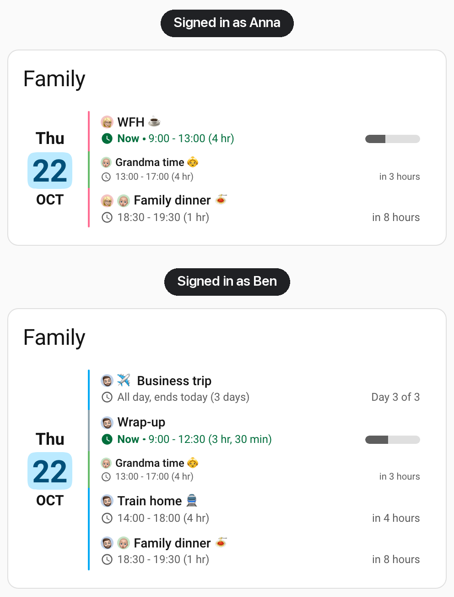
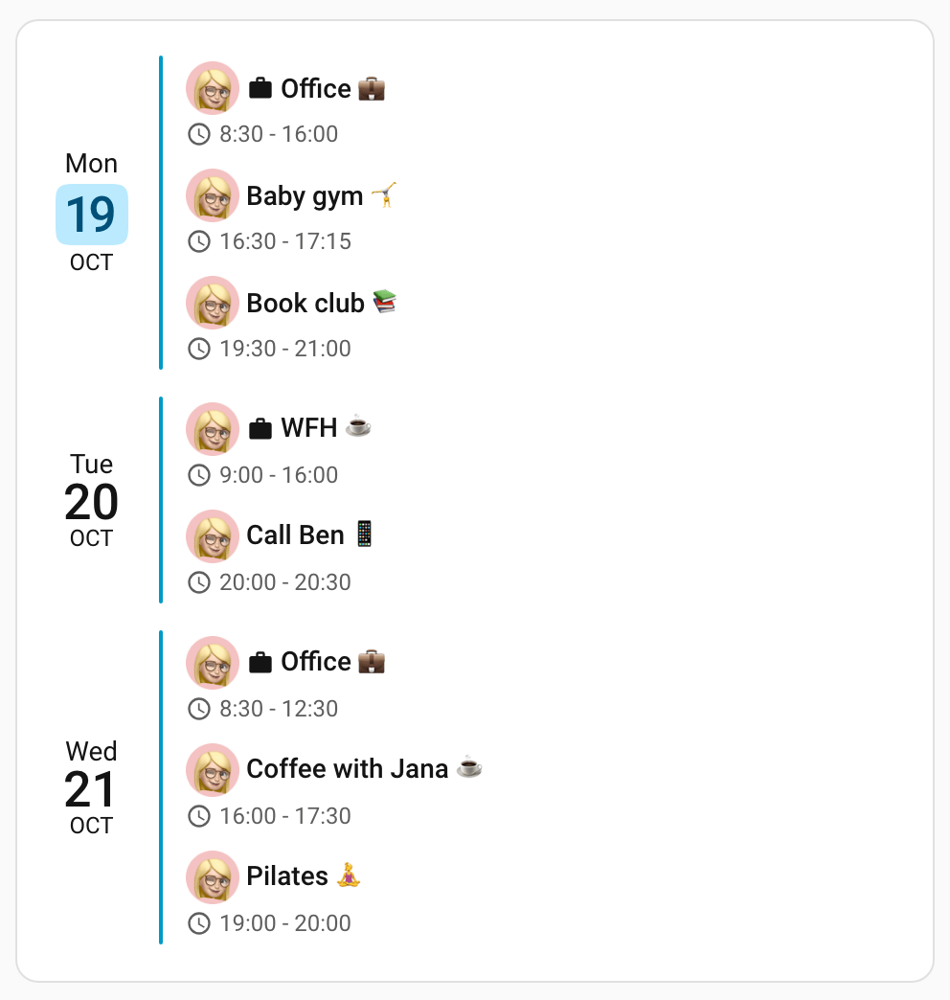

# Calendars

A card reads the calendars listed in its `entities`, and each entry decides how that calendar is
shown: its name, colors, label and picture, when it appears, whether its events are private and
how large its text is. Everything else in this documentation builds on the entries described here.
Which of a calendar's events the card keeps is on
[Filtering & Text Replacement](/features/filtering), how many a list shows on
[List View](/features/list-view), and how the layouts share options on
[Choose a Layout](/features/layouts).

## 🗂️ Entity Configuration

Calendar Card Pro can display events from multiple calendar entities in Home Assistant. The `entities` array accepts either:

1. **A simple entity ID** (default styling applies)
2. **An advanced object configuration** (custom styling per entity)

```yaml
entities:
  - calendar.family # Simple entity ID (default styling)
  - entity: calendar.work
    # Advanced object with custom styling (see options below)
    color: '#1e90ff'
    accent_color: '#ff6347'
```

### Available Options for Entity Configuration Objects

| Option                   | Type           | Default                  | Description                                                                                                                                                                                                                                                                                                                                                                                                                                                                                    |
| ------------------------ | -------------- | ------------------------ | ---------------------------------------------------------------------------------------------------------------------------------------------------------------------------------------------------------------------------------------------------------------------------------------------------------------------------------------------------------------------------------------------------------------------------------------------------------------------------------------------- |
| `entity`                 | string         | —                        | **Required.** The calendar entity ID                                                                                                                                                                                                                                                                                                                                                                                                                                                           |
| `name`                   | string         | Home Assistant's name    | The calendar's name on this card: in the calendar filter, the event popover, the "Couldn't load" line and the names grid view gives labels for screen readers. Never drawn on event rows. One per calendar, shared by every entry for it; see [Naming a Calendar in the Card](#naming-a-calendar-in-the-card)                                                                                                                                                                                  |
| `show_in_legend`         | boolean        | `true`                   | Whether the [calendar filter](/features/header-toolbar#leaving-a-calendar-out-of-the-filter) lists this calendar. `false` leaves it out, as a chip and in the menu, and its events always show. One per calendar, shared by every entry for it                                                                                                                                                                                                                                                 |
| `hidden_by_default`      | boolean        | `false`                  | Whether the [calendar filter](/features/header-toolbar#starting-a-calendar-hidden) starts with this calendar hidden, on a device that has not chosen otherwise. Does nothing where the filter does not list it. One per calendar, shared by every entry for it                                                                                                                                                                                                                                 |
| `lane`                   | string         | the calendar's own       | The lane this entry's events are drawn in while a layout draws [lanes](/features/lanes): entries with the same value share one, and an entry without one shares its calendar's. Belongs to this entry, so two entries of one calendar can take a lane each; see [One Lane for Several Calendars](/features/lanes#one-lane-for-several-calendars)                                                                                                                                               |
| `label`                  | string or list | `-`                      | Calendar label displayed before event titles. Supports text/emoji, MDI icons (`mdi:icon-name`), or images — any address, whether a file you saved (`/local/image.jpg`) or one Home Assistant serves (`/api/image/serve/…`). Accepts a person entity ID (`person.anna`) to show that person's picture, and `home-assistant` to follow this calendar's Home Assistant icon. A list draws several of these in order; see [Combining a Picture, an Icon & Text](#combining-a-picture-an-icon-text) |
| `label_type`             | string         | derived from `label`     | Forces how `label` is read, every part of a list alike: `none`, `text`, `icon` or `image`. Only needed when the value alone would be read as the wrong kind                                                                                                                                                                                                                                                                                                                                    |
| `color`                  | string         | `event_color`            | Custom color for event titles from this calendar                                                                                                                                                                                                                                                                                                                                                                                                                                               |
| `accent_color`           | string         | `accent_color`           | Custom color for the accent bar and event background (when `event_background_opacity` is >0). Accepts `home-assistant` to follow this calendar's Home Assistant color                                                                                                                                                                                                                                                                                                                          |
| `label_icon_color`       | string         | `-`                      | Custom color for label icons (only applies to `mdi:` and other icon labels)                                                                                                                                                                                                                                                                                                                                                                                                                    |
| `label_image_size`       | string         | `1em`                    | Height of a picture label, such as `2em` or `40px`; a bare number is pixels. Icons, text and emoji keep the text's size; see [Sizing a Picture Label](#sizing-a-picture-label)                                                                                                                                                                                                                                                                                                                 |
| `text_scale`             | number         | `1`                      | Draws this calendar's event text, and the icons beside it, at this multiple of the card's sizes: `0.75` at three quarters; see [Scaling One Calendar's Text](#scaling-one-calendars-text)                                                                                                                                                                                                                                                                                                      |
| `show_time`              | boolean        | `show_time`              | Whether to show event times for this calendar (overrides global `show_time` option)                                                                                                                                                                                                                                                                                                                                                                                                            |
| `show_location`          | boolean        | `show_location`          | Whether to show event locations for this calendar (overrides global `show_location` option). The [event popover](/features/actions#event-details) shows them whatever this says; [`private`](#keeping-a-calendar-private) keeps them out of it                                                                                                                                                                                                                                                 |
| `location_icon`          | string         | `mdi:map-marker-outline` | Icon shown beside this calendar's locations, e.g. `mdi:office-building`. Unset, Microsoft Teams meetings get `mdi:microsoft-teams` and every other location the map marker                                                                                                                                                                                                                                                                                                                     |
| `show_description`       | boolean        | `show_description`       | Whether to show event descriptions for this calendar (overrides global `show_description` option). List, column and grid view only: a month draws no descriptions. The [event popover](/features/actions#event-details) shows them whatever this says; [`private`](#keeping-a-calendar-private) keeps them out of it                                                                                                                                                                           |
| `show_weather`           | boolean        | `true`                   | `false` leaves the weather out beside this calendar's events. The forecast in the day header stays; see [Turning Weather Off for One Calendar](/features/weather#turning-weather-off-for-one-calendar)                                                                                                                                                                                                                                                                                         |
| `compact_events_to_show` | number         | `-`                      | Most events this calendar shows while the card is compact. List view only. Its events still count toward the card-wide `compact_events_to_show`; see [Entity-Level vs. Global Event Limits](/features/list-view#entity-level-vs-global-event-limits)                                                                                                                                                                                                                                           |
| `blocklist`              | string         | `-`                      | RegExp pattern to specify events to exclude (e.g., "Private\|Conference")                                                                                                                                                                                                                                                                                                                                                                                                                      |
| `allowlist`              | string         | `-`                      | RegExp pattern to specify events to include (e.g., "Birthday\|Anniversary")                                                                                                                                                                                                                                                                                                                                                                                                                    |
| `filter_field`           | string         | `title`                  | Which field `blocklist` and `allowlist` read: `title`, `location` or `description`. One at a time — list the calendar twice to filter on a second                                                                                                                                                                                                                                                                                                                                              |
| `replace_field`          | string         | `title`                  | Which field `replace_pattern` and `replace_with` rewrite: `title`, `location` or `description`. One at a time, and listing the calendar twice does **not** add a second                                                                                                                                                                                                                                                                                                                        |
| `replace_pattern`        | string         | `-`                      | RegExp pattern to find in that field. Every match is replaced, whatever its case. Unset, the whole field is replaced instead                                                                                                                                                                                                                                                                                                                                                                   |
| `replace_with`           | string         | `-`                      | Text to put in place of each match, or of the whole field when `replace_pattern` is unset. Unset, the match is removed                                                                                                                                                                                                                                                                                                                                                                         |
| `split_multiday_events`  | boolean        | `split_multiday_events`  | Whether multi-day events from this calendar span each day they cover (overrides global `split_multiday_events`). List and column view only; grid and month view draw long events their own way, as `multiday_banners` describes                                                                                                                                                                                                                                                                |
| `multiday_banners`       | boolean        | `multiday_banners`       | In grid and month view, whether this calendar's timed events a full day or longer are drawn as one banner across their days, above the hours in Grid and a bar in Month, or as an event on each day (overrides global `multiday_banners`); see [Long Timed Events as Banners](/features/grid-view#long-timed-events-as-banners) and [Long Timed Events](/features/month-view#long-timed-events) in Month                                                                                       |
| `event_type`             | string         | `event_type`             | Which class of this calendar's events to keep — `all`, `timed` for events with a clock time, or `all_day` for all-day ones (overrides global `event_type`)                                                                                                                                                                                                                                                                                                                                     |
| `starts_after`           | string         | `-`                      | Keeps only this calendar's timed events that start at or after this time of day, as `HH:MM`. All-day events always show. See [Showing Events That Start at Certain Hours](/features/filtering#showing-events-that-start-at-certain-hours)                                                                                                                                                                                                                                                      |
| `starts_before`          | string         | `-`                      | Keeps only this calendar's timed events that start before this time of day, as `HH:MM`; `00:00` and `24:00` are the end of the day. Earlier than `starts_after`, the hours run past midnight                                                                                                                                                                                                                                                                                                   |
| `allday_expires_at`      | string         | midnight                 | Time of day, as `HH:MM`, at which this calendar's all-day events start counting as past, read against the last day each one covers. Unset, they last until midnight. Only applies while `show_past_events` is `false`                                                                                                                                                                                                                                                                          |
| `days_of_week`           | string         | `-`                      | Restricts this calendar to `weekdays` (every day except the weekend) or `weekends` (the weekend days alone), judged on the day each row lands on. Which days are the weekend follows the country set in Home Assistant, or its language when no country is set. Unset, every day qualifies                                                                                                                                                                                                     |
| `visibility`             | list           | `-`                      | Home Assistant visibility conditions, as a card's own Visibility tab takes them. This entry's events show only while all of them hold; unset, they always show. See [Showing a Calendar Under Conditions](#showing-a-calendar-under-conditions)                                                                                                                                                                                                                                                |
| `private`                | boolean        | `false`                  | `true` shows when this entry's events are and whose they are, and nothing they say: each reads Private behind a lock, in its event popover too, and the card cannot change or delete it. See [Keeping a Calendar Private](#keeping-a-calendar-private)                                                                                                                                                                                                                                         |

These options are per calendar. For the card-wide options they override, see [Core Settings in the configuration reference](/reference/configuration#core-settings).

### Naming a Calendar in the Card

The card names each calendar as Home Assistant does, which is often a name its integration
chose rather than one you would. `name` gives a calendar a name of its own on this card, and
leaves it as it is everywhere else:

```yaml
type: custom:calendar-card-pro
entities:
  - entity: calendar.anna_personal
    name: Anna
  - entity: calendar.family_shared
    name: Family
toolbar:
  show: true
  legend: chips
```

The name is used wherever the card itself names a calendar:

- the chips and the menu of the [calendar filter](/features/header-toolbar#showing-hiding-calendars);
- the [event popover](/features/actions#the-event-popover), for the event's own calendar and
  for the calendars it can move to or a new event can be added to;
- the "Couldn't load: …" line at the foot of the card when a calendar
  [fails to load](/features/performance#when-a-calendar-fails-to-load);
- the names [grid view](/features/grid-view) gives icon and picture labels for screen readers;
- the [visual editor's](/features/editor#calendars) calendar list and each calendar's page.

Left unset, each of these keeps Home Assistant's name for the calendar, or its entity ID where
Home Assistant has none. Home Assistant's own controls keep Home Assistant's name either way:
the calendar picker behind the visual editor's **Add Calendar**, and Home Assistant's more-info
dialog.

A name never draws on an event row. That is what [`label`](#choosing-how-a-label-is-read) is
for, and a calendar can have either, both or neither.

::: details Calendars Listed Twice, Typos & Hidden Calendars

- The name belongs to the calendar, not to one entry in `entities`. A calendar listed twice, as
  [splitting it by event type](/features/filtering#separating-all-day-from-timed-events) does, has one name: the
  [visual editor](/features/editor#entry-pages) writes it to every entry for that calendar, and
  in YAML the first entry that sets one wins.
- A calendar whose entity ID Home Assistant does not know, usually because of a typo, keeps its
  ID beside its name in the "Couldn't load" line, as in "Couldn't load: Anna
  (calendar.ana_personal)", so the entry to fix is easy to find.
- Like any change to the configuration, renaming a calendar shows every hidden calendar again on
  every device; see [Showing & Hiding Calendars](/features/header-toolbar#showing-hiding-calendars).

:::

### Showing a Calendar Under Conditions

`visibility` shows a calendar only while Home Assistant conditions hold, so one card can show
each person their own calendars, drop a work calendar during a holiday, or keep the birthdays
off the kitchen tablet.

<br>

One card, two sign-ins: each parent's own calendars show only for them, and the rest for both.

It takes the conditions a card's own **Visibility** tab in Home Assistant takes, for one
calendar at a time:

```yaml
type: custom:calendar-card-pro
entities:
  - calendar.family
  - entity: calendar.anna_work
    visibility:
      - condition: user
        users:
          - 8a1c3f2e9b0d4c6a
      - condition: state
        entity: input_boolean.vacation
        state: 'off'
  - entity: calendar.birthdays
    visibility:
      - condition: screen
        media_query: '(min-width: 1024px)'
```

A calendar's events show while every condition in its list holds, and a calendar with no list
always shows. In the [visual editor](/features/editor#entry-pages), each calendar's page has a
**Who Sees It** heading holding Home Assistant's own Visibility editor, the one under a card's
**Visibility** tab, which picks people by name rather than by ID.

Every condition that editor offers works here:

- `user`, `state`, `numeric_state`, `screen`, `time` and `location` (where the person linked to
  your Home Assistant user is), and `and`, `or` and `not` over any of them;
- `template`, `sun`, `zone`, `device`, and a `state` that must have held `for` a while, which
  Home Assistant judges itself. These need Home Assistant 2026.10 or later, and a calendar that
  depends on one stays hidden until Home Assistant has answered.

A calendar hidden this way is not on the card for that person at that moment. Its events are
gone from every view and from [search](/features/header-toolbar#searching-the-card), it has
no chip or row in the [calendar filter](/features/header-toolbar#showing-hiding-calendars),
new events cannot be added or moved to it, and the event limits fill from the calendars shown.
The card still loads it, so it reappears the moment a condition changes.

::: warning Not a Privacy Control
Conditions tidy a shared card; they do not keep a calendar private. Everyone with a Home
Assistant login can read every calendar through Home Assistant itself, and anyone who can open
the dashboard can read its configuration, conditions included.
:::

::: details Older Home Assistant, Calendars Listed Twice & Editing

- Before Home Assistant 2026.10, a calendar whose conditions depend on `template`, `sun`, `zone`,
  `device` or a `state` held `for` a while stays hidden, and the browser console says why once.
  2026.6 to 2026.9 judge them for administrators only. A template binary sensor does the same job
  on any version: put the test in the sensor, and use `condition: state` on it.
- Before Home Assistant 2023.11, which has no Visibility editor to lend, the page takes the
  conditions as YAML instead.
- Written by hand, a `state` or `numeric_state` condition naming its entity with `entity` rather
  than `entity_id` cannot wait (`for`) or use a `value_template`. Its calendar stays hidden, and
  the browser console says why. Home Assistant's editor writes `entity_id`.
- Conditions belong to one entry in `entities`. `visibility` at the top level, beside `type`, is
  Home Assistant's own and hides the whole card, as it does for any card; this card leaves it
  alone. A calendar listed twice, as
  [splitting it by event type](/features/filtering#separating-all-day-from-timed-events) does, needs them on each
  entry, and one entry can show while the other does not. The calendar leaves the filter, adding
  events and the "Couldn't load" line only while all its entries are hidden.
- A `state` or `numeric_state` condition with no `entity` reads the calendar itself, which is
  `on` while one of its events is under way.
- `time` reads the time zone your Home Assistant profile sets: the server's or this device's.
- While the card is being edited every calendar shows, so you can still style one hidden from
  you.
- A calendar the filter hid stays hidden there while its conditions hide it, and when it comes
  back.
- An event's popover or a new event's form that is already open when a condition changes keeps
  the calendars it opened with until it closes.

:::

### Keeping a Calendar Private

`private: true` shows when a calendar's events are and whose they are, and nothing they say: each
event's title reads Private behind a lock, and its location and description are left out. It is
for a screen everyone walks past, such as a hallway tablet that shows Ben is busy on Thursday
afternoon but not with what.

```yaml
entities:
  - entity: calendar.work
    label: person.ben
    private: true
```

In the visual editor, switch on **Private** on the calendar's page, under **Who Sees It**.

::: warning Changed in v6: Only `private` Keeps Text Out of the Event Details
`private: true` is what keeps a calendar's titles, locations and descriptions out of the
[event details](/features/actions#event-details) a tap opens. `show_location: false` and
`show_description: false` on the calendar, **Never Show** in the visual editor, leave those fields
out of the event rows only: the event details still show them. See
[Hidden Fields Now Show in the Event Details](/guide/upgrading#hidden-fields-now-show-in-the-event-details).
:::

A private event keeps everything that comes from its time and its calendar: its date and times,
how it repeats, a countdown or progress bar, the weather for its hour, and the calendar's color,
label and name. Everything the event says for itself goes:

- **On the card**, its title reads Private in every layout, and its location and description are
  not drawn.
- **In the [event popover](/features/actions#event-details)**, the title reads Private, and so do
  the location and the description where the event has one. There is no map, and nothing is
  looked up.
- **Nothing can be changed.** The popover offers no editing and no Delete, grid view does not drag
  the event, and it cannot be moved to another calendar. Change it on a card where the calendar is
  not private. Adding a new event to the calendar still works.

To show a word of your own instead, add [`replace_with`](/features/filtering#hiding-what-an-event-is-about) without a
`replace_pattern`: it takes the place of Private for its field, without the lock, so
`replace_with: Busy` makes every title read Busy.

::: details Ages, Search, Event Actions & Replaced Text

- A [birthday age](/features/event-content#birthday-ages-anniversary-counts), which would say what
  the event is, is left off the card too.
- **Search** finds the event as Private, never by its own words.
- **An [event action](/features/actions#using-the-events-fields-in-an-action)** gets Private in
  `{title}`, `{location}` and `{description}`.
- A location or description replaced with `replace_with` shows in the popover only, since the
  rows draw neither.
- A `replace_pattern` does nothing on a private calendar, since it would show the rest of the
  text.

:::

::: details Splitting a Calendar Into Private & Shared Events

- `private` belongs to one entry, so a calendar listed twice can keep one entry private and not
  the other, as the [Family Agenda's Busy block](/guide/one-calendar-many-purposes#busy-nothing-else)
  does.
- The entries' `allowlist` and `blocklist` still read the events' own words, since they decide
  which entry an event belongs to. An entry that picks events by their words and gives them a
  label of their own, such as a tooth for the dentist, says that much about them.
- With [`filter_duplicates`](/features/filtering#filtering-duplicate-events) on, an event in a private calendar and in
  one that is not stays two rows: the other calendar's, with its title, and the private
  calendar's, reading Private. Merged, the row would put the private calendar's label beside the
  other calendar's title.
- Private hides what the card shows, not the calendar. Anyone who can open the calendar in Home
  Assistant still reads its events in full, and so does Home Assistant's own more-info dialog,
  which an [event action](/features/actions#using-the-events-fields-in-an-action) of `more-info`
  opens. The card receives each event in full and keeps a copy in the browser's storage for its
  next visit, like every event it shows.

:::

### Using the Colors From Home Assistant

Home Assistant holds a color for each calendar entity, which the built-in calendar card and
calendar panel already use. Setting `accent_color` to `home-assistant` makes Calendar Card Pro
follow it, so a calendar keeps the same color everywhere.

Set it card-wide and every calendar follows its own color:

```yaml
type: custom:calendar-card-pro
accent_color: home-assistant
entities:
  - calendar.work
  - calendar.family
  - calendar.trash
```

Or per calendar, mixing it freely with your own colors:

```yaml
type: custom:calendar-card-pro
entities:
  - entity: calendar.work
    accent_color: home-assistant # follows Home Assistant
  - entity: calendar.family
    accent_color: '#43a047' # your own color wins
  - calendar.trash # follows the card
```

::: warning Requires Home Assistant 2026.2
Calendar colors were added in Home Assistant 2026.2. On an older version there is nothing to
read, and every calendar falls back exactly as described below.
:::

**Calendars Home Assistant has no color for fall back rather than losing their color.** A
per-calendar `home-assistant` falls back to the card's `accent_color`; a card-wide
`home-assistant` falls back to the card's default accent, which is your theme's primary color
(`#03a9f4` where the theme defines none).

**Google Calendar is currently the only integration that fills the color in for you**, and
only when a calendar is **first added** to Home Assistant. Local Calendar, CalDAV and ICS
feeds start with no color, so beside Google they stay on the fallback until you give them a
color by hand. That is the fallback working, not a bug.

::: tip Setting a Color By Hand
Any calendar can be given a color, whichever integration it came from. Open **Settings →
Devices & Services → Entities**, pick the calendar, and use the color field in its settings.
:::

::: warning A Google Integration Older Than 2026.2 Has No Colors, and Nothing Back-Fills Them
Google's colors are copied only when a calendar is first added, so a Google integration set
up before Home Assistant 2026.2 has none, and every calendar shows the fallback. It looks
exactly like the feature not working.

**Removing and re-adding the integration does not fix this.** Home Assistant restores a
removed calendar's old settings when it comes back, color included, and skips the import.
Set the colors by hand instead. A color you set yourself is restored the same way, so it
survives removing and re-adding the integration later.
:::

### Choosing How a Label Is Read

`label` holds one of four things — nothing, text or an emoji, an icon, or the address of an
image — or a [list of them](#combining-a-picture-an-icon-text), and the card works out which by
looking at the value. A value starting `mdi:` is an
icon. An address is an image: anything beginning with `/` or `https://`, plus a relative
filename ending in a picture extension. Anything else is text. That is right almost always,
so most configurations never need to say more:

```yaml
entities:
  - entity: calendar.family
    label: '📅' # text
  - entity: calendar.work
    label: mdi:briefcase # icon
  - entity: calendar.school
    label: /local/school.png # image
```

In grid view, all-day banners show the title alone, without the label.

`label_type` is for the cases where reading the value gets it wrong. Set it to `none`,
`text`, `icon` or `image` and it wins over the value:

```yaml
entities:
  # Shows the text "mdi:calendar" rather than the icon of that name
  - entity: calendar.notes
    label: 'mdi:calendar'
    label_type: text
```

Existing configurations need no change: leave `label_type` out and the card reads the value
as described above.

::: tip Visual Editor
The **Label Type** dropdown on each calendar's page, under **Name & Look**, writes this for
you, and only when it has to. Pick a type and the right control appears below it — a text box, Home Assistant's icon
browser, or a path field — along with **Label Icon Color** where the label is an icon.
:::

### Using a Picture Home Assistant Already Serves

An image label does not have to be a file you saved in `www/`. Home Assistant serves the
pictures it holds over addresses beginning `/api/`, and some of them work as a label, a
person's photo among them:

```yaml
entities:
  - entity: calendar.anna
    label: /api/image/serve/5f2b9c0e7d14a6b38e90c1d2f4a7b6e3/512x512 # a picture, by address
```

Find the address in **Settings → Tools → States** (**Developer Tools** before Home Assistant
2026.8, in the sidebar before 2026.2): pick the entity and read its `entity_picture` attribute. A
person's picture (`/api/image/serve/…`) loads with no further setup.

An address that carries a `token=` does not keep working as a label. A camera's frame is
one: Home Assistant refuses the address without its token and replaces the token regularly.
A media player's artwork and an image entity's picture carry a token too, and current Home
Assistant also refuses an integration's brand icon (`/api/brands/…`) to a card.

::: tip For a Person, Name the Person Instead
The example above works, but there is a shorter way that does not go stale — see
[Showing a Person's Picture](#showing-a-persons-picture) below.
:::

::: warning A Text Label Beginning With a Slash
Because the card reads a leading `/` as the start of an address, a label you mean as words
needs `label_type: text` to stay words:

```yaml
entities:
  - entity: calendar.notes
    label: /dev
    label_type: text
```

:::

### Showing a Person's Picture

Set `label` to a **person entity ID** and the card shows that person's picture. You do not
have to find the address, and a new photo in Home Assistant appears on the card without
touching your configuration:

```yaml
type: custom:calendar-card-pro
entities:
  - entity: calendar.anna
    label: person.anna # Anna's photo
  - entity: calendar.ben
    label: person.ben
  - calendar.family # no label
```

The picture carries the person's name from Home Assistant as its text alternative, so a
screen reader says whose event it is. A picture given by its address is treated as
decoration and skipped, the way icon and emoji labels are.

**Only `person.` entity IDs are read this way.** Another entity's picture has to be given by
its address, and not every address keeps working; see
[above](#using-a-picture-home-assistant-already-serves).

**A person Home Assistant has no picture for shows no label**, rather than an empty space
where one would go, and so does a `person.` ID naming somebody who no longer exists.

::: tip Setting a Person's Picture
Open **Settings → People**, pick the person, and use the picture field. A person does not
need a Home Assistant login to have one.
:::

::: tip Visual Editor
Choose **An Image** as the label type and an **Image Source** dropdown appears above the
field. Set it to **A person's picture** and the field becomes a person picker; leave it on
**Custom image** for a path you type yourself.
:::

::: warning A Text Label Shaped Like a Person
The card reads `person.anna` as "show that person's picture" rather than as literal text. On
the rare occasion you want the characters themselves, say so with `label_type`:

```yaml
entities:
  - entity: calendar.notes
    label: person.anna
    label_type: text
```

:::

### Following the Icon From Home Assistant

Home Assistant holds an icon for each calendar entity as well as a color, and `label` takes
the same `home-assistant` value the [accent color](#using-the-colors-from-home-assistant)
does. The card then shows whatever icon that calendar has in Home Assistant, so changing it
there changes it on the card too:

```yaml
type: custom:calendar-card-pro
entities:
  - entity: calendar.work
    label: home-assistant # follows Home Assistant's icon
  - entity: calendar.family
    label: mdi:home # your own icon wins
  - calendar.trash # no label
```

It is per calendar only, with no card-wide counterpart.

**A calendar Home Assistant has no icon for shows no label**, rather than an empty space
where one would go. Most integrations supply no icon, so this usually means setting one
yourself, in the same place as a color:

::: tip Setting an Icon By Hand
Open **Settings → Devices & Services → Entities**, pick the calendar, and use the icon field
in its settings. Any calendar can be given one, whichever integration it came from.
:::

::: tip Visual Editor
Choose **An Icon** as the label type and an **Icon Source** dropdown appears above the
picker. Set it to **Follow Home Assistant** and the picker goes away. **Label Icon Color**
stays either way, so an inherited icon can still be tinted to match the rest of your card.
:::

An icon changed in Home Assistant appears without reloading the dashboard or waiting for the
next calendar refresh.

::: warning `home-assistant` as a Literal Label
The card reads `home-assistant` as "follow Home Assistant" rather than as literal text. On
the rare occasion you want the words themselves, say so with `label_type`:

```yaml
entities:
  - entity: calendar.notes
    label: home-assistant
    label_type: text
```

:::

### Combining a Picture, an Icon & Text

`label` also takes a list, and draws its parts before the title in the order they are written.
A person's picture can then carry an icon or an emoji that says what kind of event it is:

```yaml
type: custom:calendar-card-pro
entities:
  - entity: calendar.anna
    label: [person.anna, mdi:briefcase]
    label_image_size: 2em
    allowlist: Office|WFH
  - entity: calendar.anna
    label: person.anna
    label_image_size: 2em
    blocklist: Office|WFH
```

<br>

Each part is read on its own, as a single `label` is: text or an emoji, an `mdi:` icon, an image
address, a `person.` entity ID, or `home-assistant`. `label_icon_color` tints every icon in the
list, and [`label_image_size`](#sizing-a-picture-label) sizes every picture. Listing a calendar
twice, as above, gives each kind of its events a label of its own;
[Mapping Icons Onto Events by Keyword](/features/filtering#mapping-icons-onto-events-by-keyword)
shows the pattern.

::: tip Visual Editor
Choose **Several Parts** as the label type. Each part takes a line of its own, with **Label Icon
Color** and **Image Size** below them. The calendar's row in the editor's list shows the first
part.
:::

::: details Parts That Draw Nothing, `label_type` & Merged Rows

- A part that draws nothing is left out: a person with no picture, or `home-assistant` for a
  calendar Home Assistant holds no icon for. A list that draws one part draws it as a single
  label would.
- `label_type` applies to every part, so `label_type: text` draws each part as its own words,
  and `none` hides them all.
- A row [merged from several calendars](/features/filtering#labeling-coloring-shared-events)
  draws every part of each calendar's label, a part two calendars share only once.
- Grid view names each picture after its person and each icon after its calendar for screen
  readers, as it does a single label.

:::

### Sizing a Picture Label

`label_image_size` sets how tall a picture label is drawn, so a face reads at a glance beside a
short title. Unset, a picture is as tall as the title's text:

```yaml
type: custom:calendar-card-pro
entities:
  - entity: calendar.anna
    label: person.anna
    label_image_size: 2em
```

It takes a CSS length, such as `2em` or `40px`; a bare number is read as pixels. A size in `em`
follows the event's text, [`text_scale`](#scaling-one-calendars-text) included. A title that
wraps lines its later lines up with its first, past the picture. Icons, text and emoji keep the
size of the text.

It applies to the rows of list and column view, to grid view's timed blocks, and to month view's
day list and day panel. The wide month's one-line entries keep their pictures at the size of
their line.

::: tip Visual Editor
**Image Size** is under **Name & Look** on the calendar's page, below the label, while the label
is an image or has several parts.
:::

::: details Unusable Sizes, Merged Rows & card-mod

- A percentage, a keyword such as `auto`, or a negative size cannot size a picture and is
  ignored, which leaves the picture as tall as the text.
- A row merged from several calendars draws its pictures at the size of the calendar listed
  first among them.
- A card-mod rule setting `height` on `.label-image` still sizes the picture, but leaves a
  wrapped title's later lines where an unsized picture would put them; this option moves them
  too.

:::

### Scaling One Calendar's Text

`text_scale` draws one calendar's events with smaller or larger text, so a calendar that only
needs to be there, such as a school's, takes less room and less attention than the rest. It
multiplies the card's own sizes: `0.75` draws them at three quarters, `1.25` at a quarter more.

```yaml
type: custom:calendar-card-pro
entities:
  - calendar.family
  - entity: calendar.school
    text_scale: 0.75
```

It scales the text in each of the calendar's events and the icons beside it: the title with its
label, the time with its countdown, the location, the description and the event's weather. The
spacing around them stays as it is, so a scaled-down row is shorter and a scaled-up one taller.
In grid view a block keeps the height its times give it, and its title and time fit into it as
they would at any other size.

It applies in every layout: in list and column view to the rows, in grid view to the blocks and
all-day banners, and in month view to the lines and bars in its cells and to the rows of a day's
list. A wide month gives a scaled-up event as many of a day's lines as it is tall, and moves
what no longer fits behind "+N more". The event popover, search results and calendar filter keep the card's sizes. It takes a
positive number, quoted or not; left unset, or set to anything else, the calendar's events draw
as the card's do.

::: tip Visual Editor
**Text Scale** is the last setting under **Name & Look** on each calendar's page.
:::

::: details Calendars Listed Twice, Merged Rows, Grid Overlaps & Theming

- The scale belongs to the entry, not the calendar. A calendar listed twice, as
  [splitting it by event type](/features/filtering#separating-all-day-from-timed-events) does, can draw its all-day
  and its timed events at two scales.
- A row [merged from several calendars](/features/filtering#filtering-duplicate-events) takes the scale of the
  calendar listed first among them.
- In grid view, an event that starts shortly after a scaled-up one is drawn beside it rather
  than over it until it starts far enough in to leave room for that event's larger title.
- A font size written as a keyword, such as `large`, is scaled from the size browsers draw it at
  by default. One that names a variable, as in `var(--my-size)`, is scaled whole; a variable
  holding a keyword cannot be multiplied, and the text then takes the size of the text around it.
- An icon size in `em` is scaled once, with the text it sits beside. One that names a variable
  is scaled whole, which suits a variable holding a length such as `14px`; one holding an `em`
  length comes out smaller than the text beside it.
- A scaled calendar writes the card's size properties on its own events, so a card-mod rule
  setting one of them on `.event` needs `!important` to reach that calendar's events; see
  [Weather Custom Properties](/features/theming#weather-custom-properties). Its events carry
  the class `event-text-scaled`.

:::

**→ [Per-Entity Options in the configuration reference](/reference/configuration#per-entity-options)** — every option a calendar's entry takes.
**→ [Core Settings in the configuration reference](/reference/configuration#core-settings)** — the full option table for everything on this page.
