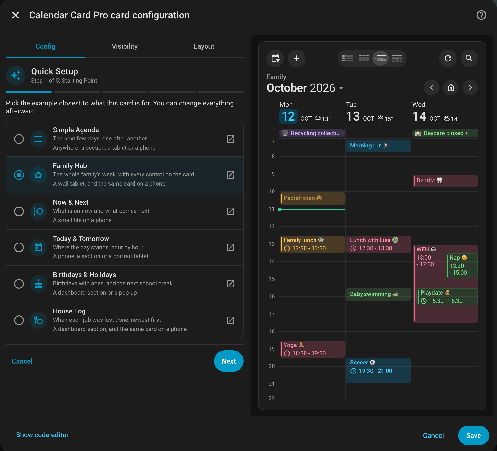

# Visual Configuration Editor

Configure the card with Home Assistant's visual editor and see a live preview as you edit. The
editor opens on an overview of the card, edits what most cards need right there, and leads to a
page for everything else.

<br>

To open it, click the three dots (⋮) in the top-right corner of the card and select
**Configure**. If you have not added a card yet, start with [Usage](/guide/usage).

## 🗺️ The Overview

The overview is the first thing the editor shows. It holds the settings almost every card sets,
so a simple card can be finished without leaving it, and a row for each page that holds the
rest. Top to bottom:

| Part                           | What it does                                                                                                             |
| ------------------------------ | ------------------------------------------------------------------------------------------------------------------------ |
| **Notices**                    | Only when the YAML holds [options the card ignores](#options-the-card-ignores) or [removed options](#deprecated-options) |
| **Quick Setup**                | On a fresh card, a banner offering [Quick Setup](#quick-setup), which takes focus as the editor opens                    |
| **Search**, **Undo**, **Redo** | [Search](#search) every setting; [Undo and Redo](#undo-redo) the last change                                             |
| **⋯ Editor Preferences**       | Show YAML Option Names, at the end of the search row                                                                     |
| **Settings For**               | Which layout's settings the pages edit; see [Options for the Selected View](#options-for-the-selected-view)              |
| **Calendars**                  | The card's [calendars](#calendars), a row each                                                                           |
| **Card Displays**              | List, Columns or Grid, the layout the card opens with                                                                    |
| **Days to Show**               | How many days the card covers                                                                                            |
| **Start Date**                 | Today, Tomorrow, Start of Week, A Fixed Date, or Relative to Today                                                       |
| **Tapping an Event Opens It**  | Opens an event's details on a tap                                                                                        |
| **Settings**                   | A row per page, saying in one line what the page holds for this card                                                     |
| **More**                       | [What This Card Changes](#what-this-card-changes) and Start From an Example                                              |

The settings rows open these pages:

| Page                 | What it holds                                                                                                    |
| -------------------- | ---------------------------------------------------------------------------------------------------------------- |
| **Which Events**     | Event Type, duplicates, event order, past events, multi-day events, empty days and Compact Mode                  |
| **Card & Header**    | The title, the card's background and language, the toolbar and your own toolbar buttons                          |
| **Day Header**       | How each day announces itself: its date, weeks and week numbers, today and its indicator, past days and weekends |
| **Event Appearance** | What each event shows, the time format, and how each part looks                                                  |
| **Size & Spacing**   | The card's height and spacing, the density of Columns and Grid, and the rules between days, weeks and months     |
| **Grid**             | Only while you edit Grid: the hours it shows, its hour labels, and what it draws on the grid                     |
| **Weather**          | The weather entity, and the forecast in the day header and beside each event                                     |
| **Taps & Refresh**   | What a tap or a hold on the card, a day or an event does, and how often the card reads its calendars again       |

**Start Date**'s choices write the existing `start_date` option: Tomorrow writes `today+1`, Start
of Week writes `start_of_week`, and Relative to Today takes any offset, such as `today-29`.
**Tapping an Event Opens It** writes `event_tap_action: { action: details }`. While another tap
action is stored, such as a navigation, the switch gives way to a line naming it, and **Change**
opens Taps & Refresh, where the full action editor is.

The **⋯** menu at the end of the search row holds **Show YAML Option Names**, remembered in this
browser for every card. It shows each setting's YAML option name beside its label, and the YAML
path in search results and in What This Card Changes, which helps when you move between the
editor and YAML. Down Arrow opens the menu from its button,
and Escape closes it.

### Pages & Back

A row opens its page with focus on the page's title. **Back**, at the top and at the foot of
every page, returns to where you came from, the overview or the search results, with its scroll
position and focus where you left them. Nothing goes deeper than a page.

- **Escape** closes whatever the editor has open first, such as a setting's state menu or a row's
  actions, then goes Back. On the overview it clears a search, and only then lets Home Assistant
  close the dialog. A picker Home Assistant opened keeps its own Escape.
- **Which Events** and **Day Header** link to each other: whether past events show is one, and
  how the dates of past days look is the other.
- The editor adds nothing to the browser's history, so the browser's Back closes the dialog as
  it does for any card.
- The line under a setting says only what its name does not: a default, a format, or how it
  works with another setting. **Documentation**, at the foot of every page, opens the part of
  this site that covers the page's settings in full, in a new tab.

## 🪄 Quick Setup

**Quick Setup** starts a card from a [Simple Agenda](/guide/usage#your-first-card) or one of the
[Example Stories](/reference/examples) and asks only
what a story cannot know about your home: the title, your calendars, your weather and how the
card should answer a tap. Use it on a new card to get a finished-looking one in a few steps, or
on an existing card to try a different look without retyping anything.

<br>

Pick a story and the preview draws it at once, on your own calendars as soon as you name them.

A fresh card offers Quick Setup in a banner at the top of the overview; on any card it is
**Start From an Example** under **More**. Starting from Birthdays & Holidays on two calendars
writes this:

```yaml
type: custom:calendar-card-pro
config_version: 5
title: Coming Up
days_to_show: 60
show_countdown: true
countdown_exact_days: true
show_single_allday_time: false
month_separator_width: 1px
day_spacing: 4px
event_gap: 4px
vertical_line_width: 4px
toolbar:
  show: true
  legend: false
  add_event: false
  refresh: false
  view_switcher: false
event_tap_action:
  action: details
entities:
  - entity: calendar.birthdays
    accent_color: '#f06292'
  - entity: calendar.holidays
    accent_color: '#26a69a'
```

| Step                  | What it asks                                                                                                                                                                                                                                                  |
| --------------------- | ------------------------------------------------------------------------------------------------------------------------------------------------------------------------------------------------------------------------------------------------------------- |
| **Starting Point**    | [Simple Agenda](/guide/usage#your-first-card), [Family Hub](/guide/family-calendar), [Now & Next](/guide/now-and-next), [Today & Tomorrow](/guide/today-and-tomorrow), [Birthdays & Holidays](/guide/birthdays-and-holidays) or [House Log](/guide/house-log) |
| **Title & Calendars** | The card's title, and its calendars; at least one                                                                                                                                                                                                             |
| **Weather**           | A weather entity, or none                                                                                                                                                                                                                                     |
| **Taps & Toolbar**    | Whether to show the toolbar, open an event on a tap, and add an event on a tap on a day                                                                                                                                                                       |
| **Review**            | The example, calendars, layout, title and weather Apply leaves, each setting it replaces, then **Apply**                                                                                                                                                      |

- **The preview follows every answer.** **Cancel** puts the card back exactly as it was, and
  after **Apply**, one **Undo** does.
- **The story replaces the card's look**: its layout, spacing, toolbar settings and actions, and
  every setting the steps do not ask about. On a card with settings, the review names each one it
  replaces, with its value now and after, such as "Days To Show: 7 → 3".
- **Your calendars keep their own settings.** A calendar without a color of its own takes the
  story's next color, until the story runs out of colors.
- **The weather step starts from your card's weather entity.** Without one, a story that shows
  weather picks your home's weather entity when you have exactly one.
- **Home Assistant's own settings for the card stay**, such as its size on the dashboard.

::: details When Quick Setup Behaves Differently

- Two of the seven stories are not offered. [Bin Day](/guide/bin-day) and
  [Family Agenda](/guide/one-calendar-many-purposes) sort events by words in their titles and
  descriptions, which no question can guess for your calendars; copy them from their pages.
- A story's names and labels for each calendar are not carried over: they belong to the
  story's family.
- A calendar listed more than once keeps every one of its entries, together, in the order the
  card first lists it.
- Each answer is a real edit of the card, so pressing Home Assistant's **Save** before
  **Apply** saves what the preview shows.
- Changing the card's YAML while Quick Setup is open closes it, keeping your YAML.
- A new card from Home Assistant's card picker starts with the first calendar Home Assistant
  lists, which nobody chose. Quick Setup starts such a card with no calendar chosen, and the
  overview names that calendar under **Calendars**, with **Change Calendar** to pick another.

:::

## 🧭 Options for the Selected View

Two controls on the overview decide what you see and what you edit. **Card Displays** chooses
the card's starting layout and writes the existing `view` option. **Settings For** chooses
which settings the pages edit: **All Layouts**, **List**, **Columns** or **Grid**. It starts on the
layout the card displays and stays where you put it for the rest of the session. It is never
saved to YAML. A calendar's page has no Settings For, since a calendar's settings apply to every
layout.

On a card that stores values only for the layout it shows, and has no view switcher in its
toolbar, Settings For takes one line, **Settings for List · Change**; **Change** opens the four
choices.

- **All Layouts** edits the shared base, the top level, which each layout falls back to. It
  offers only the options that have a shared meaning, so a layout-specific one is never written
  where only one view reads it.
- **List**, **Columns** and **Grid** each write to their own block, `list:`, `column:` and
  `time_grid:`, and leave out the controls, per-calendar ones included, that cannot affect that
  view. The **Grid** page appears only while Grid is chosen.
- A layout with no value of its own uses its own default when it has one, otherwise the shared
  base. Editing All Layouts therefore changes only the layouts that inherit that option, never
  their explicit choices or built-in defaults ([YAML & View Defaults](#yaml-view-defaults)).
- Card-wide options such as calendars, title, language and actions stay card-wide whatever is
  chosen, and carry a small link mark after their name, **Whole Card** to a screen reader.

The choice follows your selection, not the preview's width-dependent fallback. When the two
differ, a line says so, as in **Editing List · Preview Shows Grid**, and **Preview List** beside
it draws List in Home Assistant's preview while you edit it. The card still opens in the layout
Card Displays names, and nothing is saved by the switch; it stays on for the session and follows
the layout you choose. To edit a List-only option used by a responsive fallback, choose List under
Settings For; Card Displays stays unchanged. [Search](#search) finds the settings only another
layout offers.

Hiding a control does not delete its stored value. For example, these empty-day options remain
available to the List fallback, even though their controls are absent while editing Grid:

```yaml
view: grid
show_empty_days: true
empty_day_text: 'No plans'
empty_day_color: '#607d8b'
```

**→ [Options With No Effect in Grid View](/reference/configuration#options-with-no-effect-in-grid-view)** and
**[Options With No Effect in Column View](/reference/configuration#options-with-no-effect-in-column-view)** — the scoped options.

### State in Words

A setting whose value is not its default says where the value comes from on a pill at the end
of its row, in words, so the state is never told by color alone. A setting at its default shows
no pill; a screen reader still reads **Default** with its name. The words are the same on every
page; Settings For says which layout they are about.

| Words                | Means                                                                  |
| -------------------- | ---------------------------------------------------------------------- |
| **Set**              | Stored where you are editing: the layout, All Layouts or a calendar    |
| **From All Layouts** | The layout has no value of its own and uses the shared one             |
| **From the Card**    | A calendar that sets nothing, where the card's value is not default    |
| no pill              | The built-in default; in a layout, its own, whatever All Layouts holds |

The pill names a state only. A card-wide option, with one value for every layout, carries a
small link mark after its name instead.

While you edit All Layouts, a line inside a setting's row, under its name, names each layout the
shared value does not reach and the value it uses, as in **Grid Has Its Own: 12px**, whether Grid
stores its own value or defaults to it.

Where a value is stored, its **Set** pill opens a small menu with the reset. **Reset (In the Day
Header)** keeps the setting open and names the value it goes back to, or **Reset (Empty)** where
nothing comes back. A group of chips has one button for all of its chips stored here, **Reset
Parts** for an event's parts and **Reset Controls** for the toolbar's. A dropdown may also show
Home Assistant's own ✕, which empties it, the same as its Reset.

### Upgrading a Card From Before v5

Opening a List or Grid card from before v5 upgrades it, and the card looks the same. Before v5,
List settings lived at the top level, alongside values inherited by Column. In v5, that same
location means **All Layouts**. When an older List or Grid card holds an option whose default
differs in another layout, the editor keeps that value for List, as it was written, and says so
at the top of the overview, for example "Upgraded. Day Spacing and Event Font Size now apply to
List, as before. The card looks the same."

- **Use Them for Every Layout** makes those values the shared starting point instead. A
  layout's own settings and built-in defaults can still take precedence.
- **Undo** puts the YAML back exactly as it was. The editor then upgrades it the same way with
  your next change.

Either way the editor keeps every option your YAML spells out, including one set to its default,
such as `show_month: true`, and the layout currently on screen. On a Grid card, the upgrade
decides what List, including a responsive List fallback, uses later; the current Grid appearance
is unchanged.

Column cards are not upgraded on opening, and their columns do not change: the first editor
edit keeps the top-level values shared, as Column read them before v5.

The upgrade is a change to the card like any other: it is kept only when you press **Save**, so
**Cancel** leaves the card as it was, and a card you never open in the editor keeps working as it
is; see
[Per-View Options](/features/core-settings#per-view-options). Once it is saved, the editor has
written the `config_version` option for you, as it does on every card it creates. You do not
need to add it by hand; see
[Core Settings in the configuration reference](/reference/configuration#core-settings).

```yaml
# Written by the visual editor
config_version: 5
```

::: details What the Upgrade Writes

- The editor upgrades a card on opening only when at least one authored value is genuinely
  ambiguous. The five options only List can read move into `list:` either way. A List or Grid
  card with no ambiguous values opens normally and adopts the v5 format on its first actual edit.
  A Column card's first edit moves only those five and records the v5 format.
- A configuration without `config_version` that already contains `list:` or `time_grid:` is
  treated as layered. It opens normally and adopts the marker on its first actual edit without
  reinterpreting shared values.
- The upgrade moves only those values, and adds `config_version`.
- Every later save works the same way: the editor removes a line you wrote only when you change
  that option, so a card that spells out a default keeps it even if a later release changes the
  default. Setting an option back to its default in the editor still removes the line, except a
  Grid value for an option whose Grid default differs (see
  [Switching an Existing Card to Grid](#switching-an-existing-card-to-grid)), and
  [deprecated options](#deprecated-options) are still removed.
- A line the save leaves alone also keeps its spelling, such as `slot_minutes: '30'`.

:::

### Switching an Existing Card to Grid

On a v5-format card, changing **Card Displays** from List or Column to Grid keeps values
you explicitly set through All Layouts, including a value equal to the List default. For
options where Grid has a different default, the editor copies your value into `time_grid:`
rather than replacing it. Options you did not set use Grid's defaults without writing
those defaults into YAML. A fresh card switched to Grid does not need a `time_grid:` block.

For example, these two authored values are kept in Grid:

```yaml
event_font_size: '18px'
event_background_opacity: 5
```

The corresponding entries after switching are:

```yaml
view: grid
event_font_size: '18px'
event_background_opacity: 5
time_grid:
  event_font_size: '18px'
  event_background_opacity: 5
```

One notice under Card Displays, **Existing Values Kept for Grid**, lists the options kept
instead of Grid's defaults. Use the option's **Reset** while editing Grid to return to its
default; switching away and back in the same editing session does not recreate a reset value.

Only a switch made in the editor keeps your values this way. A change to `view` made in YAML,
opening a card that is already on Grid, or choosing a layout under Settings For copies nothing
and shows no notice: a v5 card with root `event_background_opacity: 5` and no Grid opacity still shows
Grid's default of 20.
Choose Grid under Settings For to change that value directly.

::: details Reset, Saving & Reopening

- The switch does not remove older `time_grid:` values that happen to match a divergent Grid
  default.
- A reset applies only to the options that control writes. A later switch to Grid still keeps
  other values you author in All Layouts, and if you deliberately change the reset option itself
  in All Layouts afterward, that newer choice can be kept on the next switch too. Re-entering an
  equivalent value, such as `14` for `14px`, does not replace the reset.
- Reset memory belongs to the current editor session. After reopening, the saved YAML
  determines which shared choices a later switch to Grid keeps.
- An explicit shared choice stays in YAML when another layout has a different default for that
  option, even if you set it back to the card's default, and so does one you chose to share
  during an upgrade. Setting Event Font Size to `14px` in All Layouts keeps
  `event_font_size: '14px'`, so a later switch to Grid keeps `14px` after reopening, just as it
  does in the original session. Untouched defaults are not added, and a value set directly in
  Grid still wins.
- What each layout's block keeps when you save is under
  [View Exceptions](#view-exceptions).

:::

### YAML & View Defaults

The editor does not change the renderer's precedence rules. With no per-view override,
these top-level values behave as follows:

| Top-Level YAML            | List              | Column            | Grid              |
| ------------------------- | ----------------- | ----------------- | ----------------- |
| `show_empty_days: false`  | Hides empty days  | Keeps empty days  | Keeps empty days  |
| `show_past_events: false` | Hides past events | Hides past events | Keeps past events |
| `show_location: true`     | Shows locations   | Shows locations   | Hides locations   |

Set the corresponding value in `column:` or `time_grid:` to change that view, or choose that
layout under Settings For. Grid also substitutes its own styling defaults, even when you
set a different top-level value. All fourteen are listed in
[Grid Options That Start From a Different Default](/features/grid-view#options-that-start-from-a-different-default).
Column's two substitutions are listed in
[Column Options That Start From a Different Default](/features/column-view#options-that-start-from-a-different-default).

## 📅 Calendars

The overview's **Calendars** block lists the calendars on the card, a row each, and opens a page
for each one. A row shows the calendar's color, [its label](#per-calendar-labels), its name and
what it shows, such as **All-day events** or **Events with a time · Without: Private**, then how
many of its settings it sets. Every kind of label shows, text, emoji, icon and picture alike, as
the card draws it, and once any calendar has one, every row keeps room for it so the names line
up. From eight calendars on, **Filter Calendars** above the list narrows it by name.

**+ Add Calendar** offers Home Assistant's calendar picker, with focus in it, ready to type a
calendar's name. Choosing a calendar does nothing yet;
**Add** puts it on the card and opens its page. The picker leaves out the calendars already on
the card; where a Home Assistant release still offers one, the editor says **Anna is already on
the card.** and offers **Open Anna** instead.

A calendar listed more than once in `entities:` is one calendar with several **entries**, each
with its own settings. Its calendar row heads the group, counting its entries, with a row for each
entry indented under it, numbered and told apart by what each one shows, as in **2 · Events with
a time**. An entry that keeps exactly the events an earlier one keeps says so, as in **Same events
as entry 1**: each of those events then shows twice. That is how one calendar can show its all-day
events in one color and its timed events in another; [Split This Calendar](#split-this-calendar)
builds it in one step.

### Entry Pages

A calendar's row opens its page; for a calendar with several entries, each entry's row opens
that entry's page. Its heading names the calendar and,
where there are several, which entry it is, as in **Anna · Entry 2 of 3**. **Previous Calendar** and
**Next Calendar** step through the list without going Back. The page holds these headings:

| Heading              | What it holds                                                                                                                                                                       |
| -------------------- | ----------------------------------------------------------------------------------------------------------------------------------------------------------------------------------- |
| **Name & Look**      | Its Accent Color first, then the calendar's name on the card, [its label](#per-calendar-labels), Show in Calendar Filter and Text Scale                                             |
| **Who Sees It**      | [Visibility conditions](/features/core-settings#showing-a-calendar-under-conditions), in Home Assistant's own Visibility editor                                                     |
| **Which Events**     | [Split This Calendar](#split-this-calendar), Days of the Week, Event Type, All-Day Events Expire At, Hide Events Containing, Only Show Events Containing and Compact Events to Show |
| **Text Replacement** | Find and Replace With, rewriting the event's title, location or description                                                                                                         |
| **Multi-Day Events** | Whether this calendar's long events split across days, and how Grid draws them                                                                                                      |
| **Event Details**    | Whether this calendar's events show their time, location, description and weather                                                                                                   |

To show a calendar only on some days of the week, use **Days of the Week** under **Which
Events**; the line under **Who Sees It** leads there.

**Hide Events Containing** and **Only Show Events Containing** write `blocklist` and `allowlist`.
Each takes one word or phrase at a time, matched as written, so punctuation needs no escaping, and
each is ready to type in the moment it is added. They check the event title unless **Match
Against** names another field. The **Use a Pattern** link under a list switches it to the regular
expression the card stores, and a pattern the card cannot read is flagged at the field: the card
ignores that pattern, so it stops filtering events.

The calendar's name and **Show in Calendar Filter** belong to the calendar, not to one entry:
changing them on one entry changes every entry, and the page says so.

**→ [Entity configuration options](/features/core-settings#available-options-for-entity-configuration-objects)** — everything an entry page can set.

### Calendar Actions

Each row's ⋮ opens its actions, and an entry page's ⋮ holds that entry's. A calendar with one
entry offers them all on its row. A calendar with several splits them: its calendar row moves or
removes the whole calendar, and each entry row duplicates, copies, pastes or removes that entry.

| Action                                      | What it does                                                                                                                       |
| ------------------------------------------- | ---------------------------------------------------------------------------------------------------------------------------------- |
| **Move Up**, **Move Down**, **Move to Top** | Moves the calendar, with all its entries; see [Reordering](#reordering)                                                            |
| **Duplicate**                               | Adds a second entry for the calendar, carrying this one's settings                                                                 |
| **Copy Settings**                           | Takes this entry's settings, without the calendar itself, its name or Show in Calendar Filter                                      |
| **Paste Settings**                          | Applies them to this entry, keeping the calendar it reads, its name and Show in Calendar Filter                                    |
| **Remove**                                  | On an entry, drops that entry; on a calendar's own row, removes the calendar with every entry, as **Remove Anna (2 entries)** says |

- **Remove asks nothing.** A line takes the row's place, such as **Removed Ben · Undo**, and
  **Undo** puts it back exactly.
- **The copied settings outlive the dialog**, so settings copied while editing one card can be
  pasted into another; **Paste Settings** names where they came from.
- **A duplicated entry shows the same events as the first** until one of the two sets Event Type
  or a word list, so until then every event shows twice, unless Filter Duplicates is on; the page
  says so.
- **The calendar an entry reads can change**: its page's **Calendar** field points it at another
  calendar and keeps its settings.

### Reordering

The order of the calendars decides which one keeps an event several of them hold, under
[Filter Duplicates](/features/core-settings#filtering-duplicate-events), and which is the card's
first calendar. Drag a calendar by the handle on its row, or move it without dragging:

- **Move Up**, **Move Down** and **Move to Top** in the row's actions;
- **Alt+↑** and **Alt+↓** on a focused row;
- Space on the handle grabs the calendar, the arrow keys move it, Space drops it and Escape puts
  it back. Every move announces the new position, such as **Ben, position 2 of 4.**

A move takes the whole calendar, every entry with it, and an entry keeps its place among its
calendar's other entries, because the first entry decides how a duplicated event looks.

### Split This Calendar

**Split This Calendar** turns one entry into two, each with its own color and label, and writes
both in one step that **Undo** takes back. From its Colors step on, the preview draws the two
parts; **Cancel** or Escape puts the entry back as it was. Use it to show a calendar's all-day events apart from
its timed ones, or the events mentioning certain words apart from the rest. It is the first
row under an entry page's **Which Events**, and the first action in its ⋮.

It takes three steps:

| Step       | What it asks                                                                                                                        |
| ---------- | ----------------------------------------------------------------------------------------------------------------------------------- |
| **How**    | **All-Day vs. With a Time**, or **By Words**: the words, and whether to look for them in the event's title, location or description |
| **Colors** | A color and a label for each part; the first keeps the entry's color                                                                |
| **Review** | Where the entry's upcoming events land, part by part, over the days the card shows                                                  |

Splitting all-day from timed events writes `event_type` on each part. Splitting by words writes
the words as `allowlist` on the first part and adds them to the second part's `blocklist`. Both
parts keep every other setting the entry had, its visibility conditions included.

Every event the entry shows lands in exactly one part, so nothing shows twice and nothing goes
missing. Where two entries could not promise that, Split refuses and says why, with a way
forward:

- an entry that already shows only all-day events, or only timed ones, cannot split on that;
  **Duplicate** it and change the copy's Event Type instead;
- an entry with its own Only Show Events Containing cannot split by words, since one entry holds
  one list;
- an entry whose word list the card cannot read cannot split by words until it is fixed;
- an entry with its own **Compact Events to Show** clears it first, since two entries would
  double it.

## 🏷️ Per-Calendar Labels

An entry page's **Name & Look** opens with **Name**, the
calendar's [name on the card](/features/core-settings#naming-a-calendar-in-the-card), then
**Show in Calendar Filter** while the toolbar shows a
[calendar filter](/features/layout-appearance#leaving-a-calendar-out-of-the-filter), and the
control after them is **Label Type**. A label is the mark shown before every event from
that calendar, and it can be four things — nothing, text or an emoji, an icon, or an image.

The editor reads the type from the value: `mdi:home` is an icon, `/local/work.png` is an
image, and anything else is text. So a calendar configured in YAML opens with the right
control already selected, without a `label_type` option anywhere in it. Only when the
value alone would give the wrong answer — picking **Text or Emoji** and then typing `mdi:home`,
for example, or picking **An Icon** before choosing one — does the editor store `label_type`
alongside `label`, and then it takes precedence over the value.

Choosing **An Icon** or **An Image** first shows an **Icon Source** or **Image Source**
dropdown, which says where the label comes from. With **Custom icon** as the source you get
Home Assistant's icon picker. **Label Icon Color** appears only for **An Icon**, the only type
it affects.

::: tip Your Choice Wins Over the Value
Type `mdi:calendar` into the text box and the card renders it as the literal text
`mdi:calendar`, not as an icon. The editor records that you asked for text, so the value
is left alone rather than being reinterpreted. Switch **Label Type** to **An Icon** to
get the icon picker.
:::

**→ [Entity configuration options](/features/core-settings#available-options-for-entity-configuration-objects)** — the `label` option itself, and the rest of the per-calendar table.

## 🎨 Colors

Every color setting is one control. Closed, it shows a swatch of the color in use, its name and
where it comes from. Open, it offers what that setting can follow, such as **Default**, **Follow
Home Assistant** or **Calendar Color**, then Home Assistant's named colors as swatches, then
**Custom…**.

- **Custom…** takes any color the card can draw: a hex value such as `#e91e63`, a CSS color name,
  or a theme variable such as `var(--primary-color)`. Text the card cannot draw is flagged and
  not written; the color in use stays until the text is a color.
- **Follow Home Assistant** on a calendar's Accent Color uses the color Home Assistant holds for
  that calendar, under Settings › Devices & Services › Entities, and names it. A calendar Home
  Assistant holds no color for falls back to the card.
- **A named swatch** writes Home Assistant's theme variable for that color, such as
  `var(--pink-color)`, so the color follows the theme.

**→ [Using the Colors From Home Assistant](/features/core-settings#using-the-colors-from-home-assistant)**
— what Follow Home Assistant reads.

## 🗂️ Every Setting on Its Page

Every page shows every setting that applies here, each on a row of its own: its name, its value,
its state pill where it has one, an **ⓘ** and a chevron, as in **Week Number Color · Primary
Text**. A setting at its default is just that row. Each heading and its settings sit in a card
of their own. Press the row to open Home Assistant's control for it below the row; press the
same spot again to fold it. Nothing is written until you change a value.

- **The row never moves.** Opening a setting draws its control under the row, so the pill, the
  **ⓘ** and the chevron stay where they were, and a second press always lands on the same row.
- **Settings you set stay open.** So do the few every card needs, such as Time Format. Leaving a
  page folds again what you opened there without changing it.
- **ⓘ** shows the setting's help under it. A screen reader reads the help as the setting's
  description.
- **A switch** is Home Assistant's own switch row, with its pill and **ⓘ** after it. Every switch
  ends where the values end, so switches and values share one column. A row grows with a name
  that wraps, and the pill and **ⓘ** stay level with the switch.
- **On a phone** the name gets the row's width: the value shows once you open the setting, and a
  pill sits under the name. On a wider screen the values, pills and **ⓘ** line up in columns
  down every page.
- **A setting that needs another one** stays in its place until it applies, as in **Indicator
  Size · Appears once the Style is a dot, an icon or an emoji**. Several in a row waiting on the
  same setting share one line. Turning the other setting on brings them in.
- **A value stored but not in use**, such as a description size while descriptions are off, is
  listed under its heading, as in **Stored but not in use: Description Font Size (16px)**, with its
  **Reset**. The feature is never switched on to show it.

## 🔎 Search

The search field at the top of the overview reaches every setting, including the folded ones,
the ones waiting on another setting, the ones only another layout offers, and
values stored but not in use. Typing turns the overview into a list of results, each with its
name, the page and heading it lives under, its current value, and where the value comes from;
with Show YAML Option Names on, its YAML path too. **Search Settings** at the top of every page
takes you to the field, and **Back**, or Escape in an empty field, returns to the page.

Results that match alike list a page's main settings first, so `past` leads with **Show Past
Events**. Choosing a result opens its page at the setting, highlighted, with **Return to
Results** above it, which brings back the query and the list. A result that is not on its page
yet is added there as it opens; one waiting on another setting says what it needs, as in
**Needs Show Description**. **Edit Here** turns the card settings the search found into their
live controls, on the results list itself, and **Show as a List** goes back; a setting that is
waiting on another one, not in use, or only another layout's stays a row that opens it.

Search matches what the editor shows: a setting's name, the sentence explaining it, the choices
a dropdown offers, its page's and heading's titles, and a calendar's names. Typing `opacity`
finds **Past Event Opacity** and **Event Background Opacity**. It also matches the YAML option
name, so a key copied out of the [Configuration Options reference](/reference/configuration)
leads straight to its control, including the controls the editor names differently from the
option they write: `time_24h` finds **Time Format**.

It also knows a few words people use for a setting whose name says something else: `12h` or
`AM/PM` finds **Time Format**, `hide past` finds **Show Past Events**, `newest first` finds
**Event Order**, `tomorrow` finds **Start Date**, and `exclude` or `blocklist` finds a calendar's **Hide Events Containing**.
A translated editor searches by its own language's words for these, and by the English ones
where it has none. Earlier names still lead somewhere, such as `separators` to **Size & Spacing**, and the British
spelling of color finds every color setting.

Two jobs belong to Home Assistant rather than to this card, and search names them where they
are: `full width` finds **Card Width**, in Home Assistant's **Layout** tab above the editor, and
`who sees` finds **Who Sees the Card**, in its **Visibility** tab.

::: details How Search Reads the Editor

- Words match in any order, whatever their case or accents, so `wochennummern` finds the week
  numbers in a German editor.
- A setting found only by the sentence explaining it comes last, with the phrase that matched.
- A calendar's name, or its entity id, finds every setting of that calendar's entries.
- With nothing found, the editor suggests fewer words, or an option name from YAML.

:::

## 👆 Pick From Preview

**Pick From Preview** opens a setting by pointing at the part of the card it changes. Turn it on
with its button, after **Undo** and **Redo** beside the search field and at the top of every
page, then click a part of the preview: a day header, an event's time, a separator, the Grid's
hour labels. Its page opens with that part's heading at the top and its first setting marked, as
a search result opens one.

- While it is on, a line above the editor says so, with **Cancel**, and the part under the
  pointer is outlined and named, as in **Event Appearance › Location · Click to Edit**.
- One pick turns it off again, and so do **Cancel**, Escape, the button itself, and moving
  anywhere else in the editor. **Back** returns to where you were.
- The preview's own taps, holds and Grid's drag do nothing while it is on.
- A legend chip opens its calendar's page. A part only one layout has, such as the Grid's hour
  labels, switches **Settings For** to that layout first and says so.
- A heading's first setting opens there, as a search result does, even where it was folded.
- On a phone the preview sits below the editor. Tap a part once to outline it, then tap it again
  to open it; the editor scrolls back up to the setting.

::: details When Pick From Preview Is Not Offered

The button appears only where the editor can find the card's preview beside it, which is Home
Assistant's card editor dialog, on a sections dashboard and a masonry one alike. Anywhere else the
editor opens, it draws no button, and the section rows and **Search** reach every setting there as
before.
Keyboard and screen reader users keep those too: the preview needs no new tab stops.

:::

## ↩️ Undo & Redo

**Undo** and **Redo** sit beside the search field and at the top of every page. They cover
every change the editor makes: a value typed or picked, a reset, a calendar added, moved or
removed, a split, and Quick Setup's **Apply**. Each puts the card back exactly as it was before
that step, so an option written at its default or a line the editor would otherwise tidy away
comes back as it was.

Outside a text field, Ctrl+Z (⌘Z on a Mac) undoes, and Ctrl+Y or Ctrl+Shift+Z (⌘⇧Z) redoes.
Inside one, those keys stay the text field's own. Undo opens the page the change was made on,
and says so, as in **Undid: Change Description. Showing Events.**

The history lasts while the editor is open. A change made outside it, such as an edit in Home
Assistant's code editor, ends what Undo can reach.

## 📋 What This Card Changes

**What This Card Changes**, under **More** on the overview, lists every value this card stores,
in words, grouped by where it lives: **Whole Card** for settings with one value for every layout,
**All Layouts** for the values every layout uses unless it has its own, then **List**,
**Columns** and **Grid**, and each calendar entry. Anything not listed uses its default. Its row on
the overview names where values are stored, as in **All Layouts · Grid · Anna · Not in Use: 1**.

Each line shows its setting and its value; with Show YAML Option Names on, its YAML path too.
Pressing a line opens its actions under it:

- **Change Here**, which opens the setting's control right there and writes where the line lives;
- **Open in** its page, as in **Open in Day Header**, which opens the page at the setting; Card
  Displays and your own toolbar buttons are changed there;
- **Reset**, or **Remove** where the setting leaves its page, which removes the line. The line
  left in its place says what was reset, with **Undo**.

A layout's group adds **Reset All in Grid**. A line written at its default says **Same as the
Default**, one stored but not in use says when it would apply, and a line under All Layouts that a
layout overrides says so, a line per layout. Lines the editor does not own, such as options it
does not know, are listed under **Kept as Written**, and the editor keeps them exactly as written.

## ⚖️ View Exceptions

To give one layout its own value, choose **List**, **Columns** or **Grid** under **Settings
For**, then use the ordinary controls. The words under each say whether the value comes from
All Layouts, from that layout's own default, or from a value set for the layout (see
[State in Words](#state-in-words)).

For example, editing Event Font Size in Grid writes the grid value while leaving the
List value alone:

```yaml
event_font_size: '14px'
time_grid:
  event_font_size: '16px'
```

A value set for the layout carries a **Reset**, which removes it and restores what the layout
would use without it, as its words say beforehand. It does not clear other layouts. Where one
mode control governs several options, its reset clears those options together, and
[What This Card Changes](#what-this-card-changes) resets a whole layout at once.

::: details What Each Layout's Block Keeps

- List keeps every valid explicit value in `list:`, even one equal to the shared value; use
  Reset to return to inheritance.
- Column and most Grid values that you edit to equal what the view inherits are omitted from
  their saved blocks. Once omitted, they follow later All Layouts edits immediately, without
  closing and reopening the editor.
- Options with a
  [different grid default](/features/grid-view#options-that-start-from-a-different-default)
  stay explicit when edited back to that default; use Reset to remove the explicit value.
- A value your YAML already holds stays, even when it equals what the view would inherit or
  default to; the view shows it as set for that layout and offers its Reset.

:::

**→ [Column View](/features/column-view)** — the `column:` block, and what may go in it.

## ⚠️ Options the Card Ignores

When your YAML puts an option where the card does not read it, the overview opens with a
**Notices** row, **Options the Card Ignores: 1**, whose page lists each such option, says where
it works and offers to move it there. On your dashboard the card ignores such an
option without a word, and only a development build warns in the browser console, so this is
where you find out.

```yaml
time_grid:
  toolbar: # ignored here: the toolbar belongs to the whole card
    show: true
```

**Move to Top Level** turns that into:

```yaml
toolbar:
  show: true
```

The editor lists five kinds:

- **A whole-card option in a layout's block**, such as `toolbar` or `event_tap_action` under
  `time_grid:`. It works only at the top level; see
  [Options That Cannot Be Overridden](/features/column-view#options-that-cannot-be-overridden).
- **A layout's own option in another layout's block**, such as `start_time` under `column:`,
  which belongs in `time_grid:`, or `compact_events_to_show` under `time_grid:`, which belongs
  in `list:`.
- **A layout's own option at the top level**, such as `hour_height`, which works only inside
  `time_grid:`.
- **A calendar's own option outside `entities:`**, such as `show_in_legend` at the top level
  or `name` in a layout's block. It has no Move button; set it on the calendar it is for.
- **A name the card does not know inside a layout's block**, often a typo. It has no Move
  button; fix it in YAML.

**Move** appears only where the destination holds no value for the option yet. Where it does,
moving would replace something you wrote, so the editor names the conflict and leaves it to you.
An option that belongs to two layouts, such as `min_day_width` at the top level, gets a Move
button for each. Until you move or remove it, the editor keeps the line as you wrote it.

## 🔄 Deprecated Options

Five options were removed in v3.0.0. They are **inert**, so a configuration still carrying one is not doing what it says:

| Removed                 | Use instead              |
| ----------------------- | ------------------------ |
| `max_events_to_show`    | `compact_events_to_show` |
| `vertical_line_color`   | `accent_color`           |
| `horizontal_line_width` | `day_separator_width`    |
| `horizontal_line_color` | `day_separator_color`    |
| `row_spacing`           | `day_spacing`            |

`max_events_to_show` is also recognized on an individual entry under `entities:`.

**The editor's next change removes them.** The overview's **Notices** row counts them as
**Old Options**, and its page lists each with its replacement. **Move to** carries the value to
its replacement, where that holds no value yet; otherwise the option simply goes with the next
change, and since it does nothing, removing it changes no behavior. A replacement is never filled
in without that button: the card has been running on defaults for those settings, so setting
them now is a change to make deliberately.

::: warning YAML Is Not Migrated Automatically
There is no runtime migration, so a deprecated option written directly in YAML is ignored and the card falls back to the default — it does not keep working under the old name.

Each deprecated option found in your configuration is reported in the browser console, naming the current option to use in its place. Open your browser's developer tools and look for messages prefixed with `📅 Calendar Card Pro`. If you manage your card in YAML, use the current names from the [Configuration Options reference](/reference/configuration).
:::

## 🌐 Editor Languages

The editor follows Home Assistant's language, or the card's own **Language** under Card &
Header, and keeps its layout when the words run long: labels wrap rather than being cut off.

::: info Editor Language Support
The editor is available in **12 languages**, and the calendar itself in **38**. Besides English, nine are translated in full (German, Estonian, Italian, Latvian, Lithuanian, Norwegian Bokmål, Polish, Slovak and Swedish), Korean in part, and British English carries only the strings where it differs from US English.

A string not yet translated appears in English, so a partial translation is useful from its first string. If your language is not among the 12 the editor is entirely in English. Either way, calendar settings applied through it still display correctly in all 38 supported languages, and contributions of further editor translations are very welcome; see [Translating the Editor](/contributing#translating-the-editor).
:::

## 🗃️ Where Earlier Controls Went

Before v6 the editor was nine collapsible panels, with switches that narrowed them. Each of
those controls has a new home, and searching for its old name still finds it.

| Before v6                | Now                                                                                                         |
| ------------------------ | ----------------------------------------------------------------------------------------------------------- |
| **Calendars**            | The overview's calendar list, and a page per entry                                                          |
| **Layout**               | Card Displays on the overview; Size & Spacing; the Grid page                                                |
| **Time Range & Content** | Days to Show and Start Date on the overview; Which Events; Language on Card & Header; Time Format on Events |
| **Card & Header**        | Card & Header                                                                                               |
| **Day Header**           | Day Header, now with First Day of Week                                                                      |
| **Events**               | Event Appearance, with what each event shows as a row of parts to press                                     |
| **Separators**           | Size & Spacing                                                                                              |
| **Weather**              | Weather                                                                                                     |
| **Actions & Refresh**    | Taps & Refresh, and Tapping an Event Opens It on the overview                                               |
| **Editing Settings For** | Settings For                                                                                                |

### Essentials Only

The **Essentials Only** switch is gone, because every page now shows
[every setting on its page](#every-setting-on-its-page), each one at its default folded to a
single row.

### Search & Customized Only

[Search](#search) is still at the top of the overview, now as a list of results that open each
setting where it lives. The **Customized Only** switch is gone: pages show what the card sets
anyway, and [What This Card Changes](#what-this-card-changes) lists every stored value in one
place, each with Change Here and Reset.

### Per-Calendar Panels & Actions

The calendar picker and the panel per calendar under it became one
[calendar list](#calendars), with a [page per entry](#entry-pages). Copy Settings, Paste
Settings, Duplicate and Remove are in the rows' [actions](#calendar-actions), Remove no longer
needs care because Undo takes it back, and splitting a calendar by event type is one step:
[Split This Calendar](#split-this-calendar).

**→ [Configuration Options reference](/reference/configuration)** — every option the editor
writes, with its YAML name.
