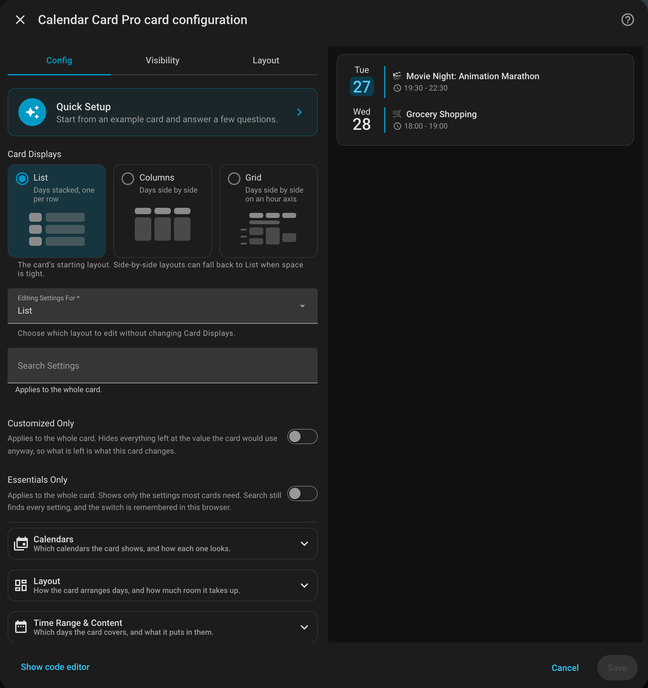
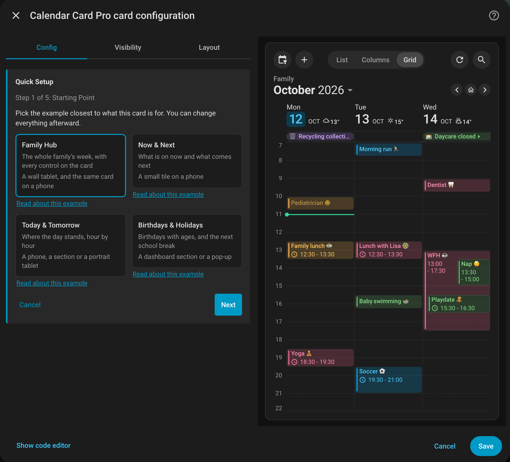

# Visual Configuration Editor

Configure the card with Home Assistant's visual editor and see a live preview as you edit.

<br>

The editor, with the card's preview beside it. **Card Displays** is set to List, so **Editing Settings For** starts on List too; [Options for the Selected View](#options-for-the-selected-view) explains the two.

To open it, click the three dots (⋮) in the top-right corner of the card and select **Configure**. If you have not added a card yet, start with [Usage](/guide/usage).

## 🪄 Quick Setup

**Quick Setup** starts a card from one of the [Example Stories](/reference/examples) and asks only
what a story cannot know about your home: the title, your calendars, your weather and how the
card should answer a tap. Use it on a new card to get a finished-looking one in a few steps, or
on an existing card to try a different look without retyping anything.

<br>

Pick a story and the preview draws it at once, on your own calendars as soon as you name them.

Choose **Quick Setup** at the top of the editor. Starting from Birthdays & Holidays on two
calendars writes this:

```yaml
type: custom:calendar-card-pro
config_version: 5
title: Coming Up
days_to_show: 60
show_countdown: true
show_single_allday_time: false
month_separator_width: 1px
day_spacing: 4px
event_gap: 4px
vertical_line_width: 4px
toolbar:
  show: true
  legend: false
  add_event: false
  refresh: false
  view_switcher: false
event_tap_action:
  action: details
entities:
  - entity: calendar.birthdays
    accent_color: '#f06292'
  - entity: calendar.holidays
    accent_color: '#26a69a'
```

| Step                  | What it asks                                                                                                                                                                    |
| --------------------- | ------------------------------------------------------------------------------------------------------------------------------------------------------------------------------- |
| **Starting Point**    | [Family Hub](/guide/family-calendar), [Now & Next](/guide/now-and-next), [Today & Tomorrow](/guide/today-and-tomorrow) or [Birthdays & Holidays](/guide/birthdays-and-holidays) |
| **Title & Calendars** | The card's title, and its calendars; at least one                                                                                                                               |
| **Weather**           | A weather entity, or none                                                                                                                                                       |
| **Taps & Toolbar**    | Whether to show the toolbar, open an event on a tap, and add an event on a tap on a day                                                                                         |
| **Review**            | What Apply will change, then **Apply**                                                                                                                                          |

- **The preview follows every answer.** **Cancel** puts the card back exactly as it was.
- **The story replaces the card's look**: its layout, spacing, toolbar settings and actions, and
  every setting the steps do not ask about.
- **Your calendars keep their own settings.** A calendar without a color of its own takes the
  story's next color, until the story runs out of colors.
- **The weather step starts from your card's weather entity.** Without one, a story that shows
  weather picks your home's weather entity when you have exactly one.
- **Home Assistant's own settings for the card stay**, such as its size on the dashboard.

::: details When Quick Setup Behaves Differently

- Two of the six stories are not offered. [Bin Day](/guide/bin-day) and
  [Family Agenda](/guide/one-calendar-many-purposes) sort events by words in their titles and
  descriptions, which no question can guess for your calendars; copy them from their pages.
- A story's names and labels for each calendar are not carried over: they belong to the
  story's family.
- A calendar listed more than once keeps every one of its blocks, together, in the order the
  card first lists it.
- Each answer is a real edit of the card, so pressing Home Assistant's **Save** before
  **Apply** saves what the preview shows.
- Changing the card's YAML while Quick Setup is open closes it, keeping your YAML.

:::

## 🗂️ Editor Organization

The editor groups its options into nine panels, each named for what it configures rather than for where the option lives in YAML. They are listed here in the order the editor shows them:

| Panel                    | What it covers                                                                              |
| ------------------------ | ------------------------------------------------------------------------------------------- |
| **Calendars**            | Which calendars the card shows, and how each one looks                                      |
| **Layout**               | How the card arranges days, and how much room it takes up                                   |
| **Time Range & Content** | Which days the card covers, and what it puts in them                                        |
| **Card & Header**        | The card itself, and its header: the title and the toolbar                                  |
| **Day Header**           | How each day announces itself, and in Columns and Grid the rule drawn under it              |
| **Events**               | The events themselves, and the lines each one can carry                                     |
| **Separators**           | The rules between days, weeks and months; in Grid also those across it, and **Day Spacing** |
| **Weather**              | A forecast beside the day, beside the event, or both                                        |
| **Actions & Refresh**    | What a tap on the card or an event does, and how often the card re-reads its calendars      |

Several panels can be open at once, and a [search](#search-customized-only) opens every panel
holding a match. Options appear only when they apply: switching a feature on reveals the
settings that belong to it.

Most panels look the same whichever [layout you are editing](#options-for-the-selected-view).
Where they differ:

- **List** adds **Event Order**, **Skip First Events** and **Compact Mode** under Time Range &
  Content, and **Vertical Alignment** and **Indicator Position** under Day Header.
- **Columns** adds a collapsible **Column Density** group under Layout, which decides how narrow a column may get
  before the card gives one up.
- **Columns** and **Grid** add **Gap & Rule** under Day Header, the space under a day header
  and the rule drawn inside it, and a table under Layout's fields showing which layout the card
  renders at each width.
- **Grid** captions Layout's fields **Time Axis**, **Hour Labels**, **On the Grid** and
  **Card Size & Spacing**, then adds **Grid Density**. It titles **Separators** as **Rules**,
  and its **Day Spacing** sits there.
- **Grid** leaves out **Multi-Day Events**, which it arranges itself; the empty-day text and
  color, since it draws an empty day as a blank column; and **Show Now Indicator**, since it
  marks the present with the **Now Line** under **Layout → On the Grid**.

::: details Inside Each Panel

- **Calendars** and **Time Range & Content** share an order: **Event Filtering**, then
  **Multi-Day Events**. A calendar adds **Name & Appearance** and **Visibility** above them,
  **Text Replacement** between them and **Event Details** below. **Visibility** holds Home
  Assistant's own Visibility editor, for the calendar's
  [visibility conditions](/features/core-settings#showing-a-calendar-under-conditions). Time
  Range & Content opens with
  **Time Range**, the days the card covers, and ends with **Empty Days**, then the collapsible
  groups **Compact Mode** and **Language & Time Format**.
- **Layout** orders its spacing from the outside in: between days (**Day Spacing**), between a
  day's events (**Event Gap**), inside each event (**Event Spacing**), then
  **Additional Card Spacing** and **Card Height**. The layout's density group comes last.
- **Card & Header** ends with a **Toolbar** heading over the
  [header toolbar](/features/layout-appearance#header-toolbar). **Show Toolbar** turns it on or
  off. While it is on, the panel offers the toolbar's controls in the order the toolbar is read:
  **Calendar Filter**, **Add Event Button**, **View Switcher**, **Reset Button**,
  **Refresh Button** and **Search Button** for the top row, then **Date Navigation** for the row under it.
  **Calendar Filter** is a dropdown of **Off**, **Menu** and **Chips**, with **Menu** the
  default. Under them, **Your Own Buttons** holds a panel for each of the toolbar's
  [buttons of your own](/features/layout-appearance#your-own-buttons), with **Move Up**,
  **Move Down** and **Remove** over its **Icon**, **Name**, **Entity** and **Tap Action**, and
  **Add Button** after the last. Turning the toolbar off hides them and keeps what they were set
  to.
- **Day Header → Today Indicator**: the **Style** decides what follows. The **Date Tile** offers
  only **Indicator Color**, while the dots, **An Icon** and **An Emoji or Image** add
  **Indicator Size** and, in List, **Indicator Position**. Under **Week Numbers**, the styling
  options appear once **Numbering** is anything but **None**.
- **Events → Event State** sits between the Event Details switches and Accent.
  **Show Now Indicator** puts "Now" before the time of an event that is happening, and **Now Color** is the
  color of that event, offered whether or not the switch is on. It colors grid view's now line
  too; in the Grid workspace it writes `time_grid.now_color`, which colors grid alone.
- **Past Event Opacity** accepts 0-100%, including fractions: 60% is the default look, 100%
  removes the dimming, and 0% makes contents transparent without hiding events. It is offered in
  every workspace, even when All Layouts has Show Past Events off, because Grid can show past
  events on its own. Clear the number to restore 60 in All Layouts, or inheritance in a layout's
  workspace; that layout's Reset does the same. See
  [Past Events Display](/features/event-content#past-events-display) and the
  [configuration reference](/reference/configuration#event-column).
- **Events → Title → Scroll Long Titles** turns on
  [scrolling long titles](/features/event-content#scrolling-long-titles) in supported browsers,
  and can be set separately in each workspace; reduced motion always keeps titles still. It is
  the only motion setting with a switch of its own: the **Pulsing Dot** style under
  **Day Header → Today Indicator** animates too.

:::

## 🧭 Options for the Selected View

Two controls sit together above search. **Card Displays** chooses the card's starting
layout and writes the existing `view` option. **Editing Settings For** chooses which settings
the panels edit: **All Layouts**, **List**, **Columns**, or **Grid**. It starts by following
Card Displays, then stays independent once you choose a workspace. The workspace is never
saved to YAML; opening the editor again starts from the card's displayed view.

- **All Layouts** edits the shared base, the top level, which each layout falls back to. It
  offers only the options that have a shared meaning, so a layout-specific one is never written
  where only one view reads it.
- **List**, **Columns** and **Grid** each write to their own block, `list:`, `column:` and
  `time_grid:`, and omit the controls, per-calendar ones included, that cannot affect that view.
  [Editor Organization](#editor-organization) lists the differences.
- A layout with no value of its own uses its own default when it has one, otherwise the shared
  base. Editing All Layouts therefore changes only the layouts that inherit that option, never
  their explicit choices or built-in defaults ([YAML & View Defaults](#yaml-view-defaults)).
- Card-wide options such as calendars, title, language, and actions stay card-wide in every
  workspace.

The workspace follows your selection, not the preview's width-dependent fallback, and search
and **Customized Only** do not bring back controls for another workspace. To edit a list-only
option used by a responsive fallback, choose List under Editing Settings For; Card Displays
stays unchanged. An edit still pending when you switch workspaces stays with the workspace
where you made it.

Hiding a control does not delete its stored value. For example, these empty-day options
remain available to the list fallback, even though their controls are absent while
editing Grid:

```yaml
view: grid
show_empty_days: true
empty_day_text: 'No plans'
empty_day_color: '#607d8b'
```

**→ [Options With No Effect in Grid View](/reference/configuration#options-with-no-effect-in-grid-view)** and
**[Options With No Effect in Column View](/reference/configuration#options-with-no-effect-in-column-view)** — the scoped options.

### Upgrading a Card From Before v5

Opening a List or Grid card from before v5 can raise one question first. Before v5, List
settings lived at the top level, alongside values inherited by Column. In v5, that same
location means **All Layouts**. When an older List or Grid card contains an option whose
default differs in another layout, the editor cannot safely guess which meaning you want. It
pauses before showing the normal controls and offers two choices:

- **Keep my existing List appearance** — recommended. The existing values stay with List,
  while Column and Grid keep their own settings and defaults.
- **Use these settings for all layouts** — the existing values become the shared starting
  point. A layout's own settings and built-in defaults can still take precedence.

Either choice keeps every option your YAML spells out, including one set to its default, such
as `show_month: true`, and preserves the layout currently on screen at the moment you choose
it. On a Grid card, the choice decides what List — including a responsive List fallback — uses
later; the current Grid appearance is unchanged.

Column cards do not show this choice, and their columns do not change: the first editor edit
keeps the top-level values shared, as Column read them before v5.

Merely opening and closing the editor writes nothing, and a card you never edit keeps working
as it is; see [Per-View Options](/features/core-settings#per-view-options). Once the choice or
an automatic adoption is saved, it is not asked again, and the editor has written the
`config_version` option for you, as it does on every card it creates. You do not need to add
it by hand; see
[Core Settings in the configuration reference](/reference/configuration#core-settings).

```yaml
# Written by the visual editor
config_version: 5
```

::: details What the Upgrade Writes

- The editor asks only when at least one authored value is genuinely ambiguous. The five
  options only List can read move into `list:` without asking. A List or Grid card with no
  ambiguous values opens normally and adopts the v5 format on its first actual edit. A Column
  card's first edit moves only those five and records the v5 format.
- A configuration without `config_version` that already contains `list:` or `time_grid:` is
  treated as layered. It opens normally and adopts the marker on its first actual edit without
  reinterpreting shared values.
- The choice moves only the values it asks about, and adds `config_version`.
- Every later save works the same way: the editor removes a line you wrote only when you change
  that option, so a card that spells out a default keeps it even if a later release changes the
  default. Setting an option back to its default in the editor still removes the line, except a
  Grid value for an option whose Grid default differs (see
  [Switching an Existing Card to Grid](#switching-an-existing-card-to-grid)), and
  [deprecated options](#deprecated-options) are still removed.
- A line the save leaves alone also keeps its spelling, such as `slot_minutes: '30'`.

:::

### Switching an Existing Card to Grid

On a v5-format card, changing **Card Displays** from List or Column to Grid keeps values
you explicitly set through All Layouts, including a value equal to the List default. For
options where Grid has a different default, the editor copies your value into `time_grid:`
rather than replacing it. Options you did not set use Grid's defaults without writing
those defaults into YAML. A fresh card switched to Grid does not need a `time_grid:` block.

For example, these two authored values are kept in Grid:

```yaml
event_font_size: '18px'
event_background_opacity: 5
```

The corresponding entries after switching are:

```yaml
view: grid
event_font_size: '18px'
event_background_opacity: 5
time_grid:
  event_font_size: '18px'
  event_background_opacity: 5
```

One notice lists the options kept instead of Grid's defaults. Use the option's
**Reset** button in the Grid workspace to return to its default; switching away and
back in the same editing session does not recreate a reset value.

Only a switch made in the editor keeps your values this way. A change to `view` made in YAML,
opening a card that is already on Grid, or choosing a workspace copies nothing and shows no
notice: a v5 card with root `event_background_opacity: 5` and no Grid opacity still shows
Grid's default of 20.
Choose the Grid workspace to change that value directly.

::: details Reset, Saving & Reopening

- The switch does not remove older `time_grid:` values that happen to match a divergent Grid
  default.
- A reset applies only to the options that control writes. A later switch to Grid still keeps
  other values you author in All Layouts, and if you deliberately change the reset option itself
  in All Layouts afterward, that newer choice can be kept on the next switch too. Re-entering an
  equivalent value, such as `14` for `14px`, does not replace the reset.
- Reset memory belongs to the current editor session. After reopening, the saved YAML
  determines which shared choices a later switch to Grid keeps.
- An explicit shared choice stays in YAML when another layout has a different default for that
  option, even if you set it back to the card's default, and so does one you chose to share
  during an upgrade. Setting Event Font Size to `14px` in All Layouts keeps
  `event_font_size: '14px'`, so a later switch to Grid keeps `14px` after reopening, just as it
  does in the original session. Untouched defaults are not added, and a value set directly in
  Grid still wins.
- What each layout's block keeps when you save is under
  [View Exceptions](#view-exceptions).

:::

### YAML & View Defaults

The editor does not change the renderer's precedence rules. With no per-view override,
these top-level values behave as follows:

| Top-Level YAML            | List              | Column            | Grid              |
| ------------------------- | ----------------- | ----------------- | ----------------- |
| `show_empty_days: false`  | Hides empty days  | Keeps empty days  | Keeps empty days  |
| `show_past_events: false` | Hides past events | Hides past events | Keeps past events |
| `show_location: true`     | Shows locations   | Shows locations   | Hides locations   |

Set the corresponding value in `column:` or `time_grid:` to change that view, or use
its editor workspace. Grid also substitutes its own styling defaults, even when you
set a different top-level value. All fourteen are listed in
[Grid Options That Start From a Different Default](/features/grid-view#options-that-start-from-a-different-default).
Column's two substitutions are listed in
[Column Options That Start From a Different Default](/features/column-view#options-that-start-from-a-different-default).

## ✨ Key Features

- **Live Preview** — see changes immediately as you configure the card
- **Quick Setup** — start from an example card and answer a few questions; see [Quick Setup](#quick-setup)
- **Context-Aware Options** — settings appear only when they are relevant, so a panel shows what applies rather than everything that exists
- **Search** — find any option by name or by what it does, without knowing which panel holds it
- **Customized Only** — hide everything left at its default, to see what a card actually changes
- **Essentials Only** — show only the settings most cards need
- **Direct Per-View Editing** — choose a workspace and edit its effective values without adding a second control

::: info Editor Language Support
The editor is available in **12 languages**, and the calendar itself in **38**. Besides English, nine are translated in full (German, Estonian, Italian, Latvian, Lithuanian, Norwegian Bokmål, Polish, Slovak and Swedish), Korean in part, and British English carries only the strings where it differs from US English.

A string not yet translated appears in English, so a partial translation is useful from its first string. If your language is not among the 12 the editor is entirely in English. Either way, calendar settings applied through it still display correctly in all 38 supported languages, and contributions of further editor translations are very welcome; see [Translating the Editor](/contributing#translating-the-editor).
:::

## 🔎 Search & Customized Only

The editor holds nearly two hundred options, so it opens with a search box above the panels.
Typing filters every panel down to what matches, drops the panels and the groups inside them
that have nothing left, and expands what survives, so a match is never hidden behind a
collapsed heading.

Search matches what is on screen: the name of a setting, the sentence explaining it, and the choices a dropdown offers. Typing `opacity` finds **Past Event Opacity** and **Event Background Opacity**; typing `iso` finds the week-number control, because that is where the word appears. It also matches the YAML option name, so a key copied out of the [Configuration Options reference](/reference/configuration) leads straight to its control, including the controls the editor names differently from the option they write: `time_24h` finds **Time Format**, and `entities` finds the **Calendars** picker.

Some searches bring back a whole group rather than one control:

- **A panel's title or helper** shows that panel's relevant controls, including a
  workspace-specific title such as Grid's **Rules**, in your editor language.
- **A calendar's entity id**, the name Home Assistant gives it, or its
  [name on the card](/features/core-settings#naming-a-calendar-in-the-card) shows every setting
  of that calendar, on each of its blocks, and keeps the **Calendars** picker that lists it.
- **A label** shows every setting of the block that carries it.

**Customized Only** hides everything still set to the value the card would use anyway, leaving exactly what this card changes. Three things follow their own rule under it:

- **Calendars** show only the ones you have given settings of their own, which is a quick way to see which calendars have a color or a label and which simply follow the card.
- **Per-calendar options** count as customized when they are set at all. Several of them mean "follow the card" when left alone, so `Show Time: Off` on one calendar is a real setting rather than a default.
- **View values** count as customized when the selected layout stores its own value. Values inherited from the shared base or supplied by the layout's defaults do not count.

### Essentials Only

**Essentials Only** cuts the editor down to about twenty settings most cards need, so a first
setup is not a walk through nine panels. It is off until you switch it on, and your browser
remembers it for every card.

It keeps these, and hides the rest:

- **Calendars**: the calendar picker, and each calendar's name, label and accent color
- **Time Range & Content**: Days to Show, Start Date, Show Past Events and Show Empty Days
- **Card & Header**: Title, Show Toolbar and Calendar Filter
- **Events**: Show Time, Show End Time, Show Location, Show Description and Show Countdown
- **Weather**: the weather entity and its position
- **Actions & Refresh**: Tap Action, Day Tap Action and Event Tap Action
- **Layout**, in Grid only: the hours the grid starts and ends

Typing a search sets Essentials Only aside, so a search still reaches every setting. With
**Customized Only** also on, it shows the essentials this card has changed. Your toolbar's own
buttons are hidden while it is on, and a line under the switches says how many settings it is
hiding.

::: tip Not Everything Is There To Be Found
The editor only offers the settings your current configuration calls for: a fixed calendar content height appears once the height mode is fixed, the compact-mode modifier appears once there is an event limit for it to modify, Allow Editing Events and Allow Deleting Events appear once Event Tap Action is Show Event Details, and Open Links in Events only while Event Tap Action and Event Hold Action are both Nothing. A search cannot turn up a control that is not on screen, so if nothing matches, check whether the option it depends on is switched on.
:::

::: details How Search & Customized Only Read the Editor

- A sub-heading is never a match on its own: it shows only to caption a result beneath it, so a
  word that appears in a heading and nowhere else returns nothing.
- **Customized Only** reads values the way the card does. A number written as `"3"` in YAML
  counts as untouched when `3` is the default, and a value the card rejects counts as untouched
  too, since the card does not use it either.

:::

## 📋 Per-Calendar Panels & Actions

The Calendars picker lists each calendar **once**, however many times the card uses it. It answers one question — which calendars this card shows — and the panels beneath it answer the other: how many blocks each calendar has, and what is set on each.

Every calendar gets a collapsible panel of its own, headed with the calendar's name as Home Assistant knows it — the same name the picker shows, rather than the entity id underneath it. A [`name`](/features/core-settings#naming-a-calendar-in-the-card) you give the calendar on the card does not change the heading; it shows in the **Name** field at the top of the panel and on the line under the heading, where it differs from the heading. That line also shows your own label if you have set one, then **Configured** if the calendar carries settings of its own, or **Using the card settings** if it does not.

Each panel opens with four actions:

| Action             | What it does                                                                                                   |
| ------------------ | -------------------------------------------------------------------------------------------------------------- |
| **Copy Settings**  | Takes this calendar's settings, without taking the calendar itself, its name or **Show in Calendar Filter**    |
| **Paste Settings** | Applies them to this calendar, keeping the calendar it is applied to, its name and **Show in Calendar Filter** |
| **Duplicate**      | Gives this calendar a second block, carrying the first one's settings and its name                             |
| **Remove**         | Drops this block                                                                                               |

**Remove** is held apart from the other three: it is the only one that discards anything, and a card editor has no undo.

**Copy Settings** is offered only once a calendar carries something besides its name and **Show in Calendar Filter**. The clipboard behind it outlives the dialog, so settings copied while editing one card can be pasted into another — useful when several cards list the same calendars.

**Duplicate** is how you give one calendar two sets of settings. That is what [splitting a calendar by event type](/features/core-settings#separating-all-day-from-timed-events) needs, and it cannot be done from the picker, which will not hold the same calendar twice. Both panels then carry the same heading, and their secondary lines are numbered **Entry 1 of 2** and **Entry 2 of 2**.

The copy starts out identical to the block it came from, so until you change something on one of them the card shows every event from that calendar **twice**. Setting **Event Type** on each usually resolves it.

::: tip Two Ways to Take Something Away, and They Differ
Clearing a calendar's row in the **picker** removes that calendar from the card altogether, along with every block it had. **Remove** on a panel drops just that one block and leaves the calendar's others alone.
:::

::: details Names & Missing Calendars

- A calendar that has been removed from Home Assistant keeps its entity id in the heading, since
  that is all there is left to identify it by.
- A calendar whose only setting is its name shows just that name under the heading, as
  **Kids** rather than **Kids · Configured**, and with a label as well it reads
  **Kids · School**.
- A calendar with two blocks has one name, so changing it on either block changes it on both,
  and removing the block that held it leaves it on the block that remains. **Show in Calendar
  Filter** works the same way.

:::

**→ [Entity configuration options](/features/core-settings#available-options-for-entity-configuration-objects)** — everything a single calendar's panel can set.

## 🏷️ Per-Calendar Labels

Each calendar's panel opens with **Name**, the
calendar's [name on the card](/features/core-settings#naming-a-calendar-in-the-card), then
**Show in Calendar Filter** while the toolbar shows a
[calendar filter](/features/layout-appearance#leaving-a-calendar-out-of-the-filter), and the
control after them is **Label Type**. A label is the mark shown before every event from
that calendar, and it can be four things — nothing, text or an emoji, an icon, or an image.

The editor reads the type from the value: `mdi:home` is an icon, `/local/work.png` is an
image, and anything else is text. So a calendar configured in YAML opens with the right
control already selected, without a `label_type` option anywhere in it. Only when the
value alone would give the wrong answer — picking **Text or Emoji** and then typing `mdi:home`,
for example, or picking **An Icon** before choosing one — does the editor store `label_type`
alongside `label`, and then it takes precedence over the value.

Choosing **An Icon** or **An Image** first shows an **Icon Source** or **Image Source**
dropdown, which says where the label comes from. With **Custom icon** as the source you get
Home Assistant's icon picker. **Label Icon Color** appears only for **An Icon**, the only type
it affects.

::: tip Your Choice Wins Over the Value
Type `mdi:calendar` into the text box and the card renders it as the literal text
`mdi:calendar`, not as an icon. The editor records that you asked for text, so the value
is left alone rather than being reinterpreted. Switch **Label Type** to **An Icon** to
get the icon picker.
:::

**→ [Entity configuration options](/features/core-settings#available-options-for-entity-configuration-objects)** — the `label` option itself, and the rest of the per-calendar table.

## ⚖️ View Exceptions

To give one layout its own value, select **List**, **Columns**, or **Grid** under
**Editing Settings For**, then use the ordinary controls. Their helper text says whether
the value comes from the shared card settings, from that layout's own default, or from a
value set for the layout.

For example, editing Event Font Size in Grid writes the grid value while leaving the
List value alone:

```yaml
event_font_size: '14px'
time_grid:
  event_font_size: '16px'
```

**Reset** buttons at the foot of each panel remove individual view values and restore what the
layout would use without them. They do not remove the input or clear other layouts.
Where one mode control governs several options, its reset clears those options together.

::: details What Each Layout's Block Keeps

- List keeps every valid explicit value in `list:`, even one equal to the shared value; use
  Reset to return to inheritance.
- Column and most Grid values that you edit to equal what the view inherits are omitted from
  their saved blocks. Once omitted, they follow later All Layouts edits immediately, without
  closing and reopening the editor.
- Options with a
  [different grid default](/features/grid-view#options-that-start-from-a-different-default)
  stay explicit when edited back to that default; use Reset to remove the explicit value.
- A value your YAML already holds stays, even when it equals what the view would inherit or
  default to; the view shows it as set for that layout and offers its Reset.

:::

**→ [Column View](/features/column-view)** — the `column:` block, and what may go in it.

## ⚠️ Options the Card Ignores

When your YAML puts an option where the card does not read it, the editor lists it at the top,
says where it works and offers to move it there. On your dashboard the card ignores such an
option without a word, and only a development build warns in the browser console, so this is
where you find out.

```yaml
time_grid:
  toolbar: # ignored here: the toolbar belongs to the whole card
    show: true
```

**Move to Top Level** turns that into:

```yaml
toolbar:
  show: true
```

The editor lists five kinds:

- **A whole-card option in a layout's block**, such as `toolbar` or `event_tap_action` under
  `time_grid:`. It works only at the top level; see
  [Options That Cannot Be Overridden](/features/column-view#options-that-cannot-be-overridden).
- **A layout's own option in another layout's block**, such as `start_time` under `column:`,
  which belongs in `time_grid:`, or `compact_events_to_show` under `time_grid:`, which belongs
  in `list:`.
- **A layout's own option at the top level**, such as `hour_height`, which works only inside
  `time_grid:`.
- **A calendar's own option outside `entities:`**, such as `show_in_legend` at the top level
  or `name` in a layout's block. It has no Move button; set it on the calendar it is for.
- **A name the card does not know inside a layout's block**, often a typo. It has no Move
  button; fix it in YAML.

**Move** appears only where the destination holds no value for the option yet. Where it does,
moving would replace something you wrote, so the editor names the conflict and leaves it to you.
An option that belongs to two layouts, such as `min_day_width` at the top level, gets a Move
button for each. Until you move or remove it, the editor keeps the line as you wrote it.

## 🔄 Deprecated Options

Five options were removed in v3.0.0. They are **inert**, so a configuration still carrying one is not doing what it says:

| Removed                 | Use instead              |
| ----------------------- | ------------------------ |
| `max_events_to_show`    | `compact_events_to_show` |
| `vertical_line_color`   | `accent_color`           |
| `horizontal_line_width` | `day_separator_width`    |
| `horizontal_line_color` | `day_separator_color`    |
| `row_spacing`           | `day_spacing`            |

`max_events_to_show` is also recognized on an individual entry under `entities:`.

**Opening a card in the editor and saving removes them.** There is no button to press, and since the options do nothing, removing them changes no behavior. Their replacements are not filled in for you: the card has been running on defaults for those settings, so setting them now is a change you should make deliberately.

::: warning YAML Is Not Migrated Automatically
There is no runtime migration, so a deprecated option written directly in YAML is ignored and the card falls back to the default — it does not keep working under the old name.

Each deprecated option found in your configuration is reported in the browser console, naming the current option to use in its place. Open your browser's developer tools and look for messages prefixed with `📅 Calendar Card Pro`. If you manage your card in YAML, use the current names from the [Configuration Options reference](/reference/configuration).
:::
