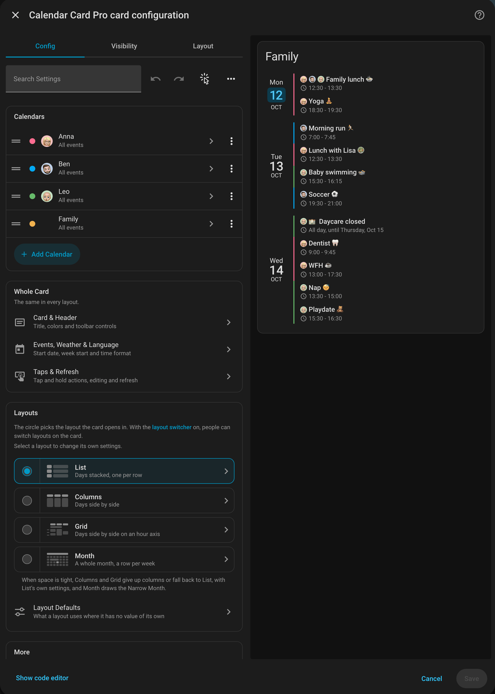

# Visual Configuration Editor

Configure the card with Home Assistant's visual editor and see a live preview as you edit. The
editor opens on an overview of the card, edits what most cards need right there, and leads to a
page for everything else.

Picking Calendar Card Pro in Home Assistant's card picker, on its **By card** tab, opens the
editor. To open it again later, edit the dashboard and choose the card's **Edit**. A card added
from the **By entity** tab goes straight onto the dashboard, so open it with **Edit** too. When you
are done, press Home Assistant's **Save**, then **Done** to leave the dashboard's edit mode. If you
have not added a card yet, start with [Usage](/guide/usage).

## 🗺️ The Overview

<br>

The overview is the first thing the editor shows. It holds the card's calendars, the settings
the whole card shares, and its layouts, each leading to pages of their own. Top to bottom:

| Part                           | What it does                                                                                                                                                                     |
| ------------------------------ | -------------------------------------------------------------------------------------------------------------------------------------------------------------------------------- |
| **Options the Card Ignores**   | Only when the YAML holds [options the card ignores](#options-the-card-ignores) or [removed options](#deprecated-options), as in **Options the Card Ignores: 1 · Old Options: 2** |
| **Quick Setup**                | On a fresh card, a banner offering [Quick Setup](#quick-setup), which takes focus as the editor opens                                                                            |
| **Search**, **Undo**, **Redo** | [Search](#search) every setting; [Undo and Redo](#undo-redo) the last change                                                                                                     |
| **⋯ Editor Preferences**       | Show YAML Option Names, at the end of the search row                                                                                                                             |
| **Calendars**                  | The card's [calendars](#calendars), a row each                                                                                                                                   |
| **Whole Card**                 | The pages whose settings are the same in every layout, a row each saying in one line what the page holds                                                                         |
| **Layouts**                    | List, Columns, Grid and Month, a row each with its picture, then Layout Defaults; see [Options for the Selected View](#options-for-the-selected-view)                            |
| **More**                       | [Stored Settings](#stored-settings) and Start From an Example                                                                                                                    |

**Whole Card**'s rows open these pages, each row saying in a line what its page holds:

| Page                           | What it holds                                                                                                                                                                                                                                |
| ------------------------------ | -------------------------------------------------------------------------------------------------------------------------------------------------------------------------------------------------------------------------------------------- |
| **Card & Header**              | The title and the card's background, the toolbar and your own toolbar buttons                                                                                                                                                                |
| **Events, Weather & Language** | The whole card's answers to a first setup's questions: Start Date, Event Type and Hide The Card When Empty, the Weather Entity, then First Day of Week, Time Format and Language; see [Events, Weather & Language](#events-weather-language) |
| **Taps & Refresh**             | What a tap or a hold on the card, a day or an event does, editing and deleting events, and how often the card reads its calendars again                                                                                                      |

Each layout's page lists five topics, and Layout Defaults the first four, since no forecast
setting has a value for every layout:

| Topic                | What it holds                                                                                                                                         |
| -------------------- | ----------------------------------------------------------------------------------------------------------------------------------------------------- |
| **Which Events**     | Days to Show and Start Date, Grid's hours, duplicates, event order, past events, all-day and multi-day events, empty days and Compact Mode            |
| **Days**             | How each day announces itself: its date, week numbers, today and its indicator, past days and weekends, and Grid's and Month's shading                |
| **Event Appearance** | What each event shows, Grid's now line and overlapping events, and how each part looks, Month's day text included                                     |
| **Size & Spacing**   | The card's height and spacing, Grid's hour height and hour labels, the narrow month's heights, what each layout draws on a narrow card, and the rules |
| **Weather**          | This layout's forecast in the day header and beside each event, Month's beside its events only, and the weather entity every layout shares            |

**Which Events** opens with **Date Range**: Days to Show, and Start Date's choices, which write
the existing `start_date` option. Tomorrow writes `today+1`, Start of Week writes
`start_of_week`, and Relative to Today takes any offset, such as `today-29`. Month's page offers
Today, A Fixed Date and Relative to Today. It shows Tomorrow and Start of Week as Today, since
Month opens today's month for them, and names what the other layouts start on instead.
Month's page also holds **First Week** and **Weeks Shown**, which show
[the coming weeks](/features/month-view#the-coming-weeks) rather than a calendar month. A tap on
an event opens its details; to change that, choose another action under **Event Tap Action** on
Taps & Refresh.

**Weather** opens with **Weather Entity**, shared by every layout. Choosing one here turns the
forecast on in the layout you are editing, beside its days, or in Month beside its events, and
leaves the other layouts as they are; clearing it removes the forecast from every layout.
Everything else on the page is that layout's own, so List can show the forecast beside events while
Grid shows it in the day header; see [Weather Per Layout](/features/weather#weather-per-layout).

### Events, Weather & Language

**Events, Weather & Language**, under **Whole Card**, holds the settings a first setup asks about
that have one value for the whole card: **Start Date**, **Event Type** and **Hide The Card When
Empty** under Which Events, the **Weather Entity** under Forecast, and **First Day of Week**,
**Time Format** and **Language** under Format & Language.

The layouts' topics name all but Language too, each in its place. Start Date sits editable beside
Days to Show, and the Weather Entity on each layout's Weather, where choosing it turns that
layout's forecast on. Event Type and Hide The Card When Empty on Which Events, First Day of Week on
Days and Time Format on Event Appearance show as a row with their value and **Whole Card · Events,
Weather & Language**, which opens the setting here; **Back to** and the topic's name, under the
header there, returns to the row.

Under Start Date, **Days to show, per layout** links to Days to Show in each layout the card can
show that counts days, since each layout keeps a count of its own. **Show the forecast in** links
to each layout's Weather, where the forecast is turned on, since choosing the entity here turns
none on. With no entity chosen yet, each link opens that layout's Weather Entity, where choosing
one turns that layout's forecast on.

The **⋯** menu at the end of the search row holds **Show YAML Option Names**, remembered in this
browser for every card, with a box that is checked while it is on. It shows each setting's YAML
option name beside its label, and the YAML path in search results and in Stored Settings,
which helps when you move between the editor and YAML. The **⋯** button opens and closes the
menu, Down Arrow opens it from the button, and Escape closes it.

### Pages & Back

A row opens its page with focus on the page's title. **Back**, at the top and at the foot of
every page, goes up one level: from a layout's topic to that layout's page, and from every other
page to the overview. It lands on the row that opens the page you left, in view and focused, with
the page scrolled as you left it on the way down. Nothing goes deeper than a layout's topic. At
the top, Back and the title share the first row, and **Search Settings**, **Undo**, **Redo** and
**Pick From Preview** sit on the row under it, at every width.

- A page you reached another way than by its row says how to return under its header:
  **Return to Results** after a search result, and **Back to** and the page's name after a link
  from another page, Pick From Preview or Undo of a step taken there. Back still goes up.
- **Escape** closes whatever the editor has open first, such as a setting's state menu or a row's
  actions, then goes Back. On the overview it clears a search, and only then lets Home Assistant
  close the dialog. A picker Home Assistant opened keeps its own Escape.
- **Which Events** and **Days** link to each other: whether past events show is one, and
  how the dates of past days look is the other.
- The editor adds nothing to the browser's history, so the browser's Back closes the dialog as
  it does for any card.
- The line under a setting says only what its name does not: a default, a format, or how it
  works with another setting. **Documentation**, at the foot of a page that holds settings, opens
  the part of this site that covers them in full, in a new tab. A layout's own page and Layout
  Defaults, which only list their topics, have none.

## 🪄 Quick Setup

<br>

**Quick Setup** starts a card from a [Simple Agenda](/guide/usage#your-first-card) or one of the
[Example Stories](/reference/examples) and asks only
what a story cannot know about your home: the title, your calendars, your weather and how the
card should answer a tap. Use it on a new card to get a finished-looking one in a few steps, or
on an existing card to try a different look without retyping anything.

Quick Setup offers six starting points: a Simple Agenda and five of the stories. Pick one and the
preview draws it at once, on your own calendars as soon as you name them.

A fresh card offers Quick Setup in a banner at the top of the overview. A card that already holds
options of its own, such as one from the card picker's **By entity** tab or one pasted from these
docs, shows no banner: use **Start From an Example** under **More**, which every card has.
Starting from Birthdays & Holidays on two calendars writes this:

```yaml
type: custom:calendar-card-pro
config_version: 6
title: Coming Up
days_to_show: 60
show_countdown: true
countdown_exact_days: true
show_single_allday_time: false
show_month: false
month_separator_width: 1px
day_spacing: 4px
event_gap: 4px
vertical_line_width: 4px
toolbar:
  show: true
  legend: false
  add_event: false
  refresh: false
  view_switcher: false
entities:
  - entity: calendar.birthdays
    accent_color: '#f06292'
  - entity: calendar.holidays
    accent_color: '#26a69a'
list:
  month_separator_label: true
```

| Step                  | What it asks                                                                                                                                                                                                                                                  |
| --------------------- | ------------------------------------------------------------------------------------------------------------------------------------------------------------------------------------------------------------------------------------------------------------- |
| **Starting Point**    | [Simple Agenda](/guide/usage#your-first-card), [Family Hub](/guide/family-calendar), [Now & Next](/guide/now-and-next), [Today & Tomorrow](/guide/today-and-tomorrow), [Birthdays & Holidays](/guide/birthdays-and-holidays) or [House Log](/guide/house-log) |
| **Title & Calendars** | The card's title, and its calendars; at least one                                                                                                                                                                                                             |
| **Weather**           | A weather entity, or none                                                                                                                                                                                                                                     |
| **Taps & Toolbar**    | Whether to show the toolbar, open an event on a tap, and add an event on a tap on a day                                                                                                                                                                       |
| **Review**            | The example, calendars with their colors, every layout the card can show with its own days, the title, weather and the toolbar controls Apply turns on, each setting it replaces, then **Apply**                                                              |

- **The preview follows every answer.** **Cancel** puts the card back exactly as it was, and
  after **Apply**, one **Undo** does.
- **Apply sets the card up in the editor, and does not save it.** Press Home Assistant's **Save**
  after it, then **Done** to leave the dashboard's edit mode.
- **The story replaces the card's look**: its layout, spacing, toolbar settings and actions, and
  every setting the steps do not ask about. On a card with settings, the review names each one it
  replaces, with its value now and after, such as "Days To Show: 7 → 3". It lists five at first,
  and a button such as **Show All 12** lists the rest.
- **Your calendars keep their own settings.** A calendar without a color of its own takes the
  story's next color, until the story runs out of colors; the calendars step and the review draw
  each color beside its calendar.
- **The weather step starts from your card's weather entity.** Without one, a story that shows
  weather picks your home's weather entity when you have exactly one.
- **Home Assistant's own settings for the card stay**, such as its size on the dashboard.

::: details When Quick Setup Behaves Differently

- Two of the seven stories are not offered. [Bin Day](/guide/bin-day) and
  [Family Agenda](/guide/one-calendar-many-purposes) sort events by words in their titles and
  descriptions, which no question can guess for your calendars; copy them from their pages.
- A story's names and labels for each calendar are not carried over: they belong to the
  story's family.
- A calendar listed more than once keeps every one of its entries, together, in the order the
  card first lists it.
- Each answer is a real edit of the card, so pressing Home Assistant's **Save** before
  **Apply** saves what the preview shows.
- Changing the card's YAML while Quick Setup is open closes it, keeping your YAML.
- A new card from Home Assistant's card picker starts with the first calendar Home Assistant
  lists, which nobody chose. Quick Setup starts such a card with no calendar chosen, and the
  overview names that calendar under **Calendars**, with **Change Calendar** to pick another.

:::

## 🧭 Options for the Selected View

Most settings can differ by layout, so a Grid card can keep tighter spacing for the List it falls
back to on a narrow screen. **Layouts**, on the overview, gives each layout a row of its own:

- **The circle** picks the layout the card opens in and writes the existing `view` option. With
  the [layout switcher](/features/header-toolbar#switching-between-layouts) on, people can
  switch layouts on the card; the link in the help above the rows opens its chip on Card & Header.
  The layout the card opens in is always one the switcher offers, so picking one it did not offer
  adds it there, and a line under **Layouts** names the layouts the switcher offers now.
- **The rest of the row**, its picture, name and description, opens that layout's page, which
  lists its topics: Which Events, Days, Event Appearance and Size & Spacing. Opening a layout
  never changes the card. Its topics write to its own block, `list:`, `column:`, `time_grid:` or
  `month:`, and leave out the controls, per-calendar ones included, that cannot affect that
  layout. Grid's hours are on its Which Events, its hour labels and hour height on Size &
  Spacing, its shading on Days and its now line and overlapping events on Event Appearance.
  Month's heights sit on its Size & Spacing, its shading on Days, and the text sizes of its days
  on Event Appearance, beside the sizes its rows take. Month's page names its two forms and the
  two places it lists a day's events once, and every Month page uses the same four names: the
  **Wide Month**, the **Narrow Month**, the **Day List** under the narrow weeks, and the **Day
  Panel** "+N more" opens in either form; see [Month View](/features/month-view).
- **A topic page names its layout** under its title. **Also for: List · Columns · Month · Layout
  Defaults** opens the same topic in another layout, and **Continue with**, at its foot, opens the
  next topic, then the next layout's Which Events, through List, Columns, Grid and Month in turn.
- **Layout Defaults**, under the rows, is what a layout uses where it has no value of its own: the
  top level of the YAML. It offers only the options with a shared meaning. A layout with no value
  of its own uses its own default where it has one, otherwise Layout Defaults, so editing Layout
  Defaults changes only the layouts that inherit that option, never their own choices or
  built-in defaults ([YAML & View Defaults](#yaml-view-defaults)). It has no Weather topic: each
  layout's forecast is its own.
- **Whole-card settings** keep one value for every layout. Those a first setup asks about live on
  Whole Card's pages, and a topic that also concerns one names it by a row that opens it there.
  The detailed ones, such as the day colors and the card's Accent Color, stay on the topics,
  marked **Whole Card**, so a change in one layout is a change in every layout.

The preview shows the layout you are editing, whatever its width would make it fall back to. When
that is not the layout the card opens in, a line says so, as in **Preview shows Grid · The card
opens in Month**, and for a layout the switcher does not offer the preview draws no switcher.
Layout Defaults and Whole Card's pages preview the card as it opens. Quick Setup and Split This
Calendar show their own previews while they are open, and a line edited in place under
[Stored Settings](#stored-settings) previews its own layout. To edit a List-only
option used by a responsive fallback, open List. [Search](#search) finds the settings only
another layout offers.

Hiding a control does not delete its stored value. For example, these empty-day options remain
available to the List fallback, even though Grid's pages leave out their controls:

```yaml
view: grid
show_empty_days: true
empty_day_text: 'No plans'
empty_day_color: '#607d8b'
```

**→ [Options With No Effect in Grid View](/reference/configuration#options-with-no-effect-in-grid-view)** and
**[Options With No Effect in Column View](/reference/configuration#options-with-no-effect-in-column-view)** — the scoped options.

### Card Height

**Card Height**, first on every layout's Size & Spacing, sets how tall the whole card is: **Fit
content**, **Fixed height** with its **Height**, or **Maximum height** with its **Maximum Height**.
On a layout's page it writes `card_height` or `card_max_height` in that layout's block, and on
Layout Defaults at the top level, for every layout without a height of its own. Month's first
choice reads **Default height**, its own `632px`.

Choosing **Fixed height** or **Maximum height** clears that layout's `height` and `max_height`,
which size the events area alone. The editor shows those two, as **Events Area Height** and
**Events Area Maximum Height**, only on a card that already holds one. See
[Card Dimensions & Scrolling](/features/layout-appearance#card-dimensions-scrolling).

### Narrow Cards

**Narrow Cards**, on Size & Spacing, decides what the card draws where it is too narrow for its
days: **When Too Narrow** for Columns and Grid, with **Down To** and **Below That** where a choice
needs them, and each layout's **Minimum Day Width**, Month's included. On Month's page the heading
reads **Wide or Narrow Month**, since its Minimum Day Width chooses between Month's two forms. The
choices, and the YAML each writes, are under
[Setting It in the Visual Editor](/features/column-view#setting-it-in-the-visual-editor).

Under the headings, **At Common Card Widths** lists what each layout the card can show draws at
390 px, a phone; 480 px, a Sections column; 768 px and 1,280 px. That is the layout it opens in
and those the layout switcher offers, each drawing for example **3 days**, **List, 7 days**,
**7 days, narrower**, or for Month **Wide** or **Narrow**. It is left out where the card draws the
same at every width, as a List-only card does.

Under it, on Columns', Grid's and Month's own pages, **This card renders** gives that layout's
widths themselves: for Columns and Grid the width each
number of days needs and where the card turns into a list, and for Month the width it draws wide
from and the width a narrow month turns wide again from.

**At Common Card Widths** shows the first draw, when a dashboard opens at that width. A card
already on screen keeps its layout a little past each width, as **This card renders** notes, so it
does not flicker on the line.

### State in Words

Under a setting's name, its facts say where its value lives, in words, so the state is never told
by color alone. Each kind of fact has a form of its own, and none of them can be pressed. A
setting at its default shows none, except where only some layouts use it; a screen reader still
reads **Default** with its name. The words are the same on every page; a layout's page title says
which layout they are about, and a calendar's page is about every layout the card shows.

| Fact                                                   | Form                    | Means                                                                                                                                                                  |
| ------------------------------------------------------ | ----------------------- | ---------------------------------------------------------------------------------------------------------------------------------------------------------------------- |
| **Set**                                                | a dot before the word   | Stored where you are editing: the layout, Layout Defaults, the whole card or a calendar                                                                                |
| **Whole Card**                                         | after a card icon       | On a layout's topic: one value for every layout. Whole Card's own pages leave it out                                                                                   |
| **Whole Card · Events, Weather & Language**            | after a card icon       | On a layout's topic: a whole-card setting at home on that page; its row opens it there                                                                                 |
| **Not in Grid**                                        | after a card icon       | A whole-card setting that layout draws nothing for, such as Open Links; under Layout Defaults, any setting a layout draws nothing for                                  |
| **Day List & Day Panel**                               | after Month's icon      | On Month's pages: a setting that acts on the narrow month's Day List and the Day Panel "+N more" opens in either form, never on the weeks, listed after the weeks' own |
| **Wide Month**                                         | after Month's icon      | On Month's pages: a setting only the wide month's days draw, such as Show Month or the long-event banners                                                              |
| **Only in List**                                       | after the layout's icon | On a calendar's page: a setting only some of the card's layouts use as they are set up, such as Compact Events to Show                                                 |
| **Also Applies to Entry 2**                            | after a calendars icon  | A calendar's name or filter setting, shared by its entries                                                                                                             |
| **From Layout Defaults**, **From the Card**            | after ↳                 | Nothing is stored here; the value comes from Layout Defaults, or the card                                                                                              |
| **Grid Has Its Own: 12px**                             | after the layout's icon | Under Layout Defaults: Grid stores a value of its own, which applies there                                                                                             |
| **Grid Default: 12px**                                 | after the layout's icon | Under Layout Defaults: Grid stores nothing and uses its own default                                                                                                    |
| **Uses Grid's Default, Not 15px From Layout Defaults** | after the layout's icon | Under Grid: Layout Defaults stores a value Grid's own default takes over from                                                                                          |

Under a card-wide setting that some calendars set for themselves, such as Event Locations, a
line reads **Set on Calendars:** with the name of each calendar entry that stores its own value,
as in **Set on Calendars: Ben, Bin Day**. Unlike the facts above, those names can be pressed:
each opens that entry's page.

A setting with a stored value is always open, with **Reset** in plain view right after **Set**,
on the side away from ⓘ. **Reset (In the Day Header)** keeps the setting open and names the value
it goes back to, or **Reset (Empty)** where nothing comes back; **Remove Setting** resets a
setting and folds it. A group of chips has one button for all of its chips stored here, **Reset
Parts** for an event's parts and **Reset Controls** for the toolbar's and the lines under them,
after a line saying where each chip's state comes from: **Chosen Here**, **From Layout Defaults** or a layout's **Default**. A dropdown may also
show Home Assistant's own ✕, which empties it, the same as its Reset.

A folded setting shows the value that applies. Where nothing is stored, it names it: a setting
that follows another says so, as in **Same as Weekday Color**, and any other names what it does,
such as **No Limit**, **None** or **Theme Default**.

### Upgrading Weather From v5

Opening a card whose top-level `weather:` names an entity converts it to
[weather per layout](/features/weather#weather-per-layout), and the card looks the same: the
entity becomes `weather_entity`, and List, Columns and Grid each take the old block's options as
their own `weather:`. Month, which drew no forecast from it, stays off. A line at the top of the
overview says so, as in "Upgraded. Weather is now set per layout: List, Columns and Grid keep
what the card showed, and Month is off.", and names any line the card ignored that the conversion
removes, such as a layout's own `weather:` beside the old block.

- **Undo** puts the old block back, and your next change converts it again.
- The conversion is kept only when you press **Save**. **Cancel** leaves the card as it was, and
  a card you never open in the editor keeps drawing its forecast as before.

To make the same change by hand in YAML, see _Weather Written Before v6_ under
[Weather Per Layout](/features/weather#weather-per-layout). Everything else the
editor does when it opens an existing card is on
[Upgrading & Going Back](/guide/upgrading#what-the-editor-does-on-opening).

::: details A Weather Block That Names No Entity

A top-level `weather:` that names no entity drew nothing. Beside `weather_entity` it is converted
on opening too, and the layouts with no `weather:` of their own take its options, so they show
what they did not show before; the line at the top names them. With no entity anywhere, your
first change removes it.

:::

### Adopting the Layout Format

Opening a List or Grid card from before v5 upgrades it, and every layout the card can show looks
the same. Before v5, List settings lived at the top level, alongside values inherited by Column.
In v5, that same location means **Layout Defaults**. When an older List or Grid card holds an
option whose default differs in another layout, the editor reads it the way that changes no
layout, and says so at the top of the overview:

- **Kept for List**, where every layout the card can show draws it the same either way, as in
  "Upgraded. Day Spacing and Event Font Size now apply to List, as before. The card looks the
  same." **Use Them for Every Layout** makes them the shared starting point instead; a layout's
  own settings and built-in defaults can still take precedence.
- **Shared with every layout** otherwise, as in "Upgraded. Event Font Size now applies to every
  layout, unless a layout has its own." The value stays at the top level, where Columns has read
  it all along.

**Undo** puts the YAML back exactly as it was. The editor then upgrades it the same way with your
next change.

The same line names each calendar with `show_location: false` or `show_description: false`,
since an event's details now show what those hide, and offers **Make It Private**, which sets
`private: true` on that calendar as one undo step; see
[Hidden Fields Now Show in the Event Details](/guide/upgrading#hidden-fields-now-show-in-the-event-details).

Either way the editor keeps every option your YAML spells out, including one set to its default,
such as `show_month: true`, and the layout currently on screen. On a Grid card, the upgrade
decides what List, including a responsive List fallback, uses later; the current Grid appearance
is unchanged.

Column cards are not upgraded on opening, and their columns do not change: the first editor
edit keeps the top-level values shared, as Column read them before v5.

The upgrade is a change to the card like any other: it is kept only when you press **Save**, so
**Cancel** leaves the card as it was, and a card you never open in the editor keeps working as it
is; see [Per-View Options](/features/layouts#per-view-options) and
[Upgrading & Going Back](/guide/upgrading#what-the-editor-does-on-opening). Once it is saved, the
editor has written the `config_version` option for you, as it does on every card it creates. You
do not need to add it by hand; see
[Core Settings in the configuration reference](/reference/configuration#core-settings).

```yaml
# Written by the visual editor
config_version: 6
```

::: details What the Upgrade Writes

- The editor upgrades a card on opening only when at least one authored value is genuinely
  ambiguous. The [List-only options](/reference/configuration#list-only-options) move into
  `list:` either way. A List or Grid card with no ambiguous values opens normally and adopts the
  layered format (version 5 or later) on its first actual edit. A Column card's first edit moves
  only the List-only options and records the layered format (version 5 or later).
- A card at `config_version: 5` only has its version raised to 6.
- A configuration without `config_version` that already contains `list:` or `time_grid:` is
  treated as layered. It opens normally and adopts the marker on its first actual edit without
  reinterpreting shared values.
- The upgrade moves only those values, and adds `config_version`.
- Every later save works the same way: the editor removes a line you wrote only when you change
  that option, so a card that spells out a default keeps it even if a later release changes the
  default. Setting an option back to its default in the editor still removes the line, except a
  Grid value for an option whose Grid default differs (see
  [Switching an Existing Card to Grid](#switching-an-existing-card-to-grid)), and
  [deprecated options](#deprecated-options) are still removed.
- A line the save leaves alone also keeps its spelling, such as `slot_minutes: '30'`.

:::

::: details When the Editor Will Not Edit a Card

Two screens take the editor's place and change nothing, so the card's YAML stays as it is:

- **This Card Uses a Newer Configuration**: the card's `config_version` is higher than 6, the
  version this editor writes, usually because a newer Calendar Card Pro saved it. Update Calendar
  Card Pro, or edit the card in Home Assistant's code editor.
- **Configuration Version Is Invalid**: `config_version` is not a whole number, as with
  `config_version: '6'` in quotes. Correct it in Home Assistant's code editor, here to
  `config_version: 6`, and the visual editor opens.

:::

### Switching an Existing Card to Grid

On a v5-format card, picking Grid's circle under **Layouts** on a List or Column card keeps
values you explicitly set under Layout Defaults, including a value equal to the List default. For
options where Grid has a different default, the editor copies your value into `time_grid:`
rather than replacing it. Options you did not set use Grid's defaults without writing
those defaults into YAML. A fresh card switched to Grid does not need a `time_grid:` block.

For example, these two authored values are kept in Grid:

```yaml
event_font_size: '18px'
event_background_opacity: 5
```

The corresponding entries after switching are:

```yaml
view: grid
event_font_size: '18px'
event_background_opacity: 5
time_grid:
  event_font_size: '18px'
  event_background_opacity: 5
```

One notice under the layouts, **Existing Values Kept for Grid**, lists the options kept
instead of Grid's defaults. Use the option's **Reset** on Grid's pages to return to its
default; switching away and back in the same editing session does not recreate a reset value.

Only a switch made in the editor keeps your values this way. A change to `view` made in YAML,
opening a card that is already on Grid, or opening Grid's page copies nothing
and shows no notice: a v5 card with root `event_background_opacity: 5` and no Grid opacity still shows
Grid's default of 20.
Open Grid under **Layouts** to change that value directly.

::: details Reset, Saving & Reopening

- The switch does not remove older `time_grid:` values that happen to match a divergent Grid
  default.
- A reset applies only to the options that control writes. A later switch to Grid still keeps
  other values you author in Layout Defaults, and if you deliberately change the reset option
  itself in Layout Defaults afterward, that newer choice can be kept on the next switch too. Re-entering an
  equivalent value, such as `14` for `14px`, does not replace the reset.
- Reset memory belongs to the current editor session. After reopening, the saved YAML
  determines which shared choices a later switch to Grid keeps.
- An explicit shared choice stays in YAML when another layout has a different default for that
  option, even if you set it back to the card's default, and so does one you chose to share
  during an upgrade. Setting Event Font Size to `14px` in Layout Defaults keeps
  `event_font_size: '14px'`, so a later switch to Grid keeps `14px` after reopening, just as it
  does in the original session. Untouched defaults are not added, and a value set directly in
  Grid still wins.
- What each layout's block keeps when you save is under
  [View Exceptions](#view-exceptions).

:::

### YAML & View Defaults

The editor does not change the renderer's precedence rules. With no per-view override,
these top-level values behave as follows:

| Top-Level YAML            | List              | Column            | Grid              | Month             |
| ------------------------- | ----------------- | ----------------- | ----------------- | ----------------- |
| `show_empty_days: false`  | Hides empty days  | Keeps empty days  | Keeps empty days  | Draws every day   |
| `show_past_events: false` | Hides past events | Hides past events | Keeps past events | Keeps past events |
| `show_location: true`     | Shows locations   | Shows locations   | Hides locations   | Shows locations   |

Set the corresponding value in `column:`, `time_grid:` or `month:` to change that view, or open
that layout under **Layouts**; Month always draws every day of its weeks. Grid also substitutes its own styling defaults, even when you
set a different top-level value. All fourteen are listed in
[Grid Options That Start From a Different Default](/features/grid-view#options-that-start-from-a-different-default).
Column's two substitutions are listed in
[Column Options That Start From a Different Default](/features/column-view#options-that-start-from-a-different-default),
and Month's three in
[Month Options That Start From a Different Default](/features/month-view#options-that-start-from-a-different-default).

## 📅 Calendars

The overview's **Calendars** block lists the calendars on the card, a row each, and opens a page
for each one. A row shows the calendar's color, [its label](#per-calendar-labels), its name and
what it shows, such as **All-day events** or **Events with a time · Without: Private**, then how
many of its settings it sets. Every kind of label shows, text, emoji, icon and picture alike, as
the card draws it, and once any calendar has one, every row keeps room for it so the names line
up. From eight calendars on, **Filter Calendars** above the list narrows it by name.

**+ Add Calendar** offers Home Assistant's calendar picker, with focus in it, ready to type a
calendar's name. Choosing a calendar does nothing yet;
**Add** puts it on the card and opens its page. The picker leaves out the calendars already on
the card; where a Home Assistant release still offers one, the editor says **Anna is already on
the card.** and offers **Open Anna** instead.

A calendar listed more than once in `entities:` is one calendar with several **entries**, each
with its own settings. Its calendar row heads the group, counting its entries, with a row for each
entry indented under it, numbered and told apart by what each one shows, as in **2 · Events with
a time**. An entry that keeps exactly the events an earlier one keeps says so, as in **Same events
as entry 1**: each of those events then shows twice. That is how one calendar can show its all-day
events in one color and its timed events in another; [Split This Calendar](#split-this-calendar)
builds it in one step.

### Entry Pages

A calendar's row opens its page; for a calendar with several entries, each entry's row opens
that entry's page. Its heading names the calendar; where there are several, the line under it
says which entry it is, as in **Entry 2 of 3 · calendar.anna**. **Previous Calendar** and
**Next Calendar** step through the list without going Back. The page holds these headings:

| Heading                 | What it holds                                                                                                                                                                                                          |
| ----------------------- | ---------------------------------------------------------------------------------------------------------------------------------------------------------------------------------------------------------------------- |
| **Name & Look**         | Its Accent Color first, then the calendar's Name on the card, Show in Calendar Filter, [its label](#per-calendar-labels) with Label Icon Color, Event Color and Text Scale                                             |
| **Who Sees It**         | [Visibility conditions](/features/core-settings#showing-a-calendar-under-conditions), in Home Assistant's own Visibility editor, then [Private](/features/core-settings#keeping-a-calendar-private)                    |
| **Which Events**        | [Split This Calendar](#split-this-calendar), Days of the Week, Event Type, Starts At or After, Starts Before, All-Day Events Expire At, Hide Events Containing, Only Show Events Containing and Compact Events to Show |
| **Text Replacement**    | Find and Replace With, rewriting the event's title, location or description                                                                                                                                            |
| **Multi-Day Events**    | Whether this calendar's long events split across days, and how Grid draws them                                                                                                                                         |
| **Visible Event Parts** | Whether this calendar's events show their time, location, description and weather on the card, and its Location Icon                                                                                                   |

To show a calendar only on some days of the week, use **Days of the Week** under **Which
Events**; the line under **Who Sees It** leads there.

::: warning Changed in v6: Never Show Is Not Private
**Never Show** under **Visible Event Parts** leaves a calendar's locations or descriptions out of its
event rows only. The [event details](/features/actions#event-details) a tap opens still show them.
To keep what a calendar's events say off the card, popover included, switch on **Private** under
**Who Sees It**; see [Keeping a Calendar Private](/features/core-settings#keeping-a-calendar-private)
and [Hidden Fields Now Show in the Event Details](/guide/upgrading#hidden-fields-now-show-in-the-event-details).
:::

**Hide Events Containing** and **Only Show Events Containing** write `blocklist` and `allowlist`.
Each takes one word or phrase at a time, matched as written, so punctuation needs no escaping, and
each is ready to type in the moment it is added. They check the event title unless **Match
Against** names another field.

The calendar's name and **Show in Calendar Filter** belong to the calendar, not to one entry:
changing them on one entry changes every entry, and the page says so.

A calendar's settings are stored once and apply wherever a layout uses them, so its page shows
those any of the card's layouts use, and a setting only some of them use says which, as in
**Only in List**.

::: details Which Layouts an Entry Page Covers
The page covers the layout the card opens in, the layouts the layout switcher offers while it is
shown, and List where Columns or Grid fall back to it on a narrow screen. Event Weather, for
example, says **Only in List** where only List shows the forecast beside events. A search result
for a setting none of them uses opens the page with that setting's layout added, until you leave
it. A setting left on **Follow the card** takes the card's value in each layout, so where those
values differ, **Reset** reads **Reset (Follow the card)** rather than naming one of them.
:::

::: details Using a Pattern Instead of Words
The **Use a Pattern** link under a list switches it to the regular expression the card stores. A
pattern the card cannot read is flagged at the field: the card ignores that pattern, so it stops
filtering events.
:::

**→ [Entity configuration options](/features/core-settings#available-options-for-entity-configuration-objects)** — everything an entry page can set.

### Calendar Actions

Each row's ⋮ opens its actions, and an entry page's ⋮ holds that entry's. A calendar with one
entry offers them all on its row. A calendar with several splits them: its calendar row moves or
removes the whole calendar, and each entry row duplicates, copies, pastes or removes that entry.

| Action                                      | What it does                                                                                                                       |
| ------------------------------------------- | ---------------------------------------------------------------------------------------------------------------------------------- |
| **Move Up**, **Move Down**, **Move to Top** | Moves the calendar, with all its entries; see [Reordering](#reordering)                                                            |
| **Duplicate**                               | Adds a second entry for the calendar, carrying this one's settings                                                                 |
| **Copy Settings**                           | Takes this entry's settings, without the calendar itself, its name or Show in Calendar Filter                                      |
| **Paste Settings**                          | Applies them to this entry, keeping the calendar it reads, its name and Show in Calendar Filter                                    |
| **Remove**                                  | On an entry, drops that entry; on a calendar's own row, removes the calendar with every entry, as **Remove Anna (2 entries)** says |

- **Remove asks nothing.** A line takes the row's place, such as **Removed Ben · Undo**, and
  **Undo** puts it back exactly.
- **The copied settings outlive the dialog**, so settings copied while editing one card can be
  pasted into another; **Paste Settings** names where they came from.
- **A duplicated entry shows the same events as the first** until one of the two sets Event Type
  or a word list, so until then every event shows twice, unless Filter Duplicates is on; the page
  says so.
- **The calendar an entry reads can change**: its page's **Calendar** field points it at another
  calendar and keeps its settings, except its Name and Show in Calendar Filter. Those belong to
  the calendar, so an entry pointed at a calendar already on the card takes that calendar's, and
  its page says so.

### Reordering

The order of the calendars decides which one keeps an event several of them hold, under
[Filter Duplicates](/features/filtering#filtering-duplicate-events), and which is the card's
first calendar. Drag a calendar by the handle on its row, or move it without dragging:

- **Move Up**, **Move Down** and **Move to Top** in the row's actions;
- **Alt+↑** and **Alt+↓** on a focused row;
- Space on the handle grabs the calendar, the arrow keys move it, Space drops it and Escape puts
  it back. Every move announces the new position, such as **Ben, position 2 of 4.**

A move takes the whole calendar, every entry with it, and an entry keeps its place among its
calendar's other entries, because the first entry decides how a duplicated event looks.

### Split This Calendar

**Split This Calendar** turns one entry into two, each with its own color and label, and writes
both in one step that **Undo** takes back. From its Colors step on, the preview draws the two
parts; **Cancel** or Escape puts the entry back as it was. Use it to show a calendar's all-day events apart from
its timed ones, or the events mentioning certain words apart from the rest. It is the first
row under an entry page's **Which Events**, and the first action in its ⋮.

It takes three steps:

| Step       | What it asks                                                                                                                        |
| ---------- | ----------------------------------------------------------------------------------------------------------------------------------- |
| **How**    | **All-Day vs. With a Time**, or **By Words**: the words, and whether to look for them in the event's title, location or description |
| **Colors** | A color and a label for each part; the first keeps the entry's color                                                                |
| **Review** | Where the entry's upcoming events land, part by part, over the days the card shows                                                  |

Splitting all-day from timed events writes `event_type` on each part. Splitting by words writes
the words as `allowlist` on the first part and adds them to the second part's `blocklist`. Both
parts keep every other setting the entry had, its visibility conditions included.

Every event the entry shows lands in exactly one part, so nothing shows twice and nothing goes
missing. Where two entries could not promise that, Split refuses and says why, with a way
forward:

- an entry that already shows only all-day events, or only timed ones, cannot split on that;
  **Duplicate** it and change the copy's Event Type instead;
- an entry with its own Only Show Events Containing cannot split by words, since one entry holds
  one list;
- an entry with its own Hide Events Containing can split by words, but **Match Against** is locked
  to the field that list already reads, since one entry holds one Match Against;
- an entry whose word list the card cannot read cannot split by words until it is fixed;
- an entry with its own **Compact Events to Show** clears it first, since two entries would
  double it.

## 🏷️ Per-Calendar Labels

An entry page's **Name & Look** opens with **Accent Color**, then **Name**, the
calendar's [name on the card](/features/core-settings#naming-a-calendar-in-the-card), then
**Show in Calendar Filter** while the toolbar shows a
[calendar filter](/features/header-toolbar#leaving-a-calendar-out-of-the-filter), and the
control after them is **Label Type**. **Event Color** and **Text Scale** close the heading. A label is the mark shown before every event from
that calendar, and it can be four things — nothing, text or an emoji, an icon, or an image — or
several of them together.

The editor reads the type from the value: `mdi:home` is an icon, `/local/work.png` is an
image, and anything else is text. So a calendar configured in YAML opens with the right
control already selected, without a `label_type` option anywhere in it. Only when the
value alone would give the wrong answer — picking **Text or Emoji** and then typing `mdi:home`,
for example, or picking **An Icon** before choosing one — does the editor store `label_type`
alongside `label`, and then it takes precedence over the value.

Choosing **An Icon** or **An Image** first shows an **Icon Source** or **Image Source**
dropdown, which says where the label comes from. With **Custom icon** as the source you get
Home Assistant's icon picker. **Label Icon Color** appears for **An Icon**, and **Image Size**
for **An Image**, the types they affect.

**Several Parts** takes a line per part, each read as a label of its own: text or an emoji,
`mdi:` and an icon's name, an image path, `person.` and a person's name, or `home-assistant`.
Choosing it starts from the label the calendar has; leaving it keeps the first part of the type
you choose. **Label Icon Color** and **Image Size** both appear for it; see
[Combining a Picture, an Icon & Text](/features/core-settings#combining-a-picture-an-icon-text).

::: tip Your Choice Wins Over the Value
Type `mdi:calendar` into the text box and the card renders it as the literal text
`mdi:calendar`, not as an icon. The editor records that you asked for text, so the value
is left alone rather than being reinterpreted. Switch **Label Type** to **An Icon** to
get the icon picker.
:::

**→ [Entity configuration options](/features/core-settings#available-options-for-entity-configuration-objects)** — the `label` option itself, and the rest of the per-calendar table.

## 🎨 Colors

Every color setting is one control. Closed, it shows a swatch of the color in use, its name and
where it comes from. Open, it offers what that setting can follow, such as **Default**, **Follow
Home Assistant** or **Calendar Color**, then Home Assistant's named colors as swatches, then
**Custom…**.

- **Custom…** takes any color the card can draw: a hex value such as `#e91e63`, a CSS color name,
  or a theme variable such as `var(--primary-color)`. Text the card cannot draw is flagged and
  not written; the color in use stays until the text is a color.
- **Follow Home Assistant** on a calendar's Accent Color uses the color Home Assistant holds for
  that calendar, under Settings › Devices & Services › Entities, and names it. A calendar Home
  Assistant holds no color for falls back to the card.
- **A named swatch** writes Home Assistant's theme variable for that color, such as
  `var(--pink-color)`, so the color follows the theme.

**→ [Using the Colors From Home Assistant](/features/core-settings#using-the-colors-from-home-assistant)**
— what Follow Home Assistant reads.

## 🗂️ Every Setting on Its Page

Every page shows every setting that applies here, each on a row of its own: its name with its
[state words](#state-in-words) under it where it has them, its value, a chevron and an **ⓘ**, as in **Week Number Color · Primary
Text**. A setting at its default is just that row. Each heading and its settings sit in a card
of their own. Press the row to open Home Assistant's control for it below the row; press the
same spot again to fold it. Nothing is written until you change a value.

- **The row never moves.** Opening a setting draws its control under the row, so the state words, the
  **ⓘ** and the chevron stay where they were, and a second press always lands on the same row.
- **Settings you set stay open.** So do the few every card needs, such as Time Format. Leaving a
  page folds again what you opened there without changing it.
- **ⓘ** shows the setting's help under it. To a screen reader, an open setting is named with the
  words under its name, such as **Event Font Size, From Layout Defaults**, and the help is its
  description, on its own.
- **A switch** is Home Assistant's own switch row. A switch never opens, so it sits where the
  chevron sits on other rows, at the end of the row before its **ⓘ**; its state words, where it has
  them, are under its name. A row grows with a name that wraps, and the **ⓘ** stays level with the
  switch.
- **On a phone** the name gets the row's width: the value shows once you open the setting, and the
  state words sit under the name. On a wider screen the values line up in a column down every
  page, and **ⓘ** is always the last column.
- **A setting that needs another one** stays in its place until it applies, with what it waits
  for under its name, as in **Indicator Size** over **Appears once the Style is a dot, an icon or
  an emoji**. Several in a row waiting on the same setting share one line. Turning the other
  setting on brings them in.
- **A heading with nothing to edit yet** says why beside its title. While a part of each event is
  off, such as Location, its heading says **Off** with **Turn On**, which does what pressing the
  part under Visible Event Parts does, for the layout shown. Before a weather entity is chosen, the
  weather headings say **No Entity** with **Choose Weather Entity**, which goes to the picker. One
  line under the title names the settings it holds.
- **A value stored but not in use**, such as a description size while descriptions are off, is
  listed under its heading, as in **Stored but not in use: Description Font Size (16px)**, with its
  **Reset**. The feature is never switched on to show it.

## 🔎 Search

The search field at the top of the overview reaches every setting, including the folded ones,
the ones waiting on another setting, the ones only another layout offers, and
values stored but not in use. Typing turns the overview into a list of results, each with its
name, the page and heading it lives under, its current value, and where the value comes from;
with Show YAML Option Names on, its YAML path too. A value is the one its page opens with, for the
layout the search began in: a layout's page, one of its topics or Layout Defaults searches that
layout or Layout Defaults, and opens its results there; anywhere else, it is the layout the card
opens in. Where layouts hold different values, a result names the layout, as in **Grid: 12px**. **Search Settings** at the top of every page takes you to the field, and
**Back**, or Escape in an empty field, returns to the page. The **✕** beside the field, or Escape
in it, clears the search. On a very narrow screen, Undo, Redo and the other buttons sit on a line
under the field, so the field keeps room to type in.

Results that match alike list a page's main settings first, so `past` leads with **Show Past
Events**. Choosing a result opens its page at the setting, under the layout it belongs to,
highlighted, with **Return to
Results** above it, which brings back the query and the list. A result that is not on its page
yet is added there as it opens; one waiting on another setting says what it needs, as in
**Needs Show Description**. A calendar setting found on several entries is one row saying how many of them set it, as in
**Set on Calendars: 2**; press it to list each entry. **Edit Here** turns the card settings the search found into their
live controls, on the results list itself, and **Show as a List** goes back; a setting that is
waiting on another one, not in use, or only another layout's stays a row that opens it.

Search matches what the editor shows: a setting's name, the sentence explaining it, the choices
a dropdown offers, its page's and heading's titles, and a calendar's names. Typing `opacity`
finds **Past Event Opacity** and **Event Background Opacity**. It also matches the YAML option
name, so a key copied out of the [Configuration Options reference](/reference/configuration)
leads straight to its control, including the controls the editor names differently from the
option they write: `time_24h` finds **Time Format**. A path that starts with a layout's block,
such as `column.day_spacing`, searches that layout: its value is shown, and its result opens
under it.

It also knows a few words people use for a setting whose name says something else: `12h` or
`AM/PM` finds **Time Format**, `hide past` finds **Show Past Events**, `newest first` finds
**Event Order**, `tomorrow` finds **Start Date**, and `exclude` or `blocklist` finds a calendar's **Hide Events Containing**.
A translated editor searches by its own language's words for these, and by the English ones
where it has none. Earlier names still lead somewhere, such as `separators` to **Size & Spacing** and `card displays` to the layout the card opens in, and the British
spelling of color finds every color setting.

Two jobs belong to Home Assistant rather than to this card, and search names them where they
are: `full width` finds **Card Width**, in Home Assistant's **Layout** tab above the editor, and
`who sees` finds **Who Sees the Card**, in its **Visibility** tab.

::: details How Search Reads the Editor

- Words match in any order, whatever their case or accents, so `wochennummern` finds the week
  numbers in a German editor.
- A setting found only by the sentence explaining it comes last, with the phrase that matched.
- A calendar's name, or its entity id, finds every setting of that calendar's entries.
- A translated editor also finds every setting by its English name, so a name read in these docs
  works in any language.
- Where nothing matches, three or more letters still find a setting whose name holds them in
  order, so `evntfontsz` finds **Event Font Size**, and a typo or two in a word is forgiven, so
  `fomt size` and `seperators` find their settings; a word under four letters has to be exact.
- A word that is one of a setting's other names ranks right after a name that matches exactly.
- With nothing found, the editor suggests fewer words, or an option name from YAML.

:::

## 👆 Pick From Preview

**Pick From Preview** opens a setting by pointing at the part of the card it changes. Turn it on
with its button, after **Undo** and **Redo** beside the search field and at the top of every
page, then click a part of the preview: a day header, an event's time, a separator, the Grid's
hour labels. Its page opens with that part's heading at the top and its first setting marked, as
a search result opens one.

- While it is on, a line above the editor says so, with **Cancel**, and away from a touch screen
  that search or the pages reach the same settings from the keyboard. The part under the
  pointer is outlined and named, as in **Event Appearance › Location · Click to Edit**.
- One pick turns it off again, and so do **Cancel**, Escape, the button itself, and moving
  anywhere else in the editor. Picked from another page, its page says **Back to** and that
  page's name under its header, which returns there.
- The preview's own taps, holds and Grid's drag do nothing while it is on.
- A legend chip opens its calendar's page, and the filter's button or row of chips the
  **Calendar Filter** chip. The view switcher opens **View Switcher offers**, its layouts, just
  under the chips. A part only one layout has, such as
  the Grid's hour labels, opens on that layout's page; any other opens under the layout the
  preview shows.
- A heading's first setting opens there, as a search result does, even where it was folded.
- On a phone the preview sits below the editor. Tap a part once to outline it, then tap it again
  to open it; the editor scrolls back up to the setting.

::: details When Pick From Preview Is Not Offered

The button appears only where the editor can find the card's preview beside it, which is Home
Assistant's card editor dialog, on a sections dashboard and a masonry one alike. Anywhere else the
editor opens, it draws no button, and the section rows and **Search** reach every setting there as
before.
Keyboard and screen reader users keep those too: the preview needs no new tab stops.

:::

## ↩️ Undo & Redo

**Undo** and **Redo** sit beside the search field and at the top of every page. They cover
every change the editor makes: a value typed or picked, a reset, a calendar added, moved or
removed, a split, and Quick Setup's **Apply**. Each puts the card back exactly as it was before
that step, so an option written at its default or a line the editor would otherwise tidy away
comes back as it was.

Outside a text field, Ctrl+Z (⌘Z on a Mac) undoes, and Ctrl+Y or Ctrl+Shift+Z (⌘⇧Z) redoes.
Inside one, those keys stay the text field's own. Undo opens the page the change was made on,
and says so, as in **Undid: Change Description. Showing Event Appearance.**

The history lasts while the editor is open. A change made outside it, such as an edit in Home
Assistant's code editor, ends what Undo can reach.

## 📋 Stored Settings

**Stored Settings**, under **More** on the overview, lists every value this card stores, in
words, grouped by where it lives: **Whole Card** for settings with one value for every layout,
**Layout Defaults** for the values every layout uses unless it has its own, then each layout,
and each calendar entry. It lists a value written equal to its default, one stored but not in
use, and a line written as `null` or empty, too; an action written as `null` reads **Nothing**. Anything not listed uses its default; a card that stores nothing says **No Stored
Settings**.

Each line shows its setting and its value; with Show YAML Option Names on, its YAML path too.
Pressing a line opens its actions under it:

- **Change Here**, which opens the setting's control right there and writes where the line lives;
- **Open in** its page, as in **Open in Days**, which opens the page at the setting, under the
  line's layout; the layout the card opens in and your own toolbar buttons are changed there;
- **Reset**, or **Remove** where the setting leaves its page, which removes the line. The line
  left in its place says what was reset, with **Undo**.

A layout's group adds **Reset All in Grid**. A line written at its default says **Same as the
Default**, one stored but not in use says when it would apply, and a line under Layout Defaults
says, a line per layout, which layouts keep a value of their own (**Grid Has Its Own**) or a
default of their own (**Grid Default**). Lines the editor does not own, such as options it
does not know, are listed under **Kept as Written**, and the editor keeps them exactly as written.

## ⚖️ View Exceptions

To give one layout its own value, open it under **Layouts**, then use the ordinary controls on
its topic pages. The words under each say whether the value comes from Layout Defaults, from
that layout's own default, or from a value set for the layout (see
[State in Words](#state-in-words)).

For example, editing Event Font Size in Grid writes the grid value while leaving the
List value alone:

```yaml
event_font_size: '14px'
time_grid:
  event_font_size: '16px'
```

A value set for the layout carries a **Reset**, which removes it and restores what the layout
would use without it, as its words say beforehand. It does not clear other layouts. Where one
mode control governs several options, its reset clears those options together, and
[Stored Settings](#stored-settings) resets a whole layout at once.

::: details What Each Layout's Block Keeps

- List keeps every valid explicit value in `list:`, even one equal to the shared value; use
  Reset to return to inheritance.
- Column and most Grid values that you edit to equal what the view inherits are omitted from
  their saved blocks. Once omitted, they follow later Layout Defaults edits immediately, without
  closing and reopening the editor.
- Options with a
  [different grid default](/features/grid-view#options-that-start-from-a-different-default)
  stay explicit when edited back to that default; use Reset to remove the explicit value.
- A value your YAML already holds stays, even when it equals what the view would inherit or
  default to; the view shows it as set for that layout and offers its Reset.

:::

**→ [Column View](/features/column-view)** — the `column:` block, and what may go in it.

## ⚠️ Options the Card Ignores

When your YAML puts an option where the card does not read it, the overview opens with a row
saying how many, **Options the Card Ignores: 1**, whose page lists each such option, says where
it works and offers to move it there. On your dashboard the card ignores such an
option without a word, and only a development build warns in the browser console, so this is
where you find out.

```yaml
time_grid:
  toolbar: # ignored here: the toolbar belongs to the whole card
    show: true
```

**Move to Top Level** turns that into:

```yaml
toolbar:
  show: true
```

The editor lists five kinds:

- **A whole-card option in a layout's block**, such as `toolbar` or `event_tap_action` under
  `time_grid:`. It works only at the top level; see
  [Options That Cannot Be Overridden](/features/column-view#options-that-cannot-be-overridden).
- **A layout's own option in another layout's block**, such as `start_time` under `column:`,
  which belongs in `time_grid:`, or `compact_events_to_show` under `time_grid:`, which belongs
  in `list:`.
- **A layout's own option at the top level**, such as `hour_height`, which works only inside
  `time_grid:`.
- **A calendar's own option outside `entities:`**, such as `show_in_legend` at the top level
  or `name` in a layout's block. It has no Move button; set it on the calendar it is for.
- **A name the card does not know inside a layout's block**, often a typo. It has no Move
  button; fix it in YAML.

Home Assistant's own options at the top level, such as `visibility`, `grid_options` and
`view_layout`, are never listed: Home Assistant applies them to the whole card.

**Move** appears only where the destination holds no value for the option yet. Where it does,
moving would replace something you wrote, so the editor names the conflict and leaves it to you.
An option that belongs to two layouts, such as `min_day_width` at the top level, gets a Move
button for each. Until you move or remove it, the editor keeps the line as you wrote it.

## 🔄 Deprecated Options

Five options were removed in v3.0.0. They are **inert**, so a configuration still carrying one is not doing what it says:

| Removed                 | Use instead              |
| ----------------------- | ------------------------ |
| `max_events_to_show`    | `compact_events_to_show` |
| `vertical_line_color`   | `accent_color`           |
| `horizontal_line_width` | `day_separator_width`    |
| `horizontal_line_color` | `day_separator_color`    |
| `row_spacing`           | `day_spacing`            |

`max_events_to_show` is also recognized on an individual entry under `entities:`.

**The editor's next change removes them.** The overview counts them on the same row as the
[options the card ignores](#options-the-card-ignores), as in **Old Options: 2**, and its page
lists each under **Old Options** with its replacement. **Move to** carries the value to
its replacement, where that holds no value yet; otherwise the option simply goes with the next
change, and since it does nothing, removing it changes no behavior. A replacement is never filled
in without that button: the card has been running on defaults for those settings, so setting
them now is a change to make deliberately.

::: warning YAML Is Not Migrated Automatically
There is no runtime migration, so a deprecated option written directly in YAML is ignored and the card falls back to the default — it does not keep working under the old name.

Each deprecated option found in your configuration is reported in the browser console, naming the current option to use in its place. Open your browser's developer tools and look for messages prefixed with `📅 Calendar Card Pro`. If you manage your card in YAML, use the current names from the [Configuration Options reference](/reference/configuration).
:::

## 🌐 Editor Languages

The editor follows Home Assistant's language, or the card's own **Language** on
[Events, Weather & Language](#events-weather-language), and keeps its layout when the words run long: labels wrap rather than being cut off.

::: info Editor Language Support
The editor is available in **13 languages**, and the calendar itself in **39**. Besides English, eleven are translated in full (German, Estonian, Italian, Japanese, Korean, Latvian, Lithuanian, Norwegian Bokmål, Polish, Slovak and Swedish), and British English carries only the strings where it differs from US English.

A string not yet translated appears in English, so a partial translation is useful from its first string. If your language is not among the 13 the editor is entirely in English. Either way, calendar settings applied through it still display correctly in all 39 supported languages, and contributions of further editor translations are very welcome; see [Translating the Editor](/contributing#translating-the-editor).
:::

## 🗃️ Where Earlier Controls Went

Before v6 the editor was nine collapsible panels, with switches that narrowed them. Each of
those controls has a new home. Searching for a panel's old name, such as `day header` or
`separators`, finds the page that took its place; **Editing Settings For** and the switches find
nothing, and are explained below.

| Before v6                | Now                                                                                                 |
| ------------------------ | --------------------------------------------------------------------------------------------------- |
| **Calendars**            | The overview's calendar list, and a page per entry                                                  |
| **Layout**               | The layouts' rows under Layouts; Size & Spacing; Grid's settings on Grid's topic pages              |
| **Time Range & Content** | Which Events, with Days to Show; Start Date, Time Format and Language on Events, Weather & Language |
| **Card & Header**        | Card & Header                                                                                       |
| **Day Header**           | Days; First Day of Week on Events, Weather & Language                                               |
| **Events**               | Event Appearance, with what each event shows as a row of parts to press                             |
| **Separators**           | Size & Spacing                                                                                      |
| **Weather**              | Weather; the Weather Entity on Events, Weather & Language too                                       |
| **Actions & Refresh**    | Taps & Refresh                                                                                      |
| **Editing Settings For** | A page per layout, opened from its row under Layouts, and Layout Defaults                           |

### Editing Settings For

The **Editing Settings For** dropdown is gone. To edit one layout, open its row under **Layouts**
on the overview, then one of its topics; to edit the values every layout shares, open **Layout
Defaults** under the rows. Each page names the layout it edits under its title, and **Also for**
there opens the same topic in another layout; see
[Options for the Selected View](#options-for-the-selected-view).

### Essentials Only

The **Essentials Only** switch is gone, because every page now shows
[every setting on its page](#every-setting-on-its-page), each one at its default folded to a
single row.

### Search & Customized Only

[Search](#search) is still at the top of the overview, now as a list of results that open each
setting where it lives. The **Customized Only** switch is gone: pages show what the card sets
anyway, and [Stored Settings](#stored-settings) lists every stored value in one
place, each with Change Here and Reset.

### Per-Calendar Panels & Actions

The calendar picker and the panel per calendar under it became one
[calendar list](#calendars), with a [page per entry](#entry-pages). Copy Settings, Paste
Settings, Duplicate and Remove are in the rows' [actions](#calendar-actions), Remove no longer
needs care because Undo takes it back, and splitting a calendar by event type is one step:
[Split This Calendar](#split-this-calendar).

**→ [Configuration Options reference](/reference/configuration)** — every option the editor
writes, with its YAML name.
