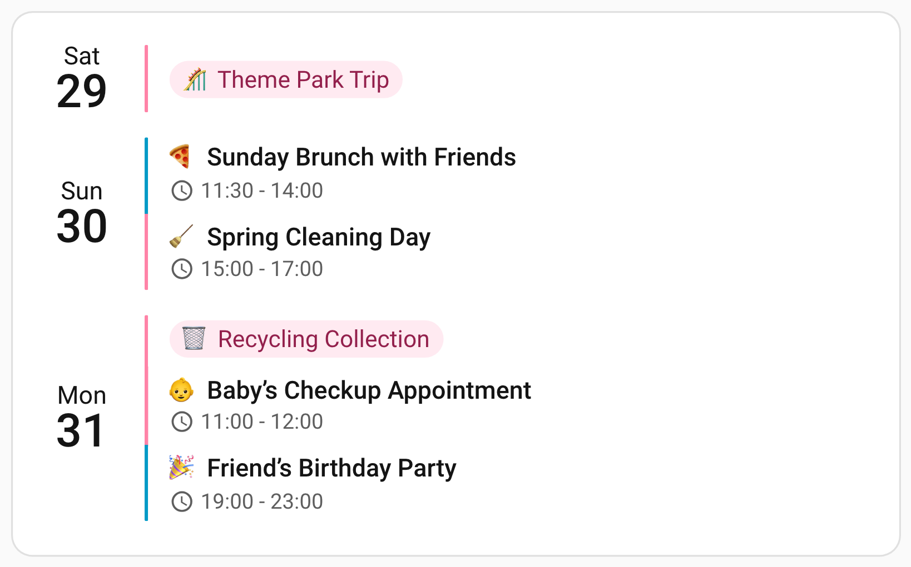
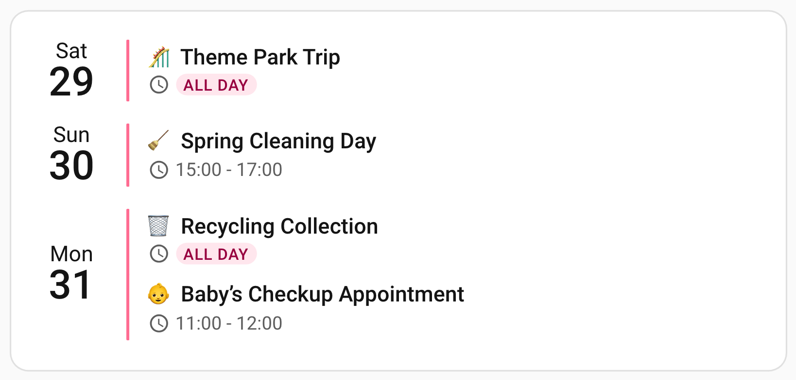
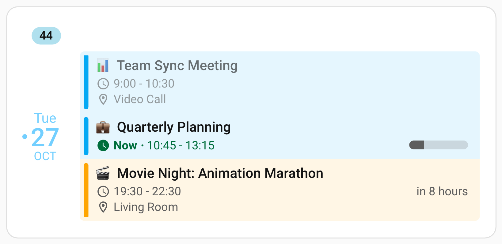
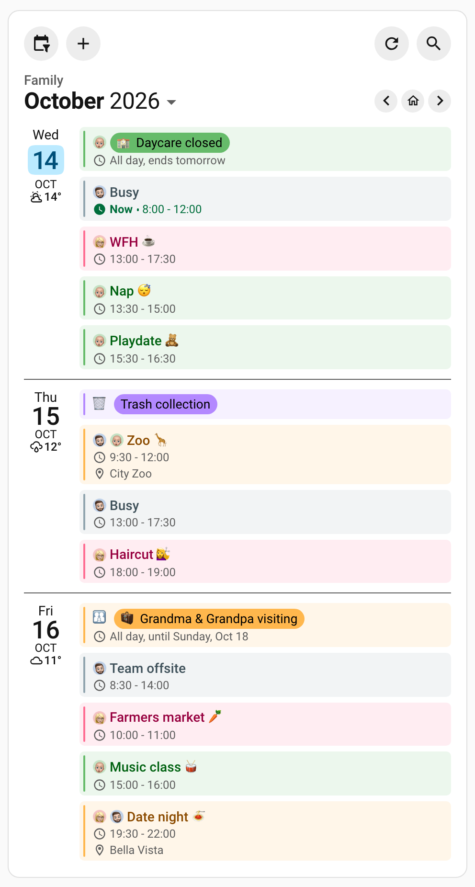

# Event Content & Display

These options control what each event actually shows — its title, times, location, description, countdown and progress — and how the card behaves on days that have no events at all. It is also where [birthday ages and anniversary counts](/features/event-content#birthday-ages-anniversary-counts) live, which need no configuration at all.

## 📅 Calendar Events Display

These options set how event titles look and what the card shows on a day with no events:

```yaml
# Event title appearance
event_font_size: '14px'
event_color: 'var(--primary-text-color)'

# Empty days display
show_empty_days: true # Show days with no events
empty_day_text: 'Leftovers' # Replaces "No events" on any empty day
empty_day_color: 'var(--secondary-text-color)' # Color for "No events" text

# Or remove the card entirely when there is nothing to show
hide_when_empty: true
```

Font sizes on this page take a CSS length such as `14px` or `1.2em`, a percentage or a keyword
such as `large`, and icon sizes take a length only; a size the card cannot read falls back to
`14px` for the title and every icon, and `12px` for the time, location and description text. A
calendar's icon or picture [label](/features/core-settings#choosing-how-a-label-is-read) is sized
from `event_font_size`, whatever form it takes.

With `show_empty_days: true`, a day without events shows a "No events" message instead of being
left out, which keeps a long range evenly laid out.

::: details Sizes the Card Accepts

These rules hold for the font and icon size options on this page.

- **Font sizes** (`event_font_size`, `time_font_size`, `location_font_size`,
  `description_font_size`) take a length such as `14px` or `1.2em`, a percentage such as
  `120%`, a keyword such as `large`, or an expression such as `calc()` that works out to one.
- **Icon sizes** (`time_icon_size`, `location_icon_size`, `description_icon_size`) take a CSS
  length such as `14px`, `1em` or `0.875rem`, or a `calc()` that works out to one. A
  percentage or a keyword such as `large` falls back to `14px`; for an icon that follows the
  text around it, use `em`: `1.2em` rather than `120%`. A `var()` is passed on as written.
- A space before the unit is closed up, so `14 px` reads as `14px`. A size the card cannot
  read, such as a negative size, a misspelled unit or a word that is not a size, falls back to
  the default: `14px` for the title and every icon, `12px` for the time, location and
  description text.

:::

### Showing Today When It Is Empty

`show_empty_today` keeps today on the card when it has nothing scheduled, while every other
empty day stays hidden, so a free today still reads as free instead of vanishing.

```yaml
show_empty_days: false
show_empty_today: true
```

- Today gets the same "No events" message as any other empty day, including a custom
  `empty_day_text`.
- It is added beside the days that already qualified, so it never pushes an event day off a
  card whose `days_to_show` is full, and on a collapsed card it takes no
  `compact_days_to_show` slot.
- With `show_past_events: false`, a today whose events have all ended counts as empty and gets
  the row.
- Today has to fall inside the card's date window: a card that starts next week gains no row
  for it.
- While `show_empty_days` is on, the option changes nothing, because today is already shown.
  The editor offers it only while empty days are hidden.

Column and grid view show every day by default, so there the option changes something only once
empty days are turned off for that view as well:

```yaml
column:
  show_empty_days: false
  show_empty_today: true
```

::: details Today on a Collapsed Card

When the compact limits of a collapsed card leave out today's events, today gets no row at all
rather than being called free, because expanding the card shows those events.

:::

### Custom Empty-Day Text

`empty_day_text` replaces the "No events" message with your own words on every day the card
shows as empty. A meal-plan calendar reads far better with "Leftovers":

```yaml
days_to_show: 7
show_empty_days: true
empty_day_text: 'Leftovers'
```

- It applies wherever an empty day appears: a gap in a planned week, a range with nothing
  scheduled, or the single row the card shows when `show_empty_days` is off and there is
  nothing at all to display.
- The default message is prefixed with a ✓; your own text is not.
- Your text is shown exactly as written, never translated or trimmed. Leave the option out, or
  set it empty, to bring back the translated default.
- It changes the wording only. Whether an empty day appears at all, and how many, is up to
  `show_empty_days` and [`show_empty_today`](#showing-today-when-it-is-empty).
- `empty_day_color` sets the message's color.

::: details More About the Empty-Day Text

- The single row of a card with nothing to show sits on the date its range is measured from,
  which is today only when [`start_date`](/features/start-date-offset) resolves to today: a
  card pointed at last week shows last week's date there.
- Your text is never migrated, so a message that happens to match an older default stays as
  you typed it, and a message of only spaces counts as your wording rather than as none.

:::

### Hiding the Card When Empty

`hide_when_empty: true` removes the card from the dashboard while it has no events on the days it
opens with, and the cards around it close the gap. It comes back on its own as soon as an event
shows up.

```yaml
hide_when_empty: true
```

- While you edit the dashboard the card always stays visible, so you can still select and
  configure it.
- Hiding wins over every empty-day placeholder: a card showing nothing but `show_empty_days`
  rows, a `show_empty_today` row or your `empty_day_text` still hides. To keep your own wording
  on screen, leave `hide_when_empty` off.
- Events count across the card's whole date range, after past-event and per-calendar filters.
  Events the card does not draw still count, so it stays visible when they fall outside grid
  view's hours, on days a narrow layout drops, or beyond a compact limit.
- With `show_past_events: false`, the card goes once its last event has finished, without
  waiting for another calendar fetch.
- In some cases the card stays visible even with nothing to show: while it is paged away from
  its own days, while the calendar filter hides a calendar, or while a calendar cannot be
  reached. _When the Card Stays Visible Anyway_, below, lists every case.

::: details When the Card Stays Visible Anyway

- A card the [date navigation](/features/layout-appearance#paging-through-dates) has paged away
  from its own days stays, so its arrows can bring it back.
- A card with a calendar hidden by the
  [calendar filter](/features/layout-appearance#showing-hiding-calendars) stays, with its filter.
- With a [different number of days in each layout](/features/core-settings#showing-a-different-number-of-days-in-each-layout),
  the card hides only when none of the layouts it can show has an event.
- Compact mode limits never hide it: a card limited to zero events with
  `compact_events_to_show: 0` stays visible so it can still be expanded.
- A configuration error, such as a missing calendar entity, stays visible so the problem is not
  hidden silently.
- A calendar that cannot be reached is not an empty one, so the card never vanishes during an
  outage. It names the calendar in a "Couldn't load: …" line and keeps showing that calendar's
  last loaded events for up to 24 hours, or shows only that line when there is nothing to fall
  back on. See [When a Calendar Fails to Load](/features/performance#when-a-calendar-fails-to-load).

:::

::: details When a Finished Card Goes

With `show_past_events: false`, a card goes as its last timed event ends, or as its last
all-day event expires, at midnight or at its
[`allday_expires_at`](/features/core-settings#retiring-all-day-events-during-the-day) time. In
grid view with its now line on, it goes within the minute.

:::

## 🏷️ The All-Day Badge

By default an all-day event says so in words, on the same line as the clock icon. The all-day
badge draws that fact as a rounded pill in the calendar accent color instead, the way most
calendar apps do.

<br>

Three options describe it — **where** the pill goes, **which** shape draws it, and in **which
color**:

```yaml
allday_badge: title # off, title or time
allday_badge_style: subtle # subtle, outline, tinted or filled
allday_badge_color: accent # accent, text, or any CSS color
```

All three are card-level, so a card shows pills for every calendar on it or for none.

### Where The Pill Goes

| Value   | What it does                                                                     |
| ------- | -------------------------------------------------------------------------------- |
| `off`   | The default. All-day events say so in plain words                                |
| `title` | The pill wraps the event title, the way Google Calendar and Apple Calendar do it |
| `time`  | The pill replaces the words on the time row, beside the clock icon               |

<br>

Above is `time`, and the image at the top of this section is `title` — the same card, the
same calendars and the same shape, so the only difference is where the pill goes. The
`title` card also sets [`show_single_allday_time: false`](#hiding-the-time-row), so the pill is
the whole statement instead of repeating _All day_ underneath it.

### Which Shape Draws It

There are four, from quietest to loudest, and all four work at either position:

| Value     | What it draws                                  |
| --------- | ---------------------------------------------- |
| `subtle`  | A gentle wash, with no outline                 |
| `outline` | An outline only, with no fill                  |
| `tinted`  | Both — a gentle wash inside a matching outline |
| `filled`  | A solid pill                                   |

`subtle` is the default and applies as soon as `allday_badge` names a position.

### Which Color It Is Drawn In

The shape says how much weight the pill carries; `allday_badge_color` says whose color it
carries. Any of the four shapes can be had in any of these:

| Value       | Where the color comes from                                                                        |
| ----------- | ------------------------------------------------------------------------------------------------- |
| `accent`    | The default. Each calendar's own accent, so events stay told apart at a glance                    |
| `text`      | The color the row already uses — the time color on the time row, the **title** color on the title |
| A CSS color | One color for every event, whatever the calendar. `#ff6c92`, `tomato`, `var(--my-token)`          |

- With `accent`, a calendar that sets its own `accent_color` is followed, even when that is a
  theme variable. A custom color can be a theme variable too.
- `text` takes the color of whatever the pill wraps: [`time_color`](/reference/configuration#event-column)
  on the time row, the event title's color on the title. That makes it the quietest choice at
  either position: the pill reads as the text that was already there, in a capsule.

::: warning `color` And `accent_color` Are Separate
`color` sets an event's **title**. `accent_color` sets its **pill**, its accent bar and
its row tint. A calendar that sets only `color` therefore keeps the default accent, your
theme's primary color, and its pill can end up in a color that relates to nothing else on the row. Set both to the
same value when you are coloring calendars apart, or use `allday_badge_color: text`, which
takes no accent at all.
:::

::: tip Which Pair To Pick
`subtle` in `accent` is the default and suits most dashboards. Reach for `outline` when
[`event_background_opacity`](/reference/configuration#event-column) is high, since an outline
has no fill to blend into the tinted row behind it. `allday_badge_color: text` is the one to
pick when the pill should stay out of the way entirely, or when a calendar's accent does not
sit well under its title. `filled` is the loud one, for when a color should read as a solid
chip.
:::

### Which Events Get One

This follows a single rule at both positions: the event has to occupy the whole of the day it
is drawn on. A timed meeting running from Wednesday evening to Monday morning does not, and
keeps its usual times. But when
[`split_multiday_events`](/features/multi-day-events) is on, that meeting's middle days
_are_ whole days, and those rows get a pill while its first and last days keep their times.

### What The Two Positions Do Differently

- At `time`, the pill replaces the _All day_ words and anything after them stays as ordinary
  text, so a multi-day all-day event reads as the pill and then its end date.
- At `title`, the time row stays exactly as it would be with no badge, so it still says how long
  a multi-day event runs.
- A title pill is always a single line. A title too long for the space ends in an ellipsis
  inside the pill; it does not wrap, and it does not follow
  [`title_max_lines`](/reference/configuration#event-column), which stays your setting for
  every other event.
- Both pills size themselves from the text they wrap: the time pill from `time_font_size`, the
  title pill from `event_font_size`, whatever unit you write it in.

::: tip Pair `title` With show_single_allday_time
Setting `show_single_allday_time: false` hides the time row of single-day all-day events, which
at `title` leaves the pilled title alone on its row. Multi-day all-day events keep their row,
so their end date still shows. At `time` the same setting hides the pill too, along with the
row it sits on.
:::

### Hiding The Time Row

An all-day event's time row is two different things depending on how long the event runs, so
it takes two options:

| Option                      | Type    | Default | Description                                                                                                                   |
| --------------------------- | ------- | ------- | ----------------------------------------------------------------------------------------------------------------------------- |
| `show_single_allday_time`   | boolean | `true`  | The time row on all-day events occupying one day, which reads just "All day"                                                  |
| `show_multiday_allday_time` | boolean | `true`  | The time row on all-day events spanning several days, which reads "All day, until Monday, Jun 29" and so carries the end date |

Turn only the first off to keep the end date on the events that have one, or both off for an
event reduced to a pill. Timed events spanning several days are touched by neither; they show
real start and end times.

::: tip With `split_multiday_events` On, Only The First Applies
Splitting gives a multi-day event one row per day, each occupying a single day, so
`show_single_allday_time` governs all of them. `show_multiday_allday_time` only ever applies to
an unsplit multi-day all-day event, the only shape that still draws an end date.
:::

For a title pill with no supporting rows, keep the location and description options on for
timed events but turn them off for all-day events:

```yaml
allday_badge: title
show_single_allday_time: false
show_multiday_allday_time: false
show_location_allday: false
show_description_allday: false
```

`show_location_allday` and `show_description_allday` apply to every all-day event, multi-day
ones included.

## ⏱️ Time & Location Information

These options decide whether each event shows its time and location, and how they look:

```yaml
# Time display options
show_time: true # Show event start/end times
show_single_allday_time: false # Hide time for single-day all-day events
show_multiday_allday_time: false # ...and for multi-day ones, which show an end date
time_24h: false # Use 12-hour format (AM/PM)
time_two_digit_hours: false # Use 2 digits in hours
show_end_time: true # Show event end time
time_font_size: '12px'
time_color: 'var(--secondary-text-color)'
time_icon_size: '14px'

# Location display options
show_location: true
show_location_allday: true # Show locations for all-day events too
remove_location_country: true # Remove country names from addresses
location_font_size: '12px'
location_color: 'var(--secondary-text-color)'
location_icon_size: '14px'
```

- An event that starts and ends in the same minute, such as a reminder, shows its time once:
  `9:41` rather than `9:41 - 9:41`, whatever `show_end_time` says. An event that runs into a
  later minute keeps its range.
- `show_location_allday: false` hides locations on all-day events only. Timed events keep
  theirs as long as `show_location` is on.
- The font and icon sizes take the forms described under
  [Calendar Events Display](#calendar-events-display), and fall back to `12px` for the text and
  `14px` for the icons.

::: details Events With a Missing or Broken End

A timed event that arrives with no end, or with an end before its start, is shown at its start
time in every view. Home Assistant should always send a valid end, so this only happens with an
integration or calendar file that gets it wrong. An all-day event whose end is missing or not
after its start has no time to fall back on and is not shown.

:::

### Time Beside the Title

`time_position: title` moves an event's time from its own row to the end of the title's line,
on every row that has a time or a countdown to show. A long title wraps across the whole row,
and the time ends its last line, or takes a line of its own where that line has no room left.
On a wide card that saves a row per event:

```yaml
time_position: title # below, the default, keeps the time under the title
```

- **The time comes without its clock**: the time or the all-day words, an
  [all-day badge on the time](#where-the-pill-goes), and the green "Now" of an event under way.
- **A [countdown](#countdown-display) follows the time after a dot**, "14:00 - 16:00 · in 4
  hours". With
  [`show_time: false`](#time-location-information) the countdown alone sits beside the title.
- **In list view a [weather badge on the title](/features/weather#weather-display-positions)
  comes before the time**, set off by the same dot: "14° · 14:00 - 16:00".
- **Everything else stays below the title**, in its order: the
  [progress bar](#progress-bar-display) on a row of its own, column view's weather row, the
  location and the description.
- **A long title wraps as it does below the time**, its calendar labels before it. The time
  sits at the end of the title's last line, on the title's baseline, where the line has room
  for it, and at the end of a line of its own where it has not. Either way the title's lines stop
  where the time ends, as far from the card's edge as every other time. The two never overlap.
- **[`title_max_lines`](#limiting-lines-per-field) caps the title.** One that needs more lines
  ends in "…" on the last of them, with the time at the end of that line, so
  `title_max_lines: 1` keeps every title and its time on one even line.
- **[`scroll_long_titles`](#scrolling-long-titles) keeps the title on one line beside the time
  and scrolls it.** With the operating system's reduce-motion setting on, it ends in "…".

Each layout can set it on its own, and so can the line limit:

```yaml
list:
  time_position: title # beside the title in the list layout
  title_max_lines: 2 # a longer title ends in "…" on its second line, the time after it
column:
  time_position: below # the columns stay as they are
```

::: warning One Line Needs a Wide Event Row
With `title_max_lines: 1` or `scroll_long_titles`, the time takes its width from the title's
line and never gives it back. With the default fonts, English text, 24-hour times and
countdowns, allow about 250px of event row, a 360px list card or a 280px day column, which still
leaves the title about 100px. Event weather, 12-hour or multi-day times, all-day badges, larger
fonts and long text labels each need more, and on a narrower row the title can shrink to a few
characters. Let the title wrap where that is not acceptable.
:::

::: details More About the Time Beside the Title

- A row with neither a time nor a countdown to show, such as an empty day or a running event
  with `show_time: false` and no countdown, keeps the layout it has below the title. In list
  view the progress bar of such a running event still moves to a row of its own, 80% of the
  event's width unless `progress_bar_width` says otherwise.
- Where the time is too wide to leave a capped title any room beside it, as a time with a
  countdown can be in a narrow column, a longer title ends in "…" across the whole row and the
  time takes a line of its own below it. A title within the limit there keeps every line.
- A time larger than the title, set with [`time_font_size`](#time-location-information), takes
  a line of its own at the end of every title: beside the title it would push the line's
  baseline down.
- A capped or one-line title that runs against the dashboard's direction, such as a Hebrew
  title on an English dashboard, keeps its beginning and ends in "…" at its own end, as it does
  below the time. The time stays at the dashboard's end of the row.
- An [all-day badge on the time](#where-the-pill-goes) with a countdown after it wraps as it
  does in column view, the countdown under the pill, and on a narrow row the pill is shortened
  with "…".
- On one line, a text label sits in the title's room, so a long one wraps beside the title and
  leaves less of it to read, in a narrow column only a letter. An icon, an emoji or a picture
  takes the least room. Beside a text label that wraps, the title sits on the label's first
  line, level with the time.
- In a column too narrow for a countdown word, that word breaks, as it does below the title.
- On one line at the width in the warning, some times still run to two or three lines. On 240
  to 300px list cards or in 145 to 200px columns, with those extras, the time can take up to six
  lines in a 145px column and up to eight on a narrow list card with event weather, where some
  titles keep less than a character.

:::

### Removing Country Names

`remove_location_country` strips country names from event locations, so a domestic address
reads as just its street and city. It is `false` by default and takes three forms:

```yaml
# Option 1: Don't remove any country information
remove_location_country: false

# Option 2: Use built-in country detection
remove_location_country: true

# Option 3: Specify exactly which countries to remove (perfect for international users)
remove_location_country: 'USA|United States|Canada'
```

The third form is a regular expression, matched against the end of the location whatever the
case. `|` separates the alternatives, so only the countries it names are removed and foreign
addresses keep theirs. A pattern that is not a valid regular expression leaves every location
unchanged. If you live in the USA but often have events abroad, you could use:

```yaml
remove_location_country: 'USA|United States|U.S.A.|U.S.'
```

This keeps "Paris, France" intact while domestic addresses shrink to just city and state.

### The Location Icon

Locations carry a map marker, and Microsoft Teams meetings carry the Teams icon instead, with
nothing to configure. The card recognizes the text Teams writes into an event's location,
including its translations such as `Microsoft Teams-Besprechung` or `Réunion Microsoft Teams`,
and a `teams.microsoft.com` join link stored there in place of a phrase. Teams is the only
service recognized this way.

The per-calendar `location_icon` sets the icon for one calendar's events, and takes precedence
over the detection:

```yaml
entities:
  - entity: calendar.work
    location_icon: mdi:office-building # every location on this calendar
  - calendar.family # keeps the marker, and the Teams icon where it applies
```

- There is no card-wide version. To give part of one calendar its own icon, pair it with
  [`filter_field`](/features/core-settings#giving-teams-meetings-their-own-icon).
- To turn the Teams icon off, name the marker: `location_icon: mdi:map-marker-outline` puts that
  calendar back on the plain marker for every event.
- `location_icon_size` sizes whichever icon ends up being drawn.
- The detection reads the location as the card draws it, not as your calendar sent it, so
  [rewriting a location](/features/core-settings#replacing-a-location-that-is-a-meeting-url) can
  take the Teams icon away or give it to an event that never had it. `location_icon` settles it
  on any calendar where that matters.

## 📝 Event Description Display

Display event descriptions below event titles for additional context:

```yaml
# Description display options
show_description: true
show_description_allday: true # Show descriptions for all-day events too
description_max_lines: 3 # Limit to 3 lines (0 = unlimited)
description_font_size: '12px'
description_color: 'var(--secondary-text-color)'
description_icon_size: '14px'
```

`show_description_allday: false` hides descriptions on all-day events only; it pairs with a
title pill as shown under [Hiding the Time Row](#hiding-the-time-row).
`description_font_size` and `description_icon_size` take the same sizes as the time and
location, and fall back to `12px` and `14px`.

Descriptions are automatically processed:

- **HTML tags** are stripped for clean, readable text — only real markup, so prose such as `temp < 5 and pressure > 3` is left as written
- **HTML entities** (e.g., `&amp;`, `&lt;`) are decoded to their proper characters
- **Line clamping** truncates long descriptions with `...` when `description_max_lines` is set

You can also control description visibility per calendar entity:

```yaml
entities:
  - entity: calendar.work
    show_description: true # Show descriptions for work events
  - entity: calendar.personal
    show_description: false # Hide descriptions for personal events
```

## 🎂 Birthday Ages & Anniversary Counts

Put **`YEAR=1976`** anywhere in an event's description and the card appends the age to its
title, recounted every year. It counts anniversaries the same way, and needs no option:

```yaml
# Nothing to configure — the marker in the event does the work
Anna's Birthday  →  Anna's Birthday (50)
```

The marker goes in the birthday you already have, which normally repeats every year, and each
occurrence counts from its own year: the 2026 occurrence of a 1976 birthday is `(50)`, and the
2027 one is `(51)`, without anyone touching the card again. A wedding in 2005 shows `(21)` in 2026. The number stands on its own without saying what it counts, which is what lets one marker
serve both. A split occurrence that runs across New Year keeps the count of the year it starts
in on every day.

The [Birthdays & Holidays](/guide/birthdays-and-holidays) story builds a whole card around it, and the [Family Hub](/guide/family-calendar#a-birthday-that-counts-itself) shows it on a grid card, where the age rides along in an all-day banner that has room for nothing but the title.

### Writing the Marker

`YEAR=1976` and `YEAR:1996` both work, in any capitalization, anywhere in the description — on a line of its own, or at the end of a sentence you already wrote.

Two rules matter, and both exist to keep the card from finding a marker in a description that never meant to carry one:

- **No spaces around the `=` or the `:`.** `YEAR=1976` counts; `YEAR = 1976` does not. This is what separates a marker from ordinary writing — a sentence such as `Academic Year: 2025` puts a space after its colon, and without this rule the card would read that as a birth year and start numbering a school calendar.
- **The marker stands as its own word.** `Born YEAR=1996` counts; `BIRTHYEAR=1996` does not, and neither does a `?year=1976` sitting inside a link.

The year is always four digits, so `YEAR=197` and `YEAR=19766` are both ignored.

| You write             | The card shows |
| --------------------- | -------------- |
| `YEAR=1976`           | `(50)` in 2026 |
| `YEAR:1996`           | `(30)` in 2026 |
| `Born YEAR=1996`      | `(30)` in 2026 |
| `YEAR = 1976`         | nothing        |
| `Academic Year: 2025` | nothing        |
| `BIRTHYEAR=1996`      | nothing        |

::: tip Nothing Showing Up?
The card only ever counts **upward**. A year that matches the event's own year, or one still in the future, shows nothing at all rather than `(0)` or a negative number — so a `YEAR=2026` on an event in 2026 looks exactly like a marker that was not recognized. Check the year first, then the spacing around the separator.
:::

### What the Description Shows

The marker never appears on your card. With `show_description: true`, a description of `Born YEAR=1996 in Bristol` is drawn as **Born in Bristol**, and a description containing nothing but the marker leaves no description line at all.

Filtering still sees it: [`blocklist` and `allowlist`](/features/core-settings) read the event exactly as your calendar delivered it, so a `filter_field: description` pattern can match the raw `YEAR=1976` and filter a birthday calendar on its markers.

The count sits at the end of the title, so on a narrow card it is the first thing to be cut when [`title_max_lines`](#limiting-lines-per-field) truncates a long one.

::: info Always On, and How to Turn It Off
There is no option for this. To keep a year from being counted, write it differently: `Born in 1976`, or `YEAR - 1976`, are both invisible to the card.
:::

## ✂️ Limiting Lines Per Field

Long titles, times, locations and descriptions can each be capped to a fixed number of lines, after which the text is truncated with `...`. Each field has its own option, and `0`, the default, means unlimited (no clamp):

```yaml
title_max_lines: 1 # Keep every event title to a single line
time_max_lines: 1 # Keep the time on one line
location_max_lines: 2 # Allow locations up to two lines
description_max_lines: 3 # Allow descriptions up to three lines
```

- Each option is a line count, not a toggle: `1` shows one line then an ellipsis, `2` shows two
  lines, and so on.
- A calendar label stays inline before the title and shares its line limit, merged-calendar
  labels included.
- With the [time beside the title](#time-beside-the-title), a shortened title's last line ends
  in "…" with the time after it, so `title_max_lines: 1` keeps a title and its time on one
  line.
- All four work in list and column view. Grid follows the title, location and description
  limits too, but fits its time row to each block itself, as
  [What a Block Shows](/features/grid-view#what-a-block-shows) describes, so `time_max_lines`
  does nothing there.

Each option can be overridden inside a `list:` or `column:` block to clamp differently per view, and the title, location and description limits inside a `time_grid:` block too:

```yaml
title_max_lines: 0 # Unlimited in list view
column:
  title_max_lines: 1 # But single-line in the denser column view
```

::: details More About Line Limits

- A clamped title that runs against the dashboard's direction, such as an English title on a
  Hebrew dashboard, keeps its beginning and ends in "…" at its own end, with its label leading
  it: "Anna: Quarterly planning…" on a right-to-left dashboard. A title that is not clamped
  stays as it is.
- Marks that Thai, Vietnamese, Arabic and other scripts stack above or below a line are drawn
  whole: "สิ้นสุดพรุ่งนี้" keeps its tone marks, and "Ể" its hook. So is a mark or letter that
  leans past the first or last letter of a field, such as a tone mark past a time's last letter
  or the hook of a "j" at the edge of a word in grid view. Browsers older than Chrome 125 or
  Safari 15.4 leave room for a pixel of it, and a font size option that names a CSS variable
  leaves room for the card's own text size where the row holding that text cuts it, as a title
  cut beside its time is. A field with a limit ends exactly at
  the bottom of its last line even where its text fits, so a mark below that line can meet the
  cut. In grid view the top edge of a block can still trim the tip of the highest marks on its
  first line.
- Where a title's last line would end in a hyphen and then "…", as "appoint-…", the title is
  laid out without automatic hyphens and ends "appoint…" or on the word before. Every other
  title keeps its hyphens.
- In grid view a title also stops at the last line its block shows whole, ending in "…" when
  more follows. A block too short for a complete first label and title line uses the
  [short timed title fallback](/features/grid-view#short-timed-titles) instead: one line that
  keeps every label. A later line that does not fit never triggers it.

:::

## ↔️ Scrolling Long Titles

A long event title normally wraps onto a second line and makes the row taller. Turn on `scroll_long_titles` and a title too wide for the space is kept to one line and scrolls sideways instead, so the whole of it can still be read on a narrow card. It is off by default:

```yaml
scroll_long_titles: true
```

- Only titles that genuinely overflow move; one that already fits stays still. Empty-day
  messages and grid's all-day banners stay static.
- The title is always one line while scrolling is on, so it replaces
  [`title_max_lines`](#limiting-lines-per-field). Reach for `title_max_lines` instead when you
  would rather a long title wrap to a fixed number of lines and truncate.
- Calendar labels stay put beside the scrolling title.
- A title moves in its reading direction: a left-to-right title moves left, and a right-to-left
  one moves right, to reveal its ending. One that runs against the dashboard's direction, such
  as a Hebrew title on an English dashboard, starts from its own beginning and, with reduce
  motion on, ends in "…" at its own end.
- With the operating system's **reduce motion** setting on, nothing moves and the title is a
  static, truncated line.
- With [`time_position: title`](#time-beside-the-title), a title beside the time stays on one
  line and scrolls this way too; with `scroll_long_titles` off, it wraps.

It is set for the whole card rather than per calendar, but it can be set per view. Titles wrap
the most in the narrow columns of the [grid layout](/features/grid-view), so a common setup is to
scroll only there and leave the wider list wrapping:

```yaml
scroll_long_titles: false # Wrap in the roomy list view
time_grid:
  scroll_long_titles: true # Scroll in the narrow grid columns
```

::: details More About Scrolling

- A short label keeps its single-line width while the labels leave room for useful title text;
  longer or merged labels wrap when they need the space, in narrow grid columns too. A label
  and the title beside it share one vertical center, whether the label is text, an emoji, an
  icon, a picture, or several of those merged together.
- Visible titles on a card scroll as a group: they start each pass together, and each then
  waits at its beginning until the longest visible title has finished, so one very long title
  sets how often the shorter ones repeat.
- A browser without the animation support this needs scrolls each title on its own, with no
  shared start.
- Turning `scroll_long_titles` off, or turning reduce motion on, stops the movement at once.
  When the whole card is scrolled off screen its titles pause in place, and they resume when it
  comes back.
- A grid block too short for its normal title uses the
  [short timed title fallback](/features/grid-view#short-timed-titles): one line, smaller if it
  has to be, that scrolls like any other title and keeps every label still beside it. A block
  too short even for that line shows no text.

:::

## ⏳ Countdown Display

`show_countdown` shows how long remains until each upcoming event starts, such as "in 20
minutes" or "tomorrow", in every view:

```yaml
# Enable countdown display for events
show_countdown: true
```

It follows the same local calendar dates as the day headers:

| When the Event Starts | Countdown                                                     |
| --------------------- | ------------------------------------------------------------- |
| Later today           | A clock countdown, such as "in 20 minutes" or "in 5 hours"    |
| Tomorrow, at any time | "tomorrow"                                                    |
| On a later date       | Date-based relative text, such as "in 3 days" or "in a month" |

- On September 8, a timed event on September 11 at 08:00 reads **in 3 days**, and one on
  September 12 at 12:00 reads **in 4 days**, all day long. Both decrease when the local date
  changes; neither the current time nor the event's start time affects them.
- **Tomorrow names a date, not a duration.** At 23:50, an event starting at 00:10 reads
  "tomorrow"; at midnight it changes to "in 10 minutes." The event's start time still says
  when, so with event times hidden, "tomorrow" alone does not say how soon after midnight.
- Today's timed events always count in clock units, never in days, however long the wait.
- Distant dates read naturally: "in a month" for an event 30 days away, "in a year" for one 365
  days away. [`countdown_exact_days`](#counting-in-days) counts them in days instead.
- The wording follows the card's language, and the date comparison stays correct across
  daylight-saving changes.
- A countdown disappears once its event has started, so today's all-day events have none.

In list view it ends the time row, or takes a line of its own where the time leaves it no room.
In grid view it trails the time on a timed block tall enough to show one, and all-day banners
carry none. Column view places it as described under
[Progress Bar & Countdown](/features/column-view#progress-bar-countdown).

All-day events are included by default and follow the same date-based rule. If you only want countdowns on events with an actual start time, turn them off separately:

```yaml
show_countdown: true
show_countdown_allday: false # Timed events only
```

When [`split_multiday_events`](/features/multi-day-events) is on, each day's row counts to its
own start by the rules above: a holiday starting tomorrow reads "tomorrow", "in 2 days", "in 3
days" and so on down its rows, whether or not it has a start time. An unsplit event counts to
its original start, and a row already under way has no countdown. With the
[progress bar](#progress-bar-display) on, a row of an event a day or longer names its
[day](/features/multi-day-events#day-counter) once the event has started, rather than counting
down to its own start.

::: details Long Countdowns on a Narrow Card

In list view, a phrase wider than the whole row, as a long Finnish one can be on a narrow card,
wraps between its words rather than run past the card's edge.

:::

### Countdown Range

`countdown_max_days` shows a countdown only for events starting within that many days, so a
countdown appears as an event draws near rather than months ahead. `0` keeps countdowns to
today's events, `7` to the week ahead:

```yaml
show_countdown: true
countdown_max_days: 7
```

| Option               | Type   | Default | Description                                                                                          |
| -------------------- | ------ | ------- | ---------------------------------------------------------------------------------------------------- |
| `countdown_max_days` | number | -       | Show a countdown only for events starting within this many calendar days; unset, every event has one |

- Days are counted between calendar dates, as the countdown counts them. With `7`, an event
  reading "in 7 days" keeps its countdown and one a day later has none until the next midnight.
- Left unset, every upcoming event counts down.
- Each view can set its own, in `list:`, `column:` or `time_grid:`. A view's limit replaces the
  card's, and a view left blank uses the card's:

```yaml
show_countdown: true
countdown_max_days: 7 # A week ahead in list and grid view
column:
  countdown_max_days: 0 # Today's events only in column view
```

::: details No Limit in One View

A blank `countdown_max_days` in a view uses the card's limit. To lift the limit in one view
alone, give that view a number larger than any wait it will show, such as `3650`. Its
`days_to_show` is not enough on its own: a card that starts later than today, or is paged
ahead, shows dates further off than that.

:::

### Repeated Countdowns

`show_countdown: once_per_day` counts down once for a day of events that all read the same, as
on a day two bins go out together: the first event keeps its countdown, and one that reads the
same as the countdown above it is left out.

```yaml
show_countdown: once_per_day
```

| Value          | Countdowns                                                               |
| -------------- | ------------------------------------------------------------------------ |
| `false`        | None                                                                     |
| `true`         | On every event still to come                                             |
| `once_per_day` | On every event still to come, leaving out one that repeats the one above |

- Countdowns later today always show, since two that read "in 5 hours" can name different
  times.
- A countdown that differs still shows, and an event without one, such as an all-day event with
  `show_countdown_allday: false` or one showing the
  [day counter](/features/multi-day-events#day-counter) in its place, is passed over.
- It applies in list and column view. In grid view every timed block keeps its countdown, as
  with `true`.
- In the visual editor it is **Leave Out Repeated Countdowns**, under Countdown & Progress.

### Counting in Days

`countdown_exact_days` counts every date after today in days, so an event 30 days away reads
"in 30 days" rather than "in a month", one 400 days away "in 400 days" rather than "in a year",
and one tomorrow "in 1 day". It suits a card where the number itself matters, such as the days
left until a trip:

```yaml
show_countdown: true
countdown_exact_days: true
```

| Option                 | Type    | Default | Description                                                                                    |
| ---------------------- | ------- | ------- | ---------------------------------------------------------------------------------------------- |
| `countdown_exact_days` | boolean | `false` | Count every date after today in days, "in 1 day" for tomorrow, rather than in months and years |

- Later today reads as it does without it, such as "in 20 minutes" or "in 5 hours".
- Tomorrow counts by its date, as "tomorrow" does: an event at 00:10 reads "in 1 day" all
  evening, and "in 10 minutes" from midnight.
- Each view can set its own, in `list:`, `column:` or `time_grid:`.

::: details Wording in Other Languages

The days are worded by the browser's own date formatting, as the default "tomorrow" is. In
some languages that reads a little differently from the default countdown for the same wait:
Spanish "dentro de 3 días" rather than "en 3 días", Norwegian "om 3 døgn" rather than "om 3
dager". Where the browser has no wording for the card's language, the days read in English, as
"tomorrow" does there: Chromium has none for Icelandic.

:::

## 🕒 Past Events Display

`show_past_events` keeps events that have already ended on the card, dimmed so what is still
ahead stands out. List and column view hide them by default; grid view shows them. The Family
Hub's [Columns picture](/guide/family-calendar#see-it) shows a morning's finished events
dimmed this way.

```yaml
show_past_events: true # Show events that have already ended
```

When enabled, finished event contents use 60% opacity in every view. Set
`past_event_opacity` to any number from **0 to 100**, including fractions, to change that
strength. `100` removes the built-in dimming; `1` means 1%, not full strength.

```yaml
show_past_events: true
past_event_opacity: 75.5
time_grid:
  past_event_opacity: 100 # Keep finished events at full strength in Grid
```

- The top-level value is shared, and `list:`, `column:` and `time_grid:` can each override it;
  there is no different grid default. Clearing the option, with a blank or `null`, returns a
  view to the shared value, or the top level to 60.
- Only the contents dim: titles, labels, pictures, icons and the detail rows still shown.
  Backgrounds and accent bars stay as they are, and colors do not change underneath. To restyle
  the dimming, see [Past Event Opacity](/features/theming#past-event-opacity).
- An event becomes past after its displayed end, not when it starts. Today's all-day events
  stay at full strength until the next local midnight.
- In list and column view an empty-day notice dims too, once its whole local date has ended:
  today's stays at full strength from midnight to midnight, and future days never dim. That
  holds with `show_past_events: false` as well, because a past day whose events were hidden can
  still show a notice.

::: warning Transparent Is Not Hidden
`past_event_opacity: 0` makes contents transparent but keeps event boxes, counts, actions,
and configured accessible names. To remove finished events, use `show_past_events: false`
in the relevant view instead. Dimming does not restore filtered events, countdowns, or
progress bars.
:::

In the [editor](/features/editor), find **Past Event Opacity** under **Events → Event
State**, in any workspace.

::: details More About Past Events

- Invalid values are ignored rather than clamped or treated as zero.
- Finished events keep the `.past-event` class, so theme or card-mod styles that target it keep
  working alongside `past_event_opacity`.
- Split rows dim by their own end, and grid's all-day banners by the original event's end; a
  banner dims its title, continuation marks included. Grid's
  [now line](/features/grid-view#the-now-line) is independent of dimming.
- Grid shows an empty day as an empty column rather than a notice, so it has nothing to dim.

:::

**→ [Event Column in the configuration reference](/reference/configuration#event-column)**

## 🟢 The Now Indicator

In list and column view, an event that is happening right now has its clock filled in and "Now ·"
in front of its time, and its time line turns green. It is on by default, needs no
configuration, and takes nothing away: the event keeps its color and its accent bar, and its
title, location and description keep theirs.

<br>

```yaml
show_now_indicator: false # Turn it off
now_color: '#ef4444' # Mark it in red instead
```

- Only timed events shorter than a [full day](/features/multi-day-events#day-counter) are
  marked, so a night shift is and a three-day trip is not: on a long event "Now" would be true,
  in green, on every one of its days. With the [progress bar](#progress-bar-display) on, a long
  event says which of its days it is on instead. Split across days, as column view does by
  default, a shorter event is marked on whichever of its rows is under way.
- The mark lives on the time line, so nothing is marked while that line is hidden: with
  `show_time: false`, card-wide or on that calendar, a running event looks like any other. With
  [`time_position: title`](#time-beside-the-title) the time has no clock, so "Now ·" and the
  green alone mark the event.
- The word comes from your browser in the card's language, "Jetzt" in German or "Maintenant" in
  French, so it needs no translation.
- `now_color`, emerald by default, is mixed toward your theme's text color so it stays readable
  as text: a darker green on a light theme, a lighter one on a dark theme.
- The mark appears and disappears the moment an event starts or ends, without waiting for Home
  Assistant to send anything. With `show_past_events` off, a finished event leaves the card on
  time the same way.
- Grid view draws no mark: its [now line](/features/grid-view#the-now-line) already runs through
  the block that is under way, in the same `now_color`. Set `now_color` in the `time_grid` block
  to give grid view a color of its own.

`show_now_indicator` can differ per view, like any other
[per-view option](/features/core-settings#per-view-options). To keep the mark in list view and
drop it from columns:

```yaml
column:
  show_now_indicator: false
```

::: details When "Now" Shows in English

The word comes from your browser. Chromium, as tested, carries no Icelandic or Norwegian
Nynorsk. With Home Assistant in a language Chromium does carry, a Nynorsk card asks for Bokmål
instead and shows "Nå", and an Icelandic card shows "Now", in English whatever language the
browser itself is in. Home Assistant set to Icelandic or Nynorsk brings its own data for that
language, and the card loads its own language alongside it, so every card keeps its words. The
countdown's "tomorrow" and hours, and the month and "Today" in the toolbar, come from the
browser the same way. [Language](/features/core-settings#language) has the whole rule.

:::

`show_now_indicator` and `now_color` are listed under
[Event Column in the configuration reference](/reference/configuration#event-column).

## 🎨 Event Text in Calendar Colors

Write `accent` into any of the card's event-text color options and that text is drawn in
**each event's own calendar color** rather than in one color for the whole card.

<br>

The [Family Agenda](/guide/one-calendar-many-purposes) sets `event_color: accent`, so each timed
event's title takes its calendar's color; its all-day titles sit in filled pills of that color,
drawn in a contrasting one. Here only the time follows the calendar; the title keeps
`event_color`:

```yaml
type: custom:calendar-card-pro
entities:
  - entity: calendar.work
    accent_color: '#E8A33D'
  - entity: calendar.personal
    accent_color: '#7B1FA2'
time_color: accent
```

`accent` is a value each of five options accepts on its own, so setting it on one tints one
thing and leaves the rest alone. The five are everything inside the event box:
`event_color` (the title), `time_color`, `location_color`, `description_color`, and
`progress_bar_color` (the bar and its track).

- The text is not the raw accent but a readable mix of it: the four text options take the
  accent mixed toward `--primary-text-color`, which darkens a pale accent on a light theme and
  lightens a dark one on a dark theme, and the hue you chose survives either way. The progress
  bar takes the accent at full strength.
- Grid view starts all five at `accent`; list and column view accept it when you set it. See
  [Grid Options That Start From a Different Default](/features/grid-view#options-that-start-from-a-different-default).
- The event weather badge follows the title: left unset, it takes the accent wherever
  `event_color` is `accent`. See [`weather.event.color`](/features/weather#weather-configuration-options).
- Three things never follow a calendar. An **empty day's** _No events_ notice keeps
  `empty_day_color`, the grid's **`+N` overflow block** stays in the theme's secondary text
  color, and the badge in the **day header** belongs to the day, not to any calendar on it.

::: tip Visual Editor
**Events → Accent** opens with **Use Calendar Colors For Event Text**, which sets all five at
once. Switching it off returns all five to their standard colors rather than to anything set
before.
:::

::: details More About Calendar-Colored Text

- The editor's switch is not stored on its own: it is on exactly when all five options are
  `accent`, so it stays true to the configuration when you edit one of them by hand or in YAML.
- Nothing else about the text changes. The secondary rows are not dimmed further, and the title
  keeps its weight, `font-weight: 500` against normal. Finished events still use the shared
  [past-content opacity](#past-events-display), applied after their colors resolve.
- Give `weather.event.color` a color of its own and that color wins; write `accent` into it and
  the weather badge follows the calendar in any view, whatever the title does.
- The mix lifts contrast more in light themes than in dark ones.

:::

**→ [Event Column](/reference/configuration#event-column)** — every option named above.

## 🌈 Weekend Day Styling

Weekend days can have their own date colors, so the weekend stands out at a glance. Which days
those are follows the [country set in Home Assistant](/features/core-settings#showing-a-calendar-on-weekdays-only),
or its language when no country is set: Saturday and Sunday in most countries, Friday and
Saturday in others.

```yaml
type: custom:calendar-card-pro
entities:
  - calendar.personal
  - calendar.work
weekend_weekday_color: '#E67C73'
weekend_day_color: '#E67C73'
weekend_month_color: '#E67C73'
```

| Option                  | Type   | Default                  | Description                                            |
| ----------------------- | ------ | ------------------------ | ------------------------------------------------------ |
| `weekend_weekday_color` | string | inherits `weekday_color` | Text color of the weekday name, such as "Sat" or "Sun" |
| `weekend_day_color`     | string | inherits `day_color`     | Text color of the day number                           |
| `weekend_month_color`   | string | inherits `month_color`   | Text color of the month name                           |

- They color the date in every layout: the date column in list view and the day header in
  column and grid view.
- Left unset, each takes the ordinary color it is named after, so you can set only the ones you
  want.
- They apply to the whole card. Written inside a `list:`, `column:` or `time_grid:` block they
  are ignored, so set them at the top level.
- When today falls on a weekend, the `today_*` colors win where they are set; see
  [Date Column Customization](/features/layout-appearance#date-column-customization).
- To tint the whole weekend column in grid view, see
  [Shading the Weekend](/features/grid-view#shading-the-weekend).

## 📊 Progress Bar Display

`show_progress_bar` draws a bar on an event that is running now, filled to show how much of the
event has already passed. An event a day or longer says which of its days it is on instead, such
as "Day 3 of 5": see [Day Counter](/features/multi-day-events#day-counter).

```yaml
show_progress_bar: true
```

A bar shows only while an event runs and a [countdown](#countdown-display) only before it
starts, so no event ever shows both.

You can customize the appearance of the progress bars:

```yaml
show_progress_bar: true
progress_bar_color: '#03a9f4'
progress_bar_height: '10px'
progress_bar_width: '80px'
```

- `progress_bar_color` is `var(--secondary-text-color)` by default, and takes
  [`accent`](#event-text-in-calendar-colors) for each event's own calendar color.
- `progress_bar_height` ships as `0.75em`, three quarters of the time text, so the bar follows
  `time_font_size` whichever form that takes. A height you set in `em` is measured against the
  time text too, wherever the bar is drawn.
- `progress_bar_width` has no shipped default in list and column view. Left unset, the bar
  sizes itself to where it is drawn:

| Layout                                                      | Where the bar is drawn | Width when unset         |
| ----------------------------------------------------------- | ---------------------- | ------------------------ |
| List                                                        | On the time row        | `60px`                   |
| List, with [`time_position: title`](#time-beside-the-title) | On a row of its own    | 80% of the event's width |
| [Column](/features/column-view#progress-bar-countdown)      | On a row of its own    | 80% of the column width  |
| Grid                                                        | Across the block       | `100%`                   |

A top-level `progress_bar_width` replaces the list and column widths alike, and a
[column exception](/features/column-view#overriding-options-in-column-view) gives the two views
different ones:

```yaml
show_progress_bar: true
progress_bar_width: '80px' # list view
column:
  progress_bar_width: '100%' # column view only
```

Grid view draws the bar at `100%` of the block, in the block's accent color, whatever the
top-level `progress_bar_width` and `progress_bar_color` say, until a `time_grid:` block sets its
own. See [Options That Start From a Different Default](/features/grid-view#options-that-start-from-a-different-default).

An event running past midnight fills its bar over the whole event. Split across days by
[`split_multiday_events`](/features/multi-day-events), it draws the bar on today's row only, so
the bar keeps growing from one day's row to the next instead of starting again at midnight. In
list and column view that is an event shorter than a day, such as a night shift, since one a day
or longer draws its [day counter](/features/multi-day-events#day-counter) instead. Grid view
keeps the bar on each day's block.

Most options on this page live under the card's event column settings — see [Event Column in the configuration reference](/reference/configuration#event-column). Two groups sit elsewhere: the empty-day options are card-wide and belong to [Core Settings](/reference/configuration#core-settings), and `location_icon` is per calendar, listed under [Per-Entity Options](/reference/configuration#per-entity-options).
