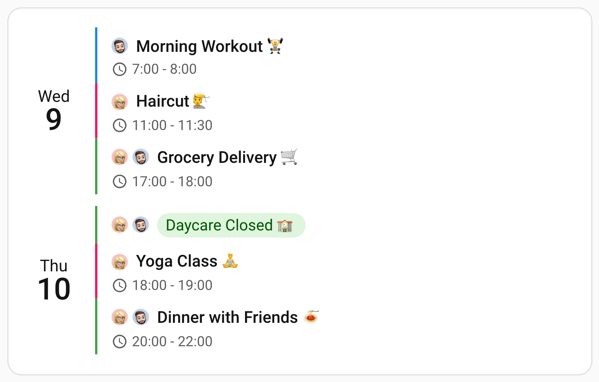

# Filtering & Text Replacement

Filtering decides which of a calendar's events the card shows; text replacement decides what they
say once shown. Both are set for each calendar in its `entities` entry, except duplicate
filtering, which works across calendars.

## 🔍 Event Filtering

Calendar Card Pro provides powerful filtering capabilities to control exactly which events appear on your dashboard:

::: tip Visual Editor
Each calendar's own filters are on that calendar's page, under **Which Events**: **Hide Events Containing** (`blocklist`) and **Only Show Events Containing** (`allowlist`) among them, each taking one word or phrase at a time, with **Match Against** choosing the field they read. **Filter Duplicates** works across calendars, so it is card-wide: find it on the **Which Events** page.
:::

### Filtering by Event Name

`blocklist` hides a calendar's events whose title matches a pattern, and `allowlist` keeps
only the ones that match. Both are regular expressions, so `|` separates alternatives:

```yaml
entities:
  - entity: calendar.work
    blocklist: 'Private|Conference' # Hide events with these words
  - entity: calendar.personal
    allowlist: 'Birthday|Anniversary' # Only show events with these words
```

Set both and both apply: an event has to match the allowlist _and_ escape the blocklist to be
shown. That is how you say "these, except those":

```yaml
entities:
  - entity: calendar.energy
    allowlist: 'Cheap' # only the cheap-rate events
    blocklist: 'quarter' # but not the quarter-hourly ones
```

### Matching the Location or Description Instead

By default both lists read the event **title**. `filter_field` points them somewhere else:
it takes `title`, `location` or `description`, and applies to that calendar's `blocklist`
and `allowlist` alike.

```yaml
entities:
  - entity: calendar.work
    filter_field: location
    blocklist: 'zoom\.us' # hide the events whose location is a Zoom link
```

It selects a field rather than adding one, so a calendar filtering on `location` has
stopped filtering on the title. To filter on two fields, list the calendar twice — each
block filters independently.

An event that has no location at all, or no description, counts as not matching: an
allowlist drops it and a blocklist keeps it, just as for an event with no title.

::: details Plain Patterns & HTML in Descriptions

- A pattern has no prefix syntax: `allowlist: 'location:'` matches the literal text
  `location:` in a title.
- The card strips HTML out of descriptions for display, but the filter reads the description
  as your calendar delivered it. With Google Calendar that usually means HTML, so a pattern
  matching a link may need to allow for the anchor markup wrapped around it.
- `show_description: false` hides descriptions without stopping them being filtered on.

:::

### Hiding Google Tasks Blended Into a Calendar

With **Show tasks in Calendar** enabled, Google surfaces scheduled Google Tasks through the
Calendar API as synthetic events **inside the same feed** as real ones. There is no separate
calendar entity for them, so they cannot be filtered out by leaving an entity off the card,
and their titles are whatever the task happened to be called — `contact admissions` — so no
title pattern can catch them reliably.

They all carry the same tell in their description, and `filter_field` reaches it:

```yaml
entities:
  - entity: calendar.work
    filter_field: description
    blocklist: 'tasks\.google\.com/task/'
```

Google's boilerplate reads:

```
Changes made to the title, description or attachments will not be saved.
To make edits, please go to: https://tasks.google.com/task/<id>
```

**Match the URL, not the sentence above it.** Google translates that sentence for every
account language; it does not translate the URL. The URL also matches whether the
description arrives as HTML or as plain text, where a pattern spanning translated words
might not.

The same approach works for any source that injects boilerplate-bearing events into a feed:
find a phrase every one of them carries and no real event does, and block on it.

### Giving Teams Meetings Their Own Icon

Pairing `filter_field: location` with [`location_icon`](/features/event-content#the-location-icon)
splits one calendar into online and in-person halves, each with its own icon and color:

```yaml
entities:
  - entity: calendar.work
    allowlist: 'Microsoft Teams'
    filter_field: location
    accent_color: '#6264a7'
  - entity: calendar.work
    blocklist: 'Microsoft Teams'
    filter_field: location
    location_icon: mdi:office-building
```

Because the same pattern is allowed in one block and blocked in the other, every event
lands in exactly one of them — nothing is lost and nothing appears twice. In the visual
editor, [Split This Calendar](/features/editor#split-this-calendar) **By Words** builds both
blocks for you.

Teams meetings need no allowlist to get their icon; that happens on its own. This pattern
is for when you want the two halves styled differently, or want a specific icon on the
half that is _not_ a Teams call.

### Hiding a Location That Is Really a Meeting URL

Online meetings tend to put a long join URL where a room name should be, and one of those
across a card is enough to unbalance every row around it. You usually still want the
event — just not that line of text under it.

`show_location` is a per-calendar option, so the partition above solves this too. Split
the calendar on the pattern and turn the location off on the half that carries the URL:

```yaml
entities:
  - entity: calendar.work
    filter_field: location
    allowlist: 'zoom\.us|teams\.microsoft\.com|meet\.google\.com'
    show_location: false
  - entity: calendar.work
    filter_field: location
    blocklist: 'zoom\.us|teams\.microsoft\.com|meet\.google\.com'
```

The online meetings keep their title, their time and their icon and lose only the URL.
Every other event on the same calendar still shows its room, because the second block
never had the option set.

Swap `show_location` for `show_description` to do the same to a description, or set both
if the URL appears twice. And if you would rather those events were gone altogether,
delete the first block — a lone `blocklist` filters them out instead of quieting them.

### Separating All-Day From Timed Events

The `event_type` option decides which class of event a calendar contributes. It takes three
values: `all` shows everything and is the default, `timed` keeps just the events that have
a clock time, and `all_day` keeps just the all-day ones.

```yaml
type: custom:calendar-card-pro
event_type: timed # Card-wide: no all-day events anywhere
entities:
  - calendar.work
  - entity: calendar.birthdays
    event_type: all # This one calendar departs from the card
```

Its more interesting use is as a way of splitting a single calendar in two. Because `timed`
and `all_day` are exact opposites, listing the same calendar twice — once each way — divides
its events between the two blocks without losing or repeating any, and each block can then
carry its own label and colors:

```yaml
type: custom:calendar-card-pro
entities:
  - entity: calendar.family
    event_type: all_day # Birthdays, holidays, trips
    accent_color: '#9e9e9e'
  - entity: calendar.family
    event_type: timed # Appointments, meetings
    accent_color: '#1e88e5'
```

This is the same technique as [Advanced Filtering Techniques](#advanced-filtering-techniques)
below, and it composes with the name filters: a block may set `event_type` and an
`allowlist` together, and an event has to satisfy both to appear.

::: tip Listing a Calendar Twice in the Visual Editor
**Split This Calendar** on the calendar's page builds both entries in one step: choose
**All-Day vs. With a Time**, give each part its color, and check where the upcoming events
land before you split. Undo takes it back. To add a second entry by hand, use **Duplicate**
in the calendar's ⋮ menu, which lists it again with the same settings, ready for you to
change the one option that differs. The entries sit under their calendar in the list, and
**Remove** on one drops it without taking the other; see
[Split This Calendar](/features/editor#split-this-calendar) and
[Calendar Actions](/features/editor#calendar-actions).
:::

::: tip It Describes the Kind of Event, Not Its Length
`event_type` says nothing about how long an event lasts. A dinner from 23:30 to 00:30 is
`timed` even though it touches two dates, and a one-day holiday is `all_day` just as a
two-week one is. For how the card handles events spanning several days, see
[Multi-Day Events](/features/multi-day-events).
:::

### Retiring All-Day Events During the Day

An all-day event normally counts as past at **midnight after the last day it covers**.
`allday_expires_at` retires a calendar's all-day events earlier, at a time of day you name,
for feeds that describe something happening at a particular hour. A waste-collection
calendar is the common case: the truck comes in the morning, and otherwise the collection's
entry sits on the card until midnight.

```yaml
entities:
  - entity: calendar.waste_collection
    allday_expires_at: '10:00' # gone from mid-morning, once the truck has been
  - calendar.family # unaffected — birthdays stay up all day
```

- It is per calendar and has no card-wide counterpart.
- Write the time as `HH:MM` on a 24-hour clock. From that time onward the event is past, and
  the row goes at that time without waiting for a refresh, within a minute in a grid showing
  its [now line](/features/grid-view#the-now-line).
- The time is read against the **last** day the event covers, so a holiday running Monday to
  Wednesday retires on Wednesday morning rather than Monday's. Split the calendar with
  `split_multiday_events: true` and each day retires on its own morning instead.
- Leaving the option out keeps the default, midnight. The option changes _when_ within the
  final day, never _whether_.

::: warning It Only Applies While Past Events Are Hidden
`allday_expires_at` decides _when_ an all-day event becomes past. Whether past events are
drawn at all is [`show_past_events`](/reference/configuration#event-column), which
defaults to `false`. With `show_past_events: true` the card is being asked to show what is
over, so this option has nothing left to do and the event stays.
:::

::: details Accepted Time Formats
A single-digit hour works, and so do seconds if you want them, so `9:30` and `10:00:30` are
both read. A value the card cannot read as a time falls back to midnight, which looks
exactly like leaving the option out, so check the value first if a calendar is not retiring
when you expect it to.
:::

### Showing a Calendar on Weekdays Only

`days_of_week` restricts one calendar to weekdays or to weekends. It takes `weekdays` for
every day except the weekend and `weekends` for the weekend days alone; leave it out and
every day qualifies, which is the default.

```yaml
entities:
  - entity: calendar.school_holidays
    days_of_week: weekdays # term dates matter on school days
    split_multiday_events: true # judge each day of the holiday on its own
  - calendar.family # keeps its weekend events
```

Like `event_type`, the two values are exact opposites, so listing one calendar twice — once
each way — divides it between two blocks that can carry their own labels and colors,
without losing an event or showing one twice.

Which days are the weekend comes from the country set in Home Assistant, under **Settings →
System → Home information** (**General** before Home Assistant 2026.3), not from the card's
own `language` option. Set the country if your weekend comes out wrong. They are the same
days the [weekend colors](/features/layout-appearance#date-column-customization) and the
weekend shading mark.

::: warning Pair This With `split_multiday_events` on a Calendar of Long Events
`days_of_week` judges the day a row **lands on**, and in list view an event spanning several
days is a single row on the first of them unless you split it. So a two-week vacation
beginning on a Saturday is one Saturday row, and `weekdays` hides the whole vacation rather
than showing you its weekdays. With `split_multiday_events: true` it becomes a row per day,
each judged separately. Column view already defaults the option to `true`.
:::

::: details Grid, Running Events, Empty Days & Weekends by Country

- Grid always judges each day on its own, whatever `split_multiday_events` says. It filters
  each timed segment and each all-day banner date, including continuations of events whose
  first day was excluded. Other calendars can still show events on the excluded days.
- An event already running when the card's window opens is drawn on the window's **first
  day**, whichever weekday that is, so that is the day the filter judges, not the date the
  event began. A calendar of single-day entries never notices the difference.
- A day the filter empties is an empty day like any other. With
  [`show_empty_days`](/reference/configuration#core-settings) off, the default in list view,
  it is left out and a later one takes its place. With it on, as column view defaults to, the
  day still appears with the usual _No events_ notice.
- By country, the weekend is Saturday and Sunday in most countries, Friday and Saturday in
  Israel and much of the Arab world, Thursday and Friday in Afghanistan, Friday alone in Iran,
  and Sunday alone in India and Uganda.
- With no country set, Home Assistant's language decides: Friday and Saturday in Arabic and
  Hebrew, Friday alone in Persian, Sunday alone in Hindi, Malayalam, Tamil and Telugu, and
  Saturday and Sunday in every other language. A language speaks for only one of the
  countries that use it, so English gives an Israeli home Saturday and Sunday, and Arabic
  gives a Moroccan one Friday and Saturday.

:::

### Showing Events That Start at Certain Hours

`starts_after` and `starts_before` keep only those of a calendar's timed events that start
within certain hours of the day. They suit a busy shared calendar of which only the afternoon,
or only the morning, matters to you:

```yaml
entities:
  - entity: calendar.volunteer_shifts
    starts_after: '16:00' # only the shifts that start after work
  - calendar.family # keeps all its events
```

- An event stays when it starts **at or after** `starts_after` and **before** `starts_before`.
  Set either or both; one alone runs to or from midnight.
- With `starts_before` earlier than `starts_after`, the hours run past midnight:
  `starts_after: '22:00'` and `starts_before: '06:00'` keep the night's events.
- Each event is judged once, by when it starts. A meeting from 15:00 to 17:00 is left out by
  `starts_after: '16:00'`, and an event over several days, an on-call week for one, is kept or
  left out on every day it covers.
- All-day events always show, since they start at no particular time. Add
  [`event_type: timed`](#separating-all-day-from-timed-events) to leave them out too.
- Like the calendar's other filters, the hours apply in every layout and to
  [search](/features/header-toolbar#searching-the-card). A day they empty is an
  [empty day](#showing-a-calendar-on-weekdays-only) like any other.
- Write each time in quotes, as `HH:MM` on a 24-hour clock.

::: details Midnight, Quotes, Two Blocks & Grid's Hours

- `starts_before` takes `00:00` or `24:00` for the end of the day, so `starts_after: '16:00'`
  keeps the same events alone or with either of them.
- Seconds count where you write them, `16:00:30`, and a single-digit hour works, `9:30`.
- Unquoted, a YAML dashboard reads `16:00` as the number 960, which is not a time. A value the
  card cannot read as a time, or the same time in both options, leaves the calendar's events
  as they are and is reported once in the browser console.
- The hours are read on the clock the card shows times in, the browser's.
- Listing one calendar twice, once with `starts_before: '16:00'` and once with
  `starts_after: '16:00'`, divides its timed events between the two blocks, each in exactly
  one. Its all-day events are in both, unless one block also sets `event_type: timed`.
- Grid view's [`start_time` and `end_time`](/features/grid-view#choosing-the-hours-the-card-shows)
  are something else: they set the hours the grid draws, for every calendar, and clip an
  event partly outside them. They leave the other layouts as they are.
- A [visibility condition](/features/core-settings#showing-a-calendar-under-conditions) of the `time` kind is
  something else too: it shows or hides the whole calendar depending on what time it is now.

:::

### Filtering Duplicate Events

When several calendars carry the same events — shared family or team calendars, most often —
`filter_duplicates` collapses each repeated event to a single row:

```yaml
entities:
  - calendar.personal # Listed first, so its copy of a shared event is the one kept
  - calendar.family # Its duplicate copy is hidden
filter_duplicates: true
```

An event counts as a duplicate of another when its original **title**, **start**, **end** and
**location** all match. Among copies that pass their calendar's filters, the surviving copy
is the one from the eligible entry listed **first** in `entities`, carrying that entry's own
`color` and `accent_color`, so reordering `entities` changes which calendar's styling a shared
event shows.

`filter_duplicates: ignore_location` leaves the location out, matching on title, start and end
alone. It suits holiday calendars, where one holiday in two regional calendars often differs
only in location: Home Assistant's Holiday integration gives each holiday its calendar's name
as the location, so `true` keeps both copies and `ignore_location` shows the holiday once:

```yaml
entities:
  - calendar.holidays_bavaria # Listed first, so its copy, location included, is the one kept
  - calendar.holidays_ticino
filter_duplicates: ignore_location
```

`filter_duplicates: merge_locations` matches the same way and lists every copy's location on
the row kept, in `entities` order, separated by a middle dot (`·`). It suits one event held in a
different place on each calendar, such as a meeting Anna and Ben join from their own rooms:

```yaml
entities:
  - calendar.anna # Room A
  - calendar.ben # Room B
filter_duplicates: merge_locations # One row, at "Room A · Room B"
```

Each location is shown as its own calendar shows it: a calendar with `show_location: false` adds
nothing, and its `replace_field: location` rewrite applies to its own location alone, as
`remove_location_country` applies to each. A location two copies share is shown once, and the
event's details show the kept copy's own location.

Keep `true` where each location should keep a row of its own, such as one title booked in two
rooms at once. In the visual editor, **Filter Duplicates** offers the four values as **Off**,
**Same title, start, end and location**, **Same title, start and end** and **Same title, start
and end, listing every location**.

Weekday restrictions and all-day expiry are applied before choosing that winner. A calendar
that excludes a date cannot remove another calendar's eligible copy:

```yaml
filter_duplicates: true
entities:
  - entity: calendar.anna
    days_of_week: weekdays
  - calendar.ben
```

On a weekend, a shared event still appears from Ben's calendar.

When the merge spans two or more **distinct** calendars, the surviving row can also name every
calendar the event belongs to and take a color that marks it as shared; see
[Labeling & Coloring Shared Events](#labeling-coloring-shared-events).

::: warning Matching Ignores Which Calendar an Event Came From
Any two events that share a title, start, end and location are treated as duplicates, even if
they are genuinely separate events and even if both live in the **same** calendar. Nothing is
hidden merely for starting at the same time — all four fields must match, or the first three
under `ignore_location` and `merge_locations`.

If events start disappearing unexpectedly, set `filter_duplicates: false` to confirm whether
this option is the cause.
:::

::: details Multi-Day Events
Daily occurrences are compared on their displayed dates, so a split multi-day event can have
different contributing calendars on different days. In List and Column, a first-listed copy
that is not split keeps its single row; lower-priority copies do not force it to split.
:::

::: details Merging Locations Within One Calendar or From a Private Calendar
Under `merge_locations`, two events of one calendar that match merge as two calendars' copies
do, so one booking per room lists every room. A [private calendar](/features/core-settings#keeping-a-calendar-private)'s
copy never merges with one that is not private, so its location never reaches another
calendar's row.
:::

### Labeling & Coloring Shared Events

When filtering collapses an event that two or more **distinct** calendars hold, the surviving
row can show **who** it belongs to, with every calendar's label, and **that** it is shared,
with `duplicate_accent_color`:

<br>

Anna's own events stay pink and Ben's stay blue. Anything they both hold shows **both** faces
in front of the title and turns gold. This is Friday and Saturday of the
[Family Hub](/guide/family-calendar) story's week, with only Anna's and Ben's calendars on the
card:

```yaml
filter_duplicates: true
duplicate_accent_color: '#ffb74d'
entities:
  - entity: calendar.anna
    label: person.anna
    accent_color: '#ff6c92'
  - entity: calendar.ben
    label: person.ben
    accent_color: '#03a9f4'
```

**The labels need nothing switched on.** A merged row draws the label of every calendar it
came from, in the order the calendars are listed. Labels that resolve to the same value, such
as the same emoji or `mdi:` icon, are drawn **once**.

**The color is the one line you switch on.** `duplicate_accent_color` replaces the accent of a
merged row — the accent bar, the row's background tint when
[`event_background_opacity`](/features/layout-appearance) is on, and the
[all-day badge](/features/event-content#the-all-day-badge). Any CSS color works, including a
theme variable such as `var(--success-color)`. Leave it unset and a shared row keeps the
first-listed calendar's color. The
[Family Hub](/guide/family-calendar#gold-means-the-whole-family) story sets it to the Family
calendar's own color, so an event on more than one person's calendar reads as a family event.

Both need two or more **distinct** calendars. A calendar listed twice to
[map icons by keyword](#mapping-icons-onto-events-by-keyword) keeps the first block's single
icon and its own calendar's color.

::: tip Pick a Label That Reads Well Beside Another One
A person's picture, an image, an emoji or an `mdi:` icon is drawn at a fixed size, so several
in a row read as a row of faces or badges. Plain text is not combined into a phrase: two
calendars labeled `Anna:` and `Ben:` render as `Anna: Ben:`, not `Anna & Ben:`. If you label
calendars with names and share events between them, prefer
[a person's picture](/features/core-settings#showing-a-persons-picture).
:::

### Advanced Filtering Techniques

Listing one calendar once per category, each block with its own filter, label and accent
color, styles different kinds of event from the same calendar differently. A last block
blocks every pattern above it and catches the rest:

```yaml
entities:
  - entity: calendar.family
    allowlist: 'shopping|grocery' # Only show shopping-related events
    label: '🛒' # Add shopping cart label to these events
    accent_color: '#1e88e5' # Blue accent for shopping events
  - entity: calendar.family
    allowlist: 'birthday|anniversary' # Only show celebration events
    label: '🎉' # Add celebration label to these events
    accent_color: '#e91e63' # Pink accent for celebration events
  - entity: calendar.family
    blocklist: 'shopping|grocery|birthday|anniversary' # Show all other events
    accent_color: '#607d8b' # Neutral accent for all other events
    # No label for remaining events
```

In the visual editor, build this with **Duplicate** in the calendar's ⋮ menu, once for each
extra block, and then give each entry its own filter, label and color on its page. See
[Calendar Actions](/features/editor#calendar-actions).

Any event whose title matches two of these blocks is drawn once per block. If your patterns
can overlap, add `filter_duplicates: true` — see
[Mapping Icons Onto Events by Keyword](#mapping-icons-onto-events-by-keyword) below for what
it does and which copy survives.

### Mapping Icons Onto Events by Keyword

The same shape gives every event an icon chosen by what its title says, without adding
emoji to the events themselves. A `label` holding an `mdi:` value renders as an icon, with
no `label_type` to set:

```yaml
filter_duplicates: true
entities:
  - entity: calendar.family
    allowlist: swim
    label: mdi:swim
  - entity: calendar.family
    allowlist: meeting
    label: mdi:briefcase
  - entity: calendar.family
    allowlist: birthday
    label: mdi:cake
  - entity: calendar.family
    blocklist: 'swim|meeting|birthday'
```

The last block is the catch-all: it blocks every keyword the blocks above it match, so
anything unmapped still appears, with no icon. Give it a `label` of its own —
`mdi:calendar-blank`, say — if you would rather unmapped events carried a fallback icon
than none.

::: warning `filter_duplicates: true` Is Doing Real Work Here
**A title can match more than
one block** — "Swim meeting" matches both `swim` and `meeting` — and each matching block
contributes its own copy, so that event is drawn **twice**, once per icon. Turning
`filter_duplicates` on collapses the copies and keeps the one from the block listed
**first**, which turns the block order into the priority order of a mapping table. With the
blocks above, "Swim meeting" takes `mdi:swim`; list `meeting` before `swim` and the same
event takes `mdi:briefcase`.

The option is card-level, not per calendar, so switching it on for this also deduplicates
across your other calendars — see [Filtering Duplicate Events](#filtering-duplicate-events)
for what that means, and reorder `entities` if a shared event starts appearing under
styling you did not expect.
:::

Put the most specific keywords first, since the first match wins. Each rule can also carry
a `color` and an `accent_color`, so a mapping can be more than an icon.

## ✏️ Text Replacement

Filtering decides which events appear. Text replacement decides what they **say** once they
are there — rewriting an event's title, location or description on the card without touching
the calendar it came from.

Three per-calendar options do it. `replace_field` names which field to rewrite and defaults
to the title; `replace_pattern` is what to find, as a regular expression; `replace_with` is
what to put there.

The [Family Agenda](/guide/one-calendar-many-purposes) story puts `replace_pattern` and
`replace_with` to work in a single card, alongside the filters above, and
[Bin Day](/guide/bin-day) uses `replace_pattern` to strip the prefix a waste feed puts on every title.

### What Each Combination Does

`replace_pattern` and `replace_with` are independently optional, and which of them you set
is the instruction:

| `replace_pattern` | `replace_with` | Result                          |
| ----------------- | -------------- | ------------------------------- |
| set               | unset          | the match is **removed**        |
| set               | set            | the match is **replaced**       |
| unset             | set            | the **whole field** is replaced |
| unset             | unset          | nothing happens                 |

In the visual editor, removing text means leaving the replacement field blank, since the
editor cannot store an empty value.

### Dropping a Prefix From Every Title

Birthday calendars in particular tend to prefix every entry, which costs the same width on
every row and tells you nothing:

```yaml
entities:
  - entity: calendar.birthdays
    replace_pattern: 'Birthday of '
```

`Birthday of Ben` becomes `Ben`. With no `replace_with`, whatever matched
is removed.

The pattern is a regular expression, matched **case-insensitively** and applied to **every**
occurrence — so a fragment repeated inside one generated title is removed from all of it, not
just the first:

```yaml
entities:
  - entity: calendar.work
    replace_pattern: '\[AUTO\] '
```

Capture groups work too, which is often tidier than deleting:

```yaml
entities:
  - entity: calendar.birthdays
    replace_pattern: 'Birthday of (.+)'
    replace_with: '$1 🎂'
```

### Hiding What an Event Is About

Leave `replace_pattern` out and the whole field is replaced, whatever it said. This is the
shared-calendar case: the family card shows that something is on, without showing what.

```yaml
entities:
  - entity: calendar.personal
    replace_with: 'Busy'
```

Every event from that calendar now reads `Busy`, keeping its time, its color and its place in
the day. The calendar itself is untouched — this is a display setting, so the same calendar on
your own card still shows real titles.

It replaces the title alone: the location and the description still show where the card shows
them, and in the event popover. To keep all of it off the card, add
[`private: true`](/features/core-settings#keeping-a-calendar-private) beside it, and the titles still read `Busy`.

::: tip Ages Are Suppressed Automatically
If those events carry a [`YEAR=` marker](/features/event-content#birthday-ages-anniversary-counts),
the count is **not** appended to a replaced title. `Busy (40)` would announce that the hidden
event is a birthday, which is the opposite of what you asked for. A title your pattern merely
_edited_ keeps its count.
:::

### Replacing a Location That Is a Meeting URL

Set `replace_field` to point the pattern somewhere other than the title:

```yaml
entities:
  - entity: calendar.work
    replace_field: location
    replace_pattern: 'https://\S*zoom\.us/\S+'
    replace_with: 'Zoom call'
```

The row keeps a location — it just reads `Zoom call` instead of a sixty-character join link.
If you would rather the line vanished entirely, [hiding it](#hiding-a-location-that-is-really-a-meeting-url)
is the other way round.

An empty field is never filled in. A `replace_with` on the location rewrites the events that
have one and leaves the rest alone, rather than giving every event a location it never had.

::: warning Rewriting a Location Also Decides Its Icon
The [Teams icon](/features/event-content#the-location-icon) is chosen from the location the
card is about to draw, so a rewrite that removes the words `Microsoft Teams` — or the join
link — takes the Teams icon with it and leaves the map marker. Set `location_icon` on the
same block to name the icon you want and the detection stops mattering either way.
:::

### One Field Per Block

::: warning A Calendar Cannot Be Listed Twice to Rewrite Two Fields
This is the one place the "list the calendar twice" pattern used throughout this page does
**not** transfer.

It works for filters because `blocklist` and `allowlist` are complementary: each block takes a
different share of the events, and every event lands in exactly one of them. Two replacement
blocks are not complementary — both match the **same** events, and each contributes its own
copy, so every event on that calendar is drawn **twice**.

Turning on [`filter_duplicates`](#filtering-duplicate-events) does not rescue it. The copies
are identical as far as deduplication is concerned, because it compares events as the calendar
delivered them and a replacement only changes what is drawn. The first block's copy is the one
kept, so the second block's replacement is silently discarded along with the duplicate row.

Rewrite the field that matters most on the card. The rest of a calendar's settings — colors,
icons, filters — are unaffected either way.
:::

Rewriting also runs **after** the card's own formatting, so patterns are written against what
you actually see: a country name removed by
[`remove_location_country`](/features/event-content#time-location-information) is already gone,
HTML in a description is already flattened, and a `YEAR=` marker is already stripped.

**→ [Per-entity options in the configuration reference](/reference/configuration#per-entity-options)** — the full per-calendar list.
