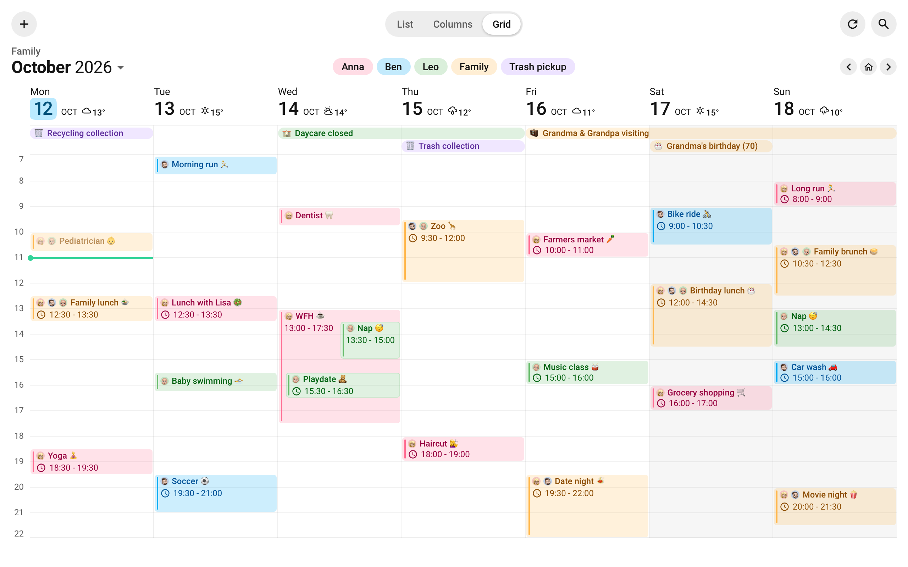
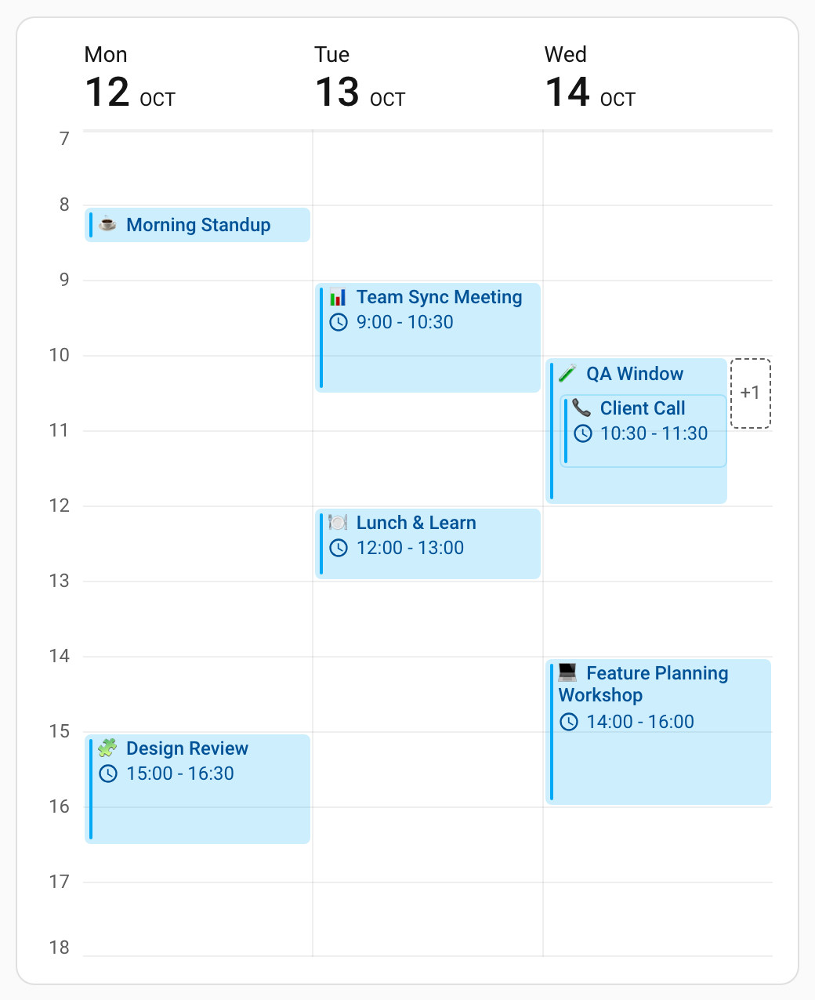
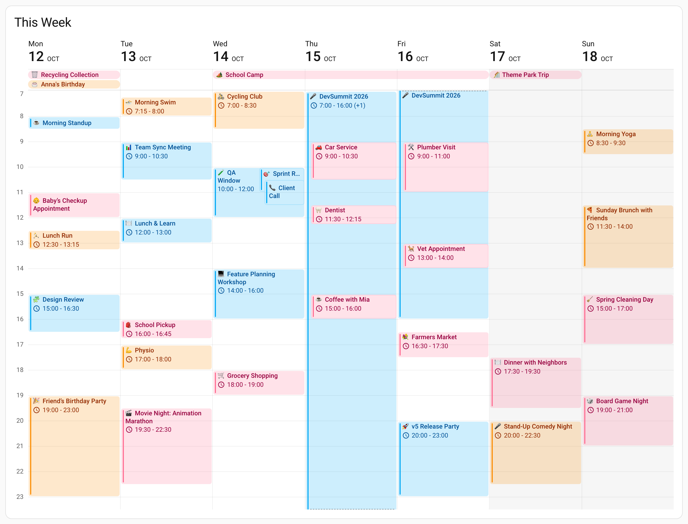
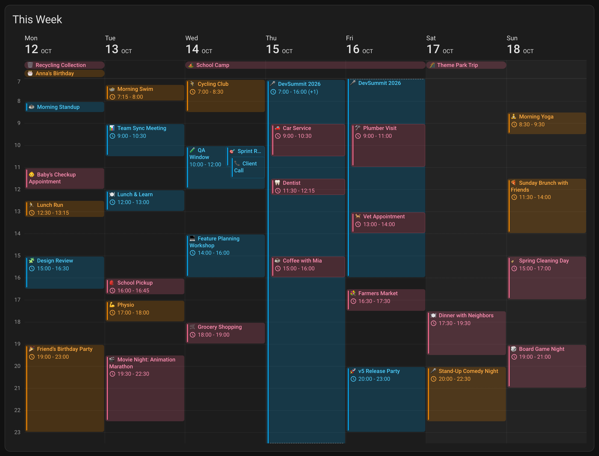
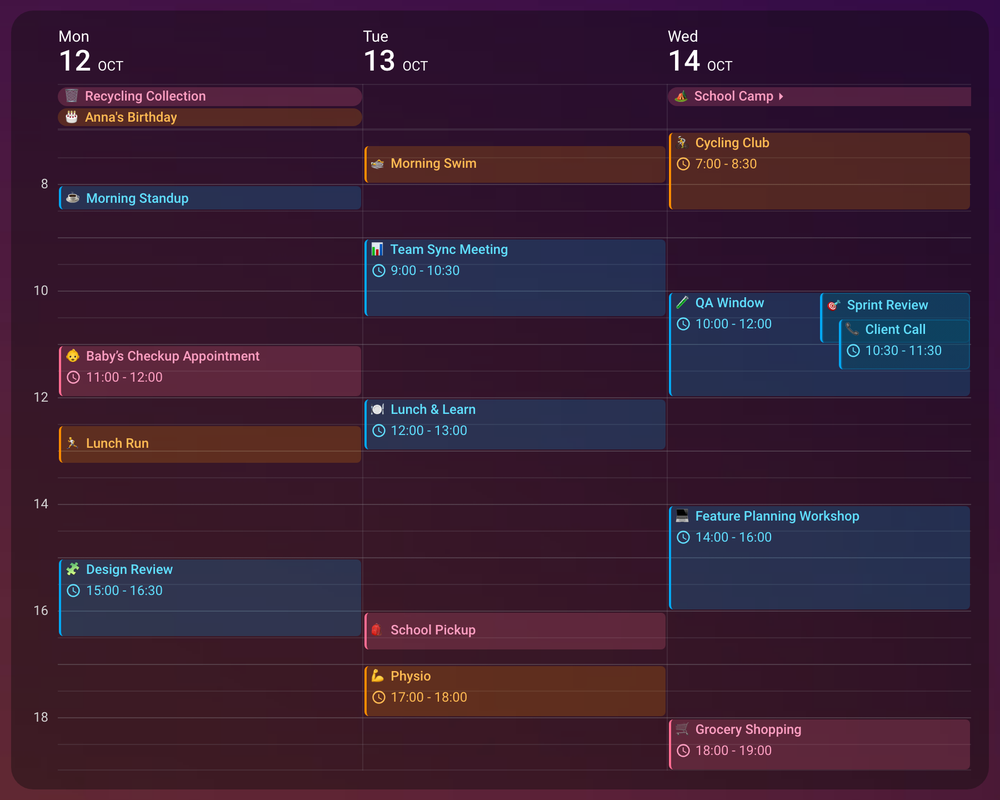
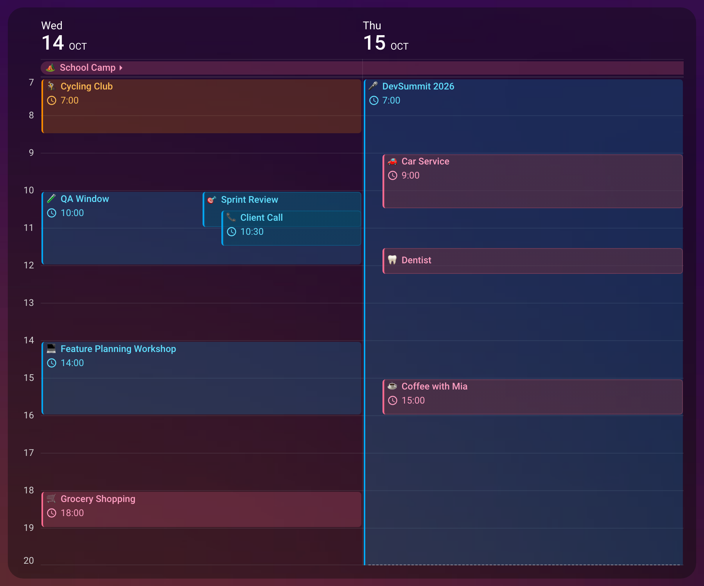
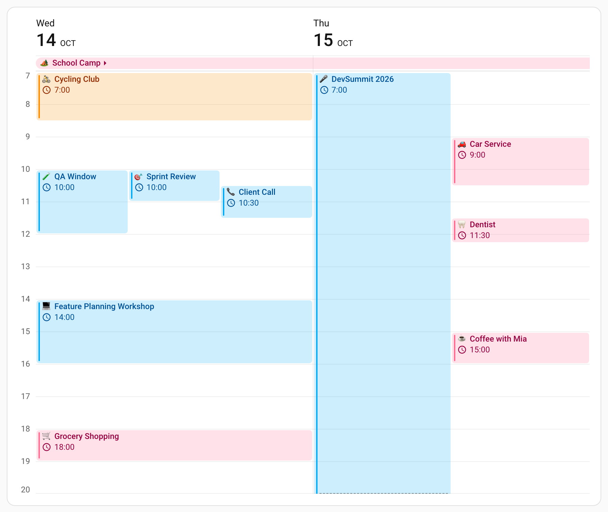
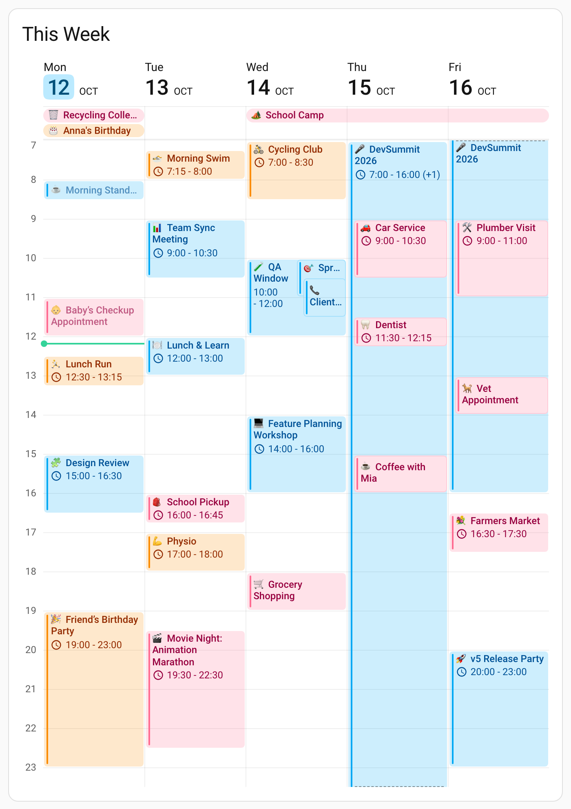

# Grid View

Grid view places the days side by side on an hour axis, so an event sits at the time it
starts and is as tall as it is long. It is the same agenda the other two layouts show,
measured against a clock instead of listed.

<br>

The [Family Hub](/guide/family-calendar) story: a fully configured grid card on a wall tablet. The YAML below is all it takes to switch a card to grid.

Set it with `view`. The default, `list`, stacks each day above the next.

```yaml
view: grid
days_to_show: 3
```

In the [visual editor](/features/editor), **Card Displays**, above the search controls,
chooses the layout the card opens with. Select **Grid** under **Editing Settings For** to
configure its time axis in **Layout** and its line styles in **Rules**, without changing
**Card Displays**.

::: tip Start With Three Days
Seven columns need a wide card to stay readable. Three is a good default on a dashboard
column, and a single day makes a compact "what's left of today" card.
:::

<br>

Three days on a dashboard column, from one calendar. Every event keeps a single accent
color, and the lanes stay wide enough for each block to show its title and its time.
[Today & Tomorrow](/guide/today-and-tomorrow) shows two days by the hour on anything from a
phone to a kitchen tablet.

Grid view reads its colors from the active theme, so an unstyled card follows light and dark
mode without any configuration. The axis, the hour lines and the weekend tint all come from
theme variables; see [Theming](/features/theming) for the ones you can override.

<br>

<br>

## 🕒 Choosing the Hours the Card Shows

`start_time` and `end_time` set the hours the axis draws, `07:00` to `22:00` by default.
Both are `HH:mm`, so a window can start at half past, and `end_time` also accepts `24:00`,
midnight at the end of the day rather than the start of it:

```yaml
type: custom:calendar-card-pro
entities:
  - calendar.family
view: grid
days_to_show: 3
time_grid:
  start_time: '06:30'
  end_time: '20:00'
```

- An event partly outside the window is drawn clipped, with a subtle dashed mark on the side
  it runs past. Its accent bar, otherwise rounded at both ends, runs on square to the block's
  edge on that side, so the event reads as carrying on past the visible hours. An event
  entirely outside the window is not drawn at all, so the window decides what the card shows,
  not only how it looks.
- A timed event that runs across more than one day gets one block per day column. The first
  shows its start time and countdown, the others neither; weather, location and description
  rows can still appear on each.
- An event with no duration, such as a reminder, or one shorter than a minute still gets a
  block at its start time, with a minimum height, so a very short event looks taller than it
  lasts. That height is too little for a time row, so a reminder shows as any block that short
  does (see [Short Timed Titles](#short-timed-titles)), and its time is where it sits on the
  axis.

::: warning A Bad Time Resets Both Bounds
If either value cannot be read as `HH:mm`, the card falls back to `07:00`–`22:00` for both.
The same happens when `end_time` is not after `start_time`, so a window that wraps past
midnight, `20:00` to `08:00`, is a fallback rather than an overnight view. It also happens
for a value of the wrong type, such as `start_time: 8`: a number is not read as an hour. An
omitted bound is different: it uses its own default and keeps the other valid bound.
:::

::: details Short, Touching & Multi-Day Events

- Near the end of the axis, a minimum-height block moves up just enough to stay inside the
  visible hours rather than disappearing below them; its time text is unchanged.
- Two reminders at exactly the same time sit side by side. Reminders close together but not
  at the same time can still overlap, because the minimum height covers more of the axis than
  separates them.
- Two events that touch, one ending at 12:30 and the one below it starting at 12:30, are
  separated by a single line, so the handover does not read as time passing between them.
  Even with `hour_line_width: 0`, two touching events from one calendar still read as two.
- A day a continuing event runs through is not empty: `show_empty_days: false` keeps its
  column, for timed and all-day events alike.
- A calendar's [`days_of_week`](/features/core-settings#showing-a-calendar-on-weekdays-only)
  filter judges each day an event covers on its own, so an event that starts on an excluded
  day can still appear on a later one.

:::

### Events in the Repeated DST Hour

When clocks go back, an event can end at the same or an earlier clock time than it started.
Grid draws it from its start for as long as it really lasts, so it stays visible: from 01:45
before the change to 01:15 after is 30 minutes, and it fills 01:45–02:15 on the axis, which
shows each clock time once. Clipping and overlaps follow the block as drawn. Its time text and
progress bar still follow its real times, and a day of 23 or 25 hours still fills one day
column. Nothing needs configuring.

## 📏 How Tall an Hour Is

`hour_height` sets how tall one hour of the axis is, `48px` by default, and with it the
natural height of the calendar content area: one hour times the hours shown. It is a CSS
length, so `4em` works too and tracks your font size.

```yaml
time_grid:
  hour_height: 64px
```

A fixed `height` overrides it: the axis compresses to fit the calendar content area instead.

```yaml
view: grid
height: 400px
```

`height` sets the calendar content area, so a header or card padding makes the outer card
taller. Give a fixed-height grid enough room for both its all-day band and its hours.

::: details Very Short Fixed-Height Cards
At least half the content height stays for the hours, and a tall all-day band scrolls in
what is left above them, under the day headers. Around `180px` the band is down to a row or
two, and below about twice the header height it is a sliver. Its events are still there and
reachable by scrolling or the keyboard, but the hours themselves start to be clipped by the
bottom of the card.
:::

**→ [Height in Grid View](/features/layout-appearance#height-in-grid-view)** — how this interacts with `max_height` and the other views.

## 📐 Ruling the Axis

`slot_minutes` sets how finely the axis is ruled: a line every `15`, `20`, `30` or `60`
minutes, `60` by default. Choose a finer setting when you schedule in quarter hours. An hour
stays the same height whichever you pick, and the hour lines still read stronger than the
ones between them, so the eye finds the hour.

```yaml
time_grid:
  slot_minutes: 15
```

`axis_width` sets the width of the label gutter. The default, `max-content`, fits the widest
visible label with fixed padding on both sides. The only other value is a pixel length, and a
bare number is read as pixels, so `axis_width: 56` and `axis_width: 56px` are the same. Any
other length falls back to `max-content`, and the card logs a warning naming the value it
ignored.

```yaml
time_grid:
  axis_width: 56px
```

`show_axis_labels: false` removes the labels and keeps the lines, which is useful on a narrow
card where the lines are enough. Labels are on by default.

```yaml
time_grid:
  show_axis_labels: false
```

### How Often the Axis Is Labeled

`axis_label_minutes` sets how often the time gutter names a time: every `30`, `60`, `120` or
`180` minutes, `60` by default. At a small `hour_height` sixteen hour labels crowd each other,
and a label every two hours is the way out:

<br>

A custom window with half-hour slots and a label every two hours. Narrowing the window and
thinning the labels keeps a long day readable without making the card taller.

```yaml
time_grid:
  hour_height: 24px
  axis_label_minutes: 120
```

- Labels and lines are separate: [`slot_minutes`](#ruling-the-axis) sets how often a line is
  drawn and `axis_label_minutes` how often one is named, so a half-hourly label can sit where
  there is no line.
- Below the hour every label carries minutes: `12:00`, `12:30`, `13:00`, or in 12-hour format
  `12:00 PM`, `12:30 PM`. Those are wider, and the default `max-content` gutter grows to fit them.
- Labels and lines both count from midnight, as a clock does, not from the top of the window: a
  window starting at `06:30` is labeled `7`, `8`, `9` every hour and `6:30`, `7:00`, `7:30` every
  half hour, and one starting at `07:00` is labeled `8`, `10`, `12` every two hours.
- The window's end is labeled only when it falls on the label cadence, and ruled only when it
  falls on the line cadence. A window ending at `24:00` is labeled as midnight, at every cadence.
- Labels never make the card taller: the gutter is clipped at the foot of the time body.

::: details Labels and Lines at the Window's End

With hourly lines and hourly labels, `end_time: 21:00` gets both a label and a line, and
`21:30` gets neither. `21:30` at `slot_minutes: 30` gets the line without a label, and `21:30`
at `axis_label_minutes: 30` gets the label. Where the closing line is drawn, a block running to
the foot of the window ends against it.

:::

### Grid Lines

A grid draws four kinds of line, each with its own options. All four start in the same light
gray, `var(--divider-color)` at half strength; a color you set is drawn exactly as written.

| Rule                                                  | Option                                                      | Default |
| ----------------------------------------------------- | ----------------------------------------------------------- | ------- |
| Vertical, between day columns                         | `day_separator_width` / `day_separator_color`               | `1px`   |
| Horizontal, between the date row and the all-day band | `day_header_separator_width` / `day_header_separator_color` | `1px`   |
| Horizontal, under the all-day band                    | `allday_band_line_width` / `allday_band_line_color`         | `2px`   |
| Horizontal, across the time body                      | `hour_line_width` / `hour_line_color`                       | `1px`   |

```yaml
time_grid:
  day_separator_width: '1px'
  hour_line_color: var(--divider-color)
  allday_band_line_width: '3px'
  week_separator_width: '2px'
  month_separator_width: '3px'
```

- **Between day columns,** `day_separator_*` runs from under the date row to the foot of the
  grid. Grid view draws it by default, and the card-level value is left to the list and column
  layouts, so set it inside `time_grid:`. `day_separator_width: 0` removes these lines and
  nothing else.
- **Under the date row,** `day_header_separator_*` is one line across all the day columns. It is
  drawn only when there is an all-day band to close off: when the days shown hold an all-day
  event, or while you [add one in the grid](/features/actions#drawing-an-event-in-grid-view).
  Without a band, the line under the band takes its place.
- **Under the all-day band,** `allday_band_line_*` is a heavier line of its own.
- **Across the time body,** `hour_line_*` rules every hour and every `slot_minutes` step between,
  at the same width, and the closing line at `end_time` where the cadence lands there.
  `hour_line_width: 0` removes them all.

The date row, the week numbers and the weekend tint are not affected by these options.

::: details More About Grid Lines

- The day lines cross the all-day band, and a banner over several days paints over them. Month
  lines win over week lines, and week lines over day lines.
- The date-row line crosses the gaps between day columns and begins and ends where the hour
  lines do.
- Where a `slot_minutes` line falls on an hour, the two coincide and the hour reads a shade
  heavier.

:::

## 🟢 The Now Line

A line marks the current time on today's column, and only there, so you can see how far
through the day you are. `show_now_line` turns it on and off; it is on by default.

The line runs across event blocks, over their color and under everything drawn on them, the
calendar's colored bar included, so it never strikes through an event's text and stays in view
across the event under way, even one drawn over a longer event. A dot at the column's edge marks
which column it belongs to.

```yaml
now_color: '#34d399' # The card's color for now, which the line takes (default)
time_grid:
  show_now_line: true
  now_color: 'var(--error-color)' # Or a color for grid view alone
```

- The line takes the card's `now_color`, emerald green by default, the color list and column
  view give an event under way. Set `now_color` inside `time_grid:`, as above, to color the
  line alone and leave list and column view as they are; `var(--error-color)` gives your
  theme's red.
- Any CSS color works. Quote a hex value, as above: YAML reads an unquoted `#` as the start of
  a comment, and the color would be lost.
- When the current time falls outside the hours shown, the line is not drawn.

## 🔢 Week Numbers

Week numbers label each week in a pill above the date columns, so a long window shows where
one week ends and the next begins. `show_week_numbers` turns them on, numbering weeks `iso` or
`simple`; the default, `null`, shows none.

```yaml
show_week_numbers: iso
show_current_week_number: true
```

- A pill sits above the first visible day and above each day that starts a week, so a window
  that straddles two weeks labels both.
- `show_current_week_number`, `true` by default, labels the first visible week. Set it to
  `false` to hide only that pill, which is usually a partial week; later week boundaries are
  still labeled.
- Every day column has a cell in the week-number row, hidden where no week starts, so the date
  row keeps one height.
- The pills match column view's. How `iso` and `simple` count weeks, and the pill's size and
  colors, are under
  [Week Numbers & Visual Separators](/features/layout-appearance#week-numbers-visual-separators).

## 🌗 Shading the Weekend

`weekend_background_color` tints the weekend's day columns, so the shape of a week is visible
before you read a date. It is on by default, in a faint mix of the theme's own text color that
darkens a light theme and lightens a dark one:

```yaml
time_grid:
  weekend_background_color: 'rgba(230, 124, 115, 0.12)'
```

- Keep it faint, since event text sits on top of it. `transparent` turns it off.
- It is a grid-only option, so it lives in `time_grid:` rather than beside the card-level
  `weekend_*` text colors.
- The tint runs from just under the date row, through the all-day band and down the hours, as
  one continuous column. The date row itself stays clear.
- Which days are shaded comes from the
  [country set in Home Assistant](/features/core-settings#showing-a-calendar-on-weekdays-only),
  so this is Friday and Saturday in Israel and Sunday alone in India, whatever language Home
  Assistant runs in. With no country set, Home Assistant's language decides instead. The
  [`weekend_*` date colors](/features/layout-appearance#date-column-customization) and
  [`days_of_week`](/features/core-settings#showing-a-calendar-on-weekdays-only) use the same
  definition.

::: details Where Two Weekend Days Meet
Where two weekend days sit next to each other, the tint also fills the gap between them, so a
Saturday and Sunday read as one block rather than as two stripes. It never spills into the gap
beside a weekday, and a window that shows only one half of a weekend tints only that column.
:::

## 📅 All-Day Events

All-day events get a band of their own between the day headers and the hours. A multi-day
event is **one banner spanning its days**, not a chip repeated in each. `allday_band_max_rows`
caps how many rows the band may grow to, `3` by default:

```yaml
time_grid:
  allday_band_max_rows: 3
```

- A banner for an event that starts before the first column or ends after the last one carries
  a small arrow on that side and is squared off there, so a week-long holiday reads as
  continuing past the card's edge. An end where the event really starts or finishes is
  rounded into a full pill.
- Banners show the title only, filled with the calendar's color and with no accent bar. They
  follow background opacity and past-event dimming, but time badges, location, description,
  event weather, countdowns, progress bars and label icons stay out of the band.
- Banners beyond `allday_band_max_rows` are dropped, so a week of long events cannot push the
  hours off the bottom of the card. Positive fractional caps round down to whole rows, with a
  minimum of one.

::: details Filters & Duplicate Calendars

- A per-calendar weekday/weekend filter can leave gaps in a banner. The banner joins adjacent
  visible columns where that event qualifies, but never crosses an excluded column that another
  calendar keeps visible. Its arrows still refer to the original event.
- With [`filter_duplicates: true`](/features/core-settings#filtering-duplicate-events), only
  eligible calendar copies contribute on each date. If those contributors change, the banner
  separates into runs, so a shared-event color does not extend into dates where only one
  calendar qualifies.

:::

## 🔀 Overlapping Events

When events overlap, one that starts well inside a longer one is drawn on top of it, slightly
indented, the way macOS and Google Calendar draw a day. A school morning or a day-long trip no
longer halves the width of everything that happens during it.

<br>

On Wednesday, QA Window and Sprint Review start together and share the width, and Client Call,
half an hour later, is drawn on top of Sprint Review. On Thursday the errands sit on top of the
conference, a little indented, so its title stays readable above them and its edge beside them.

The event drawn on top keeps nearly the whole column, and the longer one stays visible along its
leading edge. Events that start together are drawn side by side instead, because both need the
same rows at the top for their titles. The longer one comes first, and once the shorter one is
over, the longer one has the full width again for anything that starts inside it later. This is
the default, `overlap_layout: cascade`.

### When an Event Is Drawn on Top

On a card at the default size, "well inside" means at least half an hour below the longer
event's top. Closer than that, the two go side by side. An event that starts before the
visible hours counts from where it is drawn, the top of the axis, not from its real start.
None of this needs configuring.

::: details When Half an Hour Is Not Enough
With a shorter hour or larger event text, the card asks for more, so the longer event keeps
room for its title above: fifty minutes at a `30px` hour, or with `20px` event text. On a card
squeezed so far that no title would fit above anything, every overlap goes side by side.
:::

### Nothing Is Drawn Under Another Event

A longer event's text keeps to the part of it nothing covers: the rows above the first event
drawn over it, and the width beside any event that started with it. Within that part it shows
what fits in the usual order, the title first, then the time, then location and the rest, so
a long event with something starting half an hour in keeps its title, and its time once the
gap is large enough for both. When two events overlap, neither one's text is ever printed
underneath the other.

- A faint outline in its own calendar's color runs around a block drawn on top, so two events
  from the same calendar stay apart.
- A reminder or a very short event is drawn taller than it lasts, so on a compressed axis an
  event starting soon after it, without overlapping it, can still cover its lower edge. This
  happens in either layout; a larger [`hour_height`](#how-tall-an-hour-is) helps.

::: details Deep Overlaps & Translucent Themes

- A block drawn on top hides the event underneath it but not the grid: the hour lines and the
  weekend shading run through it as through any block, and its color is its own rather than a
  mix with the one beneath.
- If your theme makes the card background translucent, the event underneath shows through
  faintly, just as the dashboard shows through the rest of the card. Its text never does,
  because none is ever placed there.
- Overlaps nest at most three deep. If nesting would ever squeeze a block narrower than the
  column split evenly among one event more than `max_simultaneous_events` allows, which is a
  quarter of it at the default, those events go side by side instead.

:::

### Side by Side Instead

`overlap_layout: columns` splits the column between overlapping events for their whole length,
the way Outlook draws a day. Every overlap then reads as parallel lanes, which makes it easiest
to count how many things happen at once:

```yaml
time_grid:
  overlap_layout: columns
```

<br>

The same two days side by side. Three events at once share Wednesday's column, and Thursday's
conference keeps half the width all day. Each lane narrows rather than hiding anything.

### How Many Fit Side by Side

`max_simultaneous_events` caps how many events share the width side by side, `3` by default.
The rest collapse into a narrow `+N` strip at the column's edge, which says how many it stands
for and lists their titles on hover, so nothing is hidden without being counted:

```yaml
time_grid:
  max_simultaneous_events: 3
```

- Raise it if you routinely have four or five things at once and would rather see them all
  narrow; lower it to keep blocks readable.
- It counts only events drawn beside each other, so in the default layout an event drawn on
  top of another is never collapsed into the strip.
- A strip only gathers hidden events that overlap one another. Three separate errands hidden
  beside a long conference get a `+1` each, at their own times, rather than one `+3` stretched
  across the hours between them.
- Positive fractional caps round down to whole lanes, with a minimum of one, just like the
  all-day row cap.

::: details How Wide the Strip Is
The events that are drawn share the rest of the width, so at a cap of `1` the first event keeps
all of the column but the strip. The strip widens with a larger `time_font_size`, and never
takes more than a quarter of the space it sits in.
:::

### What a Block Shows

A block shows what fits, in a fixed order: the title first, then the time, then location and
the other details, from the same event content as list and column view. Its height comes from
the event's length and its width from how the overlap layout shares the column, so a long
meeting in a busy lane can be tall enough for a time and far too narrow for one. Whatever does
not fit is left out whole, never cut part way.

- A title needs room for one full line, the time for a full title line plus a full time line,
  and location for one more line.
- A time row too narrow for its block gives things up in order: first the clock icon, then the
  end time moves onto a second line if the block is tall enough, then the end time goes, since
  the block's bottom edge already shows it, and only then the row. It never shows a cut time:
  `10:00 - 1…` on a meeting ending at 12:00 would read as one o'clock, so the card shows a bare
  `10:00`, or nothing.
- A long title stops at the last line that fits whole, ending in "…" when more follows.
  `title_max_lines` above `0` stops it sooner; grid draws at most three title lines however high
  you set it, and fewer on a short block. A scrolling title
  ([`scroll_long_titles`](/features/event-content#scrolling-long-titles)) stays on one line and
  moves instead.
- Titles wrap only between words. A word wider than its block is cut short with "…", so
  "Quarterly review" reads "Quarte… review" rather than "Quarte rly review" over three lines. A
  hyphenated word can still wrap after its hyphen.
- Event weather gets its own row under the time, as in column view, where its words can wrap
  beneath the temperature; the progress bar gets its own row under the title. A countdown trails
  the time, its words continuing on the next line where the block has room; in a lane too narrow
  for it, the countdown gives way, not the time.
- Calendar labels, whether text, emoji, icon, picture or merged, sit before the title on its
  first line. That line counts toward the title's line limit, and the labels stay still while a
  scrolling title moves.
- All-day banners remain title-only.

::: details Narrow Lanes, Countdowns & Other Scripts

- A block left showing nothing but its title keeps it centered only while the title nearly
  fills the block; a tall, narrow one keeps it at the top.
- If your theme or `event_font_size` makes a detail row taller than its block, the card hides
  the optional detail rows rather than showing one partly clipped.
- A countdown's dot stays at the end of the time's line, and the clock icon stays wherever it
  fits beside the time. Where the block has no room for the countdown's extra line, the clock
  gives way first and then the end time, so the countdown can follow the time on its line.
  Where its dot cannot follow even the start time, or its words are wider than the block, the
  block draws its time exactly as it would with `show_countdown: false`; where no time leaves
  room for its words on their line and the block has no line to spare, it draws the time on one
  line, without the countdown.
- A first word wider than the room the labels leave is cut short on their line, so in a narrow
  lane "Birthday lunch" beside a picture reads "Birth…" with "lunch" below it, rather than
  leaving the picture on a line of its own. Wrapped lines start at the block's edge, under the
  labels, rather than indented to line up with the title as in list and column view.
- Titles in Chinese, Japanese and other scripts written without spaces wrap between
  characters. Titles in Thai and its neighbors wrap between the words the browser finds, and
  titles containing a right-to-left script such as Hebrew or Arabic wrap as the browser
  decides. In both, only the first word is a word of its own, cut short like any other, and
  the title starts beside the labels the same way.

:::

### Short Timed Titles

A small block does not have to lose its title just because it cannot hold the usual padding:
when no complete first label/title line would fit, grid fits a smaller one instead. There is no
option for it and no adjustable minimum. Large text on a compact axis, as here, is where it
shows:

```yaml
view: grid
entities:
  - entity: calendar.anna
    label: Anna
  - entity: calendar.ben
    label: 'mdi:calendar'
time_grid:
  event_font_size: 20px
  hour_height: 48px
  title_max_lines: 2
```

- Grid first tries the title on one centered line at your configured font size, with `1px` of
  space above and below.
- If that still does not fit, it shrinks the title and its labels together in `1px` font steps
  to the largest size that fits, never below `10px` for the title or any text or emoji label.
  Every calendar label stays, merged labels included, and text, emoji, icons and pictures keep
  their relative sizes, colors, order and proportions.
- The fitted title does not scroll, and ends in "…" when needed, even with
  `scroll_long_titles: true`. Normal text and scrolling return when more room becomes available.
- Some blocks still cannot show a useful line: large labels, unusually tall line spacing or a
  very narrow lane can leave no room for the labels plus meaningful title text. Grid then leaves
  the block visually empty rather than showing a label or "…" alone, so a quarter-hour event is
  not guaranteed to show text at every card height or font.
- Screen readers still get each timed event's full information, even where its block shows
  little or none of it. Picture and icon labels are read by name: a calendar by its
  [`name`](/features/core-settings#naming-a-calendar-in-the-card) where it has one, and a person
  always by their own.

::: details More About Fitted Titles

- A text part that is already smaller is neither enlarged nor reduced further, and can stop the
  whole group from shrinking; grid never sizes the labels and the title apart to get around it.
- Whenever the usual first line fits, wrapping, line limits, detail rows and scrolling are
  unchanged. A later line that does not fit is left out, with the line before it ending in "…",
  and never makes the font shrink.
- When the block's height leaves out every detail row but the usual title fits, grid centers that
  title without shrinking it or forcing two fitting lines onto one. A tall title-only event whose
  details were turned off or absent keeps its usual alignment.
- Only usual, overflowing timed titles join the card's
  [shared forward starts](/features/event-content#scrolling-long-titles). Fitted or blank titles,
  all-day banners and `+N` strips never join, and labels and pictures stay still.
- The screen-reader text follows the card's language, describes continuations by the event's
  original times, and leaves out details you turned off. It adds no event action or keyboard
  tab stop; [`event_tap_action`](/features/actions#tapping-an-event) adds both. All-day banners
  and `+N` strips are outside this fallback.

:::

::: tip Keep Detail Rows Short
Grid blocks have less room than list rows. If you show location and description in the
grid, cap the optional detail rows to one or two lines so the title stays readable. Grid
hides locations by default, so turn them on inside `time_grid:`:

```yaml
show_description: true
time_grid:
  show_location: true
  location_max_lines: 1
  description_max_lines: 2
```

:::

## ✋ Moving Events by Drag

In grid view you can move a timed event to another time or day by dragging its block, as in
Calendar on macOS. It works wherever a tap or a hold opens the event in the
[event popover](/features/actions#the-event-popover) and the popover can change it; there is
no option of its own.

<video class="clip" src="https://raw.githubusercontent.com/alexpfau/calendar-card-pro/main/.github/img/clip_grid_drag.mp4#t=0.001" width="740" height="742" loop muted playsinline controls preload="auto" aria-label="A family's week in grid view on a tablet: a finger holds Bike repair on Friday at 16:30 until it lifts, drags it to Saturday at 11:00, lets go, and later drags it back"></video><br>

Hold the event until it lifts, drag it to another day and time, and let go: it is saved there at once. The second drag puts it back.

```yaml
type: custom:calendar-card-pro
entities:
  - calendar.family
view: grid
event_tap_action:
  action: details
```

- **With a mouse,** press on the event and drag at once. A click that does not move still opens
  the popover.
- **On a phone or tablet,** hold the event for half a second, until it lifts, then drag. The page
  does not scroll while you do. Held and let go without moving, the hold does what it always did,
  such as opening the popover under `event_hold_action: details`.

The event follows the pointer in quarter hours, keeping its length and the minute it starts at
within its quarter, so one at 10:10 moves to 10:25 or 9:55. Drag sideways to move it to another
of the days shown. It stays on the day you drop it on: an event that would run past midnight
stops where it still ends by then. While you drag, it is drawn where it would go, with its new
times; let go, and it is saved there at once. Let go where it started, or press Escape, and
nothing changes.

A repeating event opens the popover at its new times when you let go, and moves its repeat with it
as a change of times in the popover does. One occurrence of a series asks whether the move is for
**Only this event** or for **This and all future events**; a series the calendar returns whole
shows **Save**. **Cancel** puts it back.

If Home Assistant refuses the change, the event goes back where it was, and Home Assistant shows
why at the bottom of the screen.

A drag moves an event only where the popover could change it: on a calendar whose integration
[can edit events](/features/actions#what-each-integration-allows), such as a Local Calendar, and
not with [`allow_event_edit: false`](/features/actions#narrowing-what-the-popover-offers) or for
an event the popover would show [read-only](/features/actions#when-the-card-leaves-them-out). It
moves timed events that start and end on the same day. A drag cannot:

- move an all-day event, or one running into another day (change those in the popover);
- take an event past the days shown, or to another calendar;
- change an event's length;
- move anything while the card is being edited.

::: details Other Ways a Drag Is Canceled
Touching the screen with a second finger also leaves the event where it was, and so does the
card turning to other days while you drag.
:::

## 📱 Fitting Narrow Cards

When a card is too narrow for all its days, grid view sheds day columns one at a time rather
than all at once, so the card stays useful as it narrows. It works as
[column view's fallback](/features/column-view#showing-fewer-columns-instead) does, with options
of its own inside `time_grid:`.

<br>

A seven-day card given room for five.

```yaml
view: grid
days_to_show: 5
time_grid:
  min_day_width: 100
  min_days_to_show: 1
  min_days_fallback: list
```

- `min_day_width`, `100` by default, is the narrowest a day column may be, in pixels, before the
  card sheds a day. Column view's default is `140`.
- `min_days_to_show` defaults to `1`, not to `days_to_show`, so a narrow five-day grid becomes a
  one-day view of today, with its now line.
- `min_days_fallback` decides what happens when even `min_days_to_show` does not fit:
  - `list`, the default, switches to the list layout.
  - `cramp` keeps the grid and lets the columns become narrower than `min_day_width`. At extreme
    widths each day keeps a `2rem` floor and the grid scrolls sideways rather than collapsing
    days to nothing; the axis and day gaps keep their sizes. On a touch screen a swipe across a
    crammed grid scrolls rather than [paging](/features/layout-appearance#paging-through-dates);
    the arrows still page.
- The days that stay always include today, and they move on at midnight.

::: warning Dropped Days Are Not Marked
The card does not draw a marker saying days before or after the visible ones were hidden,
so use `min_days_fallback: cramp` if seeing the whole range matters more than preserving the
minimum column width.
:::

::: details Which Days Stay & How Wide a Card Must Be

- At the default spacing and content-sized axis, three grid days need 383px before hysteresis, or 399px when the card opens on the grid, is switched to it or is reset to it.
  A grid already drawing three keeps them while the card narrows to 367px.
- The days that stay start at today and run forward, reaching back to earlier days only when
  the range ends before the columns are full. A `start_of_week` grid two columns wide on a
  Wednesday shows Wednesday and Thursday, not Monday and Tuesday.
- A range that lies entirely ahead keeps its first days, and one that lies entirely behind
  keeps its last.

:::

## 🎨 Overriding Options in Grid View

A block on a time axis is much smaller than a full-width row, so a value tuned for the
list layout is often wrong in it. The `time_grid:` block holds the values that apply only when
the card renders as a grid, exactly like `column:` does for the column layout:

```yaml
view: grid
show_description: true
time_grid:
  show_description: false
  title_max_lines: 2
```

Anything the block does not mention keeps its top-level value, except for the fourteen
options listed below. In the visual editor, choose the Grid workspace to edit these
values directly without changing Card Displays.

Options that decide which events the card loads, such as `start_date` and `entities`, are
card-wide and ignored inside `time_grid:`, and so are others that act on the card as a whole,
such as the actions and the `toolbar`; see
[Options That Cannot Be Overridden](/features/column-view#options-that-cannot-be-overridden).
`days_to_show` is the exception, so a grid can show one week while the list shows two:

```yaml
days_to_show: 14
time_grid:
  days_to_show: 7
```

See [Showing a Different Number of Days in Each Layout](/features/core-settings#showing-a-different-number-of-days-in-each-layout).

### A Full Week Without Dimming

Grid shows finished events by default, but dims their contents to 60%, just like List
and Column. Use `past_event_opacity: 100` inside `time_grid:` to retain full-strength
contents throughout the week without changing the other views:

```yaml
type: custom:calendar-card-pro
entities:
  - calendar.family
view: grid
start_date: start_of_week
first_day_of_week: monday
days_to_show: 7
time_grid:
  min_days_to_show: 7
  show_now_line: true
  past_event_opacity: 100
```

This applies to timed-event contents and all-day banner titles, not their background
fills or accent bars. The now line is independent: hiding it or pointing `start_date` at
another week does not change opacity. If the card is too narrow and falls back to List,
List's opacity applies instead. See [Past Events Display](/features/event-content#past-events-display)
for fractional percentages, clear-to-inherit behavior, and why zero is not a visibility
switch.

## 🔀 Options That Start From a Different Default

Fourteen shared options do not inherit their top-level value in grid view. **Default** is
the top-level default, and **Grid Default** is what grid view uses instead:

| Option                     | Type    | Default                       | Grid Default                         |
| -------------------------- | ------- | ----------------------------- | ------------------------------------ |
| `event_background_opacity` | number  | `0`                           | `20`                                 |
| `show_empty_days`          | boolean | `false`                       | `true`                               |
| `show_location`            | boolean | `true`                        | `false`                              |
| `show_past_events`         | boolean | `false`                       | `true`                               |
| `day_separator_width`      | string  | `0px`                         | `1px`                                |
| `day_separator_color`      | string  | `var(--secondary-text-color)` | Half-strength `var(--divider-color)` |
| `day_spacing`              | string  | `10px`                        | `1px`                                |
| `event_font_size`          | string  | `14px`                        | `12px`                               |
| `event_color`              | string  | `var(--primary-text-color)`   | `accent`                             |
| `time_color`               | string  | `var(--secondary-text-color)` | `accent`                             |
| `location_color`           | string  | `var(--secondary-text-color)` | `accent`                             |
| `description_color`        | string  | `var(--secondary-text-color)` | `accent`                             |
| `progress_bar_color`       | string  | `var(--secondary-text-color)` | `accent`                             |
| `progress_bar_width`       | string  | _per placement_               | `100%`                               |

These defaults take precedence even when you explicitly set a different top-level value.
For example, `event_background_opacity: 5` at the top level does not change Grid's tint,
and top-level `show_past_events: false` does not hide finished events in Grid. Set the
Grid values in the block:

```yaml
view: grid
event_background_opacity: 5
show_past_events: false
time_grid:
  event_background_opacity: 5
  show_past_events: false
```

The visual editor
[preserves authored values when you switch an existing card to Grid](/features/editor#switching-an-existing-card-to-grid),
and announces any conflicts it reconciles; a YAML-only edit has no such notice. Opening an
already-Grid card does not rewrite its configuration.

Set any of them inside `time_grid:` to change it back. Three are worth knowing:

- `show_location` is off, but with [`event_tap_action: details`](/features/actions#tapping-an-event)
  a tap on a block opens the event's details, location included.
- `day_spacing` is the gap between day columns here, rather than the space between days.
- The five event text colors start at `accent`, so a block's text is drawn in its own
  calendar's color.

**→ [Event Text in Calendar Colors](/features/event-content#event-text-in-calendar-colors)** — the option values, and what is deliberately left out of them.

Grid also accepts the same day-header spacing option as column view:

```yaml
time_grid:
  day_header_gap: 12px
```

`day_header_separator_width` and `day_header_separator_color` are accepted here too, but
they draw one line across all the day columns rather than one in each day's header as in
column view; see [Grid Lines](#grid-lines) above.

## 🚫 Options That Do Nothing in Grid View

These options have no effect while the card renders as a grid, and the visual editor leaves
them out of its **Grid** workspace. Stored values are kept for the layouts they apply to.

| Options                                                                                                                            | In Grid View                                                                                                                                                                 |
| ---------------------------------------------------------------------------------------------------------------------------------- | ---------------------------------------------------------------------------------------------------------------------------------------------------------------------------- |
| `split_multiday_events`                                                                                                            | Grid splits on its own: an all-day event is one banner across its admitted columns, and a timed event one block for each day it touches                                      |
| `empty_day_text`, `empty_day_color`                                                                                                | There are no placeholder rows. `show_empty_days` still decides whether empty days get a column, and with it off, `show_empty_today` keeps today's                            |
| `show_now_indicator`                                                                                                               | The [now line](#the-now-line) already runs through the event under way; list and column view show the [label](/features/event-content#the-now-indicator) instead             |
| `compact_events_to_show`, `compact_days_to_show`, `compact_events_complete_days`                                                   | List-only, so they do nothing in column view either. They apply again if `min_days_fallback: list` drops the card to the list layout                                         |
| `date_vertical_alignment`, `today_indicator_position`                                                                              | List-only: they describe the list layout's date cell                                                                                                                         |
| `allday_badge`, `allday_badge_style`, `allday_badge_color`                                                                         | All-day events are banners with their own shape, and timed blocks never draw an all-day badge                                                                                |
| `show_single_allday_time`, `show_multiday_allday_time`, `show_location_allday`, `show_description_allday`, `show_countdown_allday` | All-day events are [title-only banners](#all-day-events), with no time, location, description or countdown to switch                                                         |
| `time_position`                                                                                                                    | A block lays out its own rows, so there is no title row for the time to join; list and column view move it [beside the title](/features/event-content#time-beside-the-title) |
| `time_max_lines`                                                                                                                   | Grid fits each time row to its block, as [What a Block Shows](#what-a-block-shows) describes. Title, location and description line limits still apply                        |
| `event_spacing`, `event_gap`                                                                                                       | A grid block sets its own padding and is placed by its time. `day_spacing` still sets the gap between day columns                                                            |
| `open_links`                                                                                                                       | Location and description stay text in a block; [Links in Events](/features/actions#links-in-events) has the list and column behavior                                         |

The editor also leaves out the per-calendar compact limit and multi-day splitting. To edit any
of these, choose a layout they apply to under **Editing Settings For**, without changing
**Card Displays** (the all-day badge controls are in **All Layouts** too); see
[Options for the Selected View](/features/editor#options-for-the-selected-view).

The other detail-row options still shape timed blocks but never reach the all-day band:
`show_time`, `show_progress_bar`, `weather.position: event`, per-calendar `label`,
`label_type`, `label_icon_color` and the title and weather line limits.

**→ [Options With No Effect in Grid View](/reference/configuration#options-with-no-effect-in-grid-view)** — the same options in the configuration reference.
**→ [Grid-Only Options in the configuration reference](/reference/configuration#grid-only-options)** — full option table.
