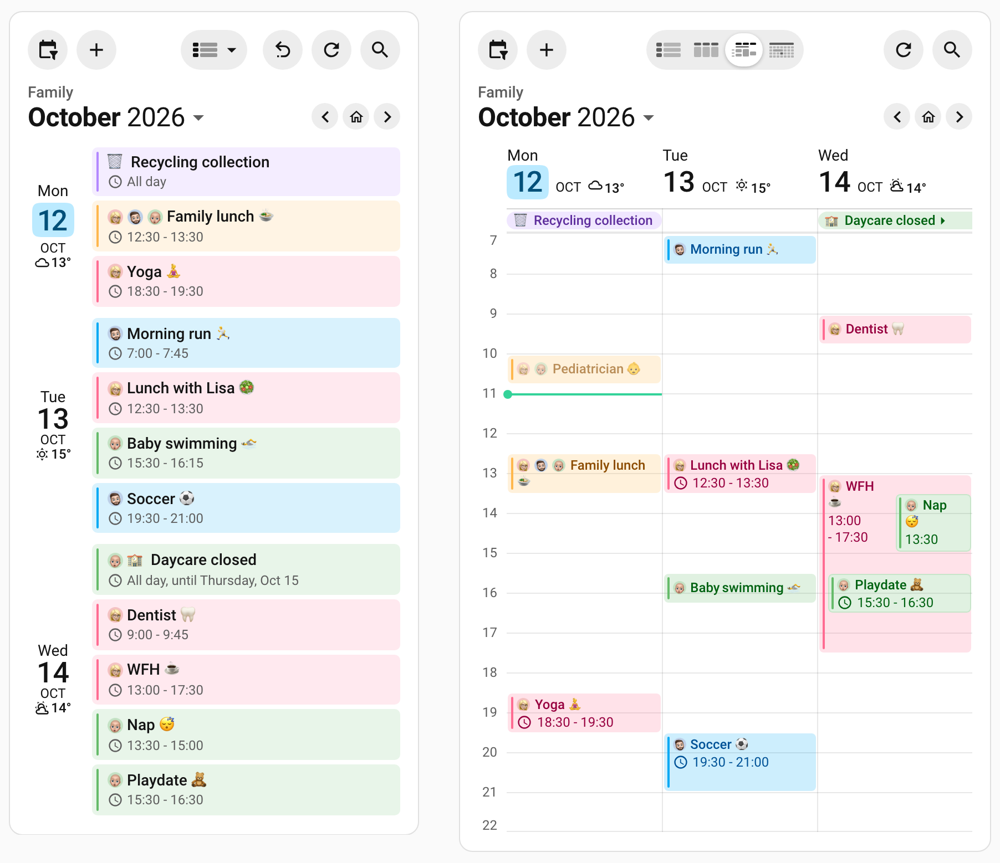

# Header Toolbar

The header toolbar puts the card's own controls in its header, for anyone at the dashboard:
arrows to page through the dates, a view switcher, a calendar filter, refresh, search, an
add-event button and buttons of your own.

## 🧰 Turning the Toolbar On

One option turns the toolbar on, with every control in it except reset.

<br>

The [Family Hub](/guide/family-calendar) on a phone and in a dashboard section. On the phone the switcher shows pictograms, and Reset appears once the layout has been switched; in the section the calendar chips fold into the filter button. On the wall, with room for them, they are chips.

```yaml
type: custom:calendar-card-pro
title: Family
entities:
  - calendar.anna
  - calendar.ben
toolbar:
  show: true
```

With the toolbar on, the header is two rows above the events: the actions in the top row, and
under them the month the days on screen start in, with the arrows at its end. The card's title
becomes a small label over the month, and the month is the card's headline, so `title_font_size`
and `title_color` style it instead. A card without a title has no label over the month. The top
row is left out while it holds no control, and a toolbar with every control turned off draws
nothing at all. With the toolbar off, the header is exactly what it always was.

| Control                                          | Option          | Where                                      | Default               |
| ------------------------------------------------ | --------------- | ------------------------------------------ | --------------------- |
| [Calendar filter](#showing-hiding-calendars)     | `legend`        | Top row, first; chips in the month's row   | `menu`                |
| [Add button](/features/actions#add-event-button) | `add_event`     | Top row, after the filter's button, if any | On                    |
| [Your own buttons](#your-own-buttons)            | `buttons`       | Top row, after the add button, if any      | None                  |
| [View switcher](#switching-between-layouts)      | `view_switcher` | Top row, in the middle                     | On                    |
| [Reset](#resetting-the-card)                     | `reset`         | Top row, before refresh                    | Off                   |
| [Refresh](#refreshing-the-events)                | `refresh`       | Top row, after reset                       | On                    |
| [Search](#searching-the-card)                    | `search`        | Top row, last                              | On, with `navigation` |
| [Date navigation](#paging-through-dates)         | `navigation`    | Month's row, at the end                    | On                    |

Each control can be turned on or off inside the block. `show: false` hides the whole toolbar and
keeps those choices for when it is turned back on:

```yaml
toolbar:
  show: true
  reset: false
```

The commands in the top row are icons, each named in its tooltip by Home Assistant's own word,
and your own buttons by their `name`. The view switcher names its layouts in words, List, Columns,
Grid and Month, wherever the card is wide enough for them beside the commands, and shows a
pictogram for each where it is not, with the name as its tooltip.

::: details Narrow Cards & Languages

- A language with longer words keeps the switcher's pictograms until its words fit.
- The month and the calendar chips are always words, and the arrows and the home button are
  always icons.
- On a narrow card the add button and your own buttons fold into a menu; see
  [Your Own Buttons](#your-own-buttons). Narrower still, the view switcher folds into one button;
  see [Switching Between Layouts](#switching-between-layouts).

:::

The toolbar's options are listed under [Header](/reference/configuration#header) in the
configuration reference.

## 📆 Paging Through Dates

The date navigation lets anyone look ahead or back without editing the card. Arrows at the end
of the month's row page through the days, the month opens a date picker, and the house between
the arrows returns to the days the card opens with. It comes with the toolbar, and on a touch
screen a swipe pages too.

<video class="clip" src="https://raw.githubusercontent.com/alexpfau/calendar-card-pro/main/.github/img/clip_swipe.mp4#t=0.001" width="390" height="685" loop muted playsinline controls preload="auto" aria-label="A two-day list card on a phone: two swipes to the left page forward to Wednesday and then Friday, and two swipes to the right page back to Monday"></video><br>

On a phone, a swipe to the left shows the next days and a swipe to the right the previous ones.

```yaml
type: custom:calendar-card-pro
entities:
  - calendar.anna
  - calendar.ben
days_to_show: 7
start_date: start_of_week
toolbar:
  show: true
```

- **The arrows** move by as many days as the card shows, a week here. Where Columns or Grid
  draw fewer days on a narrow card, they move by the days drawn, so no day is skipped. A layout
  with its own `days_to_show` pages by its own count, and Month moves a whole month; see
  [Paging Through Months](/features/month-view#paging-through-months).
- **The house** returns to the days the card opens with, the window
  [`start_date`](/features/start-date-offset) sets. Its tooltip says "Today", or names the day
  the window starts on when that window does not include today (`start_date: today+7`, a fixed
  date). In Month it says "Today" while the month shown is today's, and otherwise names that
  month.
- **The month** names the page by its first day: the week of November 30 to December 6 reads
  "November 2026". Press it to pick a day in the browser's date picker, and the card shows the
  page that holds that day, lined up with its usual pages, so a week card still starts its week
  on the usual day. On a narrow card the month is shortened to "Nov 2026".
- **A swipe** across the days on a touch screen pages as the arrows do, the other way round in
  right-to-left languages. A tap on an event still opens it, a swipe that starts on one never
  does, and scrolling up and down works as before. A mouse uses the arrows.

`navigation: false` removes the arrows and swiping, and leaves the month as plain text.

While the card is paged away from its own days:

- ended events are shown, dimmed, even with `show_past_events: false`;
- `hide_when_empty` does not hide the card, so an empty page keeps its arrows (on the card's
  own days it hides the card as before);
- the add button suggests the first day on screen, unless the page includes today.

The page is never saved. A reload, a change to the card's configuration, the dashboard entering
edit mode and the [reset button](#resetting-the-card) all bring the card back to its own days.
Switching layouts keeps the date in view; see [Switching Between Layouts](#switching-between-layouts).

::: details More About Paging

- The month's tooltip gives the exact dates on screen, and a screen reader announces them after
  each press. The date picker is the browser's, so it speaks the browser's language rather than
  the card's; pressing the month again closes it.
- On a card narrower still, the month is cut short. Which form is drawn follows the card's width
  and language, never the month on screen, so it does not change as you page.
- With reduced motion turned on in the device's settings, a swipe changes the page without any
  movement.
- Swiping is left alone at the very edge of the screen, where the browser and the Home Assistant
  app have swipes of their own. A grid that
  [`min_days_fallback: cramp`](/features/grid-view#fitting-narrow-cards) has crammed narrower
  than `min_day_width` scrolls sideways under the finger instead, and pages with the arrows only.
- At midnight a paged card stays on its dates while its own days move on.
- A list in [latest-first order](/features/list-view#event-order) is named by the day at its
  top, its last: the month, the house's tooltip away from today and the date picker all read
  that day. The arrows still move forward and back in time.
- The pages you have seen are kept in memory while the dashboard is open; see
  [What the Card Keeps](/features/performance#what-the-card-keeps).

:::

::: tip Nothing Pages While You Edit
In the card editor's preview, and on a dashboard in edit mode, the date navigation is drawn but
does nothing, and the card shows the days it opens with.
:::

## 🔀 Switching Between Layouts

The view switcher lets each device show the card as List, Columns, Grid or Month without editing
it, so a wall tablet can show Grid while a phone keeps List. It comes with the toolbar, wherever
the card offers more than one layout.

<video class="clip" src="https://raw.githubusercontent.com/alexpfau/calendar-card-pro/main/.github/img/clip_view_switcher.mp4#t=0.001" width="740" height="728" loop muted playsinline controls preload="auto" aria-label="Two days of a family's calendar on a tablet in Grid; a tap on Columns lays the same two days out side by side, a tap on List stacks them under their dates, and a tap on Grid brings back the time grid"></video><br>

Each press redraws the same two days: as Columns, then as List, then as Grid again.

It offers all four layouts by default. `view_switcher_layouts` offers those it names, and the
layout in `view` always, whether the list names it or not:

```yaml
toolbar:
  show: true
  view_switcher_layouts: [list, grid]
```

::: warning Changed In v6
The switcher now offers Month too. A card that can switch to Month loads its six weeks as well as
its own days, and with `hide_when_empty` it stays on the dashboard while the month holds an event,
even when its own days are empty. To offer only the three layouts of v5, name them:

```yaml
toolbar:
  show: true
  view_switcher_layouts: [list, column, grid]
```

See [What Else Changes on an Existing Card](/guide/upgrading#what-else-changes-on-an-existing-card).
:::

- **The configured `view` is where the card starts.** Each device remembers its own switch in its
  browser, never in the configuration. A change to the card's configuration returns every device
  to `view`, and the [reset button](#resetting-the-card) returns one.
- **The same days, nothing reloaded.** List, Columns and Grid start on the same date, since
  `start_date` is shared, and Month opens the month holding it. `days_to_show` is shared too,
  unless a layout sets its own; see
  [Showing a Different Number of Days in Each Layout](/features/layouts#showing-a-different-number-of-days-in-each-layout).
  Options set in a layout's own `list:`, `column:`, `time_grid:` or `month:` block come with it.
- **Columns and Grid need room.** On a card too narrow for even their fewest days, two for
  Columns and one for Grid by default, they draw as a list until the card is wide enough again.
  See [Column View](/features/column-view) and [Grid View](/features/grid-view).
- **On a phone it folds into one button.** Where the top row has no room for a pictogram per
  layout, the switcher becomes one wider button showing the picked layout's pictogram and a small
  arrow, so the top row stays on one line. A tap opens a menu of the layouts, each with its
  pictogram and name, the picked one checked. It folds only once the add button and your own
  buttons have moved into their menu, and comes back as the card widens.
- **In the visual editor** the View Switcher chip on Card & Header turns it on and off, and while
  it is pressed, **View Switcher offers**, under the controls, has a checkbox per layout.

::: details More About Switching

- **Your place comes along.** Paged away from the card's own days, or with a day picked on a
  [narrow month](/features/month-view#the-narrow-month), the next layout opens on the same
  date: Month on the month holding it, with that day selected, and List, Columns and Grid on the
  days starting from it. With nothing picked on the card's own days, each layout opens on its
  own, and the home button takes each back there; see
  [Paging Through Months](/features/month-view#paging-through-months).
- **Month opens today's month** when `start_date` is Tomorrow or Start of Week. The card reloads
  its events to switch only to carry you to days it has not loaded yet, such as from a day picked on a narrow
  month, which it loads as paging does.
- **List draws every one of its days; Columns and Grid draw as many as fit** the card's width, as
  close to today as the range allows, or from the first day of a page the
  [date navigation](#paging-through-dates) has moved to. Month always draws six whole weeks; see
  [Month View](/features/month-view).
- **A layout too narrow to draw stays picked.** The switcher still marks it, and draws it once the
  card is wide enough again, as when a tablet is turned. Every layout it offers stays pressable at
  any width.
- **The card's height follows its layout,** so other cards on the dashboard may move when it
  switches.
- **Resizing the card counts as a change.** Even resizing it in a sections dashboard returns every
  device to `view`; see [What the Card Keeps](/features/performance#what-the-card-keeps).
- **A layout left out is also left out of what the card loads,** so leaving `month` out keeps the
  card's load to its own days. A list that comes to one layout, or none, draws no switcher.
  `view_switcher: false` turns the switcher off and keeps the list for when it is turned back on.
- **In the editor's checkboxes** the starting layout's stays checked, and so does the last other
  one. Making the one other layout the list names the one the card opens in adds the layout it
  leaves, so the switcher stays. A list written in YAML that offers the starting layout alone
  shows a line under the checkboxes saying no switcher is drawn until a second layout is checked.

:::

::: tip Nothing Switches While You Edit
In the card editor's preview, and on a dashboard in edit mode, a press on the switcher does
nothing, and its folded button opens no menu. The editor's preview shows the layout whose
[pages you open](/features/editor#options-for-the-selected-view), so open another layout to see
it without changing the card; on the dashboard the card shows its configured `view`.
:::

## 🔄 Refreshing the Events

The refresh button loads the events again now, rather than at the next `refresh_interval`. It
asks Home Assistant for every calendar on the card, however recent the events it holds, which is
how to pick up a change made somewhere else without reloading the dashboard. It is on whenever
the toolbar is, and `refresh: false` takes it away:

```yaml
type: custom:calendar-card-pro
title: Family
entities:
  - calendar.anna
  - calendar.ben
toolbar:
  show: true
  refresh: false
```

While the card loads, the button's icon turns, in place of the small spinner the card otherwise
shows in its corner. After a press it shows a check for a moment, or an alert where a calendar
could not be loaded, and the card names that calendar at its foot, as it
[always does](/features/performance#when-a-calendar-fails-to-load). A press does nothing while
the card is already loading, or until the button is itself again.

The same refresh is available as a [tap or hold action](/features/actions#refreshing-from-a-tap-or-hold),
for a card that should not carry a button.

## 🏷️ Showing & Hiding Calendars

The calendar filter lets anyone hide or show each calendar's events on this device, without
editing the card. It comes with the toolbar as a menu, or as a row of chips that doubles as a
key to the calendars' colors.

<video class="clip" src="https://raw.githubusercontent.com/alexpfau/calendar-card-pro/main/.github/img/clip_calendar_chips.mp4#t=0.001" width="740" height="742" loop muted playsinline controls preload="auto" aria-label="A family's four days in grid view with a chip for each calendar; a tap on Anna's chip hides her events and grays it, a tap on Ben's hides his, and taps on Ben's chip and then Anna's bring them back"></video><br>

Here `legend: chips` hides Anna's events and then Ben's, and a press on Ben's chip and then Anna's shows them again.

By default, `legend: menu`, it is a button at the start of the top row that opens a menu with a
checkbox for each calendar, tinted in that calendar's color and named by its
[`name`](/features/core-settings#naming-a-calendar-in-the-card) where it has one, and as Home
Assistant names it otherwise, under a **Show all** and a **Hide all** button. `legend: chips`
shows a chip for each calendar instead, in the month's row under the view switcher, and
`legend: false` takes the filter away:

```yaml
type: custom:calendar-card-pro
title: Family
entities:
  - entity: calendar.anna
    accent_color: '#e53935'
  - entity: calendar.ben
    accent_color: '#1e88e5'
  - calendar.family
toolbar:
  show: true
  legend: chips
```

In the visual editor, the **Calendar Filter** chip under Card & Header › Toolbar turns the filter
on and off, and while it is pressed, **Calendar Filter shows**, under the controls, picks **Menu**
or **Chips**. Pressed on again, it comes back in the form the card had or was last given there
while the editor is open, else as a menu.

- **Each chip is a switch.** A press hides that calendar's events and turns its chip gray, and
  another press shows them again.
- **Show all and Hide all** sit above the calendars in the menu, so one calendar can be shown
  alone in two presses: Hide all, then that calendar's checkbox. They come with every menu, the
  one chips fold into included, and never sit among the chips. Each is dimmed while it has
  nothing to change.
- **The chips show only where all of them fit** between the month and the arrows. Where they do
  not, the card draws exactly what `legend: menu` draws, never some of the chips, and they come
  back once the card is wide enough again, as when a tablet is turned.
- **The filter button carries a dot** while any calendar is hidden, so a card filtered behind a
  closed menu still says so.

Each device remembers which calendars it hides, as it remembers its
[layout](#switching-between-layouts). A change to the card's configuration shows every calendar
again on every device, and the [reset button](#resetting-the-card) shows them all again on one.

::: details More About the Filter

- **Hiding changes what is drawn, never what is loaded,** so a press redraws at once and costs no
  request; a hidden calendar that fails to load is still named at the card's foot.
- **Everything that counts events counts only those of the calendars shown.** With
  `filter_duplicates`, an event two calendars share is drawn from the first calendar shown, so
  hiding the one that drew it hands it to the next instead of removing it.
  `compact_events_to_show` and `compact_days_to_show` are filled from the calendars shown, so
  hiding one lets more of the others in.
- **`hide_when_empty`** acts only while every calendar is shown. A card emptied by the filter
  stays, with its filter, so the calendars can be brought back.
- Opening the editor and closing it without a change forgets nothing, and paging and switching
  layouts keep the hidden calendars.
- A calendar listed twice, such as one split by `event_type`, is listed once, in the color of its
  first entry.
- A calendar can be left out of the filter altogether; see
  [Leaving a Calendar Out of the Filter](#leaving-a-calendar-out-of-the-filter).
- A calendar its [visibility conditions](/features/core-settings#showing-a-calendar-under-conditions)
  hide has no chip or row while they hide it, and the filter cannot bring it back.
- A long name is cut short on its chip with an ellipsis, and shows in full as the chip's tooltip.
- Two cards with the same configuration share their hidden calendars, and a press on either
  changes both at once, in other tabs and windows of the same browser too.

:::

::: tip Nothing Hides While You Edit
In the card editor's preview, and on a dashboard in edit mode, every calendar is shown, and the
chips and the filter button do nothing.
:::

## 🙈 Leaving a Calendar Out of the Filter

`show_in_legend: false` leaves one calendar out of the calendar filter, for a calendar that is on
the card to be seen rather than filtered. It takes no chip and no row in the menu, and its events
always show, Hide all included, since nothing is left that could hide them.

```yaml
type: custom:calendar-card-pro
title: Family
entities:
  - entity: calendar.anna
    accent_color: '#e53935'
  - entity: calendar.ben
    accent_color: '#1e88e5'
  - entity: calendar.school_holidays
    accent_color: '#1e88e5'
    show_in_legend: false
toolbar:
  show: true
  legend: chips
```

| Option           | Type    | Default | Description                                                                                                                                   |
| ---------------- | ------- | ------- | --------------------------------------------------------------------------------------------------------------------------------------------- |
| `show_in_legend` | boolean | `true`  | Set on one calendar in `entities`. `false` leaves that calendar out of the calendar filter, as a chip and in the menu; its events always show |

Here the filter has a chip for Anna and one for Ben, and the school holidays are drawn in Ben's
blue without a chip of their own.

- **Its events always show,** even on a device that hid the calendar before it was left out.
- **A card whose every calendar is left out has no filter,** exactly as with `legend: false`.
- **In the visual editor** it is the **Show in Calendar Filter** switch on each calendar's page,
  under **Name & Look**, offered while the toolbar shows a filter.

::: details Calendars Listed Twice

The option belongs to the calendar, not to one entry in `entities`. The
[visual editor](/features/editor#entry-pages) writes it to every entry for that calendar, and in
YAML the first entry that sets it wins.

:::

## ↩️ Resetting the Card

The reset button undoes, in one press, every choice made on this device. It is for a card
several people share, such as a wall tablet, where a week someone paged to or a calendar someone
hid would otherwise stay for whoever walks up next. It is off unless you turn it on:

```yaml
type: custom:calendar-card-pro
title: Family
entities:
  - calendar.anna
  - calendar.ben
toolbar:
  show: true
  reset: true
```

On a card only you use, leave it off: a layout you pick on the view switcher is your preference
for that device, and the button would otherwise keep offering to undo it.

One press brings back all of these at once:

- **The days the card opens with,** from any page the arrows or the date picker reached, as the
  home button does.
- **The configured `view`,** from a layout the [view switcher](#switching-between-layouts)
  picked. Where the card is too narrow for it, List stands in for it, as it always does.
- **Every calendar,** from any the [calendar filter](#showing-hiding-calendars) hid.
- **A compact card collapsed,** after a tap or hold with the
  [`expand` action](/features/actions#expandable-calendar-card) opened it.

The button, a U-turn arrow, is hidden while the card already shows how it is set up, or only
dimmed where it is the top row's only control, and appears the moment something is changed, so
a glance at the card says whether someone left it on a choice of their own. It is drawn only on a card with something it could undo: the date
navigation, the view switcher, the calendar filter, or an `expand` action.

The card never goes back by itself. A layout and hidden calendars stay until someone presses the
button or the card is edited, and a page until then or a reload. A press forgets what the device
remembered, its layout and its hidden calendars, on that device only, and loads nothing again
unless the card's own days are due for a refresh anyway.

The same reset can run from a tap or a hold on the card, with or without the button, through the
[`reset` action](/features/actions#resetting-from-a-tap-or-hold).

::: warning Its Name Needs Home Assistant 2026.2
The button takes its name from Home Assistant, which has had a word for "Reset" since 2026.2.
On an older version it is the same icon without a tooltip, and screen readers hear it in
English. Nothing else in the toolbar changes.
:::

::: details More About Reset

- A layout picked on the switcher counts even where the card is too narrow for it and draws the
  same list the configured layout would: the switcher marks the pick, and a press moves the mark
  back to the configured layout.
- Another card with the same configuration shows every calendar again at once, as it does after a
  press on the filter, including one open in another tab of the same browser. Its layout stays
  until that card is reset, reloaded or edited.

:::

::: tip Nothing Resets While You Edit
In the card editor's preview, and on a dashboard in edit mode, the button is hidden and does
nothing. What each device remembers is kept for when editing ends.
:::

## 🔘 Your Own Buttons

The toolbar can carry buttons of your own, each an icon and an action, at the start of the top
row after the add button, in the order you write them. Here, a way back to the page you came
from, and one to the main dashboard:

```yaml
type: custom:calendar-card-pro
title: Family
entities:
  - calendar.anna
  - calendar.ben
toolbar:
  show: true
  buttons:
    - icon: mdi:arrow-left
      name: Back
      tap_action:
        action: back
    - icon: mdi:view-dashboard-outline
      name: Main dashboard
      tap_action:
        action: navigate
        navigation_path: /lovelace/0
```

A press runs the button's `tap_action`, as a tap on the card runs the card's: any of
[Home Assistant's actions](/features/actions#available-actions), or one of the card's own,
`back`, `refresh`, `add-event`, `reset` or `expand`. `add-event` opens the
[event popover](/features/actions#the-event-popover) right under the button. For `toggle` and
`more-info`, `entity` names what the button acts on; without one it is the card's first
calendar. A button with no action, or with `none`, is drawn and does nothing, and buttons answer
a tap only, not a hold.

Give each button a `name`. It is the button's tooltip and what screen readers announce. Without
one, a button running `back`, `refresh`, `add-event` or `reset` takes Home Assistant's own word
for it, as the toolbar's own buttons do; any other is named after its icon,
"view dashboard outline", for screen readers alone. An entry with no `icon`, or with a field of
the wrong kind, is left out.

`back` goes back to the page you came from, as the arrow in Home Assistant's own header does.
Where there is none, as in a new tab, a bookmark or the first page a wall tablet shows, it shows
the page its `navigation_path` names instead, or else the first view of this dashboard; see
[Going Back From a Tap or Hold](/features/actions#going-back-from-a-tap-or-hold). In a language
read right to left the top row is mirrored, and an icon is drawn as you chose it, so pick
`mdi:arrow-right` for a back button there.

On a narrow card your buttons, and then the add button, move into a menu button, three dots, and
come back into the row as the card widens.

In the [visual editor](/features/editor#pages-back), the buttons are on the **Card & Header**
page under **Your Own Buttons** while the toolbar is shown, a row for each with **Move Up**,
**Move Down**, **Remove** and a handle to drag it into place. Each row holds **Icon**, **Name**,
**Entity** and **Tap Action**. **Add Button**, after the last, adds one with the
`mdi:gesture-tap-button` icon for you to change, and **Tap Action** offers the card's own actions
first, **Go Back** among them. The editor has no field for `back`'s `navigation_path`; write that
in YAML.

::: details Buttons on Narrow Cards

- The top row gives way in a fixed order: the view switcher's words become pictograms first, then
  controls move into the menu, your last button first, and last the switcher folds into one
  button.
- The first control in the row, the calendar filter's button wherever it is drawn, stays at any
  width, so the narrowest top row is that button and the menu button, the folded switcher, and
  the controls at the row's end.
- Reset, refresh and search never move into the menu. A card too narrow even for the narrowest
  top row, under 314px with all three, puts them on a line of their own.
- The menu lists what it holds in the order the row draws it, each with its icon and its name in
  words, and a press runs it and closes the menu. The add button there opens the new event under
  the menu button.

:::

::: tip Nothing Runs While You Edit
In the card editor's preview, and on a dashboard in edit mode, your buttons are drawn, folded as
they would be on the dashboard, and do nothing.
:::

## 🔎 Searching the Card

The search button finds the card's events a year back and a year ahead, by what they are called,
where they are and what they say. It is on whenever the toolbar is, beside the
[date navigation](#paging-through-dates) it needs to open a result's day.

<video class="clip" src="https://raw.githubusercontent.com/alexpfau/calendar-card-pro/main/.github/img/clip_search.mp4#t=0.001" width="740" height="794" loop muted playsinline controls preload="auto" aria-label="A tap on the magnifier opens the search field; zoo is typed, the matching events are listed by month, and a tap on the January result turns the card to that week and rings the event"></video><br>

Type, and the matches are listed under the field by month. A pick turns the card to that day and rings the event.

`search: false` takes the magnifier away, and so does `navigation: false`:

```yaml
type: custom:calendar-card-pro
title: Family
entities:
  - calendar.anna
  - calendar.ben
toolbar:
  show: true
  search: false
```

- **Typing** lists the events whose title, location or description hold what you typed, whatever
  the case and the accents: "zurich" finds "Zürich". Upcoming events come first, soonest first,
  then the past, most recent first and dimmed, each grouped under its month. At most 200 are
  listed, the past's oldest left out first.
- **Picking a result,** with a press, or with the arrow keys and Enter, pages the card to that day
  in the layout on screen and rings the event in the theme's primary color for two seconds. The
  [home button](#paging-through-dates) brings the card back, as after any page.
- **A search finds only what the card would show** on some page, in the words it would show: a
  calendar's own filters apply, and a calendar hidden with the
  [calendar filter](#showing-hiding-calendars) stays hidden.

The first time the panel opens, the card loads two years of every calendar, which can take a
while with CalDAV; see [How Search Loads](/features/performance#how-search-loads). Until a
calendar answers, the search finds the events the card already holds.

::: details What a Search Finds

- **A calendar's own filters apply,** `blocklist`, `allowlist`, `days_of_week`, `event_type` and
  the rest.
- **`filter_duplicates` lists an event two calendars share once,** as the card draws it. Where
  a calendar's `days_of_week` leaves it out of some of a multi-day event's days, the days it
  shares are listed apart, with every location `merge_locations` draws there and every calendar,
  and picking that result opens the first of them.
- **A title is searched as `replace_pattern` rewrites it,** and a location without the country
  `remove_location_country` takes away. A location or a description the card does not show, with
  `show_location` or `show_description` off, is not searched, nor is a description in
  [Month](/features/month-view#options-that-do-nothing-in-month-view), which draws none. The
  event's popover still shows them; to keep a calendar's text off the card, use
  [`private: true`](/features/core-settings#keeping-a-calendar-private).
- **The layout on screen decides what is drawn,** since a pick turns the card to a day in that
  layout. In the [grid](/features/grid-view#choosing-the-hours-the-card-shows) a timed event
  outside the hours from `start_time` to `end_time` is not found, and the grid draws no location
  unless its `time_grid` block turns `show_location` on.
- **`show_past_events` does not apply.** A search spans its own two years, whatever days the card
  shows.
- **A result** shows its calendar's color, its title, and its day, time and location, with what
  you typed marked. The past is set off from the upcoming events by a thin line.
- **Where the page cannot show a picked event,** the card turns to that day all the same and rings
  nothing: past a compact card's limit, in a column the card is too narrow for, and for an event
  that has ended on the days the card opens with while `show_past_events` is off. A pick closes
  the panel and lines the card up with its pages as the date picker does.
- Page elsewhere before the result's day has loaded, and nothing is ringed when you come back
  to it.

:::

::: details Loading, Languages & Screen Readers

- Google Calendar may leave out one-off events more than about 90 days old; see
  [How Search Loads](/features/performance#how-search-loads).
- If the calendars take more than a second to answer, a small spinner stands in the field in
  place of the magnifier until they have. A calendar that cannot be loaded is named under the
  results, its events left out, and is asked again the next time the panel opens.
- On a card in Turkish, "ikea" finds "IKEA" although Turkish writes its lower case "ıkea".
- Once you stop typing, a screen reader hears how many results there are in all. After a pick,
  focus moves to the event where a tap on it does something, and stays on the magnifier where it
  does not. With reduced motion turned on, the ring does not fade out and the spinner in the field
  stands still.
- Every word the panel shows is Home Assistant's own, in its language. On a phone the panel is a
  sheet from the bottom of the screen, and while you type it stands on the on-screen keyboard,
  the field and the results above the keys. Held sideways, it moves up out of the keyboard's way.

:::

::: tip Nothing Searches While You Edit
In the card editor's preview, and on a dashboard in edit mode, the magnifier is drawn and does
nothing.
:::

## 👆 Larger Arrows & Chips

For a touch screen, `size: large` draws the arrows, the home button and the calendar chips beside
the month nearly as large as the buttons in the top row, so a finger finds them easily. They are
spaced as those buttons are, and their icons are drawn with the same lines.

```yaml
type: custom:calendar-card-pro
title: Family
entities:
  - calendar.anna
  - calendar.ben
toolbar:
  show: true
  legend: chips
  size: large
```

- The top row, the month and the filter's menu keep their size.
- Larger chips need more room, so on a narrower card they fold into the
  [filter's button](#showing-hiding-calendars) sooner, and the month takes its short form sooner
  beside the larger arrows.
- The size belongs to the card, so a phone showing the same dashboard draws them large too.
- In the [visual editor](/features/editor) it is **Arrow & Chip Size** under Toolbar, where the
  usual size is called Small.

**→ [Header in the configuration reference](/reference/configuration#header)** — every toolbar option.
