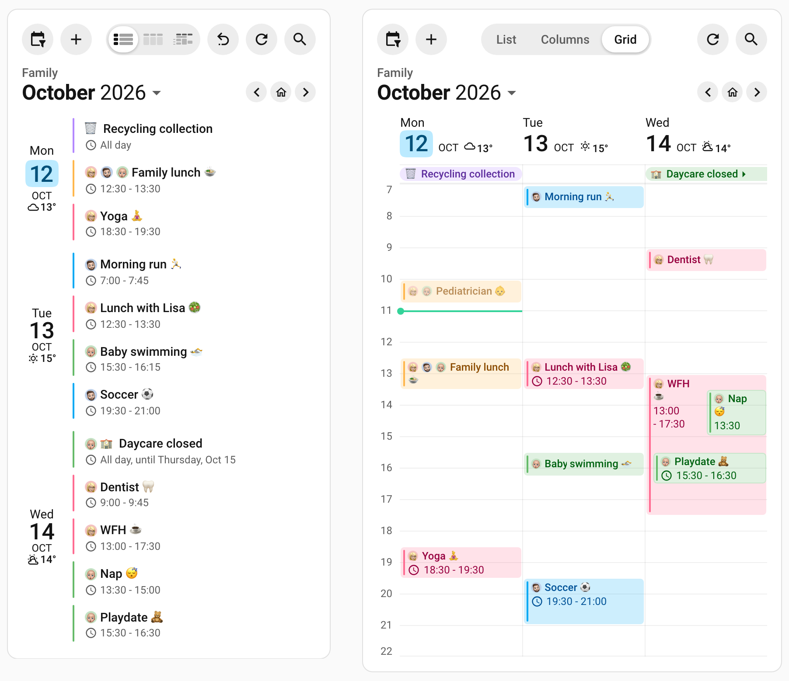
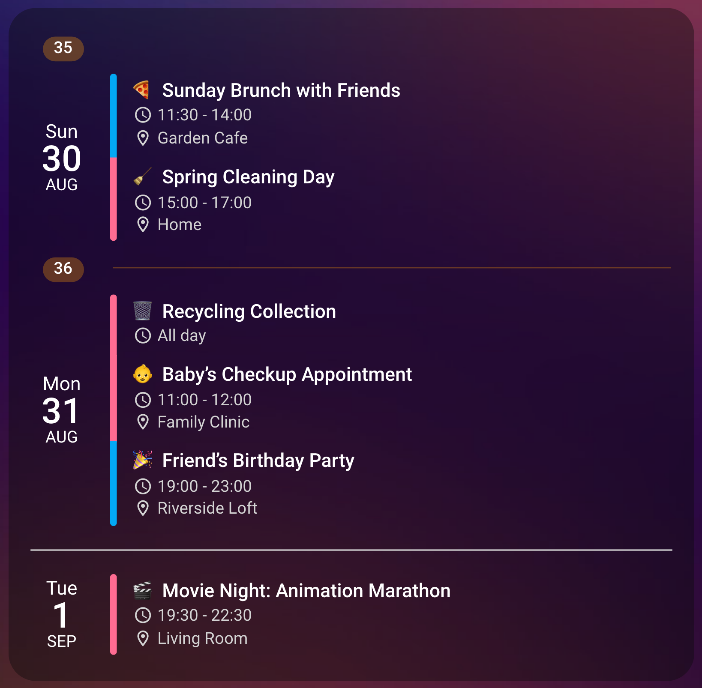
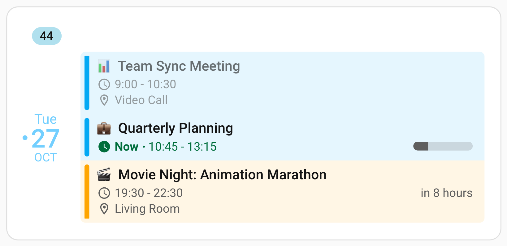

# Layout & Appearance

These options control how the card looks rather than what it shows: its dimensions and scrolling behavior, its colors and fonts, its header toolbar, the spacing between elements, and the styling of the date column, week numbers and today indicator.

## 📐 Card Dimensions & Scrolling

Calendar Card Pro offers flexible options for controlling the card's size and scroll behavior:

```yaml
# Fixed height - card always maintains exactly this height
height: '300px'

# Maximum height - card grows with content up to this height
max_height: '300px'

# Additional padding inside the card
additional_card_spacing: '10px'
```

The card offers two distinct height control mechanisms:

- **Fixed Height (`height`)**: Creates a calendar content area with exactly the specified height regardless of content amount. The full card also includes its header and card padding, so use the dashboard's layout controls when its outer height must fit a specific space.

- **Maximum Height (`max_height`)**: Allows the calendar content area to grow naturally up to the specified limit. This provides flexibility while still ensuring its event content does not become too large.

In list and column views, both options scroll when content exceeds the available space.
In grid view a fixed `height` compresses the time axis instead — see
[Height in Grid View](#height-in-grid-view). `max_height` still scrolls in every view.

Scrollbars are modern and clean, appearing only during hover or scrolling, and behave the
same on desktop and mobile.

### Height in Column View

Both options work the same way when the card renders as columns, and both may be
overridden inside a `column:` block. That matters more here than it looks: the same events
laid out side by side are far shorter than they are stacked, so a `max_height` tuned for
the list layout often never comes into play in column view — and one tuned for columns
would truncate the list badly.

```yaml
view: column
max_height: '600px'
column:
  max_height: '320px'
```

What scrolls is the **whole card**, not an individual day. The columns sit inside one
scrolling area, so the day headers move together with their events and nothing scrolls out
of alignment with its neighbors. The column layout is exactly as tall as its tallest day,
which means a quiet day leaves empty space beneath its last event rather than stretching
to match — the events stay anchored under their header.

::: tip Sizing From The Dashboard Instead
Home Assistant's own layout controls (⋮ → **Edit** → **Layout**) can constrain the card
too, and they scroll it the same way. Use them when a row height is precise enough;
reach for `max_height` when you want an exact pixel value, or a different limit per view.
:::

### Height in Grid View

In grid view a fixed `height` compresses the time axis rather than scrolling, and `hour_height`
stops applying: the hours, the events and the now line squeeze into the room left after the day
headers and the all-day band. The header and card padding sit outside that room, so use the
dashboard's layout controls when the outer card needs a particular size. `max_height` still caps
and scrolls, as in the other views.

Both options may be overridden inside a `time_grid:` block, so the grid can have a height of its
own:

```yaml
view: grid
height: 400px # List and column view
time_grid:
  height: 600px # Grid view only
```

::: details Very Short Fixed Heights
The time body keeps at least half the configured height, and a tall all-day band scrolls in what
the day headers leave above it. Around `180px` the band is down to a row or two. Below about
twice the header height it is a sliver whose events are still there but reached only by
scrolling or the keyboard, and the bottom of the card starts to clip the time axis.
:::

**→ [How Tall an Hour Is](/features/grid-view#how-tall-an-hour-is)** — `hour_height` and when a fixed height takes over.

## 🎨 Visual Styling & Colors

These options set the card's background and title, and how strongly each event is tinted and
marked:

```yaml
# Card background and title
title: 'My Calendar'
title_font_size: '20px'
title_color: 'var(--primary-color)'
background_color: 'var(--ha-card-background)'

# Event appearance
event_background_opacity: 15 # 0-100 scale for background color intensity
vertical_line_width: '3px' # Width of the accent bar beside each event
```

`event_background_opacity`, from 0 to 100, gives each event a background in its calendar's
`accent_color`, stronger the higher it goes. At 0, the default in list and column view, events
have no background; grid view [starts at 20](/features/grid-view#options-that-start-from-a-different-default).
With a background, each day's events form one rounded block, and every event keeps its own
accent bar inside it. Without one, the accent bar is the day's edge: the bars of touching events
join into one line, changing color where one calendar's event meets another's. To give each
event a bar of its own without a background, set [`event_gap`](#gaps-between-events); even `1px`
does it.

`vertical_line_width` sets the accent bar's width as a CSS length, or `thin`, `medium` and
`thick`, which mean `1px`, `3px` and `5px`. `0px` or `none` hides it, and anything else falls
back to `2px`.

`title_font_size` takes any CSS font size, as the
[date column's font sizes](#date-column-customization) do. A value that is not one is ignored,
and the title keeps Home Assistant's card header size. The header can also hold a
[toolbar](#header-toolbar) with arrows to page through the dates, a view switcher and an
add-event button.

Colors can be written as:

- CSS color values (`#ff6c92`, `rgba(255,0,0,0.5)`)
- Home Assistant theme variables (`var(--primary-color)`)
- Named colors (`red`, `blue`)

`accent_color` follows your theme's primary color by default, `var(--primary-color, #03a9f4)`,
so a calendar you have not colored takes a custom theme's accent. Set it card-wide, or for one
calendar in its `entities` entry, to choose a color yourself.

::: warning Changed In v5
Before v5, `accent_color` and `today_indicator_color` were a fixed `#03a9f4`, and the
week-number pill and week separator a fixed `#03a9f450`. To keep the old blue, add
`accent_color: '#03a9f4'` to your card or to a calendar's entry, `today_indicator_color: '#03a9f4'`,
and `'#03a9f450'` for `week_number_background_color` and `week_separator_color`.
:::

`accent_color` accepts one more value: `home-assistant`, which follows the color Home
Assistant holds for each calendar instead of a color you pick here. Named colors such as
`red` are unaffected and still mean the CSS color.

**→ [Using the Colors From Home Assistant](/features/core-settings#using-the-colors-from-home-assistant)** — how to set it, and what happens for calendars that have no color.

## 🧰 Header Toolbar

The header toolbar puts the card's own controls in its header, for anyone at the dashboard:
arrows to page through the dates, a view switcher, a calendar filter, refresh, search, an
add-event button and buttons of your own. One option turns it on, with every control in it
except reset.

<br>

The [Family Hub](/guide/family-calendar) on a phone and in a dashboard section. On the phone the switcher shows pictograms, and Reset appears once the layout has been switched; in the section the calendar chips fold into the filter button. On the wall, with room for them, they are chips.

```yaml
type: custom:calendar-card-pro
title: Family
entities:
  - calendar.anna
  - calendar.ben
toolbar:
  show: true
```

With the toolbar on, the header is two rows above the events: the actions in the top row, and
under them the month the days on screen start in, with the arrows at its end. The card's title
becomes a small label over the month, and the month is the card's headline, so `title_font_size`
and `title_color` style it instead. A card without a title has no label over the month. The top
row is left out while it holds no control, and a toolbar with every control turned off draws
nothing at all. With the toolbar off, the header is exactly what it always was.

| Control                                          | Option          | Where                                      | Default               |
| ------------------------------------------------ | --------------- | ------------------------------------------ | --------------------- |
| [Calendar filter](#showing-hiding-calendars)     | `legend`        | Top row, first; chips in the month's row   | `menu`                |
| [Add button](/features/actions#add-event-button) | `add_event`     | Top row, after the filter's button, if any | On                    |
| [Your own buttons](#your-own-buttons)            | `buttons`       | Top row, after the add button, if any      | None                  |
| [View switcher](#switching-between-layouts)      | `view_switcher` | Top row, in the middle                     | On                    |
| [Reset](#resetting-the-card)                     | `reset`         | Top row, before refresh                    | Off                   |
| [Refresh](#refreshing-the-events)                | `refresh`       | Top row, after reset                       | On                    |
| [Search](#searching-the-card)                    | `search`        | Top row, last                              | On, with `navigation` |
| [Date navigation](#paging-through-dates)         | `navigation`    | Month's row, at the end                    | On                    |

Each control can be turned on or off inside the block. `show: false` hides the whole toolbar and
keeps those choices for when it is turned back on:

```yaml
toolbar:
  show: true
  reset: false
```

The commands in the top row are icons, each named in its tooltip by Home Assistant's own word,
and your own buttons by their `name`. The view switcher names its layouts in words, List, Columns
and Grid, wherever the card is wide enough for them beside the commands, and shows a pictogram
for each where it is not, with the name as its tooltip.

::: details Narrow Cards & Languages

- A language with longer words keeps the switcher's pictograms until its words fit.
- The month and the calendar chips are always words, and the arrows and the home button are
  always icons.
- On a narrow card the add button and your own buttons fold into a menu; see
  [Your Own Buttons](#your-own-buttons).

:::

The toolbar's options are listed under [Header](/reference/configuration#header) in the
configuration reference.

### Paging Through Dates

The date navigation lets anyone look ahead or back without editing the card. Arrows at the end
of the month's row page through the days, the month opens a date picker, and the house between
the arrows returns to the days the card opens with. It comes with the toolbar, and on a touch
screen a swipe pages too.

<video class="clip" src="https://raw.githubusercontent.com/alexpfau/calendar-card-pro/main/.github/img/clip_swipe.mp4#t=0.001" width="390" height="685" loop muted playsinline controls preload="auto" aria-label="A two-day list card on a phone: two swipes to the left page forward to Wednesday and then Friday, and two swipes to the right page back to Monday"></video><br>

On a phone, a swipe to the left shows the next days and a swipe to the right the previous ones.

```yaml
type: custom:calendar-card-pro
entities:
  - calendar.anna
  - calendar.ben
days_to_show: 7
start_date: start_of_week
toolbar:
  show: true
```

- **The arrows** move by as many days as the card shows, a week here. Where Columns or Grid
  draw fewer days on a narrow card, they move by the days drawn, so no day is skipped. A layout
  with its own `days_to_show` pages by its own count.
- **The house** returns to the days the card opens with, the window
  [`start_date`](/features/start-date-offset) sets. Its tooltip says "Today", or names the day
  the window starts on when that window does not include today (`start_date: today+7`, a fixed
  date).
- **The month** names the page by its first day: the week of November 30 to December 6 reads
  "November 2026". Press it to pick a day in the browser's date picker, and the card shows the
  page that holds that day, lined up with its usual pages, so a week card still starts its week
  on the usual day. On a narrow card the month is shortened to "Nov 2026".
- **A swipe** across the days on a touch screen pages as the arrows do, the other way round in
  right-to-left languages. A tap on an event still opens it, a swipe that starts on one never
  does, and scrolling up and down works as before. A mouse uses the arrows.

`navigation: false` removes the arrows and swiping, and leaves the month as plain text.

While the card is paged away from its own days:

- ended events are shown, dimmed, even with `show_past_events: false`;
- `hide_when_empty` does not hide the card, so an empty page keeps its arrows (on the card's
  own days it hides the card as before);
- the add button suggests the first day on screen, unless the page includes today.

The page is never saved. A reload, a change to the card's configuration, the dashboard entering
edit mode and the [reset button](#resetting-the-card) all bring the card back to its own days.
Switching layouts keeps the page's first day and shows the new layout's own number of days
from it.

::: details More About Paging

- The month's tooltip gives the exact dates on screen, and a screen reader announces them after
  each press. The date picker is the browser's, so it speaks the browser's language rather than
  the card's; pressing the month again closes it.
- On a card narrower still, the month is cut short. Which form is drawn follows the card's width
  and language, never the month on screen, so it does not change as you page.
- With reduced motion turned on in the device's settings, a swipe changes the page without any
  movement.
- Swiping is left alone at the very edge of the screen, where the browser and the Home Assistant
  app have swipes of their own. A grid that
  [`min_days_fallback: cramp`](/features/grid-view#fitting-narrow-cards) has crammed narrower
  than `min_day_width` scrolls sideways under the finger instead, and pages with the arrows only.
- At midnight a paged card stays on its dates while its own days move on.
- A list in [latest-first order](/features/core-settings#event-order) is named by the day at its
  top, its last: the month, the house's tooltip away from today and the date picker all read
  that day. The arrows still move forward and back in time.
- The pages you have seen are kept in memory while the dashboard is open; see
  [What the Card Keeps](/features/performance#what-the-card-keeps).

:::

::: tip Nothing Pages While You Edit
In the card editor's preview, and on a dashboard in edit mode, the date navigation is drawn but
does nothing, and the card shows the days it opens with.
:::

### Switching Between Layouts

The view switcher lets each device show the card as List, Columns or Grid without editing it, so
a wall tablet can show Grid while a phone keeps List. It comes with the toolbar, wherever more
than one layout fits the card.

<video class="clip" src="https://raw.githubusercontent.com/alexpfau/calendar-card-pro/main/.github/img/clip_view_switcher.mp4#t=0.001" width="740" height="728" loop muted playsinline controls preload="auto" aria-label="Two days of a family's calendar on a tablet in Grid; a tap on Columns lays the same two days out side by side, a tap on List stacks them under their dates, and a tap on Grid brings back the time grid"></video><br>

Each press redraws the same two days: as Columns, then as List, then as Grid again.

- **The configured `view` is where the card starts.** Each device remembers its own switch in its
  browser, never in the configuration. A change to the card's configuration, even resizing it in
  a sections dashboard, returns every device to `view`, and the
  [reset button](#resetting-the-card) returns one; see
  [What the Card Keeps](/features/performance#what-the-card-keeps).
- **The same days, nothing reloaded.** Every layout starts on the same date, since `start_date`
  is shared, and the card does not reload its events to switch. `days_to_show` is shared too,
  unless a layout sets its own in its block, say 14 days in List and 7 in Grid; see
  [Showing a Different Number of Days in Each Layout](/features/core-settings#showing-a-different-number-of-days-in-each-layout).
  Options set for one layout in its own `list:`, `column:` or `time_grid:` block come with it.
- **List draws every one of its days; Columns and Grid draw as many as fit** the card's width, as
  close to today as the range allows, or from the first day of a page the
  [date navigation](#paging-through-dates) has moved to.
- **Columns and Grid need room.** A layout that cannot fit at the card's current width, Columns
  on a phone by default, is dimmed in the switcher, and returns when the card is wide enough
  again, as when a tablet is turned. If the layout a device remembers no longer fits, the card
  shows List and the switcher marks it, until there is room again. When only one layout fits,
  there is no switcher at all. See [Column View](/features/column-view) and
  [Grid View](/features/grid-view) for how much room each needs.
- **The card's height follows its layout,** so other cards on the dashboard may move when it
  switches.

::: tip Nothing Switches While You Edit
In the card editor's preview, and on a dashboard in edit mode, the card shows its configured
`view` and a press on the switcher does nothing. To try another layout there, change
**Card Displays** in the editor.
:::

### Refreshing the Events

The refresh button loads the events again now, rather than at the next `refresh_interval`. It
asks Home Assistant for every calendar on the card, however recent the events it holds, which is
how to pick up a change made somewhere else without reloading the dashboard. It is on whenever
the toolbar is, and `refresh: false` takes it away:

```yaml
type: custom:calendar-card-pro
title: Family
entities:
  - calendar.anna
  - calendar.ben
toolbar:
  show: true
  refresh: false
```

While the card loads, the button's icon turns, in place of the small spinner the card otherwise
shows in its corner. After a press it shows a check for a moment, or an alert where a calendar
could not be loaded, and the card names that calendar at its foot, as it
[always does](/features/performance#when-a-calendar-fails-to-load). A press does nothing while
the card is already loading, or until the button is itself again.

The same refresh is available as a [tap or hold action](/features/actions#refreshing-from-a-tap-or-hold),
for a card that should not carry a button.

### Showing & Hiding Calendars

The calendar filter lets anyone hide or show each calendar's events on this device, without
editing the card. It comes with the toolbar as a menu, or as a row of chips that doubles as a
key to the calendars' colors.

<video class="clip" src="https://raw.githubusercontent.com/alexpfau/calendar-card-pro/main/.github/img/clip_calendar_chips.mp4#t=0.001" width="740" height="742" loop muted playsinline controls preload="auto" aria-label="A family's four days in grid view with a chip for each calendar; a tap on Anna's chip hides her events and grays it, a tap on Ben's hides his, and taps on Ben's chip and then Anna's bring them back"></video><br>

Here `legend: chips` hides Anna's events and then Ben's, and a press on Ben's chip and then Anna's shows them again.

By default, `legend: menu`, it is a button at the start of the top row that opens a menu with a
checkbox for each calendar, tinted in that calendar's color and named by its
[`name`](/features/core-settings#naming-a-calendar-in-the-card) where it has one, and as Home
Assistant names it otherwise, under a **Show all** and a **Hide all** button. `legend: chips`
shows a chip for each calendar instead, in the month's row under the view switcher, and
`legend: false` takes the filter away:

```yaml
type: custom:calendar-card-pro
title: Family
entities:
  - entity: calendar.anna
    accent_color: '#e53935'
  - entity: calendar.ben
    accent_color: '#1e88e5'
  - calendar.family
toolbar:
  show: true
  legend: chips
```

- **Each chip is a switch.** A press hides that calendar's events and turns its chip gray, and
  another press shows them again.
- **Show all and Hide all** sit above the calendars in the menu, so one calendar can be shown
  alone in two presses: Hide all, then that calendar's checkbox. They come with every menu, the
  one chips fold into included, and never sit among the chips. Each is dimmed while it has
  nothing to change.
- **The chips show only where all of them fit** between the month and the arrows. Where they do
  not, the card draws exactly what `legend: menu` draws, never some of the chips, and they come
  back once the card is wide enough again, as when a tablet is turned.
- **The filter button carries a dot** while any calendar is hidden, so a card filtered behind a
  closed menu still says so.

Hiding changes what is drawn, never what is loaded, so a press redraws at once and costs no
request; a hidden calendar that fails to load is still named at the card's foot. Everything that
counts events counts only those of the calendars shown:

- **Duplicates.** With `filter_duplicates`, an event two calendars share is drawn from the first
  calendar shown, so hiding the one that drew it hands it to the next instead of removing it.
- **Compact limits.** `compact_events_to_show` and `compact_days_to_show` are filled from the
  calendars shown, so hiding one lets more of the others in.
- **`hide_when_empty`** acts only while every calendar is shown. A card emptied by the filter
  stays, with its filter, so the calendars can be brought back.

Each device remembers which calendars it hides, as it remembers its
[layout](#switching-between-layouts). A change to the card's configuration shows every calendar
again on every device, while opening the editor and closing it without a change forgets nothing.
The [reset button](#resetting-the-card) shows them all again on one device. Paging and switching
layouts keep them.

::: details More About the Filter

- A calendar listed twice, such as one split by `event_type`, is listed once, in the color of its
  first entry.
- A calendar can be left out of the filter altogether; see
  [Leaving a Calendar Out of the Filter](#leaving-a-calendar-out-of-the-filter).
- A calendar its [visibility conditions](/features/core-settings#showing-a-calendar-under-conditions)
  hide has no chip or row while they hide it, and the filter cannot bring it back.
- A long name is cut short on its chip with an ellipsis, and shows in full as the chip's tooltip.
- Two cards with the same configuration share their hidden calendars, and a press on either
  changes both at once, in other tabs and windows of the same browser too.

:::

::: tip Nothing Hides While You Edit
In the card editor's preview, and on a dashboard in edit mode, every calendar is shown, and the
chips and the filter button do nothing.
:::

### Leaving a Calendar Out of the Filter

`show_in_legend: false` leaves one calendar out of the calendar filter, for a calendar that is on
the card to be seen rather than filtered. It takes no chip and no row in the menu, and its events
always show, Hide all included, since nothing is left that could hide them.

```yaml
type: custom:calendar-card-pro
title: Family
entities:
  - entity: calendar.anna
    accent_color: '#e53935'
  - entity: calendar.ben
    accent_color: '#1e88e5'
  - entity: calendar.school_holidays
    accent_color: '#1e88e5'
    show_in_legend: false
toolbar:
  show: true
  legend: chips
```

| Option           | Type    | Default | Description                                                                                                                                   |
| ---------------- | ------- | ------- | --------------------------------------------------------------------------------------------------------------------------------------------- |
| `show_in_legend` | boolean | `true`  | Set on one calendar in `entities`. `false` leaves that calendar out of the calendar filter, as a chip and in the menu; its events always show |

Here the filter has a chip for Anna and one for Ben, and the school holidays are drawn in Ben's
blue without a chip of their own.

- **Its events always show,** even on a device that hid the calendar before it was left out.
- **A card whose every calendar is left out has no filter,** exactly as with `legend: false`.
- **In the visual editor** it is the **Show in Calendar Filter** switch under each calendar's
  **Name**, offered while the toolbar shows a filter.

::: details Calendars Listed Twice

The setting belongs to the calendar, not to one entry in `entities`. The
[visual editor](/features/editor#per-calendar-panels-actions) writes it to every entry for that
calendar, and in YAML the first entry that sets it wins.

:::

### Resetting the Card

The reset button undoes, in one press, every choice made on this device. It is for a card
several people share, such as a wall tablet, where a week someone paged to or a calendar someone
hid would otherwise stay for whoever walks up next. It is off unless you turn it on:

```yaml
type: custom:calendar-card-pro
title: Family
entities:
  - calendar.anna
  - calendar.ben
toolbar:
  show: true
  reset: true
```

On a card only you use, leave it off: a layout you pick on the view switcher is your preference
for that device, and the button would otherwise keep offering to undo it.

One press brings back all of these at once:

- **The days the card opens with,** from any page the arrows or the date picker reached, as the
  home button does.
- **The configured `view`,** from a layout the [view switcher](#switching-between-layouts)
  picked. Where the card is too narrow for it, List stands in for it, as it always does.
- **Every calendar,** from any the [calendar filter](#showing-hiding-calendars) hid.
- **A compact card collapsed,** after a tap or hold with the
  [`expand` action](/features/actions#expandable-calendar-card) opened it.

The button, a U-turn arrow, is hidden while the card already shows how it is set up, or only
dimmed where it is the top row's only control, and appears the moment something is changed, so
a glance at the card says whether someone left it on a choice of their own. It is drawn only on a card with something it could undo: the date
navigation, the view switcher, the calendar filter, or an `expand` action.

The card never goes back by itself. A layout and hidden calendars stay until someone presses the
button or the card is edited, and a page until then or a reload. A press forgets what the device
remembered, its layout and its hidden calendars, on that device only, and loads nothing again
unless the card's own days are due for a refresh anyway.

The same reset can run from a tap or a hold on the card, with or without the button, through the
[`reset` action](/features/actions#resetting-from-a-tap-or-hold).

::: warning Its Name Needs Home Assistant 2026.2
The button takes its name from Home Assistant, which has had a word for "Reset" since 2026.2.
On an older version it is the same icon without a tooltip, and screen readers hear it in
English. Nothing else in the toolbar changes.
:::

::: details More About Reset

- It goes by what is on screen. Where the card is too narrow for a layout picked on the switcher,
  List stands in for it; if the configured layout would show List at that width too, there is
  nothing to undo, so the button stays hidden, and a `reset` action does nothing, until the card
  is wide enough again.
- Another card with the same configuration shows every calendar again at once, as it does after a
  press on the filter, including one open in another tab of the same browser. Its layout stays
  until that card is reset, reloaded or edited.

:::

::: tip Nothing Resets While You Edit
In the card editor's preview, and on a dashboard in edit mode, the button is hidden and does
nothing. What each device remembers is kept for when editing ends.
:::

### Your Own Buttons

The toolbar can carry buttons of your own, each an icon and an action, at the start of the top
row after the add button, in the order you write them. Here, a way back to the page you came
from, and one to the main dashboard:

```yaml
type: custom:calendar-card-pro
title: Family
entities:
  - calendar.anna
  - calendar.ben
toolbar:
  show: true
  buttons:
    - icon: mdi:arrow-left
      name: Back
      tap_action:
        action: back
    - icon: mdi:view-dashboard-outline
      name: Main dashboard
      tap_action:
        action: navigate
        navigation_path: /lovelace/0
```

A press runs the button's `tap_action`, as a tap on the card runs the card's: any of
[Home Assistant's actions](/features/actions#available-actions), or one of the card's own,
`back`, `refresh`, `add-event`, `reset` or `expand`. `add-event` opens the
[event popover](/features/actions#the-event-popover) right under the button. For `toggle` and
`more-info`, `entity` names what the button acts on; without one it is the card's first
calendar. A button with no action, or with `none`, is drawn and does nothing, and buttons answer
a tap only, not a hold.

Give each button a `name`. It is the button's tooltip and what screen readers announce. Without
one, a button running `back`, `refresh`, `add-event` or `reset` takes Home Assistant's own word
for it, as the toolbar's own buttons do; any other is named after its icon,
"view dashboard outline", for screen readers alone. An entry with no `icon`, or with a field of
the wrong kind, is left out.

`back` goes back to the page you came from, as the arrow in Home Assistant's own header does.
Where there is none, as in a new tab, a bookmark or the first page a wall tablet shows, it shows
the page its `navigation_path` names instead, or else the first view of this dashboard; see
[Going Back From a Tap or Hold](/features/actions#going-back-from-a-tap-or-hold). In a language
read right to left the top row is mirrored, and an icon is drawn as you chose it, so pick
`mdi:arrow-right` for a back button there.

On a narrow card your buttons, and then the add button, move into a menu button, three dots, and
come back into the row as the card widens.

In the [visual editor](/features/editor#editor-organization), the buttons are under
**Card & Header** while the toolbar is shown, a panel for each with **Move Up**, **Move Down** and
**Remove**. **Add Button**, after the last, adds one with the `mdi:gesture-tap-button` icon for you
to change, and **Tap Action** offers the card's own actions first, **Go Back** among them. The
editor has no field for `back`'s `navigation_path`; write that in YAML.

::: details Buttons on Narrow Cards

- The top row gives way in a fixed order: the view switcher's words become pictograms first, and
  only then do controls move into the menu, your last button first.
- The first control in the row, the calendar filter's button wherever it is drawn, stays at any
  width, so the narrowest top row is that button and the menu button, the switcher, and the
  controls at the row's end.
- Reset, refresh and search never move into the menu. A card too narrow even for the narrowest
  top row puts them on a line of their own.
- The menu lists what it holds in the order the row draws it, each with its icon and its name in
  words, and a press runs it and closes the menu. The add button there opens the new event under
  the menu button.

:::

::: tip Nothing Runs While You Edit
In the card editor's preview, and on a dashboard in edit mode, your buttons are drawn, folded as
they would be on the dashboard, and do nothing.
:::

### Searching the Card

The search button finds the card's events a year back and a year ahead, by what they are called,
where they are and what they say. It is on whenever the toolbar is, beside the
[date navigation](#paging-through-dates) it needs to open a result's day.

<video class="clip" src="https://raw.githubusercontent.com/alexpfau/calendar-card-pro/main/.github/img/clip_search.mp4#t=0.001" width="740" height="794" loop muted playsinline controls preload="auto" aria-label="A tap on the magnifier opens the search field; zoo is typed, the matching events are listed by month, and a tap on the January result turns the card to that week and rings the event"></video><br>

Type, and the matches are listed under the field by month. A pick turns the card to that day and rings the event.

`search: false` takes the magnifier away, and so does `navigation: false`:

```yaml
type: custom:calendar-card-pro
title: Family
entities:
  - calendar.anna
  - calendar.ben
toolbar:
  show: true
  search: false
```

- **Typing** lists, as you type, the events whose title, location or description hold what you
  typed, whatever the case and the accents: "zurich" finds "Zürich". Upcoming events come first,
  soonest first, then a thin line and the past, most recent first and dimmed as the card dims
  past events, each grouped under its month. A result shows its calendar's color, its title, and
  its day, time and location, with what you typed marked. At most 200 are listed, the past's
  oldest left out first.
- **Picking a result,** with a press, or with the arrow keys and Enter, closes the panel and
  pages the card to that day, in the layout on screen and lined up with its pages as the date
  picker does. The event is then ringed in the theme's primary color for two seconds. Where the
  page cannot show the event, the card turns to that day all the same and rings nothing: past a
  compact card's limit, in a column the card is too narrow for, and for an event that has ended
  on the days the card opens with while `show_past_events` is off. The
  [home button](#paging-through-dates) brings the card back, as after any page.

A search finds only what the card would show on some page, in the words it would show:

- **A calendar's own filters apply,** `blocklist`, `allowlist`, `days_of_week`, `event_type` and
  the rest, and a calendar hidden with the [calendar filter](#showing-hiding-calendars) stays
  hidden.
- **`filter_duplicates` lists an event two calendars share once,** as the card draws it.
- **A title is searched as `replace_pattern` rewrites it,** and a location without the country
  `remove_location_country` takes away. A location or a description the card does not show, with
  `show_location` or `show_description` off, is not searched.
- **The layout on screen decides what is drawn,** since a pick turns the card to a day in that
  layout. In the [grid](/features/grid-view#choosing-the-hours-the-card-shows) a timed event
  outside the hours from `start_time` to `end_time` is not found, and the grid draws no location
  unless its `time_grid` block turns `show_location` on.
- **`show_past_events` does not apply.** A search spans its own two years, whatever days the card
  shows.

The first time the panel opens, the card loads two years of every calendar, which can take a
while with CalDAV, and Google Calendar may leave out one-off events more than about 90 days old;
see [How Search Loads](/features/performance#how-search-loads). Until a calendar answers, the
search finds the events the card already holds. If the calendars take more than a second to
answer, a small spinner stands in the field in place of the magnifier until they have. A calendar
that cannot be loaded is named under the results, its events left out, and is asked again the
next time the panel opens.

::: details More About Search

- On a card in Turkish, "ikea" finds "IKEA" although Turkish writes its lower case "ıkea".
- Once you stop typing, a screen reader hears how many results there are in all. After a pick,
  focus moves to the event where a tap on it does something, and stays on the magnifier where it
  does not. With reduced motion turned on, the ring does not fade out and the spinner in the field
  stands still.
- Page elsewhere before the result's day has loaded, and nothing is ringed when you come back
  to it.
- Every word the panel shows is Home Assistant's own, in its language. On a phone the panel is a
  sheet from the bottom of the screen, and while you type it stands on the on-screen keyboard,
  the field and the results above the keys. Held sideways, it moves up out of the keyboard's way.

:::

::: tip Nothing Searches While You Edit
In the card editor's preview, and on a dashboard in edit mode, the magnifier is drawn and does
nothing.
:::

## 📏 Spacing & Alignment

Fine-tune the spacing and alignment of your calendar elements:

```yaml
# Spacing between elements
day_spacing: '8px' # Space between different calendar days
event_gap: '6px' # Space between the events of one day
event_spacing: '6px' # Internal padding within each event

list:
  # Date column alignment
  date_vertical_alignment: 'top' # Options: 'top', 'middle', 'bottom'

# Event icon alignment
event_icon_vertical_alignment: 'middle' # Options: 'top', 'middle', 'bottom'
```

The `date_vertical_alignment` option controls how dates align with their events, which is especially noticeable when a day has many events. The default `middle` option centers the date between its events, while `top` aligns it with the first event and `bottom` with the last event.

`event_icon_vertical_alignment` does the same job one level down, for the small icons on an event's time, location and description rows. It only becomes visible when one of those wraps onto a second line: the default `top` lines the icon up with the first line of text, while `middle` centers it against the whole block and `bottom` against the last line.

::: warning Changed In v4
This option defaulted to `middle` before v4. Rows wrap often enough — a long address, a description, or a time row carrying a [countdown](/features/column-view#progress-bar-countdown) in a narrow column — that centering left the icon level with neither line of text. Add `event_icon_vertical_alignment: 'middle'` to your card to keep the old behavior.
:::

### Gaps Between Events

A day's events normally touch, so they read as one block beside their date. `event_gap` holds each event apart from the next instead, which helps most when several events in a row share a calendar color and their accent bars run together into one line:

```yaml
event_gap: 6px
event_background_opacity: 15
```

Each event then becomes a block of its own, with an accent bar of its own, the way grid view draws an event. `event_gap: 1px` is the smallest way to have that: you will hardly see the gap without a background, but each event has its own bar. Each is also a tap and hover target of its own, and a press in the gap between two reaches neither event: it is a press on the day, which [adds an event there](/features/actions#where-you-can-tap-a-day) when `day_tap_action` is `add-event`.

`event_gap` takes any CSS length, such as `6px`, `0.5em` or a `calc()`. The default, `0px`, keeps the joined block, and a negative length counts as `0px`. It applies in list and column view, and each of the two can set its own inside `list:` or `column:`. Grid view places every event by its time and ignores it:

```yaml
column:
  event_gap: 4px # Gaps in column view only; list view keeps the joined block
```

`event_gap` is the space between events, and `event_spacing` the space above and below the text inside each event. The gap falls only between two events, never above the first or below the last, so the space between days is still `day_spacing` alone and every separator stays where it was.

In list view, a gap also changes how the days read. Once the events stand apart, the space between two of them is close to the `day_spacing` between two days, and the days run together. A one-pixel day rule, `day_separator_width: 1px` inside `list:`, keeps them apart; the [Family Agenda](/guide/one-calendar-many-purposes#one-voice-for-the-whole-card) story shows the two together.

::: details Corners & Accent Bars

- With [`event_background_opacity`](#visual-styling-colors) above 0, every event rounds all four of its corners, where the joined block rounds only the top of its first event and the bottom of its last, and its bar keeps clear of all four.
- Without a background, the bars that joined into one line break between the events, each stopping just short of its event's top and bottom.

:::

## 📅 Week Numbers & Visual Separators

Week numbers, and separator lines between days, weeks and months, help a longer calendar view read at a glance:

```yaml
# Week number configuration
show_week_numbers: 'iso' # 'iso', 'simple', or null to disable
show_current_week_number: true # Show week number for the first week
first_day_of_week: 'monday' # 'monday', 'sunday', or 'system'

# Week number styling
week_number_font_size: '12px'
week_number_color: 'var(--primary-text-color)'
week_number_background_color: '#e67c7350'

# Separator configuration
day_separator_width: '1px' # Line between days
day_separator_color: '#03a9f430'
week_separator_width: '2px' # Line between weeks
week_separator_color: '#03a9f480'
month_separator_width: '3px' # Line between months
month_separator_color: '#03a9f4'
```

<br>

`show_week_numbers` adds a pill-shaped badge with the week number, counted one of two ways:

- **`iso`**: weeks start on Monday, and the first week of the year is the one containing the first Thursday (ISO 8601).
- **`simple`**: weeks are counted from January 1st.

The separators are horizontal lines between days, weeks and months, each with its own width and color. Where more than one could appear at once, such as on a day that starts both a week and a month, only the most significant is drawn: a month line over a week line, and a week line over a day line.

`week_number_font_size` takes any CSS font size, as the [date column's font sizes](#date-column-customization) do, and the pill is sized from it; a value that is not a font size falls back to `12px`. Left unset, the pill and the week separator are both your theme's primary color at 31% opacity, so they follow a custom theme the way [`accent_color`](#visual-styling-colors) does.

`first_day_of_week` decides where a week begins, which in turn drives week numbers, week separators and the `start_of_week` [start date](/features/start-date-offset). Its default, `system`, follows Home Assistant rather than the card: it uses the **First day of week** setting in your Home Assistant user profile, and when that is left at _Auto_ it falls back to the convention for your Home Assistant language — Monday for most, Sunday for languages such as English, Japanese, Hebrew and Brazilian Portuguese, Saturday for Arabic and Persian. Set `monday` or `sunday` explicitly to override Home Assistant for this card alone.

::: warning Changed In v4
Before v4, `system` always resolved to Monday and never consulted Home Assistant. If your Home Assistant profile or language implies a different week start, your week numbers and `start_of_week` anchor will shift once you upgrade. Set `first_day_of_week: 'monday'` to keep the old behavior.
:::

### Week Numbers in Column View

In column view the badge moves into the day header, on its own row directly above the
weekday, and each column answers for itself: a column that opens a week shows its number,
and the rest show nothing.

The row is reserved in **every** column, not only the ones that start a week, so the
weekday, day number and events below stay aligned across the whole card. When
`show_week_numbers` is `null` — the default — no row is added at all.

`show_current_week_number` keeps its meaning: set it to `false` to hide the badge on the
first column, which is usually a partial week. All three styling options carry over
unchanged, so a badge you have already tuned looks the same in both views.

::: tip Per-View Week Numbers
Every option in this section may be set inside a `column:` block, so you can leave week
numbers off in the list layout and switch them on only when the card renders as columns.

```yaml
show_week_numbers: null
column:
  show_week_numbers: iso
```

:::

### Separators in Column View

In column view the three separators become **vertical rules in the gaps between day columns**,
each running the full height of the grid, from the top of the day headers to the bottom of the
busiest column. The precedence is unchanged, month over week over day, and every width still
defaults to `0px`, so a card that shows no lines in the list layout shows none as columns either.

Two things differ from the list layout:

- **No spacing multipliers.** In the list a week separator gets more room than a day separator,
  and a month separator more again. Between columns the gap is always `day_spacing`, with the
  rule centered in it whatever its kind, so use width and color to show the hierarchy.
- **Week numbers keep the day rule, but shorten it.** In the list layout, switching week numbers
  on suppresses the day line at a week boundary; in column view the day rule stays. Day rules
  then stop level with the top of the weekday names, while week and month rules run on up
  through the week-number badge. With week numbers off, all three are the same length again.

::: tip Heavier Rules Between Columns
A hairline reads well between stacked rows but can disappear against a full-height column.
Set the widths independently per view when that happens:

```yaml
day_separator_width: '1px'
column:
  day_separator_width: '2px'
```

:::

## 📆 Date Column Customization

These options style the date column beside each day's events, with separate colors for weekends and for today:

```yaml
# Base date column styling
weekday_font_size: '14px'
weekday_color: 'var(--primary-text-color)'
day_font_size: '26px'
day_color: 'var(--primary-text-color)'
month_font_size: '12px'
month_color: 'var(--primary-text-color)'

# Special styling for weekends (inherits from base when not specified)
weekend_weekday_color: '#e67c73' # Weekend day names
weekend_day_color: '#e67c73' # Weekend day numbers
weekend_month_color: '#e67c73' # Weekend month names

# Special styling for today (inherits from base/weekend when not specified)
today_weekday_color: '#03a9f4' # Today's weekday name
today_day_color: '#03a9f4' # Today's day number (on the date tile, the tile's shade when unset)
today_month_color: '#03a9f4' # Today's month name
```

By default, all dates use the base styling, but you can apply special styling to:

- **Weekend days** using the `weekend_*` options — which days those are follows the [country set in Home Assistant](/features/core-settings#showing-a-calendar-on-weekdays-only), or its language when no country is set
- **Today's date** using the `today_*` options

When the special styling options are not specified, they will inherit from the base styling. If today falls on a weekend, today styling takes precedence over weekend styling. The one exception is today's day number on the default [date tile](#the-date-tile): it takes a deeper shade of the tile's color rather than `day_color`, unless you set `today_day_color` or, on a weekend, `weekend_day_color`.

`weekday_font_size`, `day_font_size` and `month_font_size` take any CSS font size: a length
such as `26px` or `2em`, a percentage such as `180%`, a keyword such as `x-large`, `larger` or
`inherit`, or an expression such as `calc()` that works out to one. A negative size, a
misspelled unit or a word that is not a font size falls back to the option's default.

::: details Font Sizes & the Column's Width

- A space before the unit is closed up, so `26 px` reads as `26px`.
- The date column is 1.75 times as wide as the day number, whichever form you use. A keyword
  such as `x-large` depends on the browser's default text size, so for those the card assumes
  the usual 16px, and the column can come out a few pixels wider than the number needs.
- A `var()` is passed on as written: the date column follows it when the property it names holds
  a length, but not a percentage or a keyword.

:::

## 🌟 Today Indicator

Calendar Card Pro marks today out of the box: today's day number sits on a soft tile tinted
with your theme's primary color, in list, column and grid view. You can restyle it, swap it
for a dot, an icon, an emoji or an image, or turn it off.

<br>

Above is the default tile, tinted with `today_indicator_color`. Every other style is drawn over the date column instead, and only those take a size and, in list view, a position.

```yaml
# Choose the indicator type
today_indicator: tile # A soft tinted tile behind today's day number (default)
today_indicator: false # No indicator
today_indicator: true # Basic dot
today_indicator: pulse # Animated pulsing dot
today_indicator: glow # Glowing dot
today_indicator: mdi:star # Any Material Design icon
today_indicator: 🎯 # Emoji
today_indicator: KW 34 # Any text — raise today_indicator_size to make words readable
today_indicator: /local/custom-indicator.png # Image path
today_indicator: https://example.com/today.png # Or any image URL

# Position the indicator precisely with CSS-like coordinates
list:
  today_indicator_position: '15% 50%' # Centered at the date column's start (default)
  today_indicator_position: '15% 15%' # Top, at the start
  today_indicator_position: '85% 15%' # Top, at the far side

# Restyle the indicator
today_indicator_color: '#e67c73' # Tints the tile; colors the dot and MDI icons (default: your theme's primary color)
today_indicator_size: 6px # Size of icons, emojis and images; the tile ignores it (default)
```

The dot can also be written `dot`. Text that is none of the above is drawn as it is written, such
as a week number, a quarter or a sprint name.

::: tip Visual Editor
Find it under **Day Header → Today Indicator**, where **Style** offers **None**,
**Date Tile**, **Dot**, **Pulsing Dot**, **Glowing Dot**, **An Icon** and
**An Emoji or Image**. The date tile takes only an **Indicator Color**; the other styles add
an **Indicator Size**, and in the List workspace an **Indicator Position**.
:::

::: warning Changed In v5
Before v5 a card showed no indicator unless one was configured, and choosing **None** in the
editor stored nothing. v5 defaults to `tile`, so such a card now shows the tile. Add
`today_indicator: false` to your card to keep the old behavior. While the tile is on, column
and grid view give every day's number the tile's height, so their day headers are taller
than they were in v4.
:::

::: details Text, Images & Typos

- Anything that is not one of the keywords, an `mdi:` icon or an image is drawn as its own
  characters, so a typo shows up on the card instead of quietly falling back to a dot.
- Text is sized by `today_indicator_size`, which defaults to `6px`: right for an emoji, far too
  small for a word, so raise it when you use one.
- A value shaped like an address is read as an image, so there is no way to draw `/dev` or a URL
  as literal text.
- The keywords `tile`, `dot`, `pulse` and `glow` count in any casing: `Tile`, `DOT` and `Glow`
  are the tile, the dot and the glow. So those four words cannot be drawn as text, though a
  longer one holding them, such as `Tiles`, can.

:::

### The Date Tile

The tile sits behind today's day number and replaces nothing: the weekday and month stay where
they are. It sizes itself from `day_font_size`, so `today_indicator_size` and
`today_indicator_position` do not apply to it.

It is a light wash of `today_indicator_color`, which follows your theme's primary color unless
you set one, over the card's background, with the day number in a deeper shade of the same
color, and it adapts to light and dark themes on its own. A color you set therefore tints the
tile rather than filling it. The digits take their shade from the tile, unless you name a color
for them with `today_day_color` or, on a weekend, `weekend_day_color`.

In column and grid view every day's number keeps the tile's height, so the dates stay on one
line across the columns and each column's first event starts at the same height.

```yaml
today_indicator: tile
today_indicator_color: '#e67c73' # Tint the tile with a fixed color instead of the theme's
today_day_color: '#8c1d18' # Choose the digits' color yourself
```

### Placing an Indicator

`today_indicator_position` places any indicator but the tile within the date column, as `"x% y%"`.
The first value follows the reading direction, as the rest of the list does: it is measured from
the left on a left-to-right dashboard, and from the right on a right-to-left one such as Hebrew
or Arabic, where the dates sit on the right. So `15% 50%`, the default, puts the indicator beside
the date's outer edge either way, and one configuration serves both.

::: tip Column View Places It For You
`today_indicator_position` applies in list view only. Column view puts the indicator immediately
before the weekday, whatever the column measures. Every other indicator option, the type,
`today_indicator_size` and `today_indicator_color`, works the same in both views.
:::

`today_indicator_size` scales every indicator type except the tile: it sets the icon size, the
font size for emoji and text, and the image width. It takes a CSS length such as `6px`, `0.5em`
or `1rem`, or an expression such as `calc()` that works out to one. A percentage, a negative
size, a keyword such as `large` or a misspelled unit falls back to `6px`, the default; for a size
that follows the text around it, use `em`: `1.5em` rather than `150%`. A space before the unit is
closed up, so `6 px` reads as `6px`, and a `var()` is passed on as written.

`today_indicator_color` tints the tile and colors the icon-based types (the dot, `pulse`, `glow`
and any `mdi:` icon), and is also the color of the glow itself; emojis and images keep their own
colors, and text takes the color it inherits.

The options on this page are grouped in the reference under [Layout & Spacing](/reference/configuration#layout-spacing), [Week Numbers & Horizontal Separators](/reference/configuration#week-numbers-horizontal-separators), [Today Indicator](/reference/configuration#today-indicator) and [Date Column](/reference/configuration#date-column). Two of them — `date_vertical_alignment` and `today_indicator_position` — are list-only and belong inside `list:`; they are listed under [List-Only Options](/reference/configuration#list-only-options).
