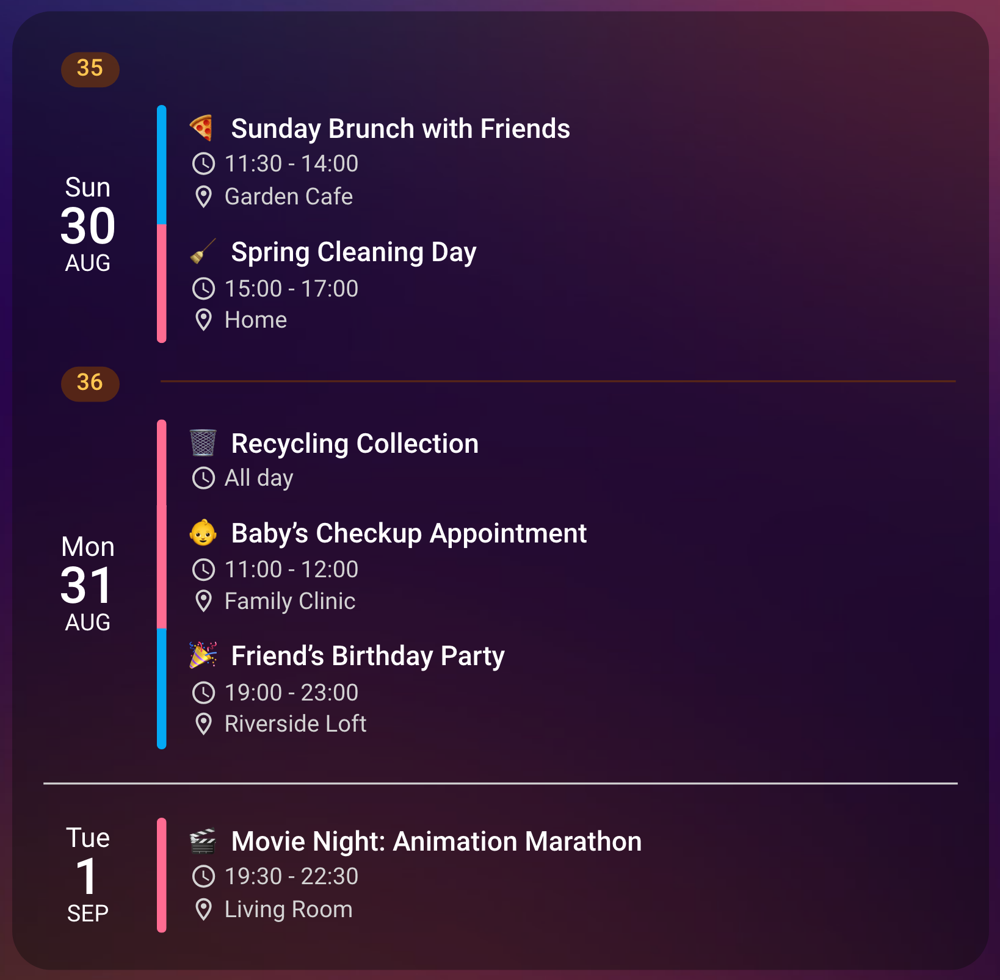
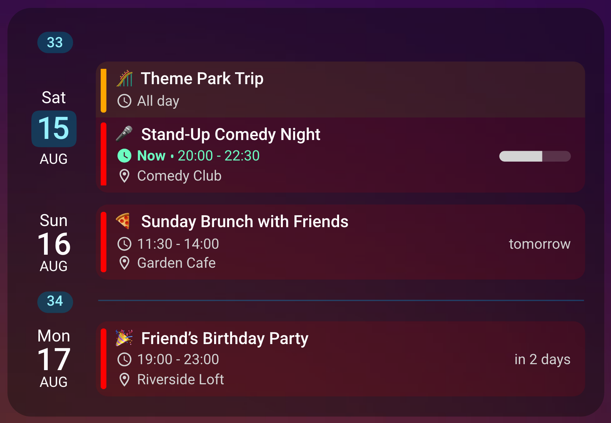

# Layout & Appearance

These options control how the card looks rather than what it shows: its dimensions and scrolling behavior, its colors and fonts, the spacing between elements, and the styling of the date column, week numbers and today indicator. The controls in the card's header have a page of their own, [Header Toolbar](/features/header-toolbar).

## 📐 Card Dimensions & Scrolling

`card_height` sets the height of the whole card, its title, toolbar and notices included, and the
events fill what the header leaves. Set it once at the top level and a card that switches layouts
keeps the same height in every one.

```yaml
card_height: 600px
```

| Option                    | Type   | Default | Description                                                                        |
| ------------------------- | ------ | ------- | ---------------------------------------------------------------------------------- |
| `card_height`             | string | `auto`  | The whole card's height; `auto` is each layout's own                               |
| `card_max_height`         | string | `none`  | The tallest the whole card may be; it clamps `card_height`                         |
| `height`                  | string | `auto`  | The events area's height under the header; see [The Events Area](#the-events-area) |
| `max_height`              | string | `none`  | The tallest the events area may be; see [The Events Area](#the-events-area)        |
| `additional_card_spacing` | string | `0px`   | Extra padding at the top and bottom of the card                                    |

- **`auto`** is each layout's own height: its content's in List, Columns and Grid, and in Month
  `632px`, or `760px` with the toolbar; see
  [How Tall the Month Is](/features/month-view#how-tall-the-month-is).
- **`card_max_height` alone** lets a List, Columns or Grid card grow with its events up to the
  cap, and then the events scroll. A wide month keeps its own height, clamped by the cap, and a
  [narrow month](/features/month-view#the-narrow-month) grows with its weeks and the day's list up
  to the cap.
- **A length** is any CSS length, such as `600px`, `40rem`, `80dvh` or a `calc()` with a `var()`.
  A bare number is read in pixels.
- **Each layout fills the height its own way.** List scrolls within it, Columns leave room under
  their days, Grid fits its hours to it ([Height in Grid View](#height-in-grid-view)), and Month
  shares it among its six weeks.
- **Rows set in a Sections dashboard's Layout tab win over both**, and every layout fills them as
  it fills a `card_height`.
- **In the visual editor** it is **Card Height** on a layout's Size & Spacing: **Fit content**,
  **Fixed height** with its **Height**, or **Maximum height** with its **Maximum Height**. On a
  layout's page it is set for that layout, and on Layout Defaults for every layout. On Month's
  page **Fit content** is called **Default height**.

Scrollbars are thin and show only while the pointer is over the events.

::: details Values the Card Refuses
A percentage, or a word such as `fit-content`, would let the events size the card, so the card
warns and uses `auto` in its place, and `none` for `card_max_height`.
:::

### A Height Per Layout

Both options may also be set in a layout's block, `list:`, `column:`, `time_grid:` or `month:`,
which wins over the top level. The same events are far shorter side by side than stacked, so a
cap tuned for List often never comes into play in Columns:

```yaml
view: column
card_max_height: 600px
column:
  card_max_height: 320px
```

### Height in Column View

What scrolls is the events area as a whole, never a single day, so the day headers move with their
events and nothing scrolls out of line with its neighbors. The columns are as tall as the tallest
day and stay at the top: a quiet day leaves space beneath its last event, and a card taller than
its columns leaves room under them.

### Height in Grid View

A `card_height`, a fixed `height` or rows set in a Sections dashboard fit the hours into the room
left under the day headers and the all-day band, and `hour_height` stops applying. A cap,
`card_max_height` or `max_height`, scrolls instead, as in the other layouts.

```yaml
view: grid
card_height: 600px
```

- **An hour is never shorter than `24px`**, or `hour_height` where that is smaller, so an hour-long
  event keeps a line of its title. Below that, the events area scrolls.
- **The all-day band keeps its rows**, at most
  [`allday_band_max_rows`](/features/grid-view#all-day-events), and never scrolls on its own.
- **The day headers and the all-day band stay at the top** while the hours scroll under them, so
  an all-day event stays in sight. They scroll with the hours where they would take more than half
  the events area, and always under `min_days_fallback: cramp`. On a translucent card background
  the hours show faintly through them as they pass under.

**→ [How Tall an Hour Is](/features/grid-view#how-tall-an-hour-is)** — `hour_height` and when a fixed height takes over.

### The Events Area

`height` and `max_height` size only the events area under the header, so the title, the toolbar
and the card's padding come on top of them.

```yaml
height: 300px
```

- **`height`** fixes the events area however much it holds, and **`max_height`** lets it grow with
  its events up to the cap. Beyond either it scrolls; Grid fits its hours to a fixed `height` as it
  does to a `card_height`.
- **A `card_height` takes the place of `height`** in a layout where it is a length, and
  `max_height` still caps the events area under it.
- **Month takes neither**; it sizes the whole card.
- **Both may be set in a layout's block**, as `card_height` may.
- **The visual editor** shows them as **Events Area Height** and **Events Area Maximum Height**
  only on a card that already holds one, so it can be read and cleared. Choosing **Fixed height**
  or **Maximum height** under **Card Height** clears them in that layout.

## 🎨 Visual Styling & Colors

These options set the card's background and title, and how strongly each event is tinted and
marked:

```yaml
# Card background and title
title: 'My Calendar'
title_font_size: '20px'
title_color: 'var(--primary-color)'
background_color: 'var(--ha-card-background)'

# Event appearance
event_background_opacity: 15 # 0-100 scale for background color intensity
vertical_line_width: '3px' # Width of the accent bar beside each event
```

`event_background_opacity`, from 0 to 100, gives each event a background in its calendar's
`accent_color`, stronger the higher it goes. At 0, the default in list and column view, events
have no background; grid view [starts at 20](/features/grid-view#options-that-start-from-a-different-default).
With a background, each day's events form one rounded block, and every event keeps its own
accent bar inside it. Without one, the accent bar is the day's edge: the bars of touching events
join into one line, changing color where one calendar's event meets another's. To give each
event a bar of its own without a background, set [`event_gap`](#gaps-between-events); even `1px`
does it.

`vertical_line_width` sets the accent bar's width as a CSS length, or `thin`, `medium` and
`thick`, which mean `1px`, `3px` and `5px`. `0px` or `none` hides it, and anything else falls
back to `2px`.

`title_font_size` takes any CSS font size, as the
[date column's font sizes](#date-column-customization) do. A value that is not one is ignored,
and the title keeps Home Assistant's card header size. The header can also hold a
[toolbar](/features/header-toolbar) with arrows to page through the dates, a view switcher and an
add-event button.

Colors can be written as:

- CSS color values (`#ff6c92`, `rgba(255,0,0,0.5)`)
- Home Assistant theme variables (`var(--primary-color)`)
- Named colors (`red`, `blue`)

`accent_color` follows your theme's primary color by default, `var(--primary-color, #03a9f4)`,
so a calendar you have not colored takes a custom theme's accent. Set it card-wide, or for one
calendar in its `entities` entry, to choose a color yourself.

::: warning Changed In v5
Before v5, `accent_color` and `today_indicator_color` were a fixed `#03a9f4`, and the
week-number pill and week separator a fixed `#03a9f450`. To keep the old blue, add
`accent_color: '#03a9f4'` to your card or to a calendar's entry, `today_indicator_color: '#03a9f4'`,
and `'#03a9f450'` for `week_number_background_color` and `week_separator_color`. Since v6 a pill
background colors its own number, so add `week_number_color: 'var(--primary-text-color)'` as well.
:::

`accent_color` accepts one more value: `home-assistant`, which follows the color Home
Assistant holds for each calendar instead of a color you pick here. Named colors such as
`red` are unaffected and still mean the CSS color.

**→ [Using the Colors From Home Assistant](/features/core-settings#using-the-colors-from-home-assistant)** — how to set it, and what happens for calendars that have no color.

## 📏 Spacing & Alignment

Fine-tune the spacing and alignment of your calendar elements:

```yaml
# Spacing between elements
day_spacing: '8px' # Space between different calendar days
event_gap: '6px' # Space between the events of one day
event_spacing: '6px' # Internal padding within each event

list:
  # Date column alignment
  date_vertical_alignment: 'top' # Options: 'top', 'middle', 'bottom'

# Event icon alignment
event_icon_vertical_alignment: 'middle' # Options: 'top', 'middle', 'bottom'
```

The `date_vertical_alignment` option controls how dates align with their events, which is especially noticeable when a day has many events. The default `middle` option centers the date between its events, while `top` aligns it with the first event and `bottom` with the last event.

`event_icon_vertical_alignment` does the same job one level down, for the small icons on an event's time, location and description rows. It only becomes visible when one of those wraps onto a second line: the default `top` lines the icon up with the first line of text, while `middle` centers it against the whole block and `bottom` against the last line.

::: warning Changed In v4
This option defaulted to `middle` before v4. Rows wrap often enough — a long address, a description, or a time row carrying a [countdown](/features/column-view#progress-bar-countdown) in a narrow column — that centering left the icon level with neither line of text. Add `event_icon_vertical_alignment: 'middle'` to your card to keep the old behavior.
:::

### Gaps Between Events

A day's events normally touch, so they read as one block beside their date. `event_gap` holds each event apart from the next instead, which helps most when several events in a row share a calendar color and their accent bars run together into one line:

```yaml
event_gap: 6px
event_background_opacity: 15
```

Each event then becomes a block of its own, with an accent bar of its own, the way grid view draws an event. `event_gap: 1px` is the smallest way to have that: you will hardly see the gap without a background, but each event has its own bar. Each is also a tap and hover target of its own, and a press in the gap between two reaches neither event: it is a press on the day, which [adds an event there](/features/actions#where-you-can-tap-a-day) when `day_tap_action` is `add-event`.

`event_gap` takes any CSS length, such as `6px`, `0.5em` or a `calc()`. The default, `0px`, keeps the joined block, and a negative length counts as `0px`. It applies in list and column view, and each of the two can set its own inside `list:` or `column:`. A month's [day list](/features/month-view#the-days-list) starts from `6px` and takes another only from `month:`. Grid view places every event by its time and ignores it:

```yaml
column:
  event_gap: 4px # Gaps in column view only; list view keeps the joined block
```

`event_gap` is the space between events, and `event_spacing` the space above and below the text inside each event. The gap falls only between two events, never above the first or below the last, so the space between days is still `day_spacing` alone and every separator stays where it was.

In list view, a gap also changes how the days read. Once the events stand apart, the space between two of them is close to the `day_spacing` between two days, and the days run together. A one-pixel day rule, `day_separator_width: 1px` inside `list:`, keeps them apart; the [Family Agenda](/guide/one-calendar-many-purposes#one-voice-for-the-whole-card) story shows the two together.

::: details Corners & Accent Bars

- With [`event_background_opacity`](#visual-styling-colors) above 0, every event rounds all four of its corners, where the joined block rounds only the top of its first event and the bottom of its last, and its bar keeps clear of all four.
- Without a background, the bars that joined into one line break between the events, each stopping just short of its event's top and bottom.

:::

## 📅 Week Numbers & Visual Separators

Week numbers, and separator lines between days, weeks and months, help a longer calendar view read at a glance:

```yaml
# Week number configuration
show_week_numbers: 'iso' # 'iso', 'simple', or null to disable
show_current_week_number: true # Show week number for the first week
first_day_of_week: 'monday' # 'monday', 'sunday', or 'system'

# Week number styling
week_number_font_size: '12px'
week_number_color: 'var(--primary-text-color)'
week_number_background_color: '#e67c7350'

# Separator configuration
day_separator_width: '1px' # Line between days
day_separator_color: '#03a9f430'
week_separator_width: '2px' # Line between weeks
week_separator_color: '#03a9f480'
month_separator_width: '3px' # Line between months
month_separator_color: '#03a9f4'
```

<br>

`show_week_numbers` adds a pill-shaped badge with the week number, counted one of two ways:

- **`iso`**: weeks are counted as in ISO 8601, Monday to Sunday, the first week of the year being the one containing the first Thursday. On a card whose week starts on another day, each of its weeks takes the number of the ISO week holding most of its days, so the number changes, and in the list the week rule falls, where the card's week begins.
- **`simple`**: weeks are counted from January 1st.

The separators are horizontal lines between days, weeks and months, each with its own width and color. Where more than one could appear at once, such as on a day that starts both a week and a month, only the most significant is drawn: a month line over a week line, and a week line over a day line.

`week_number_font_size` takes any CSS font size, as the [date column's font sizes](#date-column-customization) do, and the pill is sized from it; a value that is not a font size falls back to `12px`.

Left unset, the pill is drawn as the [date tile](#the-date-tile) is, from `today_indicator_color`: the same light wash, with the number in the same deeper shade, so a pill above today's tile matches it, and both follow a custom theme. An unset `week_separator_color` is the pill's background, so the line and the pill beside it are one color.

A `week_number_background_color` you set is drawn as given. While it is a light wash, such as `'#e67c7350'` (31%), its number is a deeper shade of it, here a deep red; behind a stronger or solid background the number keeps the text color. `week_number_color` sets the number yourself, and the week separator follows a background you set too.

Month draws its week numbers as plain text, slightly faded, with no pill: `week_number_background_color` does not apply there, and an unset `week_number_color` is the text color. See [Month's week numbers](/features/month-view#week-numbers).

::: warning Changed In v6
Before v6 the pill and the week separator were your theme's primary color at 31% opacity, with the number in the text color. To keep that look, add:

```yaml
week_number_background_color: 'color-mix(in srgb, var(--primary-color, #03a9f4) 31%, transparent)'
week_number_color: 'var(--primary-text-color)'
week_separator_color: 'color-mix(in srgb, var(--primary-color, #03a9f4) 31%, transparent)'
```

:::

`first_day_of_week` decides where a week begins, which in turn drives week numbers, week separators and the `start_of_week` [start date](/features/start-date-offset). Its default, `system`, follows Home Assistant rather than the card: it uses the **First day of week** setting in your Home Assistant user profile, and when that is left at _Auto_ it falls back to the convention for your Home Assistant language — Monday for most, Sunday for languages such as English, Japanese, Hebrew and Brazilian Portuguese, Saturday for Arabic and Persian. Set `monday` or `sunday` explicitly to override Home Assistant for this card alone.

::: warning Changed In v4
Before v4, `system` always resolved to Monday and never consulted Home Assistant. If your Home Assistant profile or language implies a different week start, your week numbers and `start_of_week` anchor will shift once you upgrade. Set `first_day_of_week: 'monday'` to keep the old behavior.
:::

::: details How the Card Reads a Background's Opacity

- The opacity can be written as an 8-digit hex color, `rgba()` or another color function with an alpha, or a `color-mix()` with `transparent`, where a theme color named in it counts as opaque. Up to about a third reads as a light wash.
- The number keeps the text color where only the browser can tell the opacity: a theme variable on its own, a mix with a `calc()` percentage or a translucent fallback, a relative color without an alpha of its own, or `light-dark()`.
- Browsers without relative colors (Safari before 18) keep the text color too.

:::

### Naming the Month on Its Rule

`month_separator_label` writes the month's name, abbreviated, at the start of each month rule in
the list, so a list that leaves the month out of every date with `show_month: false` still says
which month follows the rule:

```yaml
show_month: false
month_separator_width: 1px
list:
  month_separator_label: true
```

| Option                            | Type    | Default                          | Description                                                  |
| --------------------------------- | ------- | -------------------------------- | ------------------------------------------------------------ |
| `month_separator_label`           | boolean | `false`                          | Name the month, abbreviated, at the start of each month rule |
| `month_separator_label_color`     | string  | inherits `month_separator_color` | Color of the month's name                                    |
| `month_separator_label_font_size` | string  | `12px`                           | Font size of the month's name                                |

All three belong inside `list:`.

- The label reads "Dec 2026" in English and follows the card's language: "Dez. 2026" in German,
  "2026年12月" in Japanese.
- It names the month below the rule, so a list read latest first labels each block with its own
  month.
- It needs a rule to sit on: with `month_separator_width` at `0px`, the default, nothing is drawn.
- The label is drawn in the rule's color unless `month_separator_label_color` gives it one of its
  own, which keeps it readable beside a deliberately faint rule.
  `month_separator_label_font_size` takes any CSS font size; a value that is not one, such as
  `14pz`, falls back to `12px`.
- The first month shown is named too, on a rule of its own at the top of the list, so every block
  of days sits under its own month's name, unless a [toolbar](/features/header-toolbar) right above
  already names that month. The toolbar names the month of the page's first day, or of its last
  day in a list read latest first, so with a toolbar the first month is labeled only when that
  month has no days on screen.
- With week numbers on, a month that starts a week draws its label just after the week number.
- It applies in list view only. In column and grid view the month rule is a vertical line between
  two days, with no room for words, and month view draws no month rule at all.

::: details Languages That Abbreviate a Month to a Number
A few languages write a month's short form as a number, such as Lithuanian's "2026-12". There the
label names the month in full instead ("2026 m. gruodis"), so it always says which month it is.
:::

### Week Numbers in Column View

In column view the badge moves into the day header, on its own row directly above the
weekday, and each column answers for itself: a column that opens a week shows its number,
and the rest show nothing.

When any column shows a badge, the row is reserved in every column, not only the ones that start
a week, so the weekday, day number and events below stay aligned across the whole card. When no
column would show one, or `show_week_numbers` is `null`, the default, no row is added at all.

`show_current_week_number` keeps its meaning: set it to `false` to hide the badge on the
first column, which is usually a partial week. All three styling options carry over
unchanged, so a badge you have already tuned looks the same in both views.

::: tip Per-View Week Numbers
`show_week_numbers`, `show_current_week_number`, `week_number_font_size`, `week_number_color`
and `week_number_background_color` may each be set inside a `column:` block, so you can leave
week numbers off in the list layout and switch them on only when the card renders as columns.
`first_day_of_week` is card-wide only.

```yaml
show_week_numbers: null
column:
  show_week_numbers: iso
```

:::

### Separators in Column View

In column view the three separators become **vertical rules in the gaps between day columns**,
each running the full height of the grid, from the top of the day headers to the bottom of the
busiest column. The precedence is unchanged, month over week over day, and every width still
defaults to `0px`, so a card that shows no lines in the list layout shows none as columns either.

Two things differ from the list layout:

- **No spacing multipliers.** In the list a week separator gets more room than a day separator,
  and a month separator more again. Between columns the gap is always `day_spacing`, with the
  rule centered in it whatever its kind, so use width and color to show the hierarchy.
- **Week numbers keep the day rule, but shorten it.** In the list layout, switching week numbers
  on suppresses the day line at a week boundary; in column view the day rule stays. Day rules
  then stop level with the top of the weekday names, while week and month rules run on up
  through the week-number badge. With week numbers off, all three are the same length again.

::: tip Heavier Rules Between Columns
A hairline reads well between stacked rows but can disappear against a full-height column.
Set the widths independently per view when that happens:

```yaml
day_separator_width: '1px'
column:
  day_separator_width: '2px'
```

:::

## 📆 Date Column Customization

These options style the date column beside each day's events, with separate colors for weekends and for today, and a [size, weight and fade of their own](#today-past-days) for today and past days:

```yaml
# Base date column styling
weekday_font_size: '14px'
weekday_color: 'var(--primary-text-color)'
day_font_size: '26px'
day_color: 'var(--primary-text-color)'
month_font_size: '12px'
month_color: 'var(--primary-text-color)'

# Special styling for weekends (inherits from base when not specified)
weekend_weekday_color: '#e67c73' # Weekend day names
weekend_day_color: '#e67c73' # Weekend day numbers
weekend_month_color: '#e67c73' # Weekend month names

# Special styling for today (inherits from base/weekend when not specified)
today_weekday_color: '#03a9f4' # Today's weekday name
today_day_color: '#03a9f4' # Today's day number (on the date tile, the tile's shade when unset)
today_month_color: '#03a9f4' # Today's month name
```

By default, all dates use the base styling, but you can apply special styling to:

- **Weekend days** using the `weekend_*` options — which days those are follows the [country set in Home Assistant](/features/filtering#showing-a-calendar-on-weekdays-only), or its language when no country is set
- **Today's date** using the `today_*` options

When the special styling options are not specified, they will inherit from the base styling. If today falls on a weekend, today styling takes precedence over weekend styling. The one exception is today's day number on the default [date tile](#the-date-tile): it takes a deeper shade of the tile's color rather than `day_color`, unless you set `today_day_color` or, on a weekend, `weekend_day_color`.

`weekday_font_size`, `day_font_size` and `month_font_size` take any CSS font size: a length
such as `26px` or `2em`, a percentage such as `180%`, a keyword such as `x-large`, `larger` or
`inherit`, or an expression such as `calc()` that works out to one. A negative size, a
misspelled unit or a word that is not a font size falls back to the option's default.

::: details Font Sizes & the Column's Width

- A space before the unit is closed up, so `26 px` reads as `26px`.
- The date column widens with the day number, whichever form you use. With a keyword such as
  `x-large` the column can come out a little wider than the number needs.
- A `var()` is passed on as written: the date column follows it when the property it names holds
  a length, but not a percentage or a keyword.

:::

### Today & Past Days

`today_date_scale` and `today_date_font_weight` draw today's date larger and bolder, and
`past_date_opacity` fades the days before it, so a week that starts on Monday leads the eye
straight to today. `past_date_scale` and `past_date_font_weight` restyle past days further. Each
applies to the weekday, the day number and the month together.

```yaml
start_date: start_of_week
days_to_show: 7
today_date_scale: 1.25
today_date_font_weight: bold
past_date_opacity: 55
```

- A scale multiplies the date's sizes: `1.25` is a quarter larger, `0.85` a little smaller, and
  `1`, the default, leaves the date as it is. The [date tile](#the-date-tile) grows with today's
  number.
- A weight is `light`, `regular`, `medium` or `bold`, which follow your theme's weights, or a
  number from 1 to 1000. `default` keeps the card's own: a medium day number beside a regular
  weekday and month.
- `past_date_opacity` runs from 0 to 100, and `100`, the default, leaves past days as they are.
  A past weekend keeps its weekend color, only fainter.
- Days after today keep the base options above.
- Each option can also be set in `list:`, `column:` or `time_grid:`, so a grid on a wall
  display can enlarge today while the list a phone falls back to does not.

::: tip Visual Editor
Today's scale and weight are under **Days → Today**, and the past-day options under
**Days → Past Days**.
:::

::: details Layout, Units & Card-Mod

- In list view the date column widens for every day to fit the largest date, so the events
  stay in line. In column and grid view every header keeps the height of the largest, so each
  column's first event starts on the same line.
- A size in any unit is scaled in that unit. A keyword such as `large` is scaled from the size
  browsers draw it at.
- A past day is one before today's date on the device showing the card. Today becomes one at
  midnight, with no reload.
- For anything the options do not cover, such as italic past days, select `.past-day` with
  card-mod; see [Day Container Classes](/features/theming#day-container-classes).

:::

## 🌟 Today Indicator

Calendar Card Pro marks today out of the box: today's day number sits on a soft tile tinted
with your theme's primary color, in every layout. You can restyle it, swap it for a dot, an
icon, an emoji or an image, or turn it off; Month draws only the tile or nothing.

<br>

Above is the default tile, tinted with `today_indicator_color`. Every other style is drawn over the date column instead, and only those take a size and, in list view, a position. Pick one value for `today_indicator`; the commented lines are the alternatives.

```yaml
# Choose the indicator type
today_indicator: tile # A soft tinted tile behind today's day number (default)
# today_indicator: false # No indicator
# today_indicator: true # Basic dot
# today_indicator: pulse # Animated pulsing dot
# today_indicator: glow # Glowing dot
# today_indicator: mdi:star # Any Material Design icon
# today_indicator: 🎯 # Emoji
# today_indicator: KW 34 # Any text — raise today_indicator_size to make words readable
# today_indicator: /local/custom-indicator.png # Image path
# today_indicator: https://example.com/today.png # Or any image URL

# Restyle the indicator
today_indicator_color: '#e67c73' # Tints the tile; colors the dot and MDI icons (default: your theme's primary color)
```

```yaml
# Any style but the tile takes a size and, in list view, a position
today_indicator: pulse
today_indicator_size: 6px # Size of icons, emojis and images (default)
list:
  today_indicator_position: '15% 50%' # Centered at the date column's start (default)
  # today_indicator_position: '15% 15%' # Top, at the start
  # today_indicator_position: '85% 15%' # Top, at the far side
```

The dot can also be written `dot`. Text that is none of the above is drawn as it is written, such
as a week number, a quarter or a sprint name.

::: tip Visual Editor
Find it under **Days → Today Indicator**, where **Style** offers **None**,
**Date Tile**, **Dot**, **Pulsing Dot**, **Glowing Dot**, **An Icon** and
**An Emoji or Image**. The date tile takes only an **Indicator Color**; the other styles add
an **Indicator Size**, and on List's pages an **Indicator Position**. On Month's pages **Style**
offers only **None** and **Date Tile**.
:::

::: info Month Draws the Tile Only
In [month view](/features/month-view#the-six-weeks) today is marked by the tile or not at all:
any other style leaves today's number without a mark of its own, and `today_indicator_size` does
nothing there. The wide month [fills its tile](#the-date-tile) rather than washing it.
:::

::: warning Changed In v5
Before v5 a card showed no indicator unless one was configured, and choosing **None** in the
editor stored nothing. v5 defaults to `tile`, so such a card now shows the tile. Add
`today_indicator: false` to your card to keep the old behavior. While the tile is on, column
and grid view give every day's number the tile's height, so their day headers are taller
than they were in v4.
:::

::: details Text, Images & Typos

- Anything that is not one of the keywords, an `mdi:` icon or an image is drawn as its own
  characters, so a typo shows up on the card instead of quietly falling back to a dot.
- Text is sized by `today_indicator_size`, which defaults to `6px`: right for an emoji, far too
  small for a word, so raise it when you use one.
- A value shaped like an address is read as an image, so there is no way to draw `/dev` or a URL
  as literal text.
- The keywords `tile`, `dot`, `pulse` and `glow` count in any casing: `Tile`, `DOT` and `Glow`
  are the tile, the dot and the glow. So those four words cannot be drawn as text, though a
  longer one holding them, such as `Tiles`, can.

:::

### The Date Tile

The tile sits behind today's day number and replaces nothing: the weekday and month stay where
they are. It sizes itself from `day_font_size`, so `today_indicator_size` and
`today_indicator_position` do not apply to it.

It is a light wash of `today_indicator_color`, which follows your theme's primary color unless
you set one, over the card's background, with the day number in a deeper shade of the same
color, and it adapts to light and dark themes on its own. A color you set therefore tints the
tile rather than filling it. The digits take their shade from the tile, unless you name a color
for them with `today_day_color` or, on a weekend, `weekend_day_color`. A see-through color
such as `'#e67c7380'` makes a fainter tile, while its digits keep the color's full shade. The
[week number pills](#week-numbers-visual-separators) take the tile's colors unless you set theirs.

A wide [month](/features/month-view#the-six-weeks) fills the tile instead, with rounder corners,
so today stands out among the colored events: `today_indicator_color` itself, or a deeper shade of
it where the color is too light for white digits to read, with the digits in white. A browser too
old for that fills the color as it is, with the digits in your theme's `--text-primary-color`,
white by default. A narrow month draws today the same way while it is the selected day. A color
you name for the digits still wins, and a see-through `today_indicator_color` makes white digits
harder to read there.

In column and grid view every day's number keeps the tile's height, so the dates stay on one
line across the columns and each column's first event starts at the same height.

```yaml
today_indicator: tile
today_indicator_color: '#e67c73' # Tint the tile with a fixed color instead of the theme's
today_day_color: '#8c1d18' # Choose the digits' color yourself
```

### Placing an Indicator

`today_indicator_position` places any indicator but the tile within the date column, as `"x% y%"`.
The first value follows the reading direction, as the rest of the list does: it is measured from
the left on a left-to-right dashboard, and from the right on a right-to-left one such as Hebrew
or Arabic, where the dates sit on the right. So `15% 50%`, the default, puts the indicator beside
the date's outer edge either way, and one configuration serves both.

::: tip Column View Places It For You
`today_indicator_position` applies in list view only. Column view puts the indicator immediately
before the weekday, whatever the column measures. Every other indicator option, the type,
`today_indicator_size` and `today_indicator_color`, works the same in both views.
:::

`today_indicator_size` scales every indicator type except the tile: it sets the icon size, the
font size for emoji and text, and the image width. It takes a CSS length such as `6px`, `0.5em`
or `1rem`, or an expression such as `calc()` that works out to one. A percentage, a negative
size, a keyword such as `large` or a misspelled unit falls back to `6px`, the default; for a size
that follows the text around it, use `em`: `1.5em` rather than `150%`. A space before the unit is
closed up, so `6 px` reads as `6px`, and a `var()` is passed on as written.

`today_indicator_color` tints the tile and colors the icon-based types (the dot, `pulse`, `glow`
and any `mdi:` icon), and is also the color of the glow itself; emojis and images keep their own
colors, and text takes the color it inherits. Whatever the style, the week number pills and the
week separators take their colors from it unless you set theirs.

The options on this page are grouped in the reference under [Layout & Spacing](/reference/configuration#layout-spacing), [Week Numbers & Horizontal Separators](/reference/configuration#week-numbers-horizontal-separators), [Today Indicator](/reference/configuration#today-indicator) and [Date Column](/reference/configuration#date-column). Two of them — `date_vertical_alignment` and `today_indicator_position` — are list-only and belong inside `list:`; they are listed under [List-Only Options](/reference/configuration#list-only-options).
