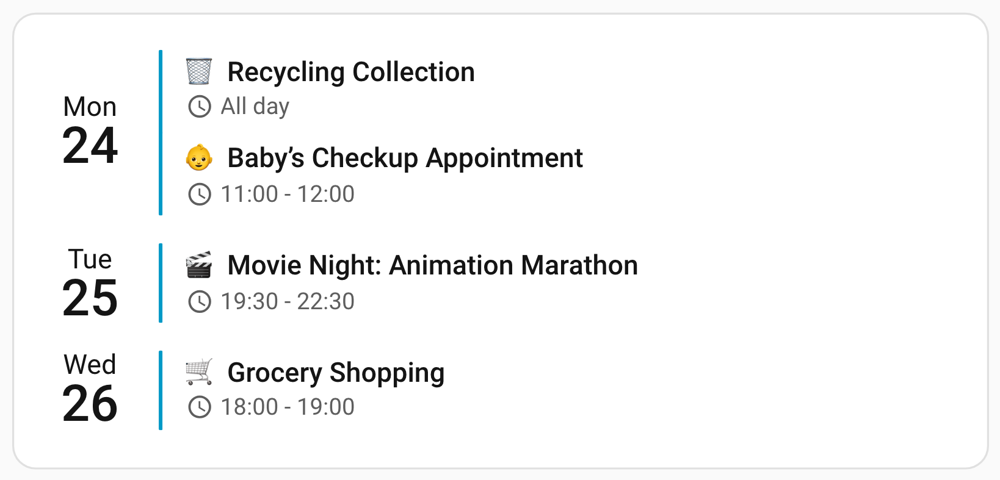

# List View

List is the card's default layout: one day under another, each day's events beside its date, as
far ahead as `days_to_show` reaches. It suits a narrow card and a quick look at what is coming,
and it is the layout Columns and Grid fall back to on a card too narrow for them.

## 📋 The List Layout

A card with no `view` is a list, so the smallest card is one:

<br>

```yaml
type: custom:calendar-card-pro
entities:
  - calendar.family
```

`view: list` says the same thing, and is what the [view switcher](/features/header-toolbar#switching-between-layouts)
writes when someone picks List. The options only List reads go in its own `list:` block:

- the compact limits and [the order of the list](#event-order), on this page;
- [`skip_first_events`](#continuing-a-list-on-a-second-card), which continues one list on a second card;
- [`date_vertical_alignment`](/features/layout-appearance#spacing-alignment),
  [`today_indicator_position`](/features/layout-appearance#today-indicator) and the
  [month's name on its rule](/features/layout-appearance#naming-the-month-on-its-rule).

Every other option is shared with the other layouts; see [Choose a Layout](/features/layouts).

## 📊 Compact Mode & Event Limits

Compact mode keeps a list card short: it shows only the first few events or days until someone
expands it to everything in `days_to_show`. Set an event or day limit and the card starts
compact; an [`expand` tap or hold action](/features/actions#expandable-calendar-card) lets
people switch between the two. Without a limit, nothing can fold, and the card offers no tap or
hold for `expand`.

```yaml
# Total days to fetch from API and display when expanded
days_to_show: 7

list:
  # Event limit for compact mode
  compact_events_to_show: 5

  # Day limit in compact mode
  compact_days_to_show: 2 # Fewer days to display in compact mode

  # Ensure complete days are shown
  compact_events_complete_days: true # Never cut off a day's events mid-day
```

::: warning Compact Mode Applies to List View Only
`compact_events_to_show`, its per-calendar form, `compact_days_to_show` and
`compact_events_complete_days` are read in list view and ignored in column and grid view.

They need not be removed: a card set to `view: column` or `view: grid` renders as a list
whenever it is too narrow for even `min_days_to_show` under the default
`min_days_fallback: list`, and they all apply again the moment it does. To control how much
a side-by-side view shows while it stays side-by-side, use
[`min_days_to_show` and `min_days_fallback`](/features/column-view#showing-fewer-columns-on-narrow-cards)
for column view, or the matching
[`time_grid` day-width options](/features/grid-view#fitting-narrow-cards) for grid.
:::

::: details Accepted Limit Values

- Numeric limits follow the same rules inside `list:` as at the top level.
- Quoted values such as `compact_events_to_show: '5'` still limit the card and can be
  expanded.
- Blank, negative or nonnumeric limits mean no limit.
- `compact_events_to_show: 0` is valid and holds every event back until the card is
  expanded. A day limit below `1` means no day limit.

:::

### Entity-Level vs. Global Event Limits

`compact_events_to_show` caps the whole card, and each calendar can carry its own as well.
Neither has a default: unset, there is no cap.

```yaml
entities:
  - entity: calendar.family # No cap of its own
  - entity: calendar.work
    compact_events_to_show: 2 # At most 2 work events, from the top of the list
```

- **Each calendar's cap comes first.** A calendar keeps its events from the top of the list, up
  to its own limit: its earliest by default, its most recent with
  [`latest_first`](#event-order). The cap belongs to the entry in `entities`, so a calendar listed
  twice has one per block. A calendar with no cap of its own keeps all of its events at this step.
- **The card's cap comes second.** It counts the events left from every calendar together, in
  date and time order with each day's all-day events first, so a calendar without a cap of
  its own still counts toward it.
- **Expanded,** every cap is lifted, each calendar's own included, and the card shows
  everything in `days_to_show`.

### Controlling Days in Compact Mode

`compact_days_to_show` limits the compact card to its first few days. It has no default:
unset, the compact card covers all of `days_to_show`, and a value larger than `days_to_show`
changes nothing.

```yaml
days_to_show: 7 # Show 7 days when expanded
list:
  compact_days_to_show: 2 # Show only the next 2 days with events in compact mode
```

Which days count depends on [`show_empty_days`](/reference/configuration#core-settings):

- **Off, the list default,** it counts days that have events, so `2` shows the next two days
  with something on, however far apart they are.
- **On,** it counts dates from the first day of the card, empty ones included.

The day limit applies first, and the event limits then count only within those days.

::: details A Day a Calendar's Cap Empties
With `show_empty_days` off, a day whose only events a calendar's own cap held back drops out,
and no later day takes its place, so the compact card can show fewer days than
`compact_days_to_show` names.
:::

### Preserving Complete Days

`compact_events_complete_days`, `false` by default, stops the card's event limit from cutting
a day off part-way: once the limit reaches a day, every event of that day is shown, even past
the limit. It does nothing without `compact_events_to_show`.

```yaml
list:
  compact_events_to_show: 5
  compact_events_complete_days: true
```

With a limit of 5, a first day of four events and a second day of six:

- off, the card shows the four and the first event of the second day: five in all;
- on, it shows both days in full: ten.

A day the limit never reaches stays hidden, so if the first day alone held five events, the
second would not appear at all. Complete days stretch only the card's own limit: the card
still shows no more days than `compact_days_to_show`, and events a calendar's own cap held
back stay hidden.

### Continuing a List on a Second Card

`skip_first_events` leaves the first events off a list, so a second card can carry on where a
first one stops: a small card showing what is on now, and a card under it with what comes
later.

```yaml
type: vertical-stack
cards:
  - type: custom:calendar-card-pro
    title: Now
    entities:
      - calendar.anna
    list:
      compact_events_to_show: 1
  - type: custom:calendar-card-pro
    title: Later
    entities:
      - calendar.anna
    list:
      skip_first_events: 1
```

| Option                     | Type   | Default | Description                                                |
| -------------------------- | ------ | ------- | ---------------------------------------------------------- |
| `list → skip_first_events` | number | -       | Events left off the top of the list; unset leaves none off |

- **Same calendars, same count.** The second card continues exactly when it shows the same
  calendars, dates and filters as the first, including `filter_duplicates` and each
  calendar's own cap, and skips as many events as the first card's `compact_events_to_show`.
- **It counts what the card would show,** in the list's order, after every filter. A
  multi-day event split over several days counts once for each day, as the event limit counts
  it. In [latest-first order](#event-order) it leaves off the most recent events.
- **It holds when the card is expanded,** so expanding the second card never brings the first
  card's events back. The card's own day and event limits count from the first event left.
- **A day it empties leaves the card.** With `show_empty_days` or `show_empty_today` the days
  start where the list goes on, so the second card never repeats a day the first one covered.

::: details When the Second Card Does Not Continue Exactly

- `compact_events_complete_days` can make the first card show more events than its limit, and
  a `compact_days_to_show` it reaches first can make it show fewer. Set `skip_first_events` to
  the number the first card actually shows.
- Expanding the second card lifts its calendars' own caps, so with a cap set it can show
  events the first card already shows.
- A second card with nothing left shows its notice on the day the list would go on from, held
  within the card's dates. [`hide_when_empty`](/reference/configuration#core-settings) hides
  it instead.

:::

### Benefits of These Controls

Together, these keep a dashboard card short: a few days, a cap on any calendar that would
crowd out the rest, a card-wide limit that never cuts its last day off part-way, and the full
range one expand away.

## 🔃 Event Order

`event_order: latest_first` turns a list card upside down, with the most recent day and event
at the top. It is for a calendar used as a log, such as visitors arriving or a camera's
detections, where the newest entry is the one that matters.

```yaml
type: custom:calendar-card-pro
entities:
  - calendar.visitors
start_date: today-29
days_to_show: 30
show_past_events: true
list:
  event_order: latest_first
  compact_events_to_show: 5
```

| Option               | Type   | Default          | Description                                                                 |
| -------------------- | ------ | ---------------- | --------------------------------------------------------------------------- |
| `list → event_order` | string | `earliest_first` | `earliest_first`, or `latest_first` for the most recent day and event first |

- **It changes the order, not the dates.** The card covers the days `start_date` and
  `days_to_show` name, so a log's window starts in the past: `today-29` with 30 days is the
  last 30 days up to today. [`show_past_events`](/reference/configuration#event-column) keeps
  the entries that have ended, and `past_event_opacity: 100` stops dimming them.
- **Every limit keeps from the top.** `compact_events_to_show` keeps the most recent events,
  `compact_days_to_show` the most recent days with events, and a calendar's own cap its most
  recent events. Expanded, the card shows every entry, still latest first.
- **Within a day,** the latest event comes first and all-day events come last, so a limit of
  one keeps today's latest entry rather than an all-day event.
- **List view only.** Column and grid view keep time running forward, and the option applies
  again whenever they fall back to a list on a narrow card. The visual editor offers it on List's
  **Which Events** page.
- **Today and paging stay as they are.** The today indicator still marks today, and the
  [date navigation](/features/header-toolbar#paging-through-dates) still moves back and
  forward in time.
- **How long ago,** such as "13 days ago", shows on each entry with `show_countdown: true`; see
  [Counting Up From Past Events](/features/event-content#counting-up-from-past-events). The
  [House Log](/guide/house-log) story is a complete card built this way.

::: details Empty Days in a Latest-First List
With `show_empty_days` the days run from the window's last day back. A card with nothing to
show puts its notice on the window's last day, at the top, and `show_empty_today` keeps today
wherever it falls.
:::

**→ [List-Only Options in the configuration reference](/reference/configuration#list-only-options)** — `event_order` beside the compact limits.
