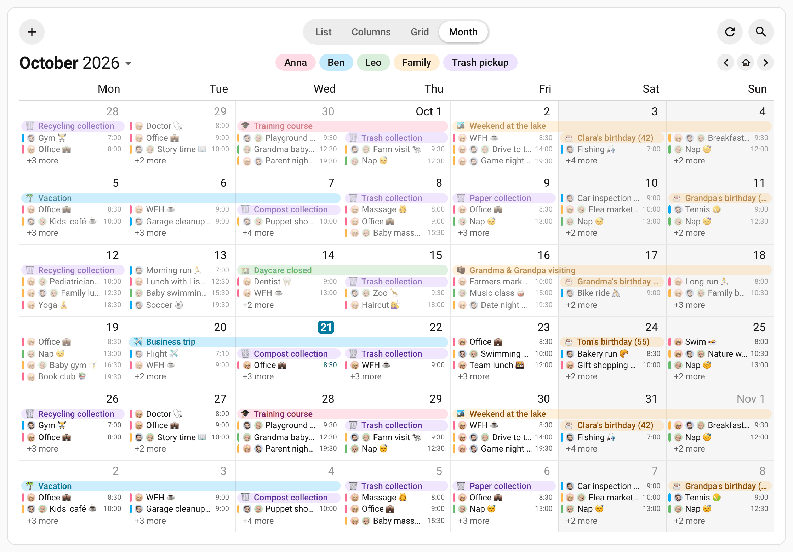
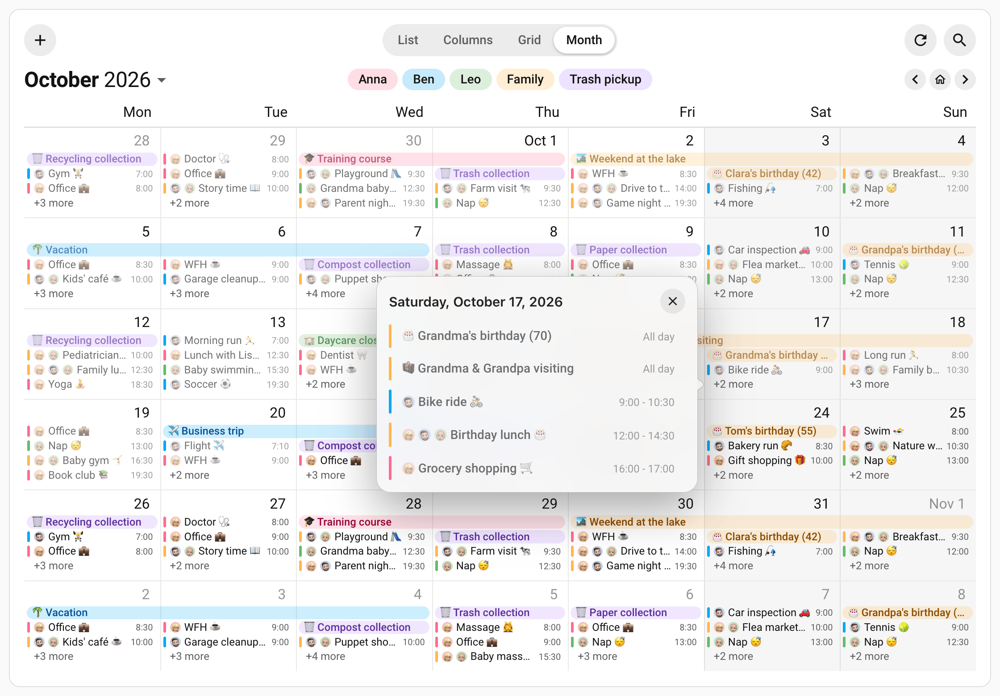
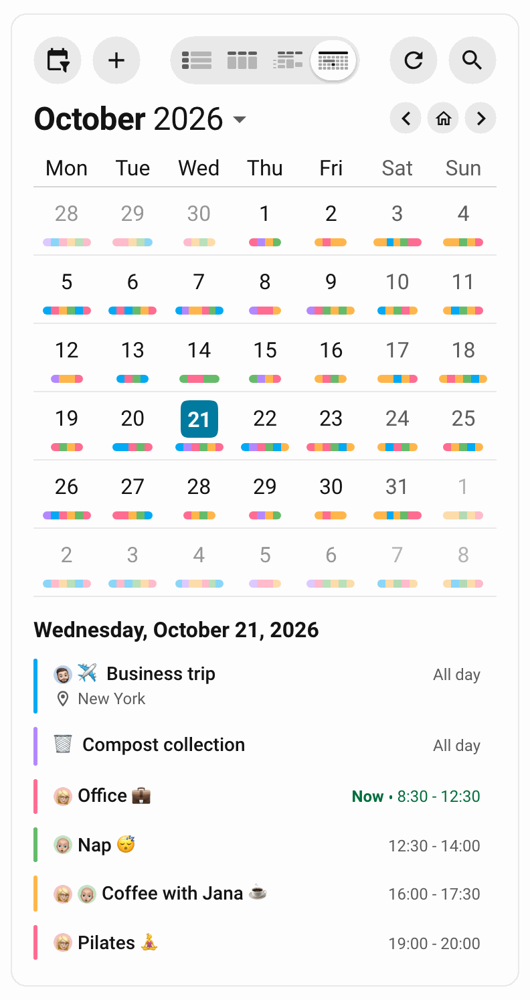

# Month View

Month view draws six whole weeks, a row each, so a household can read its calendar the
traditional way: the month at a glance, with every event on its day. It is the same agenda the
other layouts show, laid out as a wall calendar.

<br>

Set it with `view`:

```yaml
type: custom:calendar-card-pro
entities:
  - calendar.anna
  - calendar.ben
view: month
toolbar:
  show: true # the month's heading, and paging by month
```

A Month card draws one of two forms, chosen by its width: the wide month, with each day's events
in the day, and the [narrow month](#the-narrow-month), with a dot per event and the chosen day's
events listed under the weeks. "+N more" opens a day's events in a panel from either. The visual
editor names these the same way on every Month page: **Wide Month**, **Narrow Month**, the
[**Day List**](#the-day-list) and the [**Day Panel**](#the-day-panel).

The month's heading and paging by month, with the arrows, a swipe or Page Up and Page Down,
come with the [toolbar](/features/header-toolbar); without it the card shows the six weeks of
the month it opens on.

In the [visual editor](/features/editor#options-for-the-selected-view), the circle on a layout's
row under **Layouts** chooses the layout the card opens with. Select the **Month** row itself to
change how the month looks, such as its weekend and today shading under **Days**. Its height is
on **Size & Spacing**; see [How Tall the Month Is](#how-tall-the-month-is).

## 📅 The Six Weeks

The weeks start on the first day of the week, `first_day_of_week` or your Home Assistant
locale's, and the first row is the week holding the 1st of the month the card opens on: the
month holding `start_date`. So `start_date: today+30` opens the month of the day 30 days from
today, and `start_date: 2027-01-15` opens January 2027.

- **Tomorrow and Start of Week open today's month**, as does no `start_date` at all. Both days
  are always in today's six weeks, and their own month would be last month on a month's first
  days, or next month on its last.
- **Always six rows.** Six weeks hold any month, whichever day its 1st falls on: the 1st is
  always in the first row, and the weeks after the month's last are drawn below it. The six share
  the card's height, which paging never changes.
- **The toolbar's heading names one month:** the one with the most days on screen. Its tooltip
  gives the exact dates the six weeks span.
- **Days of the months around it** are dimmed and keep their events, and the 1st of each month
  carries its month's name, such as "1 Dec".
- **Today** sits on the [date tile](/features/layout-appearance#the-date-tile), filled with
  `today_indicator_color`, a deeper shade of it where the color is too light, and its number in
  white, so it stands out among the events,
  as a [narrow month](#the-narrow-month) draws it while today is the selected day.
  `today_indicator: false` turns it off, and today's number is then drawn as any other day's;
  Month draws no other indicator and reads every other style as `false`, so its editor offers
  the tile and none. `today_day_color` and `today_date_font_weight` apply either way.
- **Finished events are shown, dimmed**, by default in month view; see
  [Options That Start From a Different Default](#options-that-start-from-a-different-default).
  Past dates keep their full strength; to dim them too, set
  [`past_date_opacity`](/features/layout-appearance#today-past-days) below `100`.

### Paging Through Months

With the toolbar's [date navigation](/features/header-toolbar#paging-through-dates), the
arrows and a sideways swipe move a whole month, the date picker jumps to the month of the date
you pick, and the home button returns to the month the card opens with. It is called "Today"
while that month is today's, and otherwise by the month it goes to, such as "January 2027".

- **Switching layouts keeps your place.** The date in view goes along. Into Month, the month
  holding the other layout's first day opens with that day selected. Out of Month, List, Columns
  and Grid start on the day selected on a [narrow month](#the-narrow-month), else on today
  where the month shows it, else on the month's 1st. From home, with no day selected, each layout
  opens on its own home, and the home button returns each one there. Paging back to the month the
  card opens with is home again.
- **Search** pages to the month of the event you pick, and opens the day's list where the
  event is behind "+N more", or selects its day on a [narrow month](#the-narrow-month).

## 🟦 Bars & Lines

Each day lists its timed events one line each, and an event that covers whole days is a bar
across them, as Grid's all-day band draws it.

- **A line** is a timed event: its calendar's accent bar, its title, cut short where it is too
  long, and its start time at the line's end, with the calendar's
  [label](/features/core-settings#available-options-for-entity-configuration-objects) where it
  has one, and every calendar's label on an event
  [`filter_duplicates`](/features/filtering#filtering-duplicate-events) merged. An event that runs past midnight but less than a day has a line on each day it
  touches, the later one reading "until 01:30".
- **A bar** is an all-day or multi-day event, in its calendar's color. One all-day day is a short
  bar of its own; a longer event spans its days and starts again, with its title, at the start
  of each row it continues on.
- **Bars come first**, then each day's lines by their start time, so a bar keeps one line across
  its week.

Bars are filled, as Grid's banners are, so they start from two values of their own:

- **A tint.** Where `event_background_opacity` is `0`, the default, a bar is filled at `20`. Any
  other value reaches the bars as it reaches the lines.
- **Text in the calendar's color.** Where `event_color` and `time_color` hold their default
  values, a bar's title and times take its calendar's color, even when those defaults are
  written out. Any other color reaches the bars as written.

Set either at the top level or in `month:`.

### Long Timed Events

A timed event a full day or longer, such as an on-call week, is a bar too, with its start time
before its title and its end at the bar's far end, as in
[Grid View](/features/grid-view#long-timed-events-as-banners). `multiday_banners` turns this
off, giving it a line on each day instead:

```yaml
month:
  multiday_banners: false
```

A calendar's own `multiday_banners` wins, as it does in Grid.

::: details Days a Calendar Leaves Out
A bar breaks where a calendar's [`days_of_week`](/features/filtering#showing-a-calendar-on-weekdays-only)
leaves a day out, and starts again after it, so a weekday-only trip never covers the weekend.
:::

## 📏 How Tall the Month Is

A month is one height whatever its events, so a busy month is as tall as a quiet one, and its six
weeks share that height evenly. On a Sections dashboard it fills the rows it is given: ten unless
you choose others, or twelve with the toolbar. Anywhere else the card's own
[`card_height`](/features/layout-appearance#card-dimensions-scrolling) sets the whole card's
height, by default `632px`, or `760px` with the toolbar, and `card_height` in `month:` sets one for
Month alone. At the default text sizes either default leaves a day four lines under its date, the
last of a busy day being "+N more".

```yaml
# On a Sections dashboard: the month fills its rows
type: custom:calendar-card-pro
entities:
  - calendar.anna
view: month
grid_options:
  rows: 10
```

```yaml
# A wall tablet: a taller month, with more events a day
view: month
month:
  card_height: 50rem
```

```yaml
# A phone: the narrow month grows with the day's list, up to 40rem
view: month
month:
  narrow_card_max_height: 40rem
```

| Option                           | Type   | Default           | Description                                                                                                                                                     |
| -------------------------------- | ------ | ----------------- | --------------------------------------------------------------------------------------------------------------------------------------------------------------- |
| `month → card_height`            | string | `auto`            | Overrides the card's own `card_height` for Month: the whole card's height, its title, toolbar and notices included; `auto` is `632px`, `760px` with the toolbar |
| `month → card_max_height`        | string | `none`            | Overrides the card's own `card_max_height` for Month: the tallest the card may be; it clamps `card_height`                                                      |
| `month → narrow_card_height`     | string | `card_height`     | The same for the [narrow month](#the-narrow-month), which takes `card_height` until this is set; `auto` is the same height as the wide month's                  |
| `month → narrow_card_max_height` | string | `card_max_height` | The same cap for the narrow month; with its height `auto`, the card grows with the day's list up to it                                                          |

In the visual editor, **Card Height** on Month's Size & Spacing chooses **Default height**,
**Fixed height** or **Maximum height**, and writes `card_height` or `card_max_height` in `month:`, for both forms.
**Narrow Month Height** and **Narrow Month Maximum Height**, under **Narrow Month**, read **Same as Card Height** while unset.

- **The whole card.** The heights include the title, the toolbar and any notice, which take their
  room from the weeks. The default makes room for the toolbar, so a day keeps its four lines with
  it; a title costs a card without a toolbar one line.
- **With the toolbar** means `toolbar → show` with at least one of its controls on; search counts
  only with the date navigation, beside which it is drawn. The room is
  kept where a control is not drawn on one screen, such as add where no calendar can be written
  to, so the card's height never changes with it.
- **A Sections row count wins.** While no height or maximum applies to Month, at the top level,
  in `month:` or for the narrow month, a month asks a Sections dashboard for ten rows, or twelve
  with the toolbar; `auto`, `none` and a value it cannot use set neither. Once one does, the card
  sizes itself, and rows chosen in the dashboard's Layout tab always win, the heights then doing
  nothing. A card that opens as a month keeps its rows when you switch it to another layout, which
  fills them as it fills a `card_height`.
- **The narrow month follows the wide one**, Month's `card_height` and `card_max_height`, until
  its own two are set, and an explicit `auto` or `none` there gives it its own default back.
- **A maximum lets the narrow month grow.** With its height `auto` and a maximum from either
  key, the card is as tall as its weeks and [the day's list](#the-day-list), up to the maximum,
  so a quiet day takes less room and a busy one lists more before "+N more". A maximum alone caps
  the wide month at it.
- **Too short to fit**, each week keeps room for its date and one line, and the card's content
  scrolls rather than any text shrinking, so every day still shows its date and "+N more". The
  weekday names stay at the top while the weeks scroll under them. A narrow month scrolls its
  weeks and the day's list as one.
- **`height` and `max_height` do not apply.** They size the events area of the other layouts;
  a month sizes its whole card.

::: details Lengths the Heights Take
A height takes `auto` or a length: `600px`, `50rem`, a viewport unit such as `dvh`, or a `calc()`
with a `var()`. A bare number is read in pixels. A percentage, or a word such as `fit-content`,
would let the events size the month, so the card warns and uses `auto`; a cap takes `none` the
same way. In a panel view, where the card is the whole page, this fills the screen under the
dashboard's header:

```yaml
view: month
month:
  card_height: calc(100dvh - var(--header-height, 56px))
```

:::

### The Day Panel

<br>

Where a day has more events than its week holds, its last line reads "+2 more", and a press
opens the day in the Day Panel: every event that day, drawn as in [the Day List](#the-day-list) of a
narrow month, with their times, locations and the other details the card shows. A press on an
event there closes the panel and does what a press on it in the month would, and a hold runs
`event_hold_action`, else the card's `hold_action`. With
`day_tap_action: add-event`, a press on the day's name at the top of the panel adds an event on
that day, as the selected day's name does over a narrow month's list.

::: details Limits the Day List Ignores
The list shows the whole day whatever the list layout's own limits say: `skip_first_events`,
the compact limits, `event_order` and `show_empty_days` shape a list card, not a day.
:::

## 📱 The Narrow Month

<br>

Where a day is too narrow for titles, as on a phone, the month draws its narrow form:
under each day's number a small capsule with a segment per event in its calendar's color, or a
dot for a single event, and the events of the day you choose listed under the weeks. The capsule
grows by a segment for each event up to six; from the seventh it stays that wide and its segments
narrow, so a busy day reads as busy at a glance without a count beside it.

```yaml
view: month
month:
  min_day_width: 60 # stay wide down to narrower days
```

| Option                  | Type   | Default | Description                                                                       |
| ----------------------- | ------ | ------- | --------------------------------------------------------------------------------- |
| `month → min_day_width` | number | `80`    | Narrowest a day may be, in pixels, before the month draws its narrow form instead |

At the defaults, a card narrower than 594 pixels draws the narrow form, or 616 with week numbers.
Once narrow, it turns wide again only from 622 pixels, or 644, so a card on the edge does not
flicker between the two. In the visual editor, **Minimum Day Width** sits under **Wide or Narrow
Month** on Month's Size & Spacing, where **This card renders** gives both widths for the card as it is
set up; see [Narrow Cards](/features/editor#narrow-cards).

- **Choosing a day:** a tap selects it. The month opens with its `start_date` selected, or today
  for Tomorrow, Start of Week or no `start_date`. Paging to another month selects today where the
  heading's month holds it, and otherwise the 1st, and the home and
  [reset](/features/header-toolbar#resetting-the-card) buttons go back to the day the month
  opens with.
- **The selected day's mark:** its number sits on a mark in your theme's text color, and today's
  on the filled date tile. Without the tile, a selected today takes the same mark as any other
  day.
- **Adding an event:** the toolbar's [add button](/features/actions#add-event-button) dates a new
  event on the selected day, and with `day_tap_action: add-event`, so does a press on the day's
  name over its list. A tap on a day only selects it.
- **At midnight**, a selected today moves on to the new day.
- **A very busy day:** the capsule draws its first 36 events, one pixel each, and no more. The
  day's list and a screen reader still give every event and the full count.

### The Day List

The chosen day's events are listed under the weeks, in the room the weeks leave of the card. The
list shows as many of the day's events as fit that room, in order, and "+N more" for the rest,
which opens the day in a panel. The room is the same on every day, so the card stays one height as
you tap from day to day and page from month to month. To let a busy day list more, give the
narrow month a maximum and no height, and it grows with the list up to that maximum:

```yaml
view: month
month:
  narrow_card_max_height: 40rem
```

See [How Tall the Month Is](#how-tall-the-month-is) for the heights and the maximum.

- **Times sit beside the titles**, whatever `time_position` says, as a phone's day list puts them:
  a row is a line shorter, and the times line up at its end.
- **Each detail keeps to one line**: a title too long for the line beside its time ends in "…",
  or scrolls with [`scroll_long_titles`](/features/event-content#scrolling-long-titles), the
  forecast sits on the title's line, before the time, and the location takes a line of its own.
  The panel shows them in full.
- **A row holds a title, a time, a location and a forecast.** The description, the countdown,
  the progress bar and the all-day badge are left to the
  [event details](/features/actions#event-details) a tap on an event opens; see
  [below](#options-that-do-nothing-in-month-view).
- **"+N more" is a button** in the tab order, after the month. Closing the panel it opens brings
  you back to it.

The panel "+N more" opens, here or on a wide month, lists a day the same way, without the one-line
limit.

::: details More About the Day List

- **The day's name keeps to one line.** Where it does not fit in full, the weekday is shortened
  first ("Wed, November 18, 2026"), then the month, then the year is left out, then the weekday
  ("Nov 18"), and last the month ("18"), so the day's number shows on any card wide enough for
  its weeks.
- **Each event is a block of its own**, with its own accent bar, 6px from the next: Month starts
  [`event_gap`](/features/layout-appearance#gaps-between-events) from `6px`; see
  [below](#options-that-start-from-a-different-default).
- **Options only the list reads.** The weeks draw an event as its title and start time, and a bar
  as its title and length, so `show_location`, its styling and the
  [event forecast](/features/weather#weather-per-layout) act on the list and the panel alone. The
  editor marks those options **Day List & Day Panel** on Month's pages and lists them after
  the ones the weeks read, under each heading. The few only the wide month's days draw, the month's
  name beside a 1st and the banners of long timed events, it marks **Wide Month**.
- **On a card too short** to show the weeks, the day's name and "+N more", the weeks and the
  list scroll as one inside the card; nothing inside the list scrolls.
- **What fits.** The list keeps the day's order, so a later, shorter event never jumps ahead of
  an earlier one that does not fit. It fits again when the room or the events change size, as
  when the card is resized. Where not even one event fits beside "+N more", the list shows
  "+N more" alone, and a day with no events shows "No events".

:::

## ⌨️ Keyboard

The month is one stop in the tab order. The arrow keys move a day or a week, and Home and End go
to the ends of the week. With the toolbar's
[date navigation](/features/header-toolbar#paging-through-dates), Page Up and Page Down go to the
month before or after the one shown, on the same date where it has one, and an arrow past the
weeks drawn pages there too. Enter or Space opens the day's list in a panel, or on a narrow month
selects the day. Each day is announced with its full date and how many events it holds, and on a
wide month as opening a dialog. Rotating or zooming between the wide and narrow month keeps focus
on your day.

On a wide month the keys always open the panel, whatever a press on the day's empty part does.
That press stays in reach: with `day_tap_action: add-event`, the day's name at the top of the
panel adds an event, as a narrow day's name over its list does. A `tap_action` has
[the card's own tap button](/features/actions#where-you-can-tap), first in the card's Tab order.

The events in a wide month's days are not stops of their own, so a busy month does not hold
hundreds of them; the day's list reaches each one.

## 🔢 Week Numbers

`show_week_numbers` draws each week's number in the corner of its first day, or beside the row on
a narrow month, where the current week's stands out:

```yaml
view: month
month:
  show_week_numbers: iso
```

| Option                     | Type    | Default | Description                                                                 |
| -------------------------- | ------- | ------- | --------------------------------------------------------------------------- |
| `show_week_numbers`        | string  | `null`  | `iso`, `simple`, or `null` for none                                         |
| `show_current_week_number` | boolean | `true`  | Numbers the first row as well; `false` starts the numbers at the second row |

`iso` and `simple` count weeks as in the list layout; see
[Week Numbers & Visual Separators](/features/layout-appearance#week-numbers-visual-separators).
`week_number_color` and `week_number_font_size` apply; `week_number_background_color` does not,
since the numbers are plain text.

## 🎨 Shading the Weekend & Today

`weekend_background_color` shades each weekend day and `today_background_color` shades today, so
the shape of the month shows before you read a date. They are Grid's two options with Grid's
defaults: the weekend in a faint mix of the theme's text color, which darkens a light theme and
lightens a dark one, and today off until you give it a color.

```yaml
view: month
month:
  today_background_color: 'color-mix(in srgb, var(--primary-color) 12%, transparent)'
```

| Option                             | Type   | Default                                                         | Description                                                                                                  |
| ---------------------------------- | ------ | --------------------------------------------------------------- | ------------------------------------------------------------------------------------------------------------ |
| `month → weekend_background_color` | string | `color-mix(in srgb, var(--primary-text-color) 4%, transparent)` | Tint behind a weekend day; `transparent` turns it off                                                        |
| `month → today_background_color`   | string | `transparent`                                                   | Tint behind today. Off by default; a color turns it on, and on a weekend day it replaces the weekend's shade |

In the visual editor they are **Weekend Shading** and **Today Shading** on Month's Days.

- **The whole day is shaded**, under its date and its events, and on a
  [narrow month](#the-narrow-month) its number and marks. Days of the months either side are
  shaded too; the weekday names, the day's list and the panel are not.
- **Keep both faint**, since event text sits on top. Today's tile, the selected day's mark and the
  keyboard's focus ring stay above the shade.
- **Today on a weekend** takes today's color in place of the weekend shading rather than mixing
  the two.
- **Which days are the weekend** follows the
  [country set in Home Assistant](/features/filtering#showing-a-calendar-on-weekdays-only), or
  its language where no country is set, as in [Grid](/features/grid-view#shading-the-weekend).
- **Grid shades apart**: its own two options live in `time_grid:`, so each layout keeps its own
  colors.

## 🔤 Text Sizes

`cell_event_font_size` and `cell_time_font_size` set the text in the wide month's days, 12px
titles and 10px times, so a day a seventh of the card wide keeps more of each title and more of
its events. A day's number takes `day_font_size` and the month named on a 1st `month_font_size`,
as a list's dates do, and the month's own defaults for them, the weekday names and the week
numbers are sized with its titles.

```yaml
view: month
month:
  cell_event_font_size: 14px
  cell_time_font_size: 12px
  day_font_size: 18px
```

| Option                         | Type   | Default  | Description                                                                                   |
| ------------------------------ | ------ | -------- | --------------------------------------------------------------------------------------------- |
| `month → cell_event_font_size` | string | `12px`   | A line's title and calendar label, a bar's title, and a day's "+N more", in the wide month    |
| `month → cell_time_font_size`  | string | `10px`   | A line's time, and a bar's times and length, in the wide month                                |
| `day_font_size`                | string | `16px`   | Each day's number, in both forms; Month's own default, which only `month:` changes            |
| `weekday_font_size`            | string | `16px`   | The weekday names over the columns and a day list's heading; Month's own default              |
| `week_number_font_size`        | string | `13.5px` | The week numbers, in the first day's corner or the narrow month's gutter; Month's own default |
| `month_font_size`              | string | `16px`   | The month named beside the number on a 1st, at the number's size; Month's own default         |

In the visual editor the two cell sizes are **Event Font Size in Wide Month** and **Time Font Size
in Wide Month** on Month's Event Appearance, beside the sizes the Day List and the Day Panel take.

- **The day's list and the panel** keep `event_font_size` and `time_font_size`, so their rows read
  as a list's; set those inside `month:` to change them for Month alone.
- **A taller size fits fewer lines** in a week, and the rest go under "+N more"; text never
  shrinks to fit. The lines' spacing and color stripe are drawn for the 12px titles, so a line
  set larger stays as compact as its text allows.
- **`text_scale`** on a calendar multiplies the cell sizes in its days: at `1.5` its lines are
  `18px` where the others are `12px`. Each of its lines gets the room it needs, and what no longer
  fits goes behind "+N more".

## 🧰 Month in the View Switcher

The toolbar's [view switcher](/features/header-toolbar#switching-between-layouts) offers Month
with the other layouts by default. Month shows six weeks, so a card that can switch to it loads
those six weeks with its own days. To keep a card's loading small, name the layouts the switcher
offers in `view_switcher_layouts` and leave Month out:

```yaml
toolbar:
  show: true
  view_switcher_layouts: [list, grid]
```

In the visual editor, that is **View Switcher offers** under Card & Header › Toolbar: uncheck
Month to take it out.

`hide_when_empty` counts Month's events only from its `start_date` on, or from today for Tomorrow,
Start of Week or no `start_date`, so earlier events in the month never keep an otherwise empty
card on screen.

## 🎨 Overriding Options in Month View

The `month:` block holds the values that apply only when the card draws a month, as `column:`
and `time_grid:` do for their layouts:

```yaml
view: month
show_location: true
month:
  show_location: false
  event_font_size: 12px
```

There `event_font_size` sets the rows of [a day's list](#the-day-list) and the panel; the lines in
the days take [their own sizes](#text-sizes).

Anything the block does not mention keeps its top-level value, except the seven options below and
the bars' [tint and text colors](#bars-lines).
Options that decide which events the card loads, such as `start_date` and `entities`, and others
that act on the card as a whole, such as the actions and the `toolbar`, are card-wide and ignored
inside `month:`; see
[Options That Cannot Be Overridden](/features/column-view#options-that-cannot-be-overridden).

::: details Other Shared Options in Month

- **Finished events** fade by
  [`past_event_opacity`](/features/event-content#past-events-display), `60` by default: a line's
  title, label and time, and a row of the day's list, while the color stripe stays.
- **An event under way** writes its time on its line in
  [`now_color`](/features/event-content#the-now-indicator) while `show_now_indicator` is on, and
  the day's list marks it as a list row does.
- **A long title in the day's list** scrolls with
  [`scroll_long_titles`](/features/event-content#scrolling-long-titles); a line in the weeks is
  always cut short.

Set any of them in `month:` to change it for Month alone.
:::

## 🔀 Options That Start From a Different Default

Seven shared options do not inherit their top-level value in month view:

| Option                  | Type    | Default | Month Default |
| ----------------------- | ------- | ------- | ------------- |
| `show_past_events`      | boolean | `false` | `true`        |
| `event_gap`             | string  | `0px`   | `6px`         |
| `day_font_size`         | string  | `26px`  | `16px`        |
| `weekday_font_size`     | string  | `14px`  | `16px`        |
| `week_number_font_size` | string  | `12px`  | `13.5px`      |
| `month_font_size`       | string  | `12px`  | `16px`        |
| `vertical_line_width`   | string  | `2px`   | `3px`         |

A month shows its past days with their events, dimmed, rather than empty weeks behind today. Set
`show_past_events: false` inside `month:` to hide them. An event drawn as a [bar](#bars-lines)
then keeps all its days, in the weeks, the day's list and the panel, until the whole event is past.

The events of a [day's list](#the-day-list) stand apart, 6px from each other. Set
`event_gap: 0px` inside `month:` to join them; a top-level `event_gap` changes the list and column
layouts alone.

A day's number, the weekday names, the week numbers and a 1st's month are set to suit the
month's 12px titles rather than a list's 26px date, and the color stripe is 3px, in the days, the
day's list and the panel alike. Set any of the five inside `month:` to change it.

## 🚫 Options That Do Nothing in Month View

These options have no effect while the card draws a month, and the visual editor leaves them out
of Month's pages. Stored values are kept for the layouts they apply to.

| Options                                                                                                                                        | In Month View                                                                                              |
| ---------------------------------------------------------------------------------------------------------------------------------------------- | ---------------------------------------------------------------------------------------------------------- |
| `height`, `max_height`                                                                                                                         | Month sizes its whole card with `card_height`; see [How Tall the Month Is](#how-tall-the-month-is)         |
| `days_to_show`                                                                                                                                 | A month always shows six weeks                                                                             |
| `show_empty_days`, `show_empty_today`, `empty_day_text`, `empty_day_color`                                                                     | Every day of the six weeks is drawn, events or not, so there is no empty day to hide or fill               |
| `split_multiday_events`                                                                                                                        | A long event is one [bar](#bars-lines) across its days, and the day's list shows it on every day it covers |
| `show_multiday_allday_time`                                                                                                                    | The day's list and the panel split every multi-day event, and a bar's length follows `show_duration`       |
| `compact_events_to_show`, `compact_days_to_show`, `compact_events_complete_days`, `event_order`, `skip_first_events`                           | List-only: they shape a list card, and the [Day List](#the-day-list) always shows the whole day in order   |
| `date_vertical_alignment`, `today_indicator_position`                                                                                          | List-only: they describe the list layout's date cell                                                       |
| `day_spacing`                                                                                                                                  | Events sit on the week's lines, and hairlines divide the days                                              |
| `day_separator_width`, `day_separator_color`, `week_separator_width`, `week_separator_color`, `month_separator_width`, `month_separator_color` | The month rules its days and weeks with hairlines of its own                                               |
| `month_separator_label`, `month_separator_label_color`, `month_separator_label_font_size`                                                      | List-only: they name a month on the list layout's month separator, which month view does not draw          |
| `today_date_scale`, `past_date_scale`                                                                                                          | Every day's date is set at one size, today's and past days' included                                       |
| `today_indicator_size`, `today_weekday_color`                                                                                                  | Today is marked by its tile, and the weekday names stand once over their columns                           |
| `week_number_background_color`                                                                                                                 | [Week numbers](#week-numbers) are plain text                                                               |
| `time_position`                                                                                                                                | [A day's list](#the-day-list) always puts each time beside its title                                       |
| `time_icon_size`                                                                                                                               | No clock is drawn beside a time                                                                            |
| `show_description`, `show_description_allday`, `description_font_size`, `description_color`, `description_icon_size`, `description_max_lines`  | A day's list and the panel leave descriptions to the [event details](/features/actions#event-details)      |
| `show_countdown`, `show_countdown_allday`, `countdown_max_days`, `countdown_exact_days`                                                        | A row shows no countdown: the day's name heads the list                                                    |
| `show_progress_bar`, `progress_bar_color`, `progress_bar_height`, `progress_bar_width`                                                         | A row shows no progress bar and no "Day 2 of 3"                                                            |
| `allday_badge`, `allday_badge_style`, `allday_badge_color`                                                                                     | An all-day event says "All day" in its time and comes first, so it carries no badge                        |
| `title_max_lines`, `time_max_lines`, `location_max_lines`, `event_icon_vertical_alignment`                                                     | Each part keeps to one line in [the day's list](#the-day-list) and runs in full in the panel               |

To edit any of these, open a layout they apply to under **Layouts**, which leaves the card's
layout as it is; see [Options for the Selected View](/features/editor#options-for-the-selected-view).
A calendar's own options, such as its compact limit, multi-day splitting and Show Description,
are on its page under **Calendars**, which holds the options of every layout the card can show
and says which layouts an option applies to, such as **Only in List**. On a card that can show
only Month, those three are not offered.

::: warning Changed in v6
The event details show a calendar's descriptions and locations whatever its `show_description`
and `show_location` say: those options hide them in the rows alone. To keep what a calendar's
events say off the card, use
[`private: true`](/features/core-settings#keeping-a-calendar-private). See
[Hidden Fields Now Show in the Event Details](/guide/upgrading#hidden-fields-now-show-in-the-event-details).
:::

Month's weather is its own, set in `month → weather`, and shows only beside events, in the day's
list and the panel: `position: event` or `both` shows it there, and the `date` options do
nothing, since a month has no day header for them. Nor does `event → max_lines`: a row shows the
forecast as an icon, a temperature and a UV index beside its title, never in words. See
[Weather Per Layout](/features/weather#weather-per-layout).

**→ [Options With No Effect in Month View](/reference/configuration#options-with-no-effect-in-month-view)** — the same options in the configuration reference.
**→ [Month-Only Options in the configuration reference](/reference/configuration#month-only-options)** — full option table.
