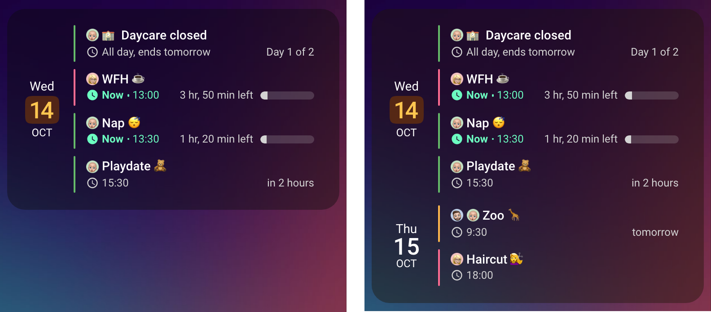

# Split Multi-Day Events

`split_multiday_events` shows a multi-day event on every day it covers instead of only on its
first, so a conference, a trip or an on-call week stays visible on each of its days and clashes
with other events are easy to spot. Set it for the whole card or per calendar:

```yaml
# Global option for all calendars
split_multiday_events: true

# Entity-specific settings
entities:
  - entity: calendar.family
    split_multiday_events: true # Show family events on each day
  - entity: calendar.work
    split_multiday_events: false # Show work events only on first day (default)
```

It is off by default, except in column view. Grid and Month ignore it and place multi-day events
themselves.

## ✂️ How Each Day Is Shown

When enabled, multi-day events are split in a way that preserves their original properties:

- **All-day events** appear as single-day all-day events on each day they cover
- **Timed multi-day events** are split into:
  - First day: its start and its own end, as the event reads unsplit (below), such as
    "10:00 until Friday, Oct 23 at 15:00"
  - Middle days: full all-day events, reading "All day"
  - Last day: its end alone, such as "Until 15:00"

Each row names a time the event really starts or ends at, so a day seen on its own, as a month's
[day list](/features/month-view#the-day-list) shows it, reads true.

A timed event ending exactly at midnight has no row on the date that midnight opens, even when
it spans several days. An event ending after midnight still has a final-day row.

Left unsplit, a timed event shows its whole span on its first day: an event from 22:30 to 0:30
the next day reads "22:30, ends tomorrow at 0:30", and one running on to Friday "9:00 until
Friday, Oct 23 at 17:00".

Each row stands for its day, which changes what other features show on it:

- A [countdown](/features/event-content#countdown-display) counts to the row's own start, a
  [count-up](/features/event-content#counting-up-from-past-events) from its own end, and a row
  under way has neither.
- A [progress bar](/features/event-content#progress-bar-display) measures the whole event and
  is drawn on today's row, so it keeps growing from one day to the next.
- The middle days of a timed event are whole days, so they get an
  [all-day badge](/features/event-content#which-events-get-one).
- Every row occupies a single day, so
  [`show_single_allday_time`](/features/event-content#hiding-the-time-row) governs every all-day
  row, a timed event's middle days included; its first and last days keep their times.
- The [day counter](#day-counter) names the row's own day.

## 🔢 Day Counter

With the [progress bar](/features/event-content#progress-bar-display) on, an event a day or
longer says which of its days it is on, such as "Day 12 of 45", in place of its bar, so a course,
a trip or a vacation shows how far along it is at a glance.

<br>

A daycare closure over two days reads "Day 1 of 2"; the shorter events under way keep their bars.

The counter goes where the countdown and the bar go:

```yaml
show_progress_bar: true
```

| Option              | Type    | Default | Description                                                                                                                       |
| ------------------- | ------- | ------- | --------------------------------------------------------------------------------------------------------------------------------- |
| `show_progress_bar` | boolean | `false` | Show a progress bar on events under way. In list and column view, an event a day or longer shows "Day 2 of 3" on each row instead |

- **Which events count.** An all-day event over two or more dates, and a timed event at least a
  full day long that takes up two or more dates: it ends at least two dates after it starts, or
  on the next date no earlier than its start time. An end at 0:00 takes up none of the date it
  opens, so a single day from midnight to midnight takes up one date and counts none, like a
  night from 22:00 to 06:00. Days are calendar dates, so Monday 18:00 to Wednesday 10:00 runs
  three days.
- **Which day a row names.** The day it is drawn on. Split, each day's row names its own; left
  unsplit, a row names the day it stands under, so a course that began before the card's first
  day reads "Day 12 of 45" there.
- **The countdown comes first.** Before an event starts, a row with a
  [countdown](/features/event-content#countdown-display) keeps it, and the counter takes over
  once the event is under way. A row with no countdown to show, because it is off, the event
  is beyond [`countdown_max_days`](/features/event-content#countdown-range), or `once_per_day`
  left a repeat out, names its day from the start. After the event ends, the counter stays where
  a [count-up](/features/event-content#counting-up-from-past-events) would go.
- **In place of the bar.** A bar barely moves over a long event, so these events draw the
  counter instead, all-day ones included, which never had a bar. Shorter events keep theirs.
  [Time left](/features/event-content#time-left-on-a-running-event) gives way to the counter in
  the same way while the bar is on.
- **No Now mark.** These events are never marked
  [Now](/features/event-content#the-now-indicator), on any row and with the bar on or off, and
  their time is not drawn green: on a 45-day course "Now" would be true every day. A night shift
  shorter than a day keeps its mark.

::: details Midnight, Later Windows, Grid & Month

- A timed event ending at 0:00 does not count the date that midnight opens: Nov 1 0:00 to Dec 16
  0:00 is 45 days. Where the clocks go back at midnight, an event ending at the second 0:00 takes
  up an hour of that date and counts it.
- When the card's window starts after the event does, through `start_date` or the toolbar, an
  unsplit row names the window's first day, such as "Day 19 of 45".
- [Grid view](/features/grid-view) draws no counter, since its all-day banners already span
  their days, and its blocks keep their progress bars.
- [Month view](/features/month-view) draws no counter and no progress bar; see
  [Options That Do Nothing in Month View](/features/month-view#options-that-do-nothing-in-month-view).
- In List and Columns the counter takes the countdown's place, including
  [beside the title](/features/event-content#time-beside-the-title), and its look. A theme can
  tell the two apart by the counter's `day-counter` class.

:::

## 🧭 Column & Grid View

In the [column layout](/features/column-view) this option starts from `true` rather than from
your top-level value, so setting `split_multiday_events: false` at the top level changes the list
layout only. To keep multi-day events whole in columns too, say so in the block:

```yaml
split_multiday_events: false
column:
  split_multiday_events: false
```

The per-calendar form works in the column layout too, so a single calendar can keep its events
whole while the rest of the card splits:

```yaml
entities:
  - entity: calendar.anna
    split_multiday_events: false
```

[Grid view](/features/grid-view) ignores the option and places multi-day events itself: an
all-day event, or a timed one a full day or longer, is one banner across its days (see
[Long Timed Events as Banners](/features/grid-view#long-timed-events-as-banners)), and a shorter
timed event gets a block on every day it touches. A
day's part of an event still shows when the event's first day is left off the card, by a
weekday or weekend filter or because empty days are hidden. See
[Options That Do Nothing in Grid View](/features/grid-view#options-that-do-nothing-in-grid-view).

## 📅 Month View

[Month view](/features/month-view) ignores `split_multiday_events` too. An all-day event over
several days is one [bar](/features/month-view#bars-lines) across them, starting again at the
start of each week it continues into. A timed event a full day or longer is a bar as well, while
`multiday_banners` is on, as it is by default; turn it off and the event has a line on each day
instead:

```yaml
month:
  multiday_banners: false
```

A shorter timed event, such as a night shift, has a line on each day it touches. The day's list
and the panel show a multi-day event on every day it covers, and with `show_past_events: false` a
bar keeps its earlier days there until the whole event is past. `multiday_banners` applies to Grid's
banners too, and a calendar's own value wins over the card's.

This page covers `split_multiday_events`, in [Core Settings in the configuration reference](/reference/configuration#core-settings), and the day counter, which `show_progress_bar` turns on, in [Event Column](/reference/configuration#event-column).
