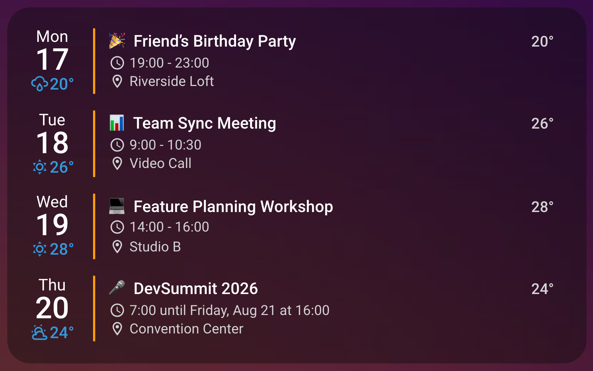
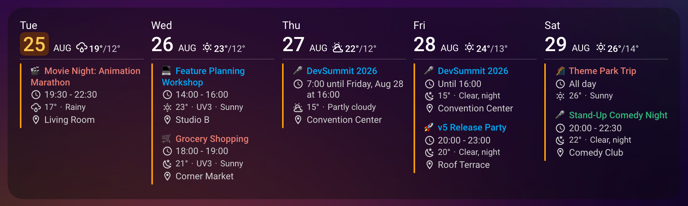
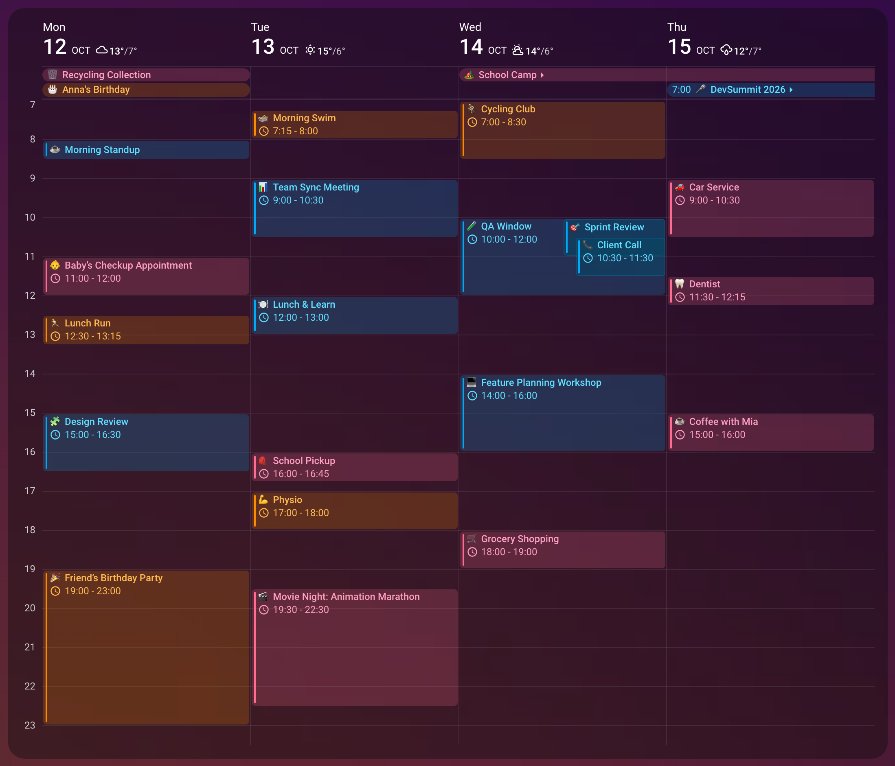

# Weather Integration

Calendar Card Pro can show the weather forecast beside your schedule: each day's forecast in its header, an event's forecast beside the event, for its hour where the hourly forecast reaches it, or both. Each layout shows it its own way, so a list can show it beside events while a grid shows it on its days.

<br>

Name the entity once with `weather_entity`, then give each layout that should show the forecast a
`weather:` of its own, inside `list:`, `column:`, `time_grid:` or `month:`. Its `position` says
where the forecast goes, and `date` and `event` set what each place shows:

```yaml
type: custom:calendar-card-pro
entities:
  - calendar.family
days_to_show: 5
weather_entity: weather.forecast_home
list:
  weather:
    position: both # Options: 'none', 'date', 'event', or 'both'
    date:
      # Date column shows condition icon and high temperature only
      show_conditions: true
      show_high_temp: true
      show_low_temp: false
      icon_size: '16px'
      font_size: '14px'
      color: '#3498db'
    event:
      # Event row shows just the temperature. In the list layout that means no icon;
      # column and grid keep the icon (see Weather In The Column Layout).
      show_conditions: false
      show_temp: true
      font_size: '13px'
      color: 'var(--secondary-text-color)'
```

::: tip Visual Editor
Each layout has a **Weather** page of its own. Choose a **Weather Entity** there, which every layout shares, and the forecast turns on in the layout you are editing; **Show The Forecast** then decides where: **In the Day Header**, **Beside Each Event**, or both, each with the options for its position. Month offers **Nowhere** and **Beside Each Event**.

The entity is also on [Events, Weather & Language](/features/editor#events-weather-language) under Whole Card, where choosing it turns no forecast on; its **Show the forecast in** line opens each layout's Weather.
:::

## ⚙️ Weather Configuration Options

`weather_entity` sits at the top level. Every other option sits under a layout's `weather`, and
those for each position under `date` or `event`:

| Option                            | Type    | Default                       | Description                                                                                                                                                                                                                                       |
| --------------------------------- | ------- | ----------------------------- | ------------------------------------------------------------------------------------------------------------------------------------------------------------------------------------------------------------------------------------------------- |
| `weather_entity`                  | string  | -                             | Weather entity every layout draws its forecast from. Top level only                                                                                                                                                                               |
| `position`                        | string  | `none`                        | Where this layout shows weather data: `'none'` (nowhere), `'date'` (day header), `'event'` (next to events), or `'both'`                                                                                                                          |
| `date → show_conditions`          | boolean | `true`                        | Whether to show weather condition icons in the day header                                                                                                                                                                                         |
| `date → show_high_temp`           | boolean | `true`                        | Whether to show high temperature in the day header                                                                                                                                                                                                |
| `date → show_low_temp`            | boolean | `false`                       | Whether to show low temperature in the day header. The UV index takes this place on days it is shown                                                                                                                                              |
| `date → show_uv_index`            | boolean | `false`                       | Whether to show UV index in the day header                                                                                                                                                                                                        |
| `date → uv_index_threshold`       | number  | `0`                           | Only show UV index when it is at least this value (0 = always show when enabled)                                                                                                                                                                  |
| `date → icon_size`                | string  | `14px`                        | Size of weather icons in the day header, as a CSS length such as `14px` or `1em`. A percentage, negative size, keyword or misspelled unit falls back to `14px`                                                                                    |
| `date → font_size`                | string  | `12px`                        | Size of weather text in the day header, as a CSS font size such as `12px`, `1em` or `90%`. A negative size, misspelled unit or word that is not a font size falls back to `12px`                                                                  |
| `date → color`                    | string  | `var(--primary-text-color)`   | Color of weather text and icons in the day header. Matches the weekday, day number and month it sits beside                                                                                                                                       |
| `event → show_conditions`         | boolean | `true`                        | List and month layouts: whether to show the condition icon. Column and grid layouts: whether to state the condition in words — the icon is always shown                                                                                           |
| `event → show_temp`               | boolean | `true`                        | Whether to show temperature in the event row                                                                                                                                                                                                      |
| `event → show_uv_index`           | boolean | `false`                       | Whether to show UV index in the event row                                                                                                                                                                                                         |
| `event → uv_index_threshold`      | number  | `0`                           | Only show UV index when it is at least this value (0 = always show when enabled)                                                                                                                                                                  |
| `event → daily_forecast_fallback` | boolean | `true`                        | Fall back to the daily forecast for a timed event on a date the hourly forecast does not reach                                                                                                                                                    |
| `event → max_lines`               | number  | `0`                           | Column and grid layouts: maximum number of lines the condition words may take (0 = unlimited). Truncated words show `...`. List and month draw no words, so it does nothing there                                                                 |
| `event → icon_size`               | string  | `14px`                        | Size of weather icons in the event row, as a CSS length such as `14px` or `1em`. A percentage, negative size, keyword or misspelled unit falls back to `14px`                                                                                     |
| `event → font_size`               | string  | `12px`                        | Size of weather text in the event row, as a CSS font size such as `12px`, `1em` or `90%`. A negative size, misspelled unit or word that is not a font size falls back to `12px`                                                                   |
| `event → color`                   | string  | `var(--secondary-text-color)` | Color of weather text and icons beside events. Matches the time and location it sits beside. Accepts `accent` for a readable shade of each event's calendar color; unset, it takes that shade wherever `event_color` is `accent`, as in grid view |

## 🗺️ Weather Per Layout

Each layout reads only its own `weather:`, so one card can show the forecast beside events in a
list and on the days of a grid, and leave a month without it. A layout without one shows no
weather, though the card names an entity:

```yaml
type: custom:calendar-card-pro
entities:
  - calendar.family
view: grid
toolbar:
  show: true # the layout switcher offers every layout
weather_entity: weather.forecast_home
list:
  weather:
    position: event
time_grid:
  weather:
    position: date
    date:
      show_low_temp: true
month:
  weather:
    position: event
# column: no weather, so Columns shows none
```

| Option           | Type   | Default | Description                                                                                                                                                      |
| ---------------- | ------ | ------- | ---------------------------------------------------------------------------------------------------------------------------------------------------------------- |
| `weather_entity` | string | -       | Weather entity every layout draws from; top level only                                                                                                           |
| `weather`        | object | -       | Inside `list:`, `column:`, `time_grid:` or `month:`: how that layout shows the forecast, with `position`, `date` and `event`. Without one, the layout shows none |

- **Each layout shows the forecast where it has room for it.** List puts a day's in its date
  column and an event's on its title row; Columns and Grid put a day's in the day's heading and
  give an event's a row of its own. See [Weather In The Column Layout](#weather-in-the-column-layout)
  and [Weather In The Grid Layout](#weather-in-the-grid-layout).
- **Month shows the forecast beside events only**, in the day list a phone shows under its weeks
  and in the list **+N more** opens. `event` and `both` show it there; `date` and `none` show
  nothing, and a month's `date` options do nothing.
- **A narrow screen's list uses List's weather.** A Columns or Grid card that falls back to the
  list layout for lack of room shows it as `list:` says, as with every other list option, so set
  weather there too if the narrow card should show it.
- **The entity is the card's.** An `entity` inside a layout's `weather:` is ignored, and the
  browser console says so.
- **Switching layouts loads nothing again.** The card subscribes once to every forecast the
  layouts it can show need, so switching between them, or falling back to the list, draws from
  the same forecast.

::: details Weather Written Before v6

Before v6, one top-level `weather:` held the entity and how every layout showed it. A card
written that way keeps working as it always has: while the top-level `weather:` names an
entity, List, Columns and Grid show it as before, Month shows none, and each layout's own
`weather:` and `weather_entity` are ignored, which the browser console reports.

Opening such a card in the visual editor converts it for you: the entity moves to
`weather_entity`, List, Columns and Grid each take the old options, the card looks the same, and
the editor says so with **Undo**. See
[Upgrading Weather From v5](/features/editor#upgrading-weather-from-v5) and
[What the Editor Does on Opening](/guide/upgrading#what-the-editor-does-on-opening).

To convert it by hand, move the entity to `weather_entity` and copy the other options into each
layout that should show them. A `position` the old block left out meant `date`, so write it out.
Replace the whole block; a card holding both keeps reading the old one.

Before:

```yaml
weather:
  entity: weather.forecast_home
  event:
    show_temp: false
```

After, showing the same:

```yaml
weather_entity: weather.forecast_home
list:
  weather:
    position: date
    event:
      show_temp: false
column:
  weather:
    position: date
    event:
      show_temp: false
time_grid:
  weather:
    position: date
    event:
      show_temp: false
```

A top-level `weather:` without an entity showed nothing before v6 and is ignored now.

:::

## 📍 Weather Display Positions

A layout's `position` decides where the forecast appears in it:

- `none`: Hides weather in that layout, the default. A card whose layouts all show none subscribes to no forecast at all
- `date`: Shows daily forecasts in the day header — the date column in list view, the column heading in column view, and the date row above each column in grid view. Month has no day header for it
- `event`: Shows hourly forecasts beside each event
- `both`: Displays weather in both positions simultaneously; in Month, beside events

::: info How Far Forecasts Reach
Home Assistant weather entities typically provide hourly forecasts for about two days
ahead, while daily forecasts reach much further (six days or more, depending on the
provider). A timed event takes, in this order:

1. the hourly forecast for the hour it starts in;
2. else the nearest hourly forecast on the same date, even one several hours away, such as that
   date's last hourly forecast for an evening event past the hourly horizon;
3. else, on a date the hourly forecast does not reach, that date's daily forecast, so weather
   keeps appearing across the whole calendar.

Set `event → daily_forecast_fallback: false` if you would rather show nothing than a daily
value; the first two steps still apply. All-day events always use the daily forecast.
:::

A timed event that has ended loses its forecast, even where the card still shows it as a past
event.

Beside an event, a sunny or partly cloudy hour is drawn with a moon after dark. Weather taken
from the daily forecast describes the whole day, so it keeps the day icon.

::: details What Counts as Dark
Where the hourly forecast marks each hour as day or night (Home Assistant's `is_daytime`), that
decides, so the icon follows the sun where the forecast is, even in another time zone. Without
it, 18:00 to 06:00 counts as night, in the same local time the card shows events in.
:::

## 🧭 Position-Specific Configuration

`date` and `event` are set independently, so the day header and the event rows can show
different parts of the forecast, at different sizes and in different colors. Only the day header
has the high and low temperatures, and only an event row has `show_temp`,
`daily_forecast_fallback` and `max_lines`; its temperature is for the event's hour, or the
nearest hour that date has, where the hourly forecast reaches it (see
[How Far Forecasts Reach](#weather-display-positions)). Every option and its default is in the
[table above](#weather-configuration-options).

## 🌂 Turning Weather Off for One Calendar

`show_weather: false` on one calendar leaves the weather out beside that calendar's events and
keeps it beside every other calendar's. It suits a calendar whose events the weather has no
bearing on, such as work held indoors.

```yaml
type: custom:calendar-card-pro
entities:
  - calendar.family
  - entity: calendar.work
    show_weather: false
weather_entity: weather.forecast_home
list:
  weather:
    position: event
```

| Option         | Type    | Default | Description                                                                          |
| -------------- | ------- | ------- | ------------------------------------------------------------------------------------ |
| `show_weather` | boolean | `true`  | Set on a calendar under `entities`. `false` leaves the weather out beside its events |

It leaves out the badge beside the title in list view, the weather row in column and grid view
and the forecast beside its events in month view, and grid view no longer reads the event's
weather to screen readers. The forecast in the day header stays, because it describes the day
for every calendar on the card.

The option can only take weather away, in every layout. A layout's `position` decides whether
its events get weather at all, so where it is `date` or `none` this changes nothing, and `true`
draws what the layout draws anyway.

::: tip Visual Editor
**Event Weather** is the last setting under **Visible Event Parts** on each calendar's page. A
calendar's page holds the options of every layout the card can show, so it appears once any of
those layouts shows the forecast beside events, and names the layouts it applies to where only
some of them do.
:::

::: details Calendars Listed Twice & Merged Rows

- The option belongs to the entry, not the calendar. A calendar
  [listed twice to split its events by type](/features/filtering#separating-all-day-from-timed-events)
  can keep the weather on its all-day events and leave it off its timed ones.
- A row [merged from several calendars](/features/filtering#filtering-duplicate-events)
  follows the calendar listed first among them.

:::

## 🧭 Weather In The Column Layout

Column and grid layouts give each event's forecast a row of its own, beneath the time and
above the location, instead of putting it on the title row.

<br>

**The condition icon is always shown there**, and `show_conditions` decides whether the
condition is also stated in words:

```yaml
type: custom:calendar-card-pro
entities:
  - calendar.family
view: column
weather_entity: weather.forecast_home
column:
  weather:
    position: event
    event:
      show_conditions: true # Column and grid layouts: state the condition in words
      show_temp: true
      show_uv_index: true
      max_lines: 1 # Keep the row to one line, truncating the words if needed
```

The pieces read in the order icon, temperature, UV index, words, separated by a middot, so the
example above reads `21° · UV4 · Partly cloudy`. Only the pieces you switched on appear, and
there is no separator after the icon.

- **The words** are Home Assistant's own, in the card's `language`: a German instance reads
  `21° · Teilweise bewölkt` with no extra configuration, and a card set to `language: en` on it
  reads `21° · Partly cloudy`. A card with no `language` of its own follows Home Assistant's. A condition Home Assistant has not translated into that language
  reads in English, and an instance too old to provide the words shows only the icon and the
  temperature.
- **The color** is that of the time and location rows above, not the title's.
  `event → color` in each layout's `weather` overrides it.
- **On a narrow track** the words move to a line of their own, starting under the temperature.
  The temperature and the UV index never wrap or truncate; the words break between whole words.
  `max_lines` caps how tall the row may grow: `0`, the default, lets it wrap as far as it needs,
  and `1` keeps it on a single line with an ellipsis.
- **On a narrow screen** a column card falls back to the list layout, which shows the weather
  as `list:` says, where `show_conditions` shows or hides the icon in the usual way.

::: details More About the Words

- Translation coverage is uneven: Thai has none of the fifteen conditions, and several languages
  are missing `windy-variant`.
- The words are fetched once per language when the card loads. Until they arrive, the row shows
  the condition in Home Assistant's language, so on a card set to another language the very
  first paint may show that wording for a moment.
- A word wider than its whole line is split mid-word rather than spilling out of the column.
  At the default `min_day_width` short words such as `Sunny` stay whole; they split only in
  columns made much narrower with a lower `min_day_width` or `min_days_fallback: cramp`.
- The words are never hyphenated.

:::

## 🌤️ Weather In The Grid Layout

Grid view puts day-header weather in the date row above each column, where it reads as a
label for the whole day rather than for any one event.

<br>

The header has more room than a column track, so the condition, the high and the low all fit
side by side:

```yaml
type: custom:calendar-card-pro
entities:
  - calendar.family
view: grid
days_to_show: 4
weather_entity: weather.forecast_home
time_grid:
  weather:
    position: date
    date:
      show_conditions: true
      show_high_temp: true
      show_low_temp: true
      icon_size: '16px'
      font_size: '12px'
```

::: tip Keep The Card Inside Forecast Range
A daily forecast reaches only a few days ahead, so the last columns of a seven-day grid
will have no weather to show. Four or five days keeps every column inside range; beyond
that, the date row simply omits what the forecast does not cover.
:::

Event-position weather works the same way in grid as in column — see the section above.

## 🔄 When the Forecast Stops Updating

The card shows each forecast as Home Assistant sends it. When no update arrives for more than 2
hours for the hourly forecast, or 48 hours for the daily one, the card dims its weather, so an
old forecast does not read as current. The next update draws it at full strength again.

After Home Assistant restarts, the card subscribes to the forecast again by itself, trying again
until the weather entity has loaded, so the forecast does not stay frozen until the dashboard is
reloaded.

## ✨ Benefits & Use Cases

Choose the position by the decision the forecast helps with:

- `date` for planning a day, such as an outing or a day at the beach, from its daily forecast.
- `event` for a timed appointment, such as whether a walk to it needs an umbrella, from the
  forecast for its hour.
- `both` when both matter.

Every option on this page lives under a layout's `weather` option, except `weather_entity`, at the
top level, and `show_weather`, which is set on a calendar under `entities` — see
[Weather in the configuration reference](/reference/configuration#weather)
and [Per-Entity Options](/reference/configuration#per-entity-options).
