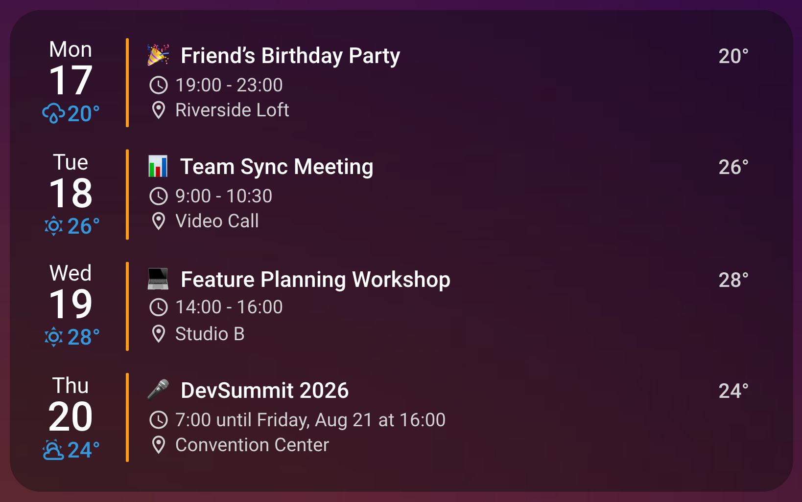
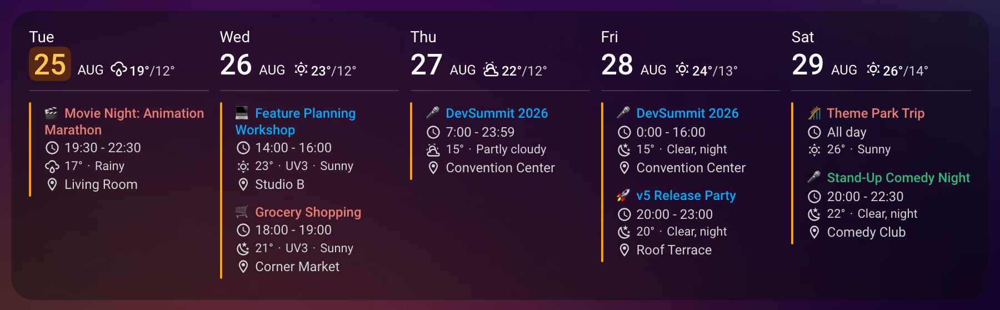
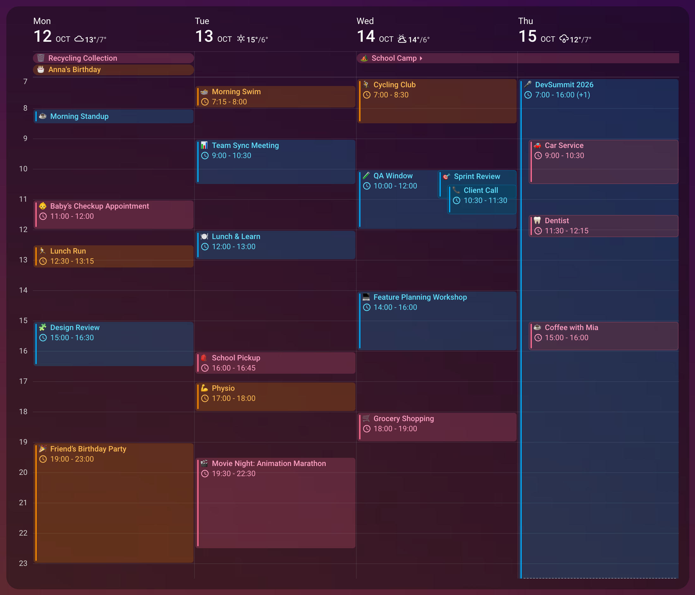

# Weather Integration

Calendar Card Pro can show the weather forecast beside your schedule: each day's forecast in its header, an event's forecast beside the event, for its hour where the hourly forecast reaches it, or both.

<br>

Give `weather` an entity and a `position`, and `date` and `event` set what each place shows:

```yaml
type: custom:calendar-card-pro
entities:
  - calendar.family
days_to_show: 5
weather:
  entity: weather.forecast_home
  position: both # Options: 'none', 'date', 'event', or 'both'
  date:
    # Date column shows condition icon and high temperature only
    show_conditions: true
    show_high_temp: true
    show_low_temp: false
    icon_size: '16px'
    font_size: '14px'
    color: '#3498db'
  event:
    # Event row shows just the temperature. In the list layout that means no icon;
    # column and grid keep the icon (see Weather In The Column Layout).
    show_conditions: false
    show_temp: true
    font_size: '13px'
    color: 'var(--secondary-text-color)'
```

::: tip Visual Editor
In the editor's **Weather** panel, choose a **Weather Entity** and **Show The Forecast** appears. Where you send the forecast decides which groups follow: **In the Day Header**, **Beside Each Event**, or both, each holding the options for its position.
:::

## ⚙️ Weather Configuration Options

Every option sits under the card's `weather` option, and those for each position under `date` or `event`:

| Option                            | Type    | Default                       | Description                                                                                                                                                                                                                                       |
| --------------------------------- | ------- | ----------------------------- | ------------------------------------------------------------------------------------------------------------------------------------------------------------------------------------------------------------------------------------------------- |
| `entity`                          | string  | -                             | Weather entity to use for forecasts                                                                                                                                                                                                               |
| `position`                        | string  | `date`                        | Where to show weather data: `'none'` (nowhere), `'date'` (day header), `'event'` (next to events), or `'both'`                                                                                                                                    |
| `date → show_conditions`          | boolean | `true`                        | Whether to show weather condition icons in the day header                                                                                                                                                                                         |
| `date → show_high_temp`           | boolean | `true`                        | Whether to show high temperature in the day header                                                                                                                                                                                                |
| `date → show_low_temp`            | boolean | `false`                       | Whether to show low temperature in the day header. The UV index takes this place on days it is shown                                                                                                                                              |
| `date → show_uv_index`            | boolean | `false`                       | Whether to show UV index in the day header                                                                                                                                                                                                        |
| `date → uv_index_threshold`       | number  | `0`                           | Only show UV index when it exceeds this value (0 = always show when enabled)                                                                                                                                                                      |
| `date → icon_size`                | string  | `14px`                        | Size of weather icons in the day header, as a CSS length such as `14px` or `1em`. A percentage, negative size, keyword or misspelled unit falls back to `14px`                                                                                    |
| `date → font_size`                | string  | `12px`                        | Size of weather text in the day header, as a CSS font size such as `12px`, `1em` or `90%`. A negative size, misspelled unit or word that is not a font size falls back to `12px`                                                                  |
| `date → color`                    | string  | `var(--primary-text-color)`   | Color of weather text and icons in the day header. Matches the weekday, day number and month it sits beside                                                                                                                                       |
| `event → show_conditions`         | boolean | `true`                        | List layout: whether to show the condition icon. Column and grid layouts: whether to state the condition in words — the icon is always shown                                                                                                      |
| `event → show_temp`               | boolean | `true`                        | Whether to show temperature in the event row                                                                                                                                                                                                      |
| `event → show_uv_index`           | boolean | `false`                       | Whether to show UV index in the event row                                                                                                                                                                                                         |
| `event → uv_index_threshold`      | number  | `0`                           | Only show UV index when it exceeds this value (0 = always show when enabled)                                                                                                                                                                      |
| `event → daily_forecast_fallback` | boolean | `true`                        | Fall back to the daily forecast for timed events beyond the hourly forecast horizon                                                                                                                                                               |
| `event → max_lines`               | number  | `0`                           | Maximum number of lines the event weather row may use (0 = unlimited). Truncated text shows `...`                                                                                                                                                 |
| `event → icon_size`               | string  | `14px`                        | Size of weather icons in the event row, as a CSS length such as `14px` or `1em`. A percentage, negative size, keyword or misspelled unit falls back to `14px`                                                                                     |
| `event → font_size`               | string  | `12px`                        | Size of weather text in the event row, as a CSS font size such as `12px`, `1em` or `90%`. A negative size, misspelled unit or word that is not a font size falls back to `12px`                                                                   |
| `event → color`                   | string  | `var(--secondary-text-color)` | Color of weather text and icons beside events. Matches the time and location it sits beside. Accepts `accent` for a readable shade of each event's calendar color; unset, it takes that shade wherever `event_color` is `accent`, as in grid view |

## 📍 Weather Display Positions

`position` decides where the forecast appears:

- `none`: Hides weather everywhere, without clearing the entity — the card subscribes to no forecast at all
- `date`: Shows daily forecasts in the day header — the date column in list view, the column heading in column view, and the date row above each column in grid view
- `event`: Shows hourly forecasts beside each event
- `both`: Displays weather in both positions simultaneously

::: info How Far Forecasts Reach
Home Assistant weather entities typically provide hourly forecasts for about two days
ahead, while daily forecasts reach much further (six days or more, depending on the
provider). Beyond the hourly horizon, timed events fall back to that day's daily
forecast so weather keeps appearing across the whole calendar. Set
`event → daily_forecast_fallback: false` if you would rather show nothing than a daily
value. All-day events always use the daily forecast.
:::

Beside an event, a sunny or partly cloudy hour is drawn with a moon after dark. Weather taken
from the daily forecast describes the whole day, so it keeps the day icon.

::: details What Counts as Dark
Where the hourly forecast marks each hour as day or night (Home Assistant's `is_daytime`), that
decides, so the icon follows the sun where the forecast is, even in another time zone. Without
it, 18:00 to 06:00 counts as night, in the same local time the card shows events in.
:::

## 🧭 Position-Specific Configuration

`date` and `event` are set independently, so the day header and the event rows can show
different parts of the forecast, at different sizes and in different colors. Only the day header
has the high and low temperatures, and only an event row has `show_temp`,
`daily_forecast_fallback` and `max_lines`; its temperature is for the event's hour where the
hourly forecast reaches it. Every option and its default is in the
[table above](#weather-configuration-options).

## 🧭 Weather In The Column Layout

<br>

Column and grid layouts give each event's forecast a row of its own, beneath the time and
above the location, instead of putting it on the title row. **The condition icon is always shown
there**, and `show_conditions` decides whether the condition is also stated in words:

```yaml
type: custom:calendar-card-pro
entities:
  - calendar.family
view: column
weather:
  entity: weather.forecast_home
  position: event
  event:
    show_conditions: true # Column and grid layouts: state the condition in words
    show_temp: true
    show_uv_index: true
    max_lines: 1 # Keep the row to one line, truncating the words if needed
```

The pieces read in the order icon, temperature, UV index, words, separated by a middot, so the
example above reads `21° · UV4 · Partly cloudy`. Only the pieces you switched on appear, and
there is no separator after the icon.

- **The words** are Home Assistant's own, in the card's `language`: a German instance reads
  `21° · Teilweise bewölkt` with no extra configuration, and a card set to `language: en` on it
  reads `21° · Partly cloudy`. A card with no `language` of its own follows Home Assistant's. A condition Home Assistant has not translated into that language
  reads in English, and an instance too old to provide the words shows only the icon and the
  temperature.
- **The color** is that of the time and location rows above, not the title's.
  `weather → event → color` overrides it in both layouts.
- **On a narrow track** the words move to a line of their own, starting under the temperature.
  The temperature and the UV index never wrap or truncate; the words break between whole words.
  `max_lines` caps how tall the row may grow: `0`, the default, lets it wrap as far as it needs,
  and `1` keeps it on a single line with an ellipsis.
- **On a narrow screen** a column card falls back to the list layout, where the same
  `show_conditions` shows or hides the icon in the usual way.

::: details More About the Words

- Translation coverage is uneven: Thai has none of the fifteen conditions, and several languages
  are missing `windy-variant`.
- The words are fetched once per language when the card loads. Until they arrive, the row shows
  the condition in Home Assistant's language, so on a card set to another language the very
  first paint may show that wording for a moment.
- A word wider than its whole line is split mid-word rather than spilling out of the column.
  `Sunny` stays whole at the default `min_day_width` of `140` and splits only at roughly half
  that, which takes a lowered `min_day_width` or `min_days_fallback: cramp`.
- The words are never hyphenated.

:::

## 🌤️ Weather In The Grid Layout

<br>

Grid view puts day-header weather in the date row above each column, where it reads as a
label for the whole day rather than for any one event. The header has more room than a
column track, so the condition, the high and the low all fit side by side:

```yaml
type: custom:calendar-card-pro
entities:
  - calendar.family
view: grid
days_to_show: 4
weather:
  entity: weather.forecast_home
  position: date
  date:
    show_conditions: true
    show_high_temp: true
    show_low_temp: true
    icon_size: '16px'
    font_size: '12px'
```

::: tip Keep The Card Inside Forecast Range
A daily forecast reaches only a few days ahead, so the last columns of a seven-day grid
will have no weather to show. Four or five days keeps every column inside range; beyond
that, the date row simply omits what the forecast does not cover.
:::

Event-position weather works the same way in grid as in column — see the section above.

## ✨ Benefits & Use Cases

Choose the position by the decision the forecast helps with:

- `date` for planning a day, such as an outing or a day at the beach, from its daily forecast.
- `event` for a timed appointment, such as whether a walk to it needs an umbrella, from the
  forecast for its hour.
- `both` when both matter.

Every option on this page lives under the card's weather settings — see [Weather in the configuration reference](/reference/configuration#weather).
