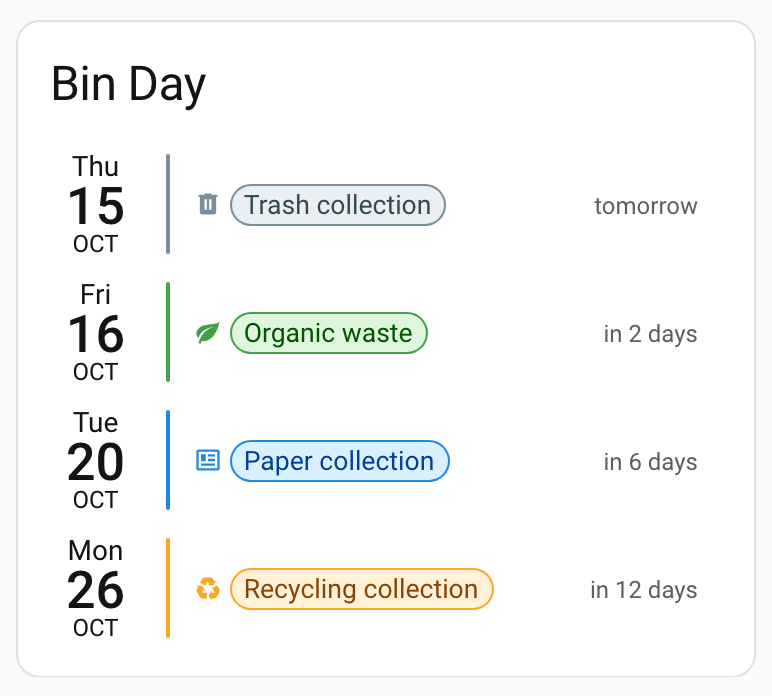

# Bin Day

One waste-collection feed, split so that each bin shows only its next pickup, in half a dashboard section. It answers one question: which bin goes out tonight?

## 🖼️ See It

<br>

Each bin's next pickup, nearest first, in the bin's own color.

## 📋 Copy the Card

Replace `calendar.trash_pickup` with your waste calendar and each `allowlist` with your feed's word for that bin. The card is built for a feed of all-day pickups, each titled with its bin's word in any capitalization: _🗑️ Recycling_ lands in the Recycling block and reads _Recycling_. `replace_pattern` removes the 🗑️ this feed puts before every title; match your own prefix, or drop it.

```yaml
type: custom:calendar-card-pro
config_version: 5
title: Bin Day
days_to_show: 31
show_countdown: once_per_day
show_single_allday_time: false
allday_badge: title
allday_badge_style: tinted
hide_when_empty: true
entities:
  - entity: calendar.trash_pickup
    allowlist: Trash
    replace_pattern: '🗑️ '
    allday_expires_at: '10:00'
    compact_events_to_show: 1
    label: mdi:trash-can
    label_icon_color: '#78909c'
    accent_color: '#78909c'
  - entity: calendar.trash_pickup
    allowlist: Recycling
    replace_pattern: '🗑️ '
    allday_expires_at: '10:00'
    compact_events_to_show: 1
    label: mdi:recycle
    label_icon_color: '#f9a825'
    accent_color: '#f9a825'
  - entity: calendar.trash_pickup
    allowlist: Paper
    replace_pattern: '🗑️ '
    allday_expires_at: '10:00'
    compact_events_to_show: 1
    label: mdi:newspaper-variant-outline
    label_icon_color: '#1e88e5'
    accent_color: '#1e88e5'
  - entity: calendar.trash_pickup
    allowlist: Organic
    replace_pattern: '🗑️ '
    allday_expires_at: '10:00'
    compact_events_to_show: 1
    label: mdi:leaf
    label_icon_color: '#43a047'
    accent_color: '#43a047'
```

A tap shows the entry's title as the card does, without the prefix. A waste-collection feed is usually read only; on a calendar that [allows editing](/features/actions#what-each-integration-allows), the title shows as stored, prefix included, once someone starts editing it.

## 🧭 What It Adds

| Editor                                     | YAML                                                                                                                  | What it adds                                                                                                   |
| ------------------------------------------ | --------------------------------------------------------------------------------------------------------------------- | -------------------------------------------------------------------------------------------------------------- |
| Calendars › Which Events                   | one calendar in four blocks, `allowlist`, `compact_events_to_show: 1`, `allday_expires_at: '10:00'`                   | Each bin's next pickup only, since the limit counts per block, not per calendar; gone at 10:00 on its day      |
| Calendars › Name & Look · Text Replacement | `label`, `label_icon_color`, `accent_color`, `replace_pattern`                                                        | A bin icon in the bin's color; the feed's prefix removed                                                       |
| Events                                     | `allday_badge: title`, `allday_badge_style: tinted`, `show_countdown: once_per_day`, `show_single_allday_time: false` | The bin's name in a pill of its color; "tomorrow" instead of "All day", once on a day two bins go out together |
| List › Which Events                        | `days_to_show: 31`, `hide_when_empty`                                                                                 | A month ahead, so a monthly bin still shows; no pickups, no card                                               |

## 🔀 Adapt It

- **More kinds of bin.** A pickup that no `allowlist` matches is left out. Add a block for it, or a catch-all with `blocklist: 'Trash|Recycling|Paper|Organic'`.
- **A later truck.** Move `allday_expires_at` to the time your bins are usually emptied.
- **The general pattern.** One calendar split into blocks with rules of their own is how the [Family Agenda](/guide/one-calendar-many-purposes#calendars-event-blocks) handles a whole family's calendars.

## 📚 Next Steps

- [Entity-Level vs. Global Event Limits](/features/list-view#entity-level-vs-global-event-limits) — a limit for each block
- [Retiring All-Day Events During the Day](/features/filtering#retiring-all-day-events-during-the-day) — when a pickup leaves the card
- [Repeated Countdowns](/features/event-content#repeated-countdowns) — one "tomorrow" for two bins on the same day
- [Text Replacement](/features/filtering#text-replacement) and [The All-Day Badge](/features/event-content#the-all-day-badge) — the prefix and the pill
- [Configuration Reference](/reference/configuration) — every option
