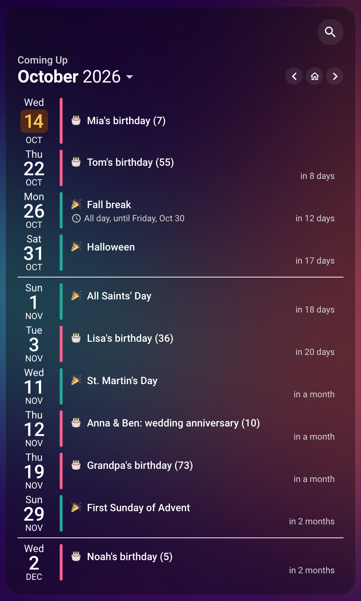

# Birthdays & Holidays

The next 60 days of birthdays and holidays, for a dashboard section or a pop-up: whose birthday is next, how old they turn, and when the next break starts and ends. The ages come from the calendar entries, with nothing to set up on the card.

## 🖼️ See It

<br>

Birthdays in pink, holidays in teal, and a rule where one month ends.

## 📋 Copy the Card

Replace the two `calendar.*` ids with your own birthday and holiday calendars. The card is built for birthdays stored as all-day events that repeat every year, each with the birth year in its description as `YEAR=1990`. It adds the age to the title, `(36)` in 2026 and `(37)` in 2027, with nothing to edit. The age is the card's own addition, so the popover a tap opens shows the title without it.

```yaml
type: custom:calendar-card-pro
config_version: 5
title: Coming Up
days_to_show: 60
show_countdown: true
show_single_allday_time: false
month_separator_width: 1px
day_spacing: 4px
event_gap: 4px
vertical_line_width: 4px
toolbar:
  show: true
  legend: false
  add_event: false
  refresh: false
  view_switcher: false
event_tap_action:
  action: details
entities:
  - entity: calendar.birthdays
    label: 🎂
    accent_color: '#f06292'
  - entity: calendar.holidays
    label: 🎉
    accent_color: '#26a69a'
```

The toolbar is there for its magnifier: a search answers _when is Clara's birthday?_ a year back or ahead, beyond the 60 days on screen. Search comes with the date navigation, so the arrows and a swipe page through the days too, and the title becomes a small label over the month. Every other toolbar control is turned off. See [Searching the Card](/features/layout-appearance#searching-the-card).

::: tip Build It in the Editor
[Quick Setup](/features/editor#quick-setup) in the visual editor builds this card on your own calendars: its layout, its look and its two colors, in order. Add the 🎂 and 🎉 labels yourself.
:::

## 🧭 What It Adds

| Editor                           | YAML                                                                           | What it adds                                                                                                                                              |
| -------------------------------- | ------------------------------------------------------------------------------ | --------------------------------------------------------------------------------------------------------------------------------------------------------- |
| Time Range & Content             | `days_to_show: 60`                                                             | 60 days, about two months ahead; days with nothing on them stay hidden                                                                                    |
| Events                           | `show_countdown`, `show_single_allday_time: false`, `vertical_line_width: 4px` | How far away each event still to come is; no "All day" line under a one-day event, while a holiday of several days still shows when it ends; a bolder bar |
| Separators · Layout              | `month_separator_width: 1px`, `day_spacing: 4px`, `event_gap: 4px`             | A rule between months; days close together, each event with a bar of its own                                                                              |
| Calendars › Name, Label & Colors | `label`, `accent_color`                                                        | A 🎂 or 🎉 before each title, in its calendar's color                                                                                                     |
| Card & Header › Toolbar          | `toolbar` with `legend`, `add_event`, `refresh` and `view_switcher` off        | A search for any birthday or holiday a year back or ahead, and the arrows it comes with                                                                   |
| Actions & Refresh                | `event_tap_action: details`                                                    | The calendar's entry on tap                                                                                                                               |

## 🔀 Adapt It

- **Fixtures & school terms.** A team's fixtures or a school's term dates are the same shape: add the calendar as a third entry with an emoji and a color of its own.
- **Anniversaries.** The same `YEAR=` marker counts the years since a wedding.
- **Further ahead.** Raise `days_to_show`; the month rules keep a long list readable.

## 📚 Next Steps

- [Birthday Ages & Anniversary Counts](/features/event-content#birthday-ages-anniversary-counts) — how to write the marker, and what the card does with it
- [Countdown Display](/features/event-content#countdown-display) — the wording under each event
- [Week Numbers & Visual Separators](/features/layout-appearance#week-numbers-visual-separators) — the rule between months
- [Tapping an Event](/features/actions#tapping-an-event) — what the popover shows
- [Searching the Card](/features/layout-appearance#searching-the-card) — what the magnifier finds
- [Configuration Reference](/reference/configuration) — every option
