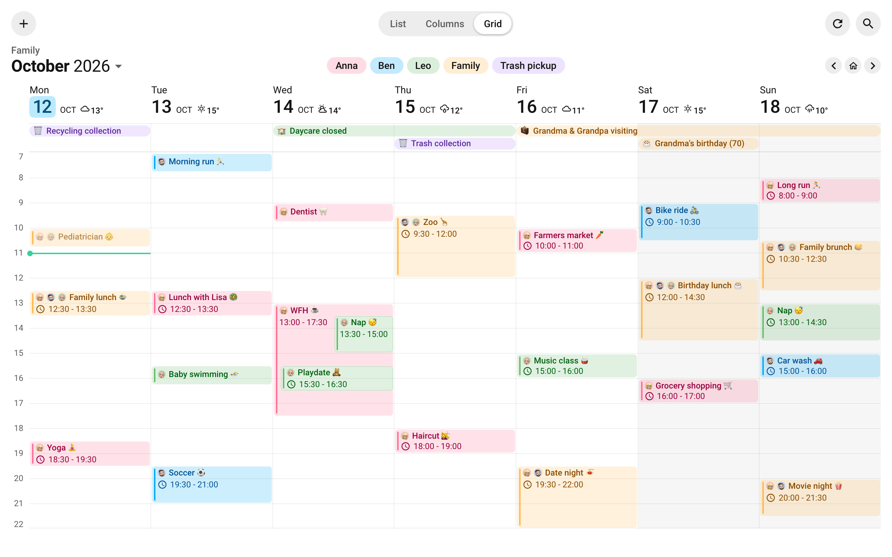
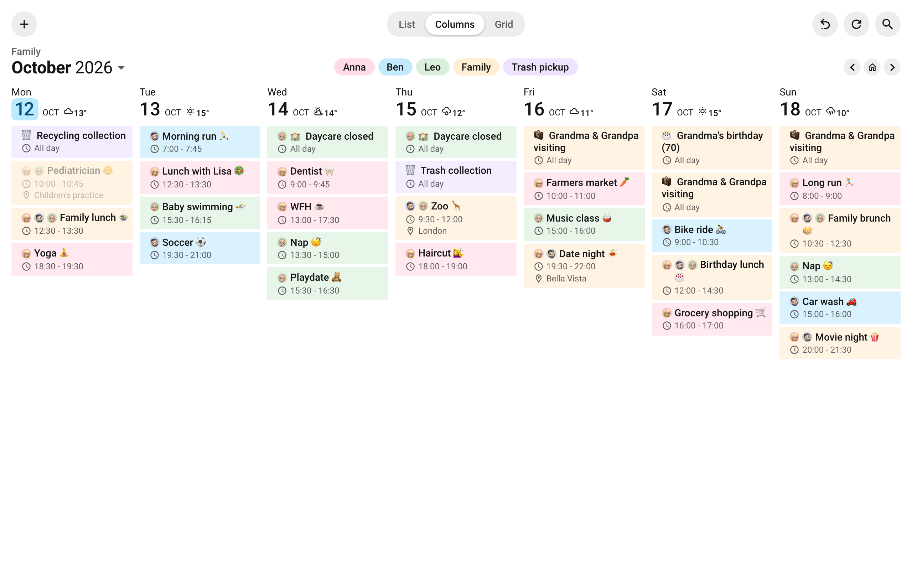
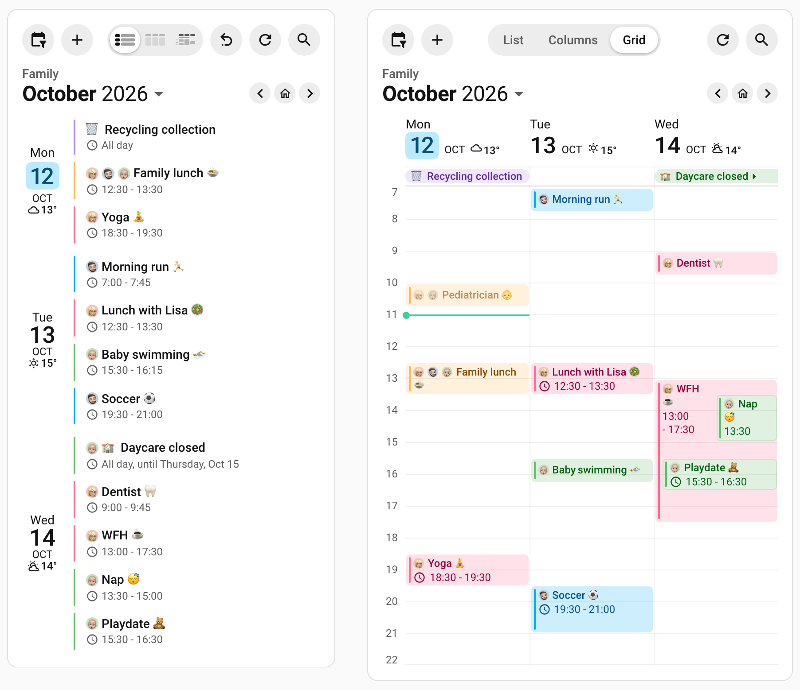

# Family Hub

Anna, Ben and their baby son Leo are an invented family with a tablet on the kitchen wall, a family dashboard and the same card on their phones. Wherever it is, it answers one question: who is busy when over the next few days, and which plans do they share? Each device picks its own layout and remembers it.

## 🖼️ See It

The kitchen wall in use, then three stills: the wall in grid view, the same card switched to Columns, and the card on a phone and in a dashboard section.

<video class="clip" src="https://raw.githubusercontent.com/alexpfau/calendar-card-pro/main/.github/img/journey_family_hub_wall.mp4" poster="https://raw.githubusercontent.com/alexpfau/calendar-card-pro/main/.github/img/journey_family_hub_wall_poster.jpg" width="800" height="500" loop muted playsinline controls preload="metadata" aria-label="A wall tablet with the family's week in grid view: a finger taps Thursday's zoo trip, whose popover shows its time, that it repeats every 4 weeks, its location, London, on a small map, and Ben's calendar; then it draws Bike repair into Tuesday at 17:00, drags it to Wednesday at 10:00, moves it to Ben's calendar so it turns blue with his face, switches to Columns and back to Grid, pages to the next week and swipes back, searches for ducks and picks Feed the ducks on Tuesday, October 20, hides Anna's and Ben's calendars, presses Reset, and deletes Bike repair"></video><br>

Tap the zoo trip to see where it is on a map, draw an event into Tuesday afternoon, drag it to Wednesday, move it to Ben's calendar, switch to Columns and back, page a week ahead and swipe back, search for the ducks, hide two calendars, reset the card and delete the event.

<br>

The wall in grid view. Anna is pink, Ben is blue and Leo is green, each face in front of its events, and anything on more than one of their calendars is gold.

<br>

Switched to Columns on the toolbar: a column of tinted boxes per day, the morning's finished events faded, and Reset ready to undo the switch.

<br>

A phone switched to List, and a dashboard section where Grid shows three days and the calendar chips fold into the filter button.

::: tip A Video Review in German
Smart-Live's video review of v5, in German, shows grid view on a family calendar: [Calendar Card Pro 5: Endlich ZEITRASTER für deinen Familienkalender in Home Assistant](https://youtu.be/ptXdis8WHXo)
:::

## 📋 Copy the Card

Replace the `calendar.*` ids with your own calendars, each `name` with what its chip should say, each `person.*` label with someone from **Settings → People**, and `weather.home` with your weather entity. A person's picture shows as Home Assistant stores it, square; [A Face for Every Calendar](#a-face-for-every-calendar) shows how to make faces round.

```yaml
type: custom:calendar-card-pro
config_version: 5
title: Family
view: grid
days_to_show: 7
event_gap: 4px
filter_duplicates: true
duplicate_accent_color: '#ffb74d'
weather:
  entity: weather.home
toolbar:
  show: true
  legend: chips
  reset: true
event_tap_action:
  action: details
day_tap_action:
  action: add-event
entities:
  - entity: calendar.anna
    name: Anna
    label: person.anna
    accent_color: '#ff6c92'
  - entity: calendar.ben
    name: Ben
    label: person.ben
    accent_color: '#03a9f4'
  - entity: calendar.leo
    name: Leo
    label: person.leo
    accent_color: '#66bb6a'
  - entity: calendar.family
    name: Family
    accent_color: '#ffb74d'
  - entity: calendar.trash_pickup
    name: Trash pickup
    accent_color: '#b388ff'
list:
  days_to_show: 3
column:
  min_days_to_show: 3
  show_past_events: true
  past_event_opacity: 40
  event_background_opacity: 15
time_grid:
  start_time: '07:00'
  end_time: '22:00'
  hour_height: 36px
```

::: tip Build It in the Editor
[Quick Setup](/features/editor#quick-setup) in the visual editor builds this card on your own calendars: its layout, its look and its colors, in order. The names and faces above are this family's, so give your calendars their own.
:::

## 🧭 Across Different Screens

`view: grid` is only where the card starts. The toolbar's switcher offers List, Columns and Grid, and each device remembers its own choice until the card is edited, so the wall stays on Grid while a phone keeps List. See [Switching Between Layouts](/features/layout-appearance#switching-between-layouts).

<video class="clip portrait" src="https://raw.githubusercontent.com/alexpfau/calendar-card-pro/main/.github/img/journey_family_hub_phone.mp4" poster="https://raw.githubusercontent.com/alexpfau/calendar-card-pro/main/.github/img/journey_family_hub_phone_poster.jpg" width="430" height="860" loop muted playsinline controls preload="metadata" aria-label="The same card on a phone, in grid view for Monday to Wednesday: a finger switches it to List, swipes to Thursday to Saturday, taps Friday's date and adds Swim lesson on Anna's calendar at 11:00, deletes it, swipes back, unchecks Ben in the filter menu so the filter button shows a dot, searches for zoo and picks the zoo trip on Thursday, October 15, and presses Reset, which brings back the grid, today and every calendar"></video><br>

On a phone: switch to List, swipe to the next three days, tap Friday to add a swim lesson and delete it, swipe back, hide Ben's calendar in the filter menu, search for the zoo, pick Thursday, October 15, and reset the card.

On Home Assistant 2026.5 or later, every screen shows a change as soon as Home Assistant knows of it, with nothing to refresh: an event added on a phone to a Local Calendar is on the wall a few seconds later, and one added to a Google calendar at its next sync. See [Live Updates](/features/performance#live-updates).

### Grid, Columns & List

`days_to_show: 7` is the week the grid and the columns show, and `list.days_to_show: 3` gives a phone's List today and the next two days. See [Showing a Different Number of Days in Each Layout](/features/core-settings#showing-a-different-number-of-days-in-each-layout).

Grid sheds days one at a time as the card narrows, always keeping today, so the same card fits a narrow dashboard section. See [Fitting Narrow Cards](/features/grid-view#fitting-narrow-cards).

The `column:` block styles Columns alone, so List stays a plain agenda. `event_background_opacity: 15` tints each event in its calendar's color, `show_past_events: true` keeps today's finished events, and `past_event_opacity: 40` fades them. `min_days_to_show: 3` lets Columns drop days on a narrower screen, down to three, before it turns into a list. See [Showing Fewer Columns Instead](/features/column-view#showing-fewer-columns-instead).

`event_gap: 4px` gives each event its own rounded box and accent bar in List and Columns. Grid ignores it.

### The Toolbar

With `show: true`, `toolbar` adds two rows of controls:

- **Add** opens a new event in the card's popover, on the first calendar in `entities` that accepts new events and is not hidden on this device: Anna's while hers is shown, not the Family calendar. With every such calendar hidden, it starts on the first of them anyway. Where more than one calendar accepts new events, the popover lets you pick another before saving. Add appears only while some calendar [accepts new events](/features/actions#what-each-integration-allows). See [Add Event Button](/features/actions#add-event-button).
- **Refresh** loads the events now.
- **Search**, the magnifier at the end of the row, finds an event a year back or ahead, and a pick turns the card to that day. See [Searching the Card](/features/layout-appearance#searching-the-card).
- **The month**, under the title _Family_, opens a date picker. The arrows beside it page by the days on screen, a week on the wall and three on a phone, and the house returns to today. On a touch screen a swipe across the days pages too. See [Paging Through Dates](/features/layout-appearance#paging-through-dates).
- **The chips** from `legend: chips` are the key to the colors, and each hides its calendar on this device. Each prints its calendar's [`name`](/features/core-settings#naming-a-calendar-in-the-card), so a calendar its integration named after an account still reads _Anna_. Where they do not all fit, as on a phone, they fold into the filter button, a menu with a checkbox per calendar under Show all and Hide all. See [Showing & Hiding Calendars](/features/layout-appearance#showing-hiding-calendars).
- **Reset** is off by default; `reset: true` turns it on for a shared wall. It appears once someone on this device has paged away, switched layouts or hidden a calendar, and one press puts it all back for whoever walks up next. See [Resetting the Card](/features/layout-appearance#resetting-the-card).

### Adding & Moving on the Wall

`day_tap_action: add-event` makes every free spot a way in: tap an empty hour, or hold it and drag down to where the plan ends, and the popover opens beside it for a title. In Columns and List, a tap on a day's empty space does the same. See [Tapping a Day to Add an Event](/features/actions#tapping-a-day-to-add-an-event).

An event on a calendar that [allows changing events](/features/actions#what-each-integration-allows), such as a Local Calendar, moves in the grid by a drag: hold it for half a second on a touch screen, then drag it to another time or day. See [Moving Events by Drag](/features/grid-view#moving-events-by-drag).

## 🗂️ Calendars & Event Blocks

Five calendars go in, and each is listed once:

| Calendar                | Holds                                                       | Blocks |
| ----------------------- | ----------------------------------------------------------- | ------ |
| `calendar.anna`         | Anna's own plans                                            | 1      |
| `calendar.ben`          | Ben's own plans                                             | 1      |
| `calendar.leo`          | Leo's daycare, naps and classes                             | 1      |
| `calendar.family`       | what belongs to nobody in particular, a visit or a birthday | 1      |
| `calendar.trash_pickup` | the recycling and trash collection days                     | 1      |

Nothing is filtered, because each calendar means one thing. A plan two or three of them share sits on each of their calendars, which is what lets the card draw it once with every face on it. A calendar that mixes several kinds of event can still feed the card, split into blocks as the [Family Agenda](/guide/one-calendar-many-purposes#calendars-event-blocks) splits its own. Local, Google and CalDAV calendars all display the same way.

## 🧩 How It Works

### A Face for Every Calendar

`label: person.anna` puts Anna's picture from Home Assistant in front of her events, so a face says whose plan it is from across the room. A new photo in Home Assistant reaches the wall by itself. See [Showing a Person's Picture](/features/core-settings#showing-a-persons-picture).

::: tip Round Faces Need Round Pictures
Home Assistant stores a person's photo square, and the card draws it as stored, so it shows as a small square. For round faces, put round pictures on a transparent background in the `www` folder and point `label` at them, such as `/local/demo/anna.png`.
:::

### Gold Means the Whole Family

Family lunch is on Anna's, Ben's and Leo's calendars at once. [`filter_duplicates: true`](/features/core-settings#filtering-duplicate-events) draws it once instead of three times, with the face of every calendar it came from, in the order the calendars are listed. Copies count as one plan only when their title, start, end and location all match, as they do when the same event is added to each calendar.

[`duplicate_accent_color`](/features/core-settings#labeling-coloring-shared-events) colors those merged plans in the Family calendar's gold, so a plan on more than one person's calendar reads as a family plan, wherever it lives: the zoo trip on Ben's and Leo's calendars is gold, though nobody filed it anywhere special. The [Family Agenda](/guide/one-calendar-many-purposes#shared-plans-in-the-family-agenda) uses the same gold.

### A Birthday That Counts Itself

Grandma's birthday is a yearly all-day event on the Family calendar, called _🎂 Grandma's birthday_, with `YEAR=1956` in its description. The card adds her age to the title, so the 2026 banner reads _🎂 Grandma's birthday (70)_ and the 2027 one says 71, with nothing to edit. Because the age is part of the title, it shows even in the grid, where a banner shows its title and nothing else. See [Birthday Ages & Anniversary Counts](/features/event-content#birthday-ages-anniversary-counts).

### The All-Day Band

In grid view, all-day events get a band between the dates and the hours, and an event that runs for several days is one banner across them, like daycare closing for two days. See [All-Day Events](/features/grid-view#all-day-events).

Banners show no label, so the emoji in _🗑️ Recycling collection_ and _🏫 Daycare closed_ are written into the titles in the calendars themselves. They do the job a face does in the timed blocks.

The [Family Agenda](/guide/one-calendar-many-purposes#a-reminder-that-retires-itself) retires the trash pickup at 11:00 with `allday_expires_at`. That option acts only where past events are hidden, and the grid and the columns here keep them.

### The Next Seven Days on an Hour Axis

`view: grid` gives each day a column and puts every event at the time it starts, as tall as it is long. With no `start_date`, the seven days start today and move on at midnight; a wall that shows Monday to Sunday is the [first variation](#a-fixed-week-on-a-dedicated-wall). See [Grid View](/features/grid-view).

Grid view keeps today's finished events on screen, and an emerald line marks the current time. `weather` puts each day's forecast in its date header, as far ahead as the forecast reaches. See [The Now Line](/features/grid-view#the-now-line) and [Weather in the Grid Layout](/features/weather#weather-in-the-grid-layout).

The axis runs from 07:00 to 22:00, the hours a family is awake. See [Choosing the Hours the Card Shows](/features/grid-view#choosing-the-hours-the-card-shows).

### Sized for a Wall Tablet

The wall is a 1280 × 800 tablet. A [panel view](https://www.home-assistant.io/dashboards/panel/) gives the card the whole screen, and the [kiosk-mode](https://github.com/NemesisRE/kiosk-mode) plugin from HACS, a separate project, hides Home Assistant's header and sidebar when the address ends in `?kiosk`.

`hour_height: 36px` over the fifteen hours from 07:00 to 22:00 makes the axis 540px tall. That leaves room for the toolbar, the dates and the all-day band on an 800px screen, so the week needs no scrolling. The two hours are grid view's defaults, written out so the fit holds even if a default changes. On another screen, adjust `hour_height` or the hours. See [How Tall an Hour Is](/features/grid-view#how-tall-an-hour-is).

## 🔒 Shared-Screen Safety

`event_tap_action: details` opens a tapped event in the card's popover, beside it, with its description, its location, which the grid leaves off its blocks, and how it repeats. The age is the card's own addition, so Grandma's birthday appears there without it. See [Tapping an Event](/features/actions#tapping-an-event).

Where the calendar's [integration allows it](/features/actions#what-each-integration-allows), the event can also be changed right there, and **Delete** removes it: a Local Calendar allows both, a Google calendar only Delete. Neither is offered on a merged shared plan. To keep them off a screen everyone walks past, add `allow_event_edit: false` and `allow_event_delete: false` to the card. Adding still works; to keep new events off it too, leave `day_tap_action` out and set `add_event: false` under `toolbar`.

## 🔀 Variations

### A Fixed Week on a Dedicated Wall

A tablet that only ever shows the week can drop the toolbar and hold the calendar week, Monday to Sunday. Give it a card of its own: `start_date` is shared by all three layouts, so on the card above `start_of_week` would make a phone's List show Monday to Wednesday, even on a Friday.

Add these lines to the card, replace its `time_grid:` block with this one, and delete its `toolbar:`, `list:` and `column:` blocks:

```yaml
start_date: start_of_week
first_day_of_week: monday
today_weekday_color: '#34d399'
today_day_color: '#34d399'
today_month_color: '#34d399'
time_grid:
  start_time: '07:00'
  end_time: '22:00'
  min_days_to_show: 7
  past_event_opacity: 100
  hour_height: 40px
  event_font_size: 13px
  today_background_color: 'color-mix(in srgb, #34d399 12%, transparent)'
```

`start_date: start_of_week` holds the current week, and `first_day_of_week: monday` starts that week on Monday rather than wherever Home Assistant does. `past_event_opacity: 100` keeps the week's finished events at full strength, and `min_days_to_show: 7` never shows fewer than seven days, turning the card into a list where they do not fit. Without the toolbar there is room for 40px hours and 13px type, a pixel above grid view's default, and the `today_*` colors paint today's date in the now line's green. On a week that starts on Monday, today moves along the wall, so `today_background_color` tints today's column in the same green, which finds it from across the room. See [A Full Week Without Dimming](/features/grid-view#a-full-week-without-dimming), [Shading Today](/features/grid-view#shading-today) and [Dynamic Start Date](/features/start-date-offset).

### A Private Work Calendar

Ben's work calendar can go on the wall too, so the family sees when he is out but not what the meeting is:

```yaml
entities:
  # calendar.anna, calendar.ben and calendar.leo as above
  - entity: calendar.work
    name: Work
    label: person.ben
    accent_color: '#90a4ae'
    replace_with: Work # says Ben is at work, not what the meeting is
    show_location: false # and not where it is
    show_description: false
  # calendar.family and calendar.trash_pickup as above
```

::: warning Editing Shows the Real Title
A tap opens a work event in the [event popover](/features/actions#event-details), which says _Work_ too. Where the calendar [allows editing](/features/actions#what-each-integration-allows), though, the real title appears as soon as someone starts editing it. Where that matters, add `allow_event_edit: false` to the card.
:::

[`replace_with: Work`](/features/core-settings#hiding-what-an-event-is-about) replaces every title with _Work_, and Ben's face says whose it is. Grid hides locations already, but List and Columns show them, so `show_location: false` keeps a meeting room off the phone, and `show_description: false` keeps an agenda off even if descriptions are turned on for the whole card. Set on the calendar itself, both also keep their field out of the popover.

To let some work events keep their real title, such as a late finish the family plans around, split the calendar into two blocks on a marker, as the Family Agenda's [Busy & Nothing Else](/guide/one-calendar-many-purposes#busy-nothing-else) does. The two blocks work in the grid unchanged.

## 📚 Next Steps

- [Family Agenda](/guide/one-calendar-many-purposes) — the same family on a short hallway list
- [Header Toolbar](/features/layout-appearance#header-toolbar) — the switcher, the chips, paging and Reset in full
- [Grid View](/features/grid-view) — every grid option, from the hours to overlapping events
- [Column View](/features/column-view) — what Columns overrides, and how it falls back on narrow screens
- [Actions](/features/actions) — the event popover, editing, deleting and the add button
- [Configuration Reference](/reference/configuration) — the complete option table
