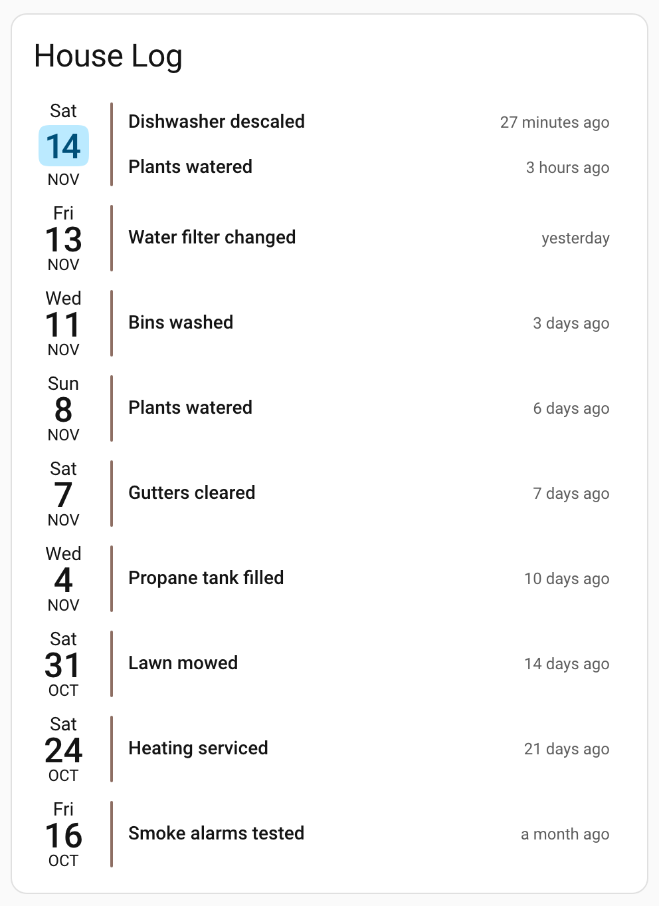
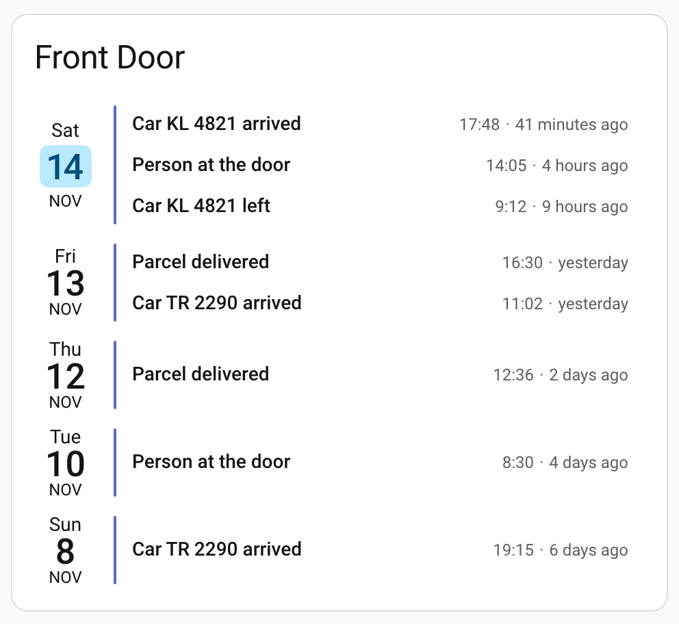

# House Log

A household log, newest first, for a dashboard section and the same card on a phone: when did we last mow the lawn, or change the water filter? Every entry reads how long ago it was, and a [variation](#a-visitor-or-camera-log) keeps a log of who came to the front door.

## 🖼️ See It

<br>

The last 30 days, newest first, each entry with how long ago it was.

## 📋 Copy the Card

Replace `calendar.house_log` with your log's calendar. The card is built for a calendar that gets one entry each time a job is done, from a script, a button or an automation (see [Writing an Entry](#writing-an-entry)). It shows the last 30 days of entries, newest first.

```yaml
type: custom:calendar-card-pro
config_version: 5
title: House Log
start_date: today-29
days_to_show: 30
show_past_events: true
past_event_opacity: 100
show_countdown: true
show_time: false
time_position: title
event_tap_action:
  action: details
entities:
  - entity: calendar.house_log
    accent_color: '#8d6e63'
list:
  event_order: latest_first
```

Each entry is one line: its title, then how long ago it was. A tap opens it, to correct a title or, on a calendar that [allows editing](/features/actions#what-each-integration-allows) such as a Local Calendar, to delete it.

::: tip Build It in the Editor
[Quick Setup](/features/editor#quick-setup) in the visual editor builds this card on your own calendar: its layout, its look and its color.
:::

## 🧭 What It Adds

| Editor                        | YAML                                                                                                 | What it adds                                                                                         |
| ----------------------------- | ---------------------------------------------------------------------------------------------------- | ---------------------------------------------------------------------------------------------------- |
| Time Range & Content          | `start_date: today-29`, `days_to_show: 30`, `show_past_events`, `list` › `event_order: latest_first` | The last 30 days up to today, entries that have ended included, the newest at the top                |
| Events                        | `show_countdown`, `show_time: false`, `time_position: title`, `past_event_opacity: 100`              | How long ago each entry was, beside its title rather than a clock time; every entry at full strength |
| Calendars › Name & Appearance | `accent_color`                                                                                       | The log's own color                                                                                  |
| Actions & Refresh             | `event_tap_action: details`                                                                          | The entry on tap                                                                                     |

The visual editor offers `event_order` under Time Range & Content while List is the layout being edited.

## ✍️ Writing an Entry

A script writes an entry each time it runs, so a button on the dashboard or an automation can log a job: a press on _Filter Changed_, or the robot mower docking after its last run of the day.

```yaml
alias: Log Lawn Mowed
sequence:
  - action: calendar.create_event
    target:
      entity_id: calendar.house_log
    data:
      summary: Lawn mowed
      start_date_time: '{{ now() }}'
      end_date_time: '{{ now() + timedelta(minutes=1) }}'
```

- **A Local Calendar takes new entries.** Add one under Settings › Devices & Services › Add Integration › Local Calendar, and it can be both the log and the card's calendar.
- **An entry lasts a minute**, so it reads "a few seconds ago" a minute after the script runs. A finished entry counts from its end.
- **Run it from a button** on the dashboard, or as an automation's action. One script per job keeps each button to one press.

## 🔀 Variations

### A Visitor or Camera Log

The same card keeps a log of the front door: a car's plate, a parcel, a person a camera saw. There the time of day matters, so each entry keeps its time beside how long ago it was.

<br>

A week at the front door, newest first, with the time of each arrival.

Change these lines on the card above, and delete `show_time: false`:

```yaml
title: Front Door
start_date: today-6
days_to_show: 7
show_end_time: false
entities:
  - entity: calendar.front_door
    accent_color: '#5c6bc0'
```

The card covers the last seven days, and each entry reads its time and how long ago it was, such as _Parcel delivered 14:05 · 4 hours ago_. `show_end_time: false` keeps an entry to one time however long it lasts, so an automation can log a visit with any length.

## 🔀 Adapt It

- **Each job's last time only.** List the calendar once per job with an `allowlist` and `compact_events_to_show: 1`, as [Bin Day](/guide/bin-day) does for its bins. Newest first, each block keeps its latest entry, so with `start_date: today-364` and `days_to_show: 365` the card answers _when did we last…_ for a whole year.
- **Further back.** `start_date: today-89` with `days_to_show: 90` covers three months. Every limit keeps the newest entries, so `compact_events_to_show: 10` under `list:` shows the latest ten.
- **Counted in days.** [`countdown_exact_days: true`](/features/event-content#counting-in-days) reads "40 days ago" rather than "a month ago", and "1 day ago" for yesterday.
- **Logging from the card.** A [toolbar](/features/layout-appearance#header-toolbar) with its add button logs an entry from the card, but a new event [starts on the hour and lasts an hour](/features/actions#add-event-button). It reads as under way until it ends, so move it to before now ahead of **Add**.

## 📚 Next Steps

- [Counting Up From Past Events](/features/event-content#counting-up-from-past-events) — how long ago, and the countdown options that shape it
- [Event Order](/features/core-settings#event-order) — newest first, and how limits keep from the top
- [Time Beside the Title](/features/event-content#time-beside-the-title) — one line per entry
- [Past Events Display](/features/event-content#past-events-display) — finished entries at full strength
- [Configuration Reference](/reference/configuration) — every option
