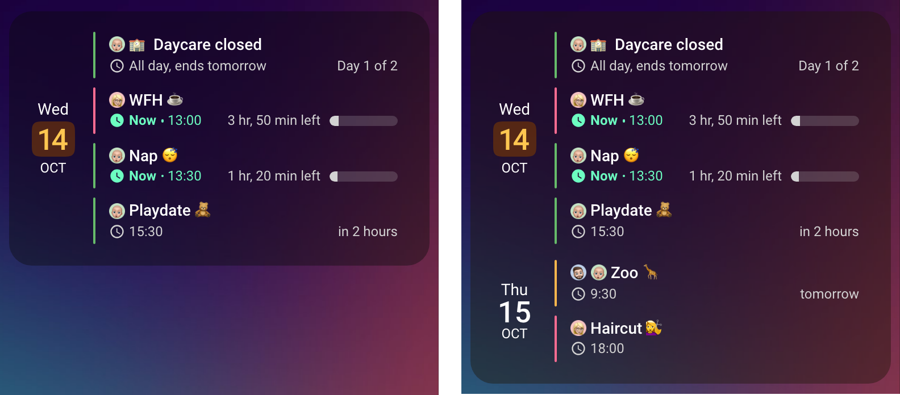

# Now & Next

A small tile with no title and no toolbar, for the top of a phone dashboard: what is on now, and what comes next? It shows today and tomorrow, four events at a time until you tap it.

## 🖼️ See It

<br>

Collapsed on the left, tapped open on the right.

## 📋 Copy the Card

Replace the `calendar.*` ids with your own calendars and the `person.*` labels with the people in your home. The colors are the [Family Hub](/guide/family-calendar)'s, so a phone and the wall say the same thing.

```yaml
type: custom:calendar-card-pro
config_version: 6
days_to_show: 2
filter_duplicates: true
duplicate_accent_color: '#ffb74d'
show_empty_today: true
show_countdown: once_per_day
show_time_left: true
show_progress_bar: true
show_location: false
show_end_time: false
scroll_long_titles: true
event_gap: 4px
tap_action:
  action: expand
event_tap_action:
  action: none
event_hold_action:
  action: details
entities:
  - entity: calendar.anna
    label: person.anna
    accent_color: '#ff6c92'
  - entity: calendar.ben
    label: person.ben
    accent_color: '#03a9f4'
  - entity: calendar.leo
    label: person.leo
    accent_color: '#66bb6a'
  - entity: calendar.family
    accent_color: '#ffb74d'
list:
  compact_events_to_show: 4
```

::: tip Tap the Card to See the Rest
Nothing on the card says that more events are waiting. Tap it to see them all, and tap again to fold it back.
:::

::: tip Build It in the Editor
[Quick Setup](/features/editor#quick-setup) in the visual editor builds this card on your own calendars: its layout, its look and its colors, in order. The faces above are this family's: give your calendars their own with **Label Type** on each calendar's page, under **Name & Look**.
:::

## 🧭 What It Adds

| Editor                     | YAML                                                                                                                                        | What it adds                                                                                                                                                                                                                                       |
| -------------------------- | ------------------------------------------------------------------------------------------------------------------------------------------- | -------------------------------------------------------------------------------------------------------------------------------------------------------------------------------------------------------------------------------------------------- |
| List › Which Events        | `days_to_show: 2`, `list.compact_events_to_show: 4`, `show_empty_today`, `filter_duplicates`                                                | Today and tomorrow, four events until tapped; a free today still says so; a shared plan appears once                                                                                                                                               |
| Taps & Refresh             | `tap_action: expand`, `event_tap_action: none`, `event_hold_action: details`                                                                | A tap shows the rest, another folds it back; a hold opens an event                                                                                                                                                                                 |
| Event Appearance           | `show_countdown: once_per_day`, `show_time_left`, `show_progress_bar`, `show_location: false`, `show_end_time: false`, `scroll_long_titles` | "in 2 hours", and "tomorrow" once rather than on every row of the day; "1 hr, 20 min left" on a running event, with a bar for how far along it is, or which day of a longer one; two short lines per event; long titles scroll instead of wrapping |
| Size & Spacing · Calendars | `event_gap: 4px`, `person.*` labels, `accent_color`, `duplicate_accent_color`                                                               | Separate bars; a face and a color per person, and a plan they share in gold, as on the [Family Hub](/guide/family-calendar#gold-means-the-whole-family)                                                                                            |

::: info Tap to Expand, Hold for an Event
By default a tap on an event opens it, and wins over the card's tap. Events cover most of this card, so most taps would open an event instead of expanding it; `event_tap_action: none` turns that off. [`event_hold_action: details`](/features/actions#holding-an-event) opens an event on a hold instead, so a tap anywhere still expands. From the keyboard, the card's first Tab stop expands it, and Enter on an event opens that event.
:::

## 🔀 Adapt It

- **More or fewer at a glance.** Change `compact_events_to_show` inside `list:`. A tap always shows everything in `days_to_show`.
- **A tile that holds still.** `compact_card_height: 240px` inside `list:` keeps the folded tile one height whatever its events, so the cards under it stay where they are. Choose a height that holds your four events, or they scroll inside it; a tap still opens it to every event. See [Compact & Expanded Heights](/features/list-view#compact-expanded-heights).
- **Only timed events.** [`event_type: timed`](/features/filtering#separating-all-day-from-timed-events) keeps all-day events off the tile, so a closure or a birthday never takes one of its four rows. Show them on another card, since this one then never will.
- **Icons instead of faces.** A `label` can also be an emoji or an `mdi:` icon.

## 📚 Next Steps

- [Expandable Calendar Card](/features/actions#expandable-calendar-card) — compact mode and the expand action
- [Compact Mode & Event Limits](/features/list-view#compact-mode-event-limits) — card-wide and per-calendar limits
- [Countdown Display](/features/event-content#countdown-display), [Repeated Countdowns](/features/event-content#repeated-countdowns), [Progress Bar Display](/features/event-content#progress-bar-display) and [Scrolling Long Titles](/features/event-content#scrolling-long-titles) — the event options
- [Day Counter](/features/multi-day-events#day-counter) — "Day 1 of 2" on an event a day or longer
- [Configuration Reference](/reference/configuration) — every option
