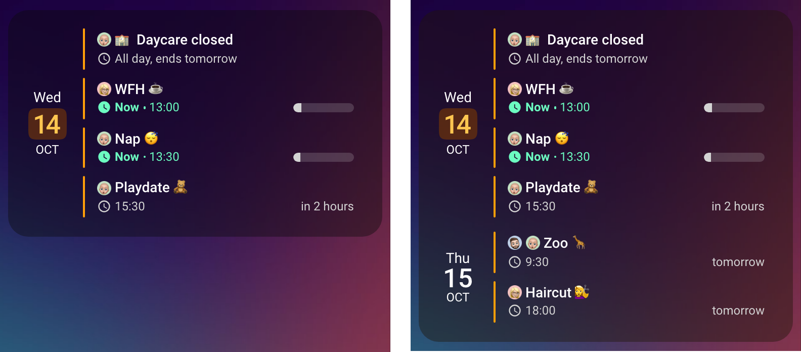

# Now & Next

A small tile with no title and no toolbar, for the top of a phone dashboard: what is on now, and what comes next? It shows today and tomorrow, four events at a time until you tap it.

## 🖼️ See It

<br>

Collapsed on the left, tapped open on the right.

## 📋 Copy the Card

Replace the `calendar.*` ids with your own calendars and the `person.*` labels with the people in your home.

```yaml
type: custom:calendar-card-pro
config_version: 5
days_to_show: 2
filter_duplicates: true
show_empty_today: true
show_countdown: true
show_progress_bar: true
show_location: false
show_end_time: false
scroll_long_titles: true
event_gap: 4px
tap_action:
  action: expand
event_hold_action:
  action: details
entities:
  - entity: calendar.anna
    label: person.anna
  - entity: calendar.ben
    label: person.ben
  - entity: calendar.leo
    label: person.leo
  - entity: calendar.family
list:
  compact_events_to_show: 4
```

::: tip Tap the Card to See the Rest
Nothing on the card says that more events are waiting. Tap it to see them all, and tap again to fold it back.
:::

::: tip Build It in the Editor
[Quick Setup](/features/editor#quick-setup) in the visual editor builds this card on your own calendars, with its layout and its look. The faces above are this family's, so give your calendars their own.
:::

## 🧭 What It Adds

| Editor               | YAML                                                                                                        | What it adds                                                                                                      |
| -------------------- | ----------------------------------------------------------------------------------------------------------- | ----------------------------------------------------------------------------------------------------------------- |
| Time Range & Content | `days_to_show: 2`, `list.compact_events_to_show: 4`, `show_empty_today`, `filter_duplicates`                | Today and tomorrow, four events until tapped; a free today still says so; a shared plan appears once              |
| Actions & Refresh    | `tap_action: expand`, `event_hold_action: details`                                                          | A tap shows the rest, another folds it back; a hold opens an event                                                |
| Events               | `show_countdown`, `show_progress_bar`, `show_location: false`, `show_end_time: false`, `scroll_long_titles` | "in 2 hours"; how far along a running event is; two short lines per event; long titles scroll instead of wrapping |
| Layout · Calendars   | `event_gap: 4px`, `person.*` labels                                                                         | Separate bars; a face per person, in the theme's accent                                                           |

::: info Tap to Expand, Hold for an Event
`event_tap_action` is left out on purpose: a tap on an event wins over the card's tap, and events cover most of this card, so most taps would open an event instead of expanding. [`event_hold_action: details`](/features/actions#holding-an-event) opens an event on a hold instead, so a tap anywhere still expands. From the keyboard, the card's first Tab stop expands it, and Enter on an event opens that event.
:::

## 🔀 Adapt It

- **More or fewer at a glance.** Change `compact_events_to_show` inside `list:`. A tap always shows everything in `days_to_show`.
- **A color per person.** Add `accent_color` to each calendar, as the [Family Hub](/guide/family-calendar) does.
- **Icons instead of faces.** A `label` can also be an emoji or an `mdi:` icon.

## 📚 Next Steps

- [Expandable Calendar Card](/features/actions#expandable-calendar-card) — compact mode and the expand action
- [Compact Mode & Event Limits](/features/core-settings#compact-mode-event-limits) — card-wide and per-calendar limits
- [Countdown Display](/features/event-content#countdown-display), [Progress Bar Display](/features/event-content#progress-bar-display) and [Scrolling Long Titles](/features/event-content#scrolling-long-titles) — the event options
- [Configuration Reference](/reference/configuration) — every option
