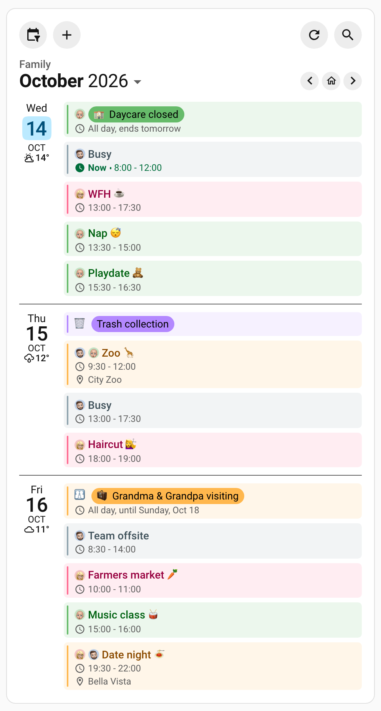

# Family Agenda

Anna, Ben and their baby son Leo, the invented family of [the Family Hub](/guide/family-calendar), keep a tablet in the hallway that everyone walks past. It shows the next three days from calendars that mix several kinds of event: whose birthday it is, whether the trash goes out, who is out this evening and when Ben is busy, without saying on the screen what his meetings are about.

## 🖼️ See It

The hallway tablet in use, then as a still: three days of the Family Hub's week, in the same colors, with most of Ben's working hours reading _Busy_.

<video class="clip" src="https://raw.githubusercontent.com/alexpfau/calendar-card-pro/main/.github/img/journey_family_agenda.mp4" poster="https://raw.githubusercontent.com/alexpfau/calendar-card-pro/main/.github/img/journey_family_agenda_poster.jpg" width="524" height="968" loop muted playsinline controls preload="metadata" aria-label="A hallway tablet with three days of the family's agenda as a list: a tap on Thursday's Busy row opens a popover that still calls the meeting Busy, showing its time, that it repeats every 4 weeks and the Work calendar, but not its real title; the arrow pages to October 18 to 20 and a swipe comes back; the filter menu hides and shows both of Ben's work blocks; a search for grandma picks Grandma time on Thursday, October 22, and the house button returns to today; and at 11:00 the trash collection pill leaves the list"></video><br>

Tap a _Busy_ row and the popover still calls the meeting _Busy_, page ahead and swipe back, hide and restore both halves of Ben's work from the filter menu, search for Grandma, pick _Grandma time_ and come back to today, and watch collection day leave the list at 11:00.

<br>

Each all-day event is a filled pill: Leo's daycare closure in his green, collection day in purple until it retires at 11:00, the grandparents' visit in the Family calendar's gold. Ben's work says _Busy_, except the offsite he marked for the family.

## 📋 Copy the Card

Replace the entity ids with your own, `weather.home` included, and each `person.*` label with a person from your Home Assistant. The lines above `entities:` speak for the whole card; the blocks below them are per calendar.

The blocks rely on how the events are written in the calendars:

- **Work events the family may read** carry `#family` in their description. On weekdays every other work event reads _Busy_; work at the weekend is left off the card.
- **Birthdays** on the Family calendar are yearly all-day events with _birthday_ in their title, written like _🎂 Grandma's birthday_, and the birth year in their description as `YEAR=1956`, from which the card works out the age each year.
- **Collection days** start their title with _🗑️_ and a space, such as _🗑️ Trash collection_.

Change the patterns in the YAML where your calendars write these differently:

```yaml
type: custom:calendar-card-pro
config_version: 5
title: Family
days_to_show: 3
filter_duplicates: true # a plan on several calendars is drawn once, with every face
duplicate_accent_color: '#ffb74d' # and in the Family calendar's gold
event_background_opacity: 12
event_gap: 6px
event_color: accent
allday_badge: title
allday_badge_style: filled
show_single_allday_time: false
show_location_allday: false
weather:
  entity: weather.home
toolbar:
  show: true
  view_switcher: false
event_tap_action:
  action: details
list:
  date_vertical_alignment: top
  day_separator_width: 1px

entities:
  # Anna's own calendar, under her face
  - entity: calendar.anna
    label: person.anna
    accent_color: '#ff6c92'

  # Ben's own calendar, under his face
  - entity: calendar.ben
    label: person.ben
    accent_color: '#03a9f4'

  # Leo's own calendar, under his face
  - entity: calendar.leo
    label: person.leo
    accent_color: '#66bb6a'

  # Ben's work, the half that is fine to share
  - entity: calendar.work
    name: Work
    filter_field: description
    allowlist: '#family'
    days_of_week: weekdays
    label: person.ben
    accent_color: '#90a4ae'

  # Ben's work, everything else — that he is busy, not what with
  - entity: calendar.work
    name: Work
    filter_field: description
    blocklist: '#family'
    replace_with: 'Busy'
    days_of_week: weekdays
    label: person.ben
    accent_color: '#90a4ae'
    show_location: false
    show_description: false

  # 🎂 Birthdays — the name and the age, nothing else
  - entity: calendar.family
    allowlist: 'birthday'
    replace_pattern: "🎂 |'s birthday"
    label: 🎂
    accent_color: '#ffb74d'

  # 👨‍👩‍👦 Everything else on the family calendar — the safety net
  - entity: calendar.family
    blocklist: 'birthday'
    label: 👨‍👩‍👦
    accent_color: '#ffb74d'

  # 🗑️ Collection day — gone once the truck has been
  - entity: calendar.trash_pickup
    replace_pattern: '🗑️ '
    allday_expires_at: '11:00'
    label: 🗑️
    accent_color: '#b388ff'
```

## 🗂️ Calendars & Event Blocks

Where a calendar holds several kinds of event, this card lists it more than once, as blocks that each pick their own events and style. The Family Hub's [calendars](/guide/family-calendar#calendars-event-blocks) go in, with Ben's work calendar added, as eight blocks:

| Calendar                | Holds                                                       | Blocks |
| ----------------------- | ----------------------------------------------------------- | ------ |
| `calendar.anna`         | Anna's own plans                                            | 1      |
| `calendar.ben`          | Ben's own plans                                             | 1      |
| `calendar.leo`          | Leo's daycare, naps and classes                             | 1      |
| `calendar.work`         | Ben's working hours, a few of them marked `#family`         | 2      |
| `calendar.family`       | what belongs to nobody in particular, a visit or a birthday | 2      |
| `calendar.trash_pickup` | the recycling and trash collection days                     | 1      |

A calendar is a source, not a category. The four calendars that already mean one thing are listed once, unfiltered. A calendar that mixes several kinds of event is split on a reliable word or marker in each event's title, location or description, never into a new calendar.

## 🧩 How the Card Works

### The Same Week, Laid Out as a List

The card shows three days, today first, in the default list layout. Finished timed events drop off as they end, and the one under way has a green "Now ·" before its time. Late in the evening the list starts at tomorrow; add [`show_empty_today: true`](/features/event-content#showing-today-when-it-is-empty) to keep today's row.

Every list row has a label, so the 🎂 and the 🗑️ that the Family Hub's all-day banners need in their titles become labels here, taken out of the titles. The visit keeps its 🧳: its label says whose it is, and the 🧳 says what.

### A Birthday Should Read Like a Name

Grandma's birthday is a yearly all-day event on the Family calendar, _🎂 Grandma's birthday_, with `YEAR=1956` in its description. Once the 🎂 is the label, the title has one thing left to say:

- [`allowlist`](/features/core-settings#filtering-by-event-name) claims the birthdays for this block; on the Family calendar, only a birthday has the word in its title.
- [`replace_pattern`](/features/core-settings#dropping-a-prefix-from-every-title) deletes the cake and the _'s birthday_. With no `replace_with`, whatever matches is removed, and the `|` lets one pattern remove both.
- The age comes from the `YEAR=1956` marker, as [Birthday Ages & Anniversary Counts](/features/event-content#birthday-ages-anniversary-counts) explains.

So _🎂 Grandma's birthday (70)_ reads **🎂 Grandma (70)** in 2026, and **🎂 Grandma (71)** in 2027 with nothing to edit. A tap opens the birthday titled _Grandma_, without the age, which only the card works out.

### A Reminder That Retires Itself

Collection day is only useful before the truck comes. The trash pickup calendar holds nothing else, so its one block needs no filter, and [`allday_expires_at`](/features/core-settings#retiring-all-day-events-during-the-day) retires the row at 11:00. It acts only where finished events are hidden, as a list hides them by default, so it does nothing in the Family Hub's grid ([The All-Day Band](/guide/family-calendar#the-all-day-band)). `replace_pattern: '🗑️ '` takes the emoji out of the title, now that it is the label.

### Three People, One Card

[`label: person.anna`](/features/core-settings#showing-a-persons-picture) shows that person's picture from Home Assistant, the same faces as on [the Family Hub](/guide/family-calendar#a-face-for-every-calendar), so whose evening is booked shows before anyone can read the title. Ben's face is on both work blocks too, so _Busy_ says who without saying what with.

The three personal blocks filter nothing. A calendar that already means one thing needs no help.

### Busy & Nothing Else

Ben's working hours are on the card, so everyone can see Thursday afternoon is gone, but they read _Busy_ rather than _Roadmap review_. The few the family needs, such as a late finish, a day of travel or the offsite, keep their real title.

The work calendar is listed twice and split on its **description**: [`filter_field`](/features/core-settings#matching-the-location-or-description-instead) points `allowlist` and `blocklist` there, and both blocks name one marker, `#family`, which Ben types into anything the family may read.

- The block that **allows** `#family` keeps the real title, so Friday's _Team offsite_ appears by name.
- The block that **blocks** it replaces every title with _Busy_ through [`replace_with`](/features/core-settings#hiding-what-an-event-is-about), which overrides the whole title when no `replace_pattern` stands beside it.
- An event with no description counts as **not matching**, so it lands in the _Busy_ block: the safe default.

Both keep the gray and Ben's face, and both carry `name: Work`, so the filter menu and the popover call the calendar _Work_ rather than whatever the work account calls itself. The rows never show the marker, because descriptions are hidden from them by default, but the popover a tap opens shows the description, marker included, unless the block itself sets `show_description: false`, as the _Busy_ block does. Anyone invited can also read it in their own calendar, so mark only events where that is fine. [`days_of_week: weekdays`](/features/core-settings#showing-a-calendar-on-weekdays-only) keeps weekend work off a family screen.

::: warning A Title Is Not the Only Thing That Leaks
Locations show by default, and _Meeting Room 2_ gives the game away. `show_location: false` and `show_description: false`, set on the _Busy_ block itself, keep both fields off the card and out of the [event popover](/features/actions#event-details) a tap opens. The popover says _Busy_ too, but where the calendar allows editing, the real title appears as soon as someone starts editing it; `allow_event_edit: false` closes that.
:::

### Why This Works

Every option in an `entities:` block applies to that block alone, so a calendar listed several times is several independent blocks; the [visual editor's](/features/editor) **Duplicate** action builds each one. The lines above `entities:` decide how the whole card reads, as [One Voice for the Whole Card](#one-voice-for-the-whole-card) shows. Two rules keep the blocks predictable:

- **Make the blocks complementary.** Within one calendar, each event should match exactly one block. With [`filter_duplicates: true`](/features/core-settings#filtering-duplicate-events), blocks that overlap draw an event once, styled by the first of them, so the later block's label and color quietly never apply.
- **Finish with a catch-all.** A block with only a `blocklist` goes last for its calendar and catches what is left over. Without it, an event nobody wrote a rule for never appears, and something missing is very hard to notice.

They are one rule read from either end: **the catch-all's `blocklist` should be exactly the union of the allowlists above it.** The Family calendar allows and blocks `birthday`; the work calendar allows and blocks `#family`. The day they stop matching, an event is drawn twice, in the wrong block's colors, or not at all.

## 🏷️ How the Display Reads

### One Voice for the Whole Card

The lines above `entities:` apply to every block at once, so a box, a color or a pill means the same thing on every calendar.

**The toolbar.** [`toolbar: show: true`](/features/layout-appearance#header-toolbar) puts the calendar filter, add and refresh in a row of their own, and under them the month, with arrows that page three days at a time; a swipe pages too. The filter lists six calendars, not eight blocks, so hiding Ben's work hides both halves. The magnifier finds an event a year back or ahead, such as the next birthday, and searches titles as the card draws them, so a _Busy_ event is found as Busy, never by its meeting's name. `view_switcher: false` drops the layout switch, so the card stays a list.

**Gaps, rules and tint.** [`event_gap: 6px`](/features/layout-appearance#gaps-between-events) gives every event a box and an accent bar of its own, `day_separator_width: 1px` draws a rule between the days, and `date_vertical_alignment: top` puts each date beside its day's first event. [`event_background_opacity: 12`](/features/layout-appearance#visual-styling-colors) tints each box in its calendar's color, [`event_color: accent`](/features/event-content#event-text-in-calendar-colors) draws each title in a readable shade of it, and `weather` puts the forecast under each date.

**The pills.** [`allday_badge: title`](/features/event-content#the-all-day-badge) wraps every all-day title in a pill, and `allday_badge_style: filled` makes it solid. Its color, [`allday_badge_color`](/features/event-content#which-color-it-is-drawn-in), defaults to `accent`, so each pill takes its calendar's color: gold for the whole family, purple for collection day, and pink, blue or green for Anna's, Ben's or Leo's own day. A quieter dashboard can use the default `subtle` style, but keep the color `accent`, or the pills stop telling the calendars apart.

`show_single_allday_time: false` drops the _All day_ row under a one-day pill, and `show_location_allday: false` the location under every pill, once for every block. `show_multiday_allday_time` stays on, because _All day, until Sunday, Oct 18_ carries the end of the grandparents' visit, which the pill cannot.

::: warning Tidying Is Not Privacy
`show_location_allday: false` and the _Busy_ block's `show_location: false` look identical on screen, but only the second protects anything. Work events are timed, so the all-day option never touches them, and only an option set on the calendar keeps a field out of the popover. `show_description_allday` sits on the same fault line.
:::

## 🔀 Variations

### Colors From Home Assistant

Home Assistant holds a color for each calendar. To follow it, set `accent_color: home-assistant` at card level and delete the `accent_color` line from every block:

```yaml
accent_color: home-assistant # each calendar's color, as set in Home Assistant
entities:
  - entity: calendar.anna
    label: person.anna # and no accent_color in any block
```

Both blocks of a split calendar then share its color. A Local Calendar has none until you give it one, and takes your theme's primary color meanwhile; see [Using the Colors From Home Assistant](/features/core-settings#using-the-colors-from-home-assistant). Keep `duplicate_accent_color` matching the Family calendar, so shared plans still read as the family's.

### A Word Instead of the Tile

[`today_indicator`](/features/layout-appearance#today-indicator) takes any text, so a hallway screen can mark today with the word instead of the [date tile](/features/layout-appearance#the-date-tile). A word is drawn over the date column, so it needs a size, and a place above the weekday that only a centered date leaves. Replace the card's `list:` with:

```yaml
today_indicator: Today
today_indicator_size: 13px # ships at 6px, right for an emoji, not a word
list:
  date_vertical_alignment: middle
  day_separator_width: 1px
  today_indicator_position: '50% 8%'
```

The position is a share of the day's height, so on a day with one event the word can still touch the date.

### Read Only on a Shared Screen

A tap opens the event in the card's popover, where it can be [changed and deleted](/features/actions#narrowing-what-the-popover-offers) if the calendar allows. On a screen everyone walks past, `allow_event_edit: false` and `allow_event_delete: false` take both out.

## 🔀 Combining the Techniques

### Shared Plans in the Family Agenda

The zoo trip on Thursday is on Ben's and Leo's calendars. [`filter_duplicates: true`](/features/core-settings#filtering-duplicate-events) draws it once, with both faces in front of the title, and [`duplicate_accent_color`](/features/core-settings#labeling-coloring-shared-events) colors it the Family calendar's gold, as on the Family Hub; see [Gold Means the Whole Family](/guide/family-calendar#gold-means-the-whole-family). The copies have to match exactly, in title, start, end and location.

Every block on this page also works in grid view, apart from the all-day layer, so the [Family Hub](/guide/family-calendar) can take any of them onto its hour axis.

## 📚 Next Steps

- [Family Hub](/guide/family-calendar): the same family's week, on one card for every screen
- [Core Settings](/features/core-settings): every per-calendar option
- [Event Content & Display](/features/event-content): the all-day badge and birthday ages
- [Header Toolbar](/features/layout-appearance#header-toolbar): the filter, paging, search and refresh
- [Tapping an Event](/features/actions#tapping-an-event): the event popover
- [Configuration Reference](/reference/configuration): every option
- [Example Stories](/reference/examples): every story
