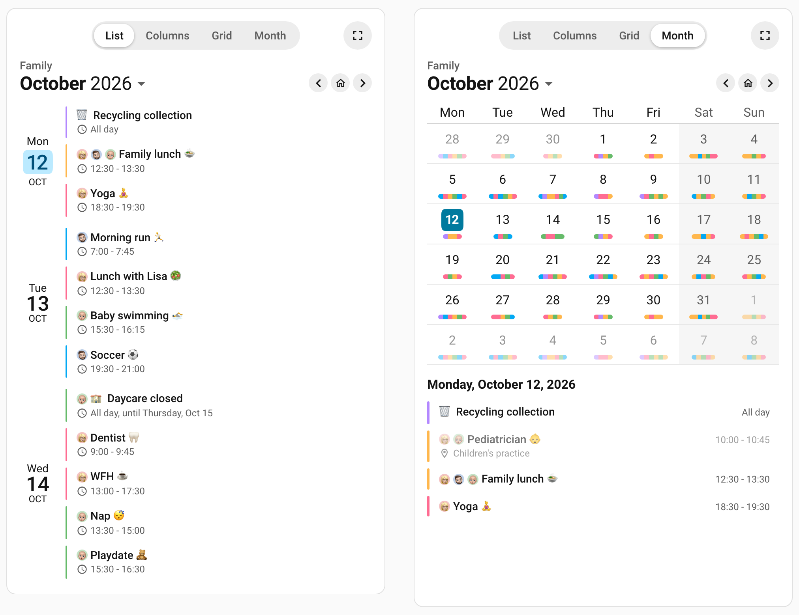
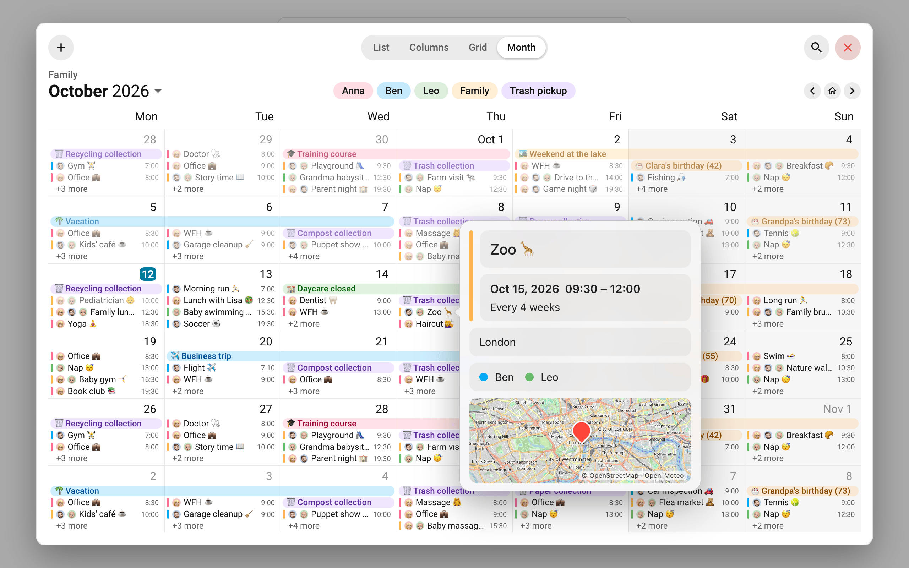
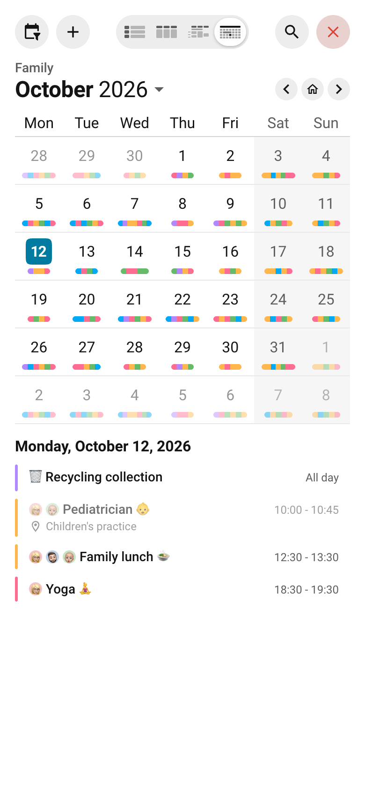

# Small Card, Big Picture

Anna, Ben and their baby son Leo, the invented family of [the Family Hub](/guide/family-calendar), keep their calendar in a narrow column of the dashboard they already have, beside the lights and the heating. It shows the next three days and switches to any layout where it sits, and one tap opens the same card full size, on the whole month.

## 🖼️ See It

<br>

In a dashboard column: the next three days as a list, and the same card switched to Month, with the chosen day's events under the weeks.

<br>

A tap opens it full size, on the whole month, with a chip per calendar, add and search. A tap on the zoo trip opens it, with London on a map.

<br>

On a phone, full size covers the screen, and Month lists the chosen day's events under its weeks.

## 📋 Copy the Card

Replace the `calendar.*` ids with your own calendars, each `name` with what its chip should say, and each `person.*` label with someone from **Settings → People**.

```yaml
type: custom:calendar-card-pro
config_version: 6
title: Family
days_to_show: 3
event_gap: 4px
filter_duplicates: true
duplicate_accent_color: '#ffb74d'
tap_action:
  action: overlay
toolbar:
  show: true
  legend: false
  add_event: false
  refresh: false
  search: false
  overlay: true
overlay:
  view: month
  toolbar:
    legend: chips
    add_event: true
    search: true
entities:
  - entity: calendar.anna
    name: Anna
    label: person.anna
    accent_color: '#ff6c92'
  - entity: calendar.ben
    name: Ben
    label: person.ben
    accent_color: '#03a9f4'
  - entity: calendar.leo
    name: Leo
    label: person.leo
    accent_color: '#66bb6a'
  - entity: calendar.family
    name: Family
    accent_color: '#ffb74d'
  - entity: calendar.trash_pickup
    name: Trash pickup
    accent_color: '#b388ff'
month:
  event_gap: 4px
```

::: tip Leave Edit Mode to Try It
While the dashboard is being edited, and in the editor's preview, the card opens nothing full size. Select **Done** first.
:::

::: tip Build It in the Editor
[Quick Setup](/features/editor#quick-setup) in the visual editor builds this card on your own calendars: its toolbar, what it opens full size and its colors, in order. The names and faces above are this family's, so give your calendars their own.
:::

## 🧭 What It Adds

| Editor                                     | YAML                                                                                 | What it adds                                                                                                          |
| ------------------------------------------ | ------------------------------------------------------------------------------------ | --------------------------------------------------------------------------------------------------------------------- |
| Layouts · List › Which Events › Date Range | `days_to_show: 3`                                                                    | Today and the next two days                                                                                           |
| Card & Header › Toolbar                    | `legend`, `add_event`, `refresh` and `search` off, `overlay: true`                   | The layout switcher, Open Full Size and the arrows, and nothing else, so a narrow column has room for them            |
| Taps & Refresh                             | `tap_action: overlay`                                                                | A tap anywhere but on an event opens the card full size too; a tap on an event opens it in the popover, as by default |
| Full Size › Full-Size Settings             | `overlay → view: month`, `overlay → toolbar`: `legend: chips`, `add_event`, `search` | Full size opens on the whole month, with a chip per calendar, the add button and search                               |
| Which Events · Calendars                   | `filter_duplicates`, `duplicate_accent_color`, labels and colors                     | A face and a color per person; a plan on several calendars once, in gold                                              |
| Size & Spacing                             | `event_gap: 4px`, `month → event_gap: 4px`                                           | A box per event in List, and in Month's lists, which would otherwise start from Month's own 6px                       |

Full size is the same card, over the dashboard: the same calendars, colors and faces, on the month, with every layout on its switcher. Close it with the red Close button, Back, Escape or a tap outside it, and the card in the column is as it was. See [Opening the Card Full Size](/features/actions#opening-the-card-full-size).

- **In the column**, the switcher redraws the same days as Columns or Grid, each as a list where the column has no room for its fewest days, and as Month. See [Switching Between Layouts](/features/header-toolbar#switching-between-layouts).
- **Month in a column** draws its narrow form: a capsule under each day's number, a segment per event in its calendar's color, and the chosen day's events listed under the weeks. A tap on a day chooses it and opens nothing. See [The Narrow Month](/features/month-view#the-narrow-month).
- **Full size on a wall or a laptop**, Month draws each event's title in its day, and a day with more than its week holds ends in "+N more", which opens the whole day. See [The Day Panel](/features/month-view#the-day-panel).
- **Full size on a phone** covers the screen, and Month draws its narrow form again, listing every event of the chosen day. In Grid it draws as many of seven days as fit. See [Opening the Card Full Size](/features/actions#opening-the-card-full-size).
- **Adding an event** happens full size: the add button, a tap on a free day or a free hour, or a drag down Grid's hours. See [Tapping a Day to Add an Event](/features/actions#tapping-a-day-to-add-an-event).

## 🔀 Adapt It

- **Only the arrows.** `view_switcher: false` under `toolbar` keeps the card a list in its column. Full size still offers every layout.
- **The button alone, or the tap alone.** Delete `tap_action`, and only Open Full Size opens it; delete `overlay: true` from `toolbar`, and only a tap does.
- **Every tap opens it.** `event_tap_action: none` makes a tap on an event open the card full size as well. Full size still opens an event on a tap.
- **The week in Grid.** Delete `view: month` under `overlay:`, and full size opens in Grid on seven days.
- **The coming weeks.** `start: week` and `weeks: 4` in a `month:` block under `overlay:` open full size on the four weeks from this one rather than on the calendar month; see [The Coming Weeks](/features/month-view#the-coming-weeks).

```yaml
overlay:
  view: month
  month:
    start: week
    weeks: 4
```

## 📚 Next Steps

- [Opening the Card Full Size](/features/actions#opening-the-card-full-size) — what full size opens with, and what it leaves behind
- [The Narrow Month](/features/month-view#the-narrow-month) and [The Day List](/features/month-view#the-day-list) — Month in a narrow column and on a phone
- [Switching Between Layouts](/features/header-toolbar#switching-between-layouts) — the switcher, and how it folds
- [Family Hub](/guide/family-calendar) — the same family on a wall tablet, with every control on the card
- [Configuration Reference](/reference/configuration) — every option
