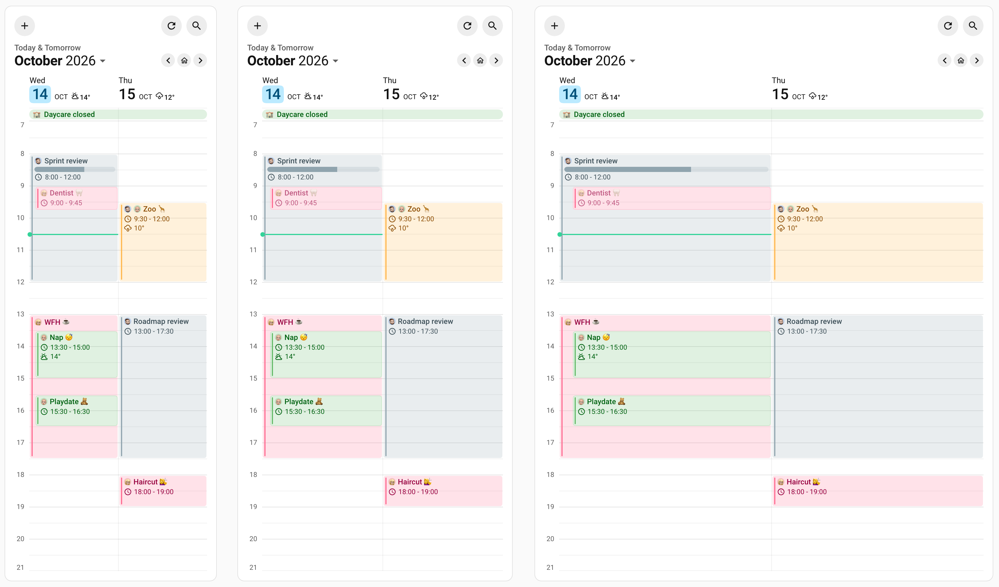
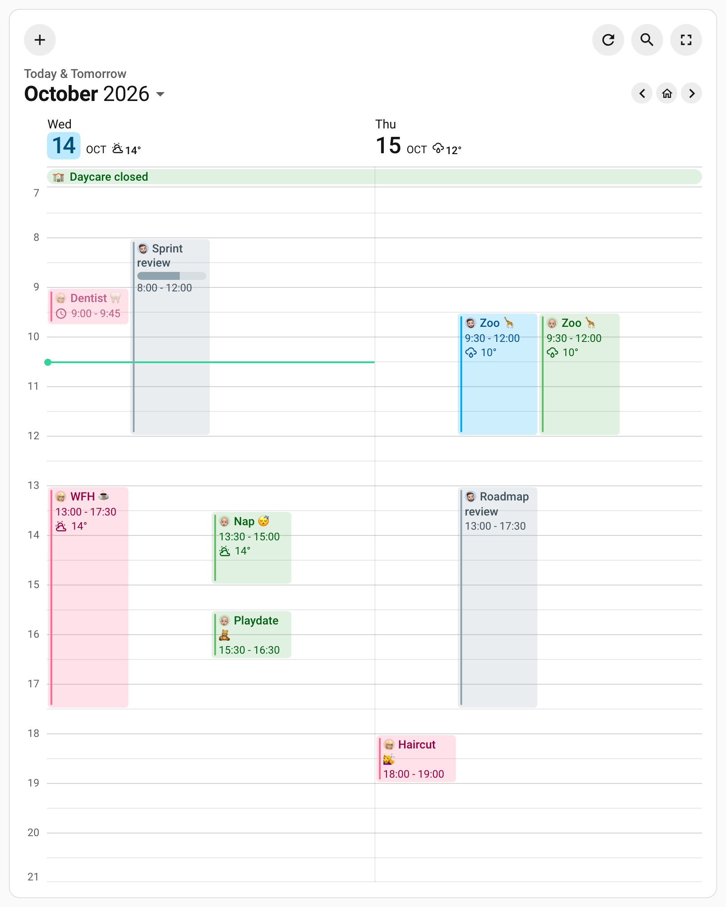

# Today & Tomorrow

Today and tomorrow on an hour axis, for the breakfast question: where are we in the day, and what is still to come? One card fits a phone, a narrow dashboard section and a portrait kitchen tablet.

## 🖼️ See It

<br>

A phone, a dashboard section and an 800px portrait tablet, with a bar filling on the event under way.

## 📋 Copy the Card

Replace the `calendar.*` ids, the `person.*` labels and `weather.home` with your own, and set `start_time` and `end_time` to your own day. They are hard bounds for a block in the hours: an event wholly outside them is not drawn at all, and one that runs past them is cut off at the edge. A timed event that lasts a full day or longer and runs into a second date is a [banner above the hours](/features/grid-view#long-timed-events-as-banners) instead, whatever its times.

```yaml
type: custom:calendar-card-pro
config_version: 6
title: Today & Tomorrow
view: grid
days_to_show: 2
filter_duplicates: true
duplicate_accent_color: '#ffb74d'
show_progress_bar: true
weather_entity: weather.home
toolbar:
  show: true
  view_switcher: false
  legend: false
  overlay: true
day_tap_action:
  action: add-event
entities:
  - entity: calendar.anna
    label: person.anna
    accent_color: '#ff6c92'
  - entity: calendar.ben
    label: person.ben
    accent_color: '#03a9f4'
  - entity: calendar.leo
    label: person.leo
    accent_color: '#66bb6a'
  - entity: calendar.work
    label: person.ben
    accent_color: '#90a4ae'
    show_weather: false
  - entity: calendar.family
    accent_color: '#ffb74d'
list:
  weather:
    position: both
    event:
      show_conditions: false
time_grid:
  start_time: '07:00'
  end_time: '21:00'
  hour_height: 56px
  slot_minutes: 30
  event_font_size: 13px
  weather:
    position: both
    event:
      show_conditions: false
```

Grid leaves locations off its blocks by default; the popover a tap opens shows them.

::: tip Build It in the Editor
[Quick Setup](/features/editor#quick-setup) in the visual editor builds this card on your own calendars: its layout, its look and its colors, in order. The faces above are this family's: give your calendars their own with **Label Type** on each calendar's page, under **Name & Look**.
:::

## 🧭 What It Adds

| Editor                                                   | YAML                                                                                                                     | What it adds                                                                                                                                                                           |
| -------------------------------------------------------- | ------------------------------------------------------------------------------------------------------------------------ | -------------------------------------------------------------------------------------------------------------------------------------------------------------------------------------- |
| Layouts · Grid › Which Events › Date Range               | `view: grid`, `days_to_show: 2`                                                                                          | Two days on one hour axis                                                                                                                                                              |
| Which Events › Hours · Size & Spacing · Event Appearance | `start_time` / `end_time`, `hour_height: 56px`, `slot_minutes: 30`, `event_font_size: 13px`, `show_progress_bar`         | 07:00 to 21:00, ruled every half hour, readable across a kitchen; a bar on the running event                                                                                           |
| Which Events · Calendars                                 | `filter_duplicates`, `duplicate_accent_color`, labels and colors                                                         | A face and color per person; shared plans once, in gold                                                                                                                                |
| Weather                                                  | `weather_entity`, `time_grid → weather`: `position: both`, `event.show_conditions: false`; `show_weather: false` on Work | The day's forecast over each column; the hour's icon and temperature in each timed event with room, but not beside Ben's meetings                                                      |
| Card & Header › Toolbar                                  | `legend: false`, `view_switcher: false`, `overlay: true`                                                                 | Add, refresh, paging by arrow or swipe, the date picker and search; no filter or layout switch; Open Full Size for the whole week                                                      |
| Taps & Refresh                                           | `day_tap_action: add-event`                                                                                              | A tap on a free hour adds an event, and a hold dragged down draws it to its end; an event opens on a tap, editable and with Delete where the calendar allows, but not on a shared plan |

## 👥 A Slice per Person on a Tablet

On a tablet, [lanes](/features/lanes#a-slice-per-lane-in-grid-view) give each person a slice of both days, so whose plan is whose reads straight down the hours: at 9:00 the dentist is Anna's and the sprint review Ben's, side by side.

<br>

A slice each for Anna, Ben, Leo and the Family calendar, with Ben's work in his own slice.

Add `lanes: true` to the card's `time_grid:` block, and give Ben's two calendars the same `lane`, so his work joins his own plans in one slice:

```yaml
time_grid:
  lanes: true # beside the time_grid lines above
entities:
  - entity: calendar.ben
    label: person.ben
    lane: Ben
    accent_color: '#03a9f4'
  - entity: calendar.work
    label: person.ben
    lane: Ben
    accent_color: '#90a4ae'
    show_weather: false
  # calendar.anna, calendar.leo and calendar.family as above
```

- **Shared plans** stand in each person's slice, in that person's color, rather than once in gold; see [Shared Events](/features/lanes#shared-events).
- **Grid draws no header** over a slice, so each event's face says whose slice it is.
- **The Family calendar keeps a slice** of its own, empty on a day without timed plans. A calendar that holds only all-day events, such as a holiday calendar, gives up its slice with [`event_type: all_day`](/features/filtering#separating-all-day-from-timed-events).
- **On a phone** each slice is narrow enough to cut titles short, so keep this for a tablet and the card above for a phone. See [How Narrow a Lane May Be](/features/lanes#how-narrow-a-lane-may-be).

## 🔀 Adapt It

- **Other hours.** A longer window between `start_time` and `end_time` makes the card taller at the same `hour_height`; lower it to keep the day on one screen.
- **A fixed height.** `card_height: 600px` fits the hours into the card instead, and so does a row count set in a Sections dashboard's Layout tab; `hour_height` then stops applying, and below `24px` an hour the hours scroll. See [Height in Grid View](/features/layout-appearance#height-in-grid-view).
- **Work kept private.** `private: true` on `calendar.work` shows Ben's meetings as Private behind a lock, on the card and in the popover, while their time and his face stay. See [Keeping a Calendar Private](/features/core-settings#keeping-a-calendar-private).
- **Read only.** `allow_event_edit: false` and `allow_event_delete: false` make the popover read-only and take Delete out of it. To stop adding too, leave out `day_tap_action`, set `add_event: false` under `toolbar`, and set `day_tap_action` to `action: none` under `overlay:`, since the card opened full size adds an event on a tap on a free hour unless told otherwise.
- **Moving by drag.** On a calendar that [allows changing events](/features/actions#what-each-integration-allows), such as a Local Calendar, an event moves to another time or day by a drag, after holding it for half a second on a touch screen. See [Moving Events by Drag](/features/grid-view#moving-events-by-drag).
- **Overlaps side by side.** `overlap_layout: columns` inside `time_grid:` puts overlapping events side by side, which a phone cramps.

## 📚 Next Steps

- [Grid View](/features/grid-view) — the axis, its hours and how overlaps are drawn
- [Weather in the Grid Layout](/features/weather#weather-in-the-grid-layout) — both forecast positions, and [Turning Weather Off for One Calendar](/features/weather#turning-weather-off-for-one-calendar)
- [Editing & Deleting Events](/features/actions#editing-deleting-events) — what the popover offers
- [Tapping a Day to Add an Event](/features/actions#tapping-a-day-to-add-an-event) — adding from a free hour, and drawing an event in the grid
- [Configuration Reference](/reference/configuration) — every option
