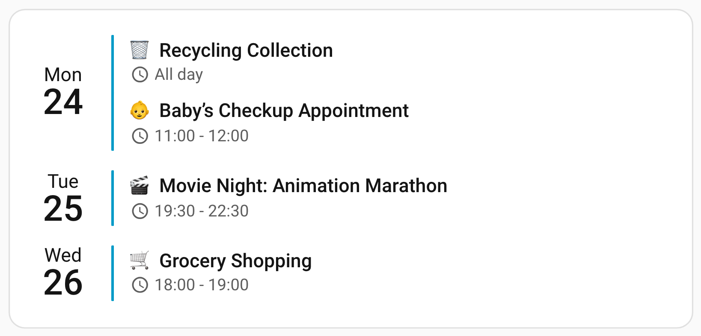

# Usage

Once **Calendar Card Pro** is [installed](/guide/installation), this page takes you from an empty dashboard to a working, customized card.

## 📌 Adding the Card to Your Dashboard

1. **Ensure a Calendar Integration is Set Up**  
   Calendar Card Pro requires at least one `calendar.*` entity in Home Assistant (e.g., **Google Calendar, CalDAV**). To find yours, open **Settings → Devices & Services → Entities** and search for `calendar.`.
2. **Open Your Dashboard for Editing**
   - Navigate to **Home Assistant → Dashboard**
   - Click the three-dot menu (⋮) → **Edit Dashboard**
3. **Add Calendar Card Pro**
   - Click the ➕ **Add Card** button
   - Switch to the **By card** tab, and search for `"Calendar"` or scroll to find `"Calendar Card Pro"`
   - Select the card, and its [visual editor](/features/editor) opens
4. **Configure with the Visual Editor**
   - Choose **Quick Setup** in the banner at the top of the editor to start from an [example card](/features/editor#quick-setup) on your own calendars. Where there is no banner, use **More → Start From an Example**
   - **Apply** sets the card up in the editor without saving it. Press Home Assistant's **Save** to put it on the dashboard, then **Done** to leave the dashboard's edit mode
   - To change the card later, edit the dashboard again and choose the card's **Edit**

::: tip Shortcut (Home Assistant 2026.6+)
In the card picker, stay on the **By entity** tab and pick any `calendar.*` entity. Calendar Card Pro is offered under **Community**, already pointed at that calendar and previewed with its real events. Picking one puts it straight on the dashboard; choose the card's **Edit** to continue with step 4. Nothing needs to be enabled for this. Five starting points are offered:

- **Calendar Card Pro - Interactive List**: the list layout, ready to page, open and add events
- **Calendar Card Pro - Interactive Time Grid**: the same in the grid layout
- **Calendar Card Pro**: the default [list layout](/features/list-view)
- **Calendar Card Pro - Columns**: the same days [side by side](/features/column-view)
- **Calendar Card Pro - Time Grid**: the days on [an hour axis](/features/grid-view)

The two interactive ones add two options to the plain card:

```yaml
toolbar:
  show: true
day_tap_action:
  action: add-event
```

They turn on the [header toolbar](/features/header-toolbar), which pages through dates, switches layouts, searches and adds events, and let a tap [add an event on a day](/features/actions#tapping-a-day-to-add-an-event). In the grid you can also [draw an event](/features/actions#drawing-an-event-in-grid-view). On every card a tap [opens an event](/features/actions#tapping-an-event) in the card's popover, and in the grid you can drag one to another time. What you can add, change or delete depends on the calendar: on one that accepts no new events, such as a holiday calendar, nothing adds an event and the popover only shows it. Taps do nothing while the card is being edited, so the picker's preview shows the toolbar, and the forecast where there is one, but nothing a tap does.

When your Home Assistant has exactly one weather entity, the two interactive ones also show its [forecast](/features/weather) beside each day, in each layout with a day header:

```yaml
weather_entity: weather.home
list:
  weather:
    position: date
column:
  weather:
    position: date
time_grid:
  weather:
    position: date
```

With several weather entities they leave weather out, rather than guess which one you mean; choose one on a layout's **Weather** page in the editor.

The other three differ only in `view`, so you can switch layouts later. The grid hides locations by default; `time_grid: { show_location: true }` brings them back.
:::

## 🚀 Your First Card

If you prefer YAML — or want to see what the editor is producing — this is a **complete, working configuration**. Replace `calendar.family` with one of your own `calendar.*` entities, then paste it into the card's YAML editor:

```yaml
type: custom:calendar-card-pro
entities:
  - calendar.family
days_to_show: 3
show_location: false
show_month: false
```



::: info Reading Examples in These Docs
Configuration snippets on the feature pages usually show **only the options being discussed**, so the relevant option is easy to spot. To use one, add it to a card that already has `type:` and `entities:` — like the one above.
:::

## ⚙️ Customizing the Card

Calendar Card Pro offers two ways to customize your card, and both edit the same configuration:

1. **[Visual Editor](/features/editor) (Recommended)**
   - An overview holds the essentials and opens a page for each part of the card, and a search box finds any option by its label or YAML key
   - Changes are previewed in real time
   - Smart validation prevents configuration errors

2. **YAML Configuration (Advanced)**
   - In Home Assistant's card editor, select **Show code editor** to see and edit the card's YAML
   - Use it for advanced customization or automation, or to paste a snippet from these docs

The feature pages explain what each feature does and show it at work. [Configuration Options](/reference/configuration) is the complete reference: every option, with its type and default.

## 🚀 Next Steps

- **Start From an Example Story** - [Example Stories](/reference/examples) are complete cards, each built for one place in a home. Pick the closest and adapt it:
  - [Family Hub](/guide/family-calendar) - the whole family's week on a wall tablet, with the same card on a phone
  - [Family Agenda](/guide/one-calendar-many-purposes) - a short hallway list, with mixed calendars split into blocks with their own rules
  - [Now & Next](/guide/now-and-next) - a small phone tile that expands on tap
  - [Today & Tomorrow](/guide/today-and-tomorrow) - two days by the hour, from a phone to a kitchen tablet
  - [Birthdays & Holidays](/guide/birthdays-and-holidays) and [Bin Day](/guide/bin-day) - what is coming up, and which bin goes out next
  - [House Log](/guide/house-log) - a log of household jobs, newest first, each with how long ago it was
- **Learn a Feature** - [Calendars](/features/core-settings), [Layout & Appearance](/features/layout-appearance) and [Event Content](/features/event-content) cover the options most people reach for first. From there, add [weather forecasts](/features/weather), filter events with [blocklists and allowlists](/features/filtering), or set up [tap and hold actions](/features/actions)
- **Use the Card on the Dashboard** - The [header toolbar](/features/header-toolbar) with its [date navigation](/features/header-toolbar#paging-through-dates), [calendar filter](/features/header-toolbar#showing-hiding-calendars), layout switcher and add-event button, and [the event popover](/features/actions#tapping-an-event) a tap on an event opens
- **Get Involved** - See [Contributing & Roadmap](/contributing) to report a bug, translate the card, contribute code or see where plans are tracked
