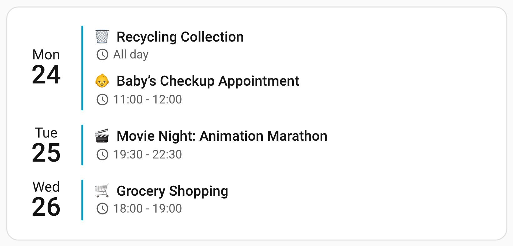

# Usage

Once **Calendar Card Pro** is [installed](/guide/installation), this page takes you from an empty dashboard to a working, customized card.

## 📌 Adding the Card to Your Dashboard

1. **Ensure a Calendar Integration is Set Up**  
   Calendar Card Pro requires at least one `calendar.*` entity in Home Assistant (e.g., **Google Calendar, CalDAV**).
2. **Open Your Dashboard for Editing**
   - Navigate to **Home Assistant → Dashboard**
   - Click the three-dot menu (⋮) → **Edit Dashboard**
3. **Add Calendar Card Pro**
   - Click the ➕ **Add Card** button
   - Search for `"Calendar"` or scroll to find `"Calendar Card Pro"`
   - Select the card to add it to your dashboard
4. **Configure with the Visual Editor**
   - Click the three dots (⋮) in the top-right corner of the card
   - Select **"Configure"** to open the [visual editor](/features/editor)

::: tip Shortcut (Home Assistant 2026.6+)
In the card picker, switch to the **By entity** tab and pick any `calendar.*` entity. Calendar Card Pro is offered under **Community**, already pointed at that calendar and previewed with its real events — so you can skip straight to step 4. Nothing needs to be enabled for this.

Five starting points are offered. The first two, **Calendar Card Pro - Interactive List** and **Calendar Card Pro - Interactive Time Grid**, start with the card's interactive features on, in the list and the grid layout. They add three options to the plain card:

```yaml
toolbar:
  show: true
event_tap_action:
  action: details
day_tap_action:
  action: add-event
```

The [header toolbar](/features/layout-appearance#header-toolbar) pages through dates, switches layouts, searches and adds events. A tap on an event opens it in the card's [popover](/features/actions#tapping-an-event), where its calendar allows changing or deleting it and, in the grid, dragging it to another time. A [tap on a day](/features/actions#tapping-a-day-to-add-an-event) adds an event there, and in the grid you can also [draw one](/features/actions#drawing-an-event-in-grid-view). The picker's preview shows only the toolbar, because a card does not respond to taps while it is being edited. On a calendar that accepts no new events, such as a holiday calendar, nothing adds an event and the popover only shows it.

The other three differ only in layout: **Calendar Card Pro** for the default [list layout](/features/layout-appearance), **Calendar Card Pro - Columns** for the [column layout](/features/column-view), which shows the same days side by side, and **Calendar Card Pro - Time Grid** for the [grid layout](/features/grid-view), which places them on an hour axis. They are identical apart from `view`, so picking one and changing your mind later costs nothing more than switching it. Grid hides locations by default, since they crowd a block on the axis; `time_grid: { show_location: true }` brings them back.

For more than a starting point, the [Example Stories](/reference/examples) are complete cards, each built for one place in a home and ready to copy.
:::

## 🚀 Your First Card

If you prefer YAML — or want to see what the editor is producing — this is a **complete, working configuration**. Paste it into the card's YAML editor as-is:

```yaml
type: custom:calendar-card-pro
entities:
  - calendar.family
days_to_show: 3
show_location: false
show_month: false
```



Replace `calendar.family` with one of your own `calendar.*` entities and you have a working card.

::: info Reading Examples in These Docs
Configuration snippets on the feature pages usually show **only the options being discussed**, so the relevant setting is easy to spot. To use one, add it to a card that already has `type:` and `entities:` — like the one above.
:::

## ⚙️ Customizing the Card

Calendar Card Pro offers two ways to customize your card:

1. **[Visual Editor](/features/editor) (Recommended)**
   - Organized panels guide you through all available options
   - Changes are previewed in real-time
   - Smart validation prevents configuration errors

2. **YAML Configuration (Advanced)**
   - Use YAML for advanced customization or automation
   - See [Configuration Options](/reference/configuration) for every available option

## 🚀 Next Steps

- **Start From an Example Story** - [Example Stories](/reference/examples) are complete cards, each built for one place in a home. Pick the closest and adapt it:
  - [Family Hub](/guide/family-calendar) - the whole family's week on a wall tablet, with the same card on a phone
  - [Family Agenda](/guide/one-calendar-many-purposes) - a short hallway list, with mixed calendars split into blocks with their own rules
  - [Now & Next](/guide/now-and-next) - a small phone tile that expands on tap
  - [Today & Tomorrow](/guide/today-and-tomorrow) - two days by the hour, from a phone to a kitchen tablet
  - [Birthdays & Holidays](/guide/birthdays-and-holidays) and [Bin Day](/guide/bin-day) - what is coming up, and which bin goes out next
- **Explore the Features** - [Core Settings](/features/core-settings), [Layout & Appearance](/features/layout-appearance) and [Event Content](/features/event-content) cover the options most people reach for first
- **Discover Advanced Capabilities** - Add [weather forecasts](/features/weather), filter events with [blocklists and allowlists](/features/core-settings), or set up [tap and hold actions](/features/actions)
- **Page, Switch Layouts & Add Events on the Card** - The [header toolbar](/features/layout-appearance#header-toolbar) puts [date navigation](/features/layout-appearance#paging-through-dates), a [calendar filter](/features/layout-appearance#showing-hiding-calendars), a List, Columns and Grid switcher and an add-event button on the card itself
- **Open an Event** - With `event_tap_action: details`, [a tap on an event](/features/actions#tapping-an-event) opens it in the card's own popover, where it can also be changed or deleted if its calendar allows
- **Reference Configuration** - Use [Configuration Options](/reference/configuration) as the complete option reference
- **Get Involved!** - See [Contributing & Roadmap](/contributing) to contribute or view upcoming features
