

## 🗓️ Every Layout, One Card

The same calendars in every layout. Pick one, or let the [toolbar](/features/header-toolbar) switch
between them: on a narrow card, in one column of a Sections dashboard or on a phone, and on a wide
one, from two columns to a wall tablet.

<button role="tab" :aria-selected="size === 'narrow'" :class="{ on: size === 'narrow' }" @click="size = 'narrow'">📱 Narrow card</button>
<button role="tab" :aria-selected="size === 'wide'" :class="{ on: size === 'wide' }" @click="size = 'wide'">🖥️ Wide card</button>

<figure>
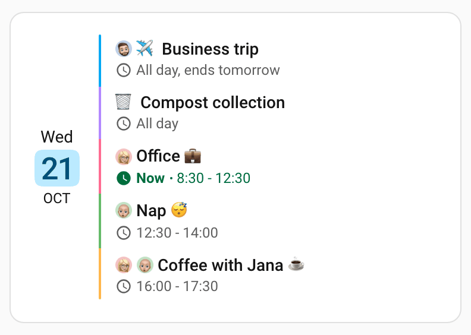
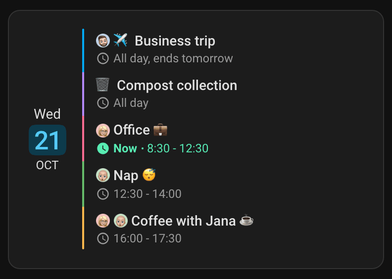
<figcaption><b>List</b> · what is next, in a few lines</figcaption>
</figure>
<figure>
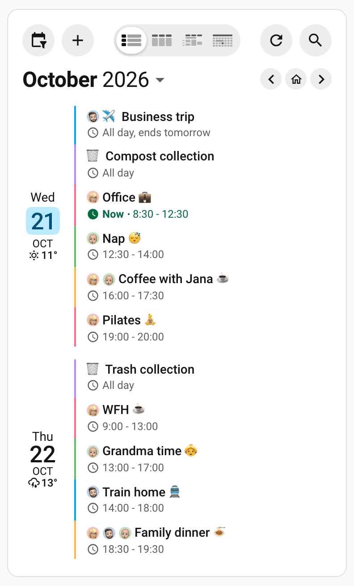
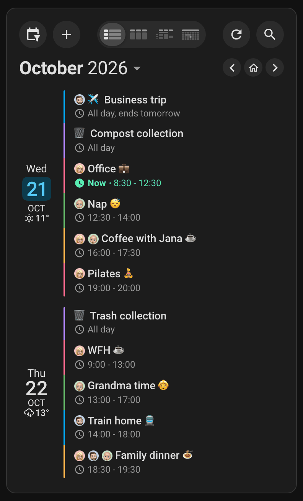
<figcaption><b>List with the toolbar</b> · page through the days</figcaption>
</figure>
<figure>
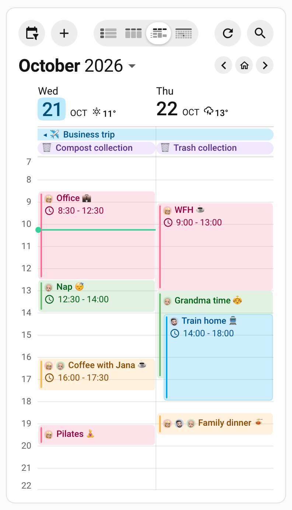
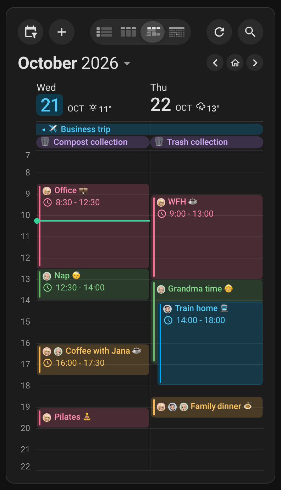
<figcaption><b>Grid</b> · the day on an hour axis</figcaption>
</figure>
<figure>
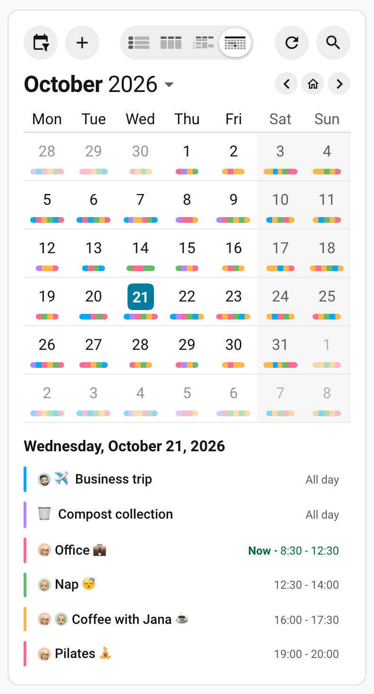
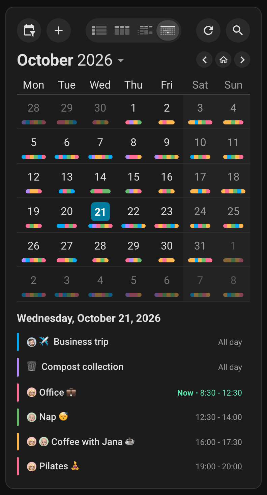
<figcaption><b>Month</b> · the month, and the day beneath</figcaption>
</figure>

<figure>
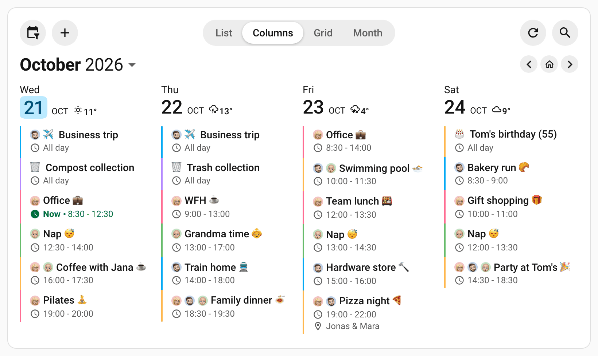
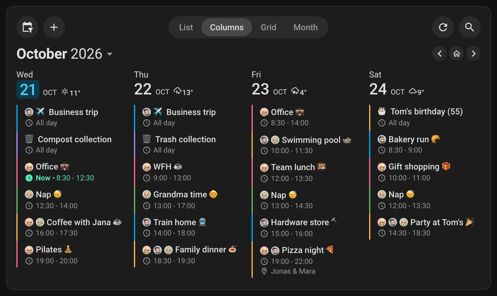
<figcaption><b>Columns</b> · the days side by side</figcaption>
</figure>
<figure>
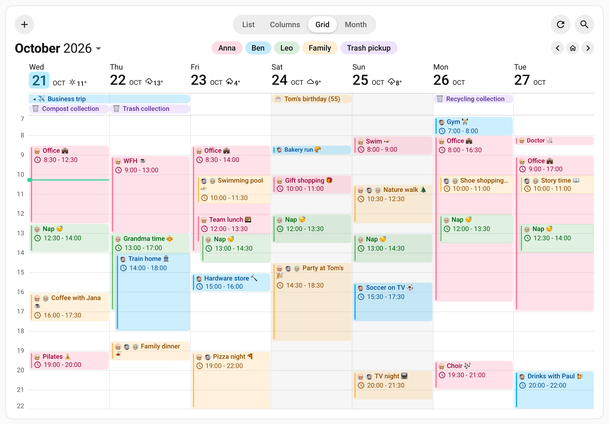
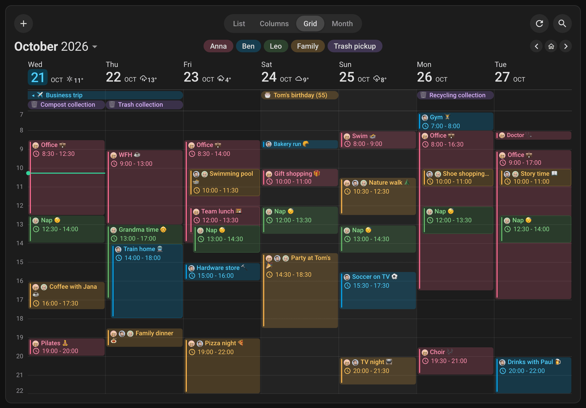
<figcaption><b>Grid</b> · a family's week, hour by hour</figcaption>
</figure>
<figure>
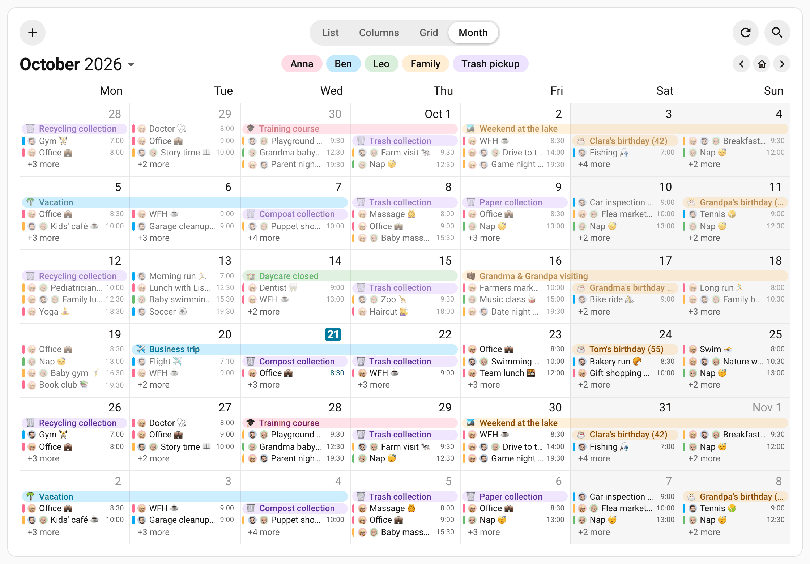
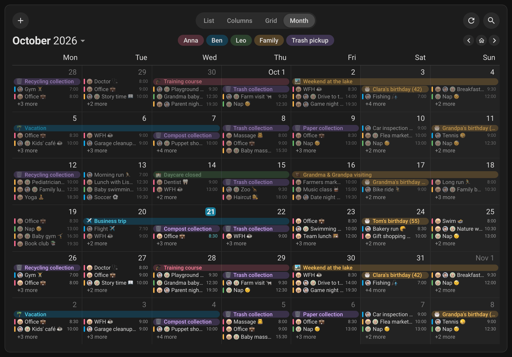
<figcaption><b>Month</b> · six weeks at a glance</figcaption>
</figure>

Each layout has a page of its own: [List](/features/list-view), [Columns](/features/column-view),
[Grid](/features/grid-view) and [Month](/features/month-view), with its
[narrow form](/features/month-view#the-narrow-month).

## 🎬 See It Move

The same card on a phone and on a wall tablet: paging through the days, switching layouts,
opening an event, a day's "+N more" and hiding calendars, in 30 seconds.

<video class="clip" src="https://raw.githubusercontent.com/alexpfau/calendar-card-pro/main/.github/img/showcase_tour.mp4" poster="https://raw.githubusercontent.com/alexpfau/calendar-card-pro/main/.github/img/showcase_tour_poster.jpg" width="800" height="612" loop muted playsinline controls preload="metadata" aria-label="The narrow card pages two days ahead and back to today, switches from List to Grid and to Month and picks Friday; then the wide card opens Party at Tom's in its popover, switches from Grid to Columns and to Month, opens Thursday's +3 more, hides Ben's and Leo's calendars with their chips and shows them again, and goes back to Grid"></video>

## 🔍 About

**Calendar Card Pro** is a calendar card for Home Assistant that you can work with right on the dashboard. It shows your events in **four layouts**, has a **toolbar** to page through the dates and switch between them, and lets you **open, add and edit events** in a popover of its own.

**Calendar Card Pro** was inspired by a beautiful [calendar design using button-card and Hass calendar add-on](https://community.home-assistant.io/t/calendar-add-on-some-calendar-designs/385790) shared in the Home Assistant community. While the original design was visually stunning, implementing it with **button-card** and **card-mod** led to **performance issues**.

This motivated me to create a **dedicated calendar card**.

## ✨ Features

- 🗓️ **[Four Layouts](/features/layouts)** – Stack the days as an agenda, lay them [side by side](/features/column-view), draw them [hour by hour](/features/grid-view), each event sized by how long it runs, or show [the whole month](/features/month-view).
- 🧰 **A Toolbar on the Card** – [Page through the dates, switch layouts, show or hide each calendar and refresh](/features/header-toolbar), each device remembering its layout and which calendars it shows.
- ✏️ **Add & Edit Events** – Open, add, edit and delete events from the card in [its own popover](/features/actions#the-event-popover), as far as each calendar allows.
- ✅ **Many Calendars, One Card** – Give each calendar its own color, label or [a person's photo](/features/core-settings#showing-a-persons-picture) and its own filters; an event on several calendars [can be merged into one](/features/filtering#labeling-coloring-shared-events).
- ⚙️ **Visual Editor** – Set the card up in the UI, with a [search box](/features/editor#search) that finds any setting by name or YAML key.
- 🌦️ **Weather** – [Forecasts](/features/weather) in the date column or beside each event.
- 🎨 **Fits Your Theme** – Follows your Home Assistant theme and its primary color, with [custom properties](/features/theming) for finer styling.
- ⚡ **Optimized Performance** – Cached events on screen the moment a dashboard opens, every calendar loaded in parallel, and the visual editor downloaded only when you open it.
- 🌍 **Multi-Language Support** – [Available in 39 languages](/contributing#adding-translations), with the visual editor in 13. Community contributions welcome!

## 🔗 Requirements

**Calendar Card Pro** needs at least one **calendar entity** in Home Assistant, from any integration that creates `calendar.*` entities, such as Local Calendar, Google Calendar or CalDAV. Whether you can add, edit and delete events from the card depends on the calendar's integration and on the event itself; [Editing & Deleting Events](/features/actions#editing-deleting-events) has the details.
